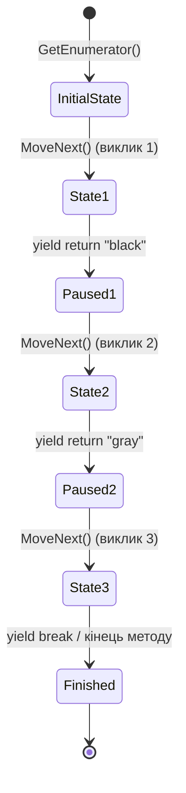

# Ітератори, yield return та кінцевий автомат (State Machine)

## Вступ
Ключове слово `yield` — один із найпотужніших інструментів C#. Воно дозволяє створювати ітератори без написання окремих класів перелічувачів, повністю делегуючи компілятору генерацію кінцевого автомата (State Machine).

---

## 1. Як працює yield return

Коли компілятор зустрічає оператор `yield return`:
1. Він генерує прихований внутрішній клас (private nested class), який реалізує `IEnumerator<T>` та `IEnumerable<T>`.
2. Код методу розбивається на стани всередині методу `MoveNext()`.
3. При зустрічі `yield return item` виконання призупиняється, поточний стан запам'ятовується, а керування повертається тому, хто викликав `MoveNext()`.
4. Наступний виклик `MoveNext()` відновлює виконання рівно з тієї точки, де воно було перервано.
5. Оператор `yield break` завершує ітерування (еквівалентно поверненню `false` з `MoveNext()`).



---

## 2. Відкладене виконання (Lazy Evaluation)

Код методу-ітератора **не виконується** в момент його виклику. Він починає виконуватися лише тоді, коли перший раз викликається `MoveNext()` (зазвичай неявно на початку циклу `foreach`).

```csharp
public IEnumerable<int> GenerateNumbers()
{
    Console.WriteLine("Початок генерації!"); // Виведеться лише при першому MoveNext()
    yield return 1;
    yield return 2;
}

// Виклик методу:
var numbers = GenerateNumbers(); // Жодного рядка ще не виведено в консоль!
foreach (var n in numbers)        // Ось тут піде реальне виконання
{
    Console.WriteLine(n);
}
```

---

## 3. Іменовані ітератори (Named Iterators)

Один клас може надавати кілька різних способів обходу своїх даних:
```csharp
public class Spectrum
{
    private string[] _colors = { "violet", "blue", "cyan", "green", "yellow", "orange", "red" };

    // Прямий порядок обходу
    public IEnumerable<string> UVtoIR()
    {
        for (int i = 0; i < _colors.Length; i++)
            yield return _colors[i];
    }

    // Зворотний порядок обходу
    public IEnumerable<string> IRtoUV()
    {
        for (int i = _colors.Length - 1; i >= 0; i--)
            yield return _colors[i];
    }
}
```

---

## 4. Проекти для практики

- [p498[SOLIS]](file:///03-Csharp-Mechanics/03-Enumerators-And-Iterators/p498[SOLIS]/Program.cs) — Ітератор, що повертає `IEnumerator<string>`.
- [p500[SOLIS]](file:///03-Csharp-Mechanics/03-Enumerators-And-Iterators/p500[SOLIS]/Program.cs) — Ітератор, що повертає `IEnumerable<string>`.
- [p503[SOLIS]](file:///03-Csharp-Mechanics/03-Enumerators-And-Iterators/p503[SOLIS]/Program.cs) — Два іменовані ітератори в одному класі (`UVtoIR` та `IRtoUV`).
- [p504[SOLIS]](file:///03-Csharp-Mechanics/03-Enumerators-And-Iterators/p504[SOLIS]/Program.cs) — Динамічний вибір напрямку ітерування на основі прапорця в конструкторі.
- [ex-03-Yield](file:///03-Csharp-Mechanics/03-Enumerators-And-Iterators/ex-03-Yield/Program.cs) — Генератор псевдовипадкових послідовностей та `yield break`.
