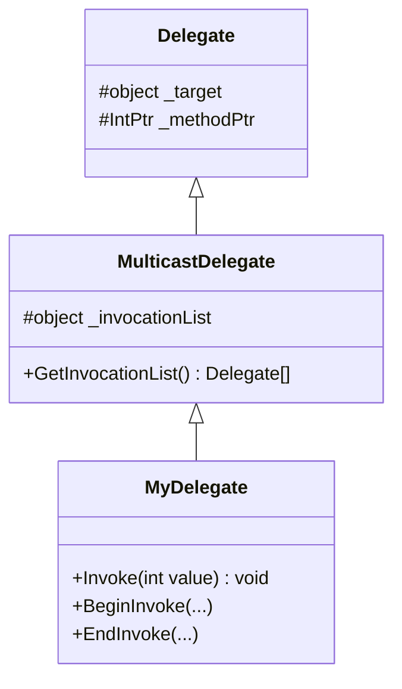

# Анатомія делегатів та багатоадресність (Multicast Delegates)

## Вступ
Делегат у C# — це безпечний щодо типів об'єктно-орієнтований покажчик на функцію (type-safe function pointer). На відміну від покажчиків на функції у мовах C/C++, делегат інкапсулює не лише адресу самого методу, але й посилання на конкретний екземпляр об'єкта, якому цей метод належить.

---

## 1. Внутрішня будова типу Delegate

Коли ви оголошуєте делегат:
```csharp
public delegate void MyDelegate(int value);
```
Компілятор генерує повноцінний клас, що успадковується від `System.MulticastDelegate` (який у свою чергу успадковується від `System.Delegate`).

Він містить три ключових приватних поля:
1. `_target (object)`: Посилання на екземпляр об'єкта для методів екземпляра (або `null` для `static` методів).
2. `_methodPtr (IntPtr)`: Вказівник на адресу скомпільованого машинного коду методу.
3. `_invocationList (object[])`: Масив інших делегатів для багатоадресних викликів.



---

## 2. Багатоадресність (Multicast) та оператори `+=` / `-=`

Делегати у C# є незмінними (immutable). Коли ви застосовуєте оператор `+=`, ви не змінюєте існуючий об'єкт, а створюєте новий об'єкт делегата, список викликів якого об'єднує обидва методи.

```csharp
MyDelegate del = MethodA;
del += MethodB; // Створюється новий делегат із двома методами у InvocationList
del(10);        // Викликаються послідовно MethodA(10), потім MethodB(10)
```

### Підводні камені:
1. **Делегати зі значенням, що повертається:** Якщо делегат повертає значення (`int`, `string`), при багатоадресному виклику повертається результат лише **останнього** зареєстрованого методу! Результати всіх попередніх методів втрачаються.
2. **Параметри `ref` / `out`:** Якщо метод приймає параметр `ref`, кожен наступний метод отримує значення, вже змінене попереднім методом (ефект конвеєра).
3. **Виключення (Exceptions):** Якщо один із методів у списку викликів викидає необроблене виключення, виконання ланцюжка переривається, і наступні методи взагалі не викликаються.

---

## 3. Проекти для практики

- [p349[SOLIS]](file:///03-Csharp-Mechanics/04-Delegates-And-Events/p349[SOLIS]/Program.cs) — Оголошення `delegate`, створення екземпляра та перший виклик.
- [p360[SOLIS]](file:///03-Csharp-Mechanics/04-Delegates-And-Events/p360[SOLIS]/Program.cs) — Багатоадресні виклики через `+=`, поєднання static та instance методів.
- [p361[SOLIS]](file:///03-Csharp-Mechanics/04-Delegates-And-Events/p361[SOLIS]/Program.cs) — Делегати зі значенням, демонстрація втрати проміжних результатів.
- [p362[SOLIS]](file:///03-Csharp-Mechanics/04-Delegates-And-Events/p362[SOLIS]/Program.cs) — Делегати з параметрами `ref` та накопичувальний ефект.
