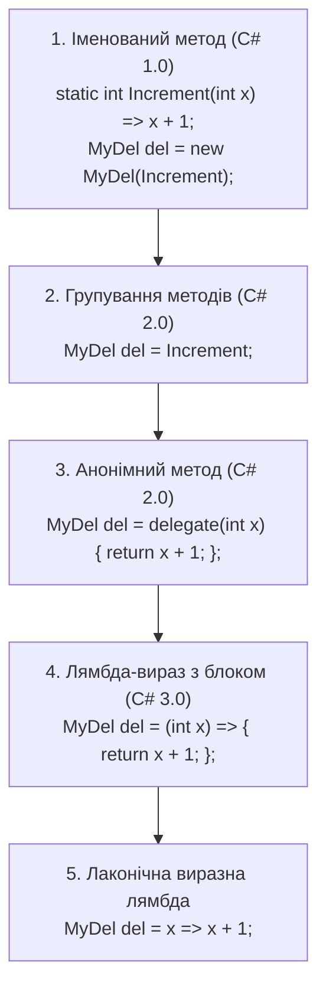

# Анонімні методи, лямбда-вирази та замикання (Closures)

## Вступ
Еволюція передачі логіки у C# пройшла шлях від обов'язкового створення окремих іменованих методів до ультра-лаконічних лямбда-виразів, які сьогодні лежать в основі LINQ та функціонального підходу в .NET.

---

## 1. Еволюція синтаксису (5 кроків скорочення)

Розглянемо, як модифікувався синтаксис одного й того самого коду від C# 1.0 до сучасного C#:



---

## 2. Замикання (Closures) та захоплені змінні (Captured Variables)

Коли лямбда-вираз або анонімний метод використовує локальну змінну із зовнішнього контексту методу:
1. Компілятор генерує прихований допоміжний клас (`DisplayClass`).
2. Захоплена змінна стає відкритим полем цього класу.
3. Екземпляр класу виділяється у керованій купі (Heap).
4. Час життя змінної тепер подовжується доти, доки живе сам делегат, навіть якщо метод, де вона була оголошена, вже завершився.

```csharp
Func<int> CreateCounter()
{
    int count = 0; // Локальна змінна
    return () => ++count; // Замикання над count!
}

var counter = CreateCounter();
Console.WriteLine(counter()); // 1
Console.WriteLine(counter()); // 2
```

> **Увага на продуктивність:** Кожне замикання призводить до виділення об'єкта в Heap (`new <>c__DisplayClass()`). Якщо продуктивність критична, у сучасному C# використовуйте **статичні лямбди** (`static (x) => ...`), які гарантують відсутність виділення пам'яті під замикання на рівні компілятора.

---

## 3. Проекти для практики

- [p367[SOLIS]](file:///03-Csharp-Mechanics/04-Delegates-And-Events/p367[SOLIS]/Program.cs) — Анонімні методи через ключове слово `delegate` та демонстрація захоплення локальних змінних.
- [p369[SOLIS]](file:///03-Csharp-Mechanics/04-Delegates-And-Events/p369[SOLIS]/Program.cs) — Перехід від анонімних методів до лямбда-виразів `=>`.
