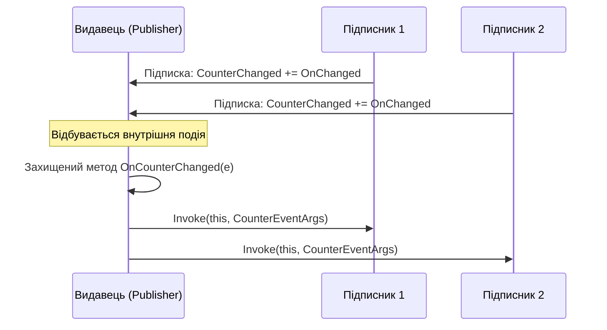

# Події (Events) та архітектурний патерн Publisher-Subscriber

## Вступ
Події (`event`) у C# — це спеціальний механізм інкапсуляції навколо делегатів, призначений для реалізації патерна **Publisher-Subscriber (Видавець-Підписник)** та забезпечення слабкого зв'язування (Loose Coupling) між компонентами системи.

---

## 1. Чому саме event, а не звичайний public delegate?

Якщо оголосити відкрите поле делегата:
```csharp
public Action OnSomethingHappened; // Звичайне поле делегата
```
Будь-який зовнішній код отримує небезпечні можливості:
1. **Знищити всіх підписників:** Викликати `obj.OnSomethingHappened = null;`, стерши всі чужі підписки.
2. **Несанкціоновано викликати подію:** Викликати `obj.OnSomethingHappened();` ззовні, хоча подія мала відбутися лише всередині об'єкта.

Ключове слово `event` створює захисну обгортку (подібно до властивостей `get`/`set`):
```csharp
public event Action OnSomethingHappened;
```
Для зовнішнього світу стають доступними **лише оператори `+=` (підписка) та `-=` (відписка)**. Викликати подію або перезаписати її може виключно сам клас-видавець!

---

## 2. Стандартний патерн .NET: EventHandler<TEventArgs>

У корпоративному C# прийнято слідувати чітким конвенціям платформи .NET:



### Канонічний шаблон:
```csharp
// 1. Власний клас аргументів події
public class OrderEventArgs : EventArgs
{
    public int OrderId { get; }
    public decimal TotalAmount { get; }

    public OrderEventArgs(int orderId, decimal totalAmount)
    {
        OrderId = orderId;
        TotalAmount = totalAmount;
    }
}

// 2. Клас-видавець
public class OrderService
{
    // Оголошення події за стандартом EventHandler<T>
    public event EventHandler<OrderEventArgs>? OrderCompleted;

    public void ProcessOrder(int id, decimal amount)
    {
        // Бізнес-логіка...
        
        // Безпечний виклик через Null-conditional оператор
        OnOrderCompleted(new OrderEventArgs(id, amount));
    }

    // Захищений віртуальний метод для сповіщення
    protected virtual void OnOrderCompleted(OrderEventArgs e)
    {
        OrderCompleted?.Invoke(this, e);
    }
}
```

---

## 3. Небезпека витоків пам'яті (Event Memory Leaks)

Підписка на подію `publisher.Event += subscriber.Handler;` створює **сильне посилання** (Strong Reference) від видавця до підписника (оскільки делегат містить поле `_target = subscriber`).

> **Правило:** Якщо довгоживучий об'єкт (наприклад, `OrderService`, зареєстрований як Singleton) має подію, на яку підписався короткоживучий об'єкт (наприклад, `Window` або екземпляр форми), цей короткоживучий об'єкт **ніколи не буде видалений GC**, доки його явно не відпишуть через `-=`!

---

## 4. Проекти для практики

- [p379[SOLIS]](file:///03-Csharp-Mechanics/04-Delegates-And-Events/p379[SOLIS]/Program.cs) — Перше знайомство з подією `event` у класі `Incrementer`.
- [p382[SOLIS]](file:///03-Csharp-Mechanics/04-Delegates-And-Events/p382[SOLIS]/Program.cs) — Стандартні угоди .NET: успадкування від `EventArgs` та типізований `EventHandler<T>`.
- [p385[SOLIS]](file:///03-Csharp-Mechanics/04-Delegates-And-Events/p385[SOLIS]/Program.cs) — Підписка (`+=`) та відписка (`-=`) для уникнення витоків пам'яті.
- [ex03-DelegateVsEvent](file:///03-Csharp-Mechanics/04-Delegates-And-Events/ex03-DelegateVsEvent/Program.cs) — Порівняння поведінки: чому `event` захищає від перезапису.
- [ex04-PublisherSubscriber](file:///03-Csharp-Mechanics/04-Delegates-And-Events/ex04-PublisherSubscriber/Program.cs) — Приклад з життя: YouTube-канал (видавець) та користувачі (підписники).
- [ex05-InteractiveCounter](file:///03-Csharp-Mechanics/04-Delegates-And-Events/ex05-InteractiveCounter/Program.cs) — Лічильник з інтерактивними сповіщеннями про досягнення порогових значень.
- [ex06-BusinessProcessLogic](file:///03-Csharp-Mechanics/04-Delegates-And-Events/ex06-BusinessProcessLogic/Program.cs) — Реалізація системи замовлень з розсилкою SMS та Email без жорстких зв'язків.
