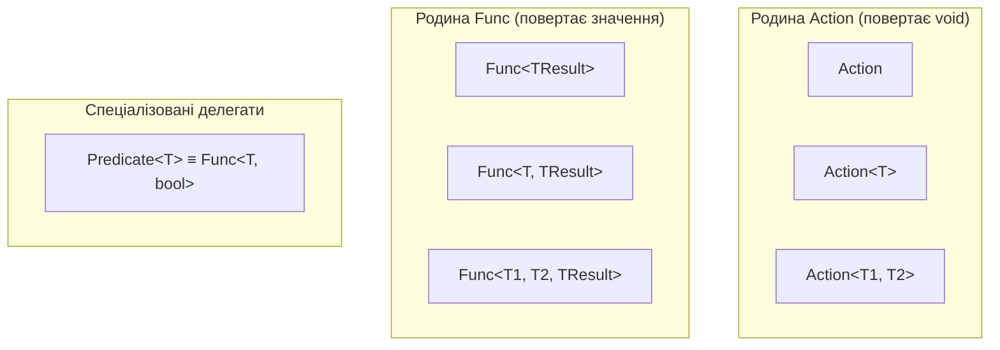

# Вбудовані узагальнені делегати: Action, Func, Predicate та сучасні патерни

## Вступ
У сучасному C# розробникам практично ніколи не потрібно оголошувати власні типи делегатів через ключове слово `delegate`. Платформа .NET надає універсальні узагальнені делегати в просторі імен `System`: `Action`, `Func`, `Predicate` та `Comparison`.

---

## 1. Специфікація базових делегатів

| Делегат | Тип результату | Кількість аргументів | Типове призначення |
| :--- | :--- | :--- | :--- |
| **`Action<...>`** | `void` | від 0 до 16 | Дії, логування, виведення на екран, модифікація стану |
| **`Func<..., TResult>`**| `TResult` | від 0 до 16 аргументів + 1 результат | Трансформація даних, обчислення значень, LINQ-проекції |
| **`Predicate<T>`** | `bool` | Рівно 1 аргумент `T` | Перевірка умови, фільтрація (ідентичний до `Func<T, bool>`) |
| **`Comparison<T>`** | `int` | Рівно 2 аргументи `(x, y)` | Кастомне порівняння елементів у `List<T>.Sort()` |



---

## 2. Делегат як параметр методу (Патерн "Стратегія" та Callback)

Передача делегата у метод дозволяє інвертувати керування (Inversion of Control) та відокремити алгоритм обходу або обробки від конкретної бізнес-логіки.

```csharp
// Метод обробки приймає дію як параметр (Callback)
public static void ProcessNumbers(List<int> numbers, Predicate<int> filter, Action<int> action)
{
    foreach (var n in numbers)
    {
        if (filter(n))
        {
            action(n);
        }
    }
}

// Виклик з довільною стратегією:
ProcessNumbers(numbers, n => n % 2 == 0, n => Console.WriteLine($"Парне: {n}"));
```

---

## 3. Коли все ж таки потрібен власний `delegate`?

Власні типи делегатів створюються лише у рідкісних спеціалізованих випадках:
1. Сигнатура методу вимагає параметрів `ref` або `out` (в `Action` та `Func` не можна передавати `ref`/`out`).
2. Коли семантична назва делегата є невід'ємною частиною предметної області (Domain-Driven Design).

---

## 4. Проекти для практики

- [ex01-DelegateAsParameter](file:///03-Csharp-Mechanics/04-Delegates-And-Events/ex01-DelegateAsParameter/Program.cs) — Передача делегата як аргументу методу, кастомні фільтри та колбеки.
- [ex02-BuiltInDelegates](file:///03-Csharp-Mechanics/04-Delegates-And-Events/ex02-BuiltInDelegates/Program.cs) — Практичне застосування `Action`, `Func`, `Predicate` та `Comparison`.
