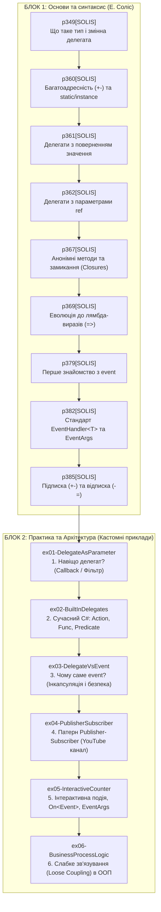

# ООП в C#: Делегати, Лямбда-вирази та Події (Delegates & Events)

Цей репозиторій є комплексним навчальним посібником для студентів початкового рівня, які опановують тему делегатів, лямбда-виразів та подієвої моделі (Events) у мові C#.

Матеріал побудований за принципом **«від простого синтаксису до реальної архітектури ООП»** і розділений на два логічних блоки:
1. **Блок Соліса (`p349`–`p385`)** — фундаментальна анатомія механізму за класичним підручником *Illustrated C#* (Деніел Соліс).
2. **Кастомний практичний блок (`ex01`–`ex06`)** — покроковий флоу пояснення: від запитання «навіщо це потрібно» до патерна Publisher-Subscriber та систем зі слабким зв'язуванням (Loose Coupling).

## 📖 Навчальні гайди модуля (Docs)

1. **[01. Анатомія делегатів та багатоадресність (Multicast)](Docs/01_Delegates_Anatomy_And_Multicast.md)** — будова `MulticastDelegate`, покажчики на методи, виклики через `+=`, підводні камені.
2. **[02. Анонімні методи, лямбда-вирази та замикання (Closures)](Docs/02_Anonymous_Methods_Closures_And_Lambdas.md)** — еволюція від `delegate` до `=>`, механізм замикань та захоплення змінних.
3. **[03. Події (Events) та архітектурний патерн Publisher-Subscriber](Docs/03_Events_Publisher_Subscriber_Pattern.md)** — інкапсуляція подій, стандарт `EventHandler<T>`, захист від витоків пам'яті.
4. **[04. Вбудовані узагальнені делегати: Action, Func, Predicate](Docs/04_Modern_BuiltIn_Delegates_And_Best_Practices.md)** — готові делегати в .NET, параметризація логіки, колбеки.

---

## 🗺️ Рекомендована дорожня карта вивчення (Roadmap)



---

## 📚 БЛОК 1: Фундаментальні приклади Е. Соліса

Усі приклади цього блоку супроводжені докладними коментарями українською мовою безпосередньо у вихідному коді.

| Проєкт | Тема | Ключові концепції |
| :--- | :--- | :--- |
| **[p349[SOLIS]](p349[SOLIS]/Program.cs)** | Базовий синтаксис | Оголошення `delegate void MyDel(int val)`, змінна делегата, прив'язка методу без дужок `()`, виклик (інвокація). |
| **[p360[SOLIS]](p360[SOLIS]/Program.cs)** | Багатоадресні делегати (Multicast) | Оператор `+=`, формування списку викликів (Invocation List), прив'язка статичних методів і методів екземпляра, перевірка на `null`. |
| **[p361[SOLIS]](p361[SOLIS]/Program.cs)** | Делегати зі значенням | Підводний камінь: якщо в списку кілька методів, повертається результат лише **останнього** методу. Результати інших втрачаються. |
| **[p362[SOLIS]](p362[SOLIS]/Program.cs)** | Параметри `ref` | Ланцюговий накопичувальний ефект: кожен наступний метод у ланцюжку отримує змінну, модифіковану попереднім методом. |
| **[p367[SOLIS]](p367[SOLIS]/Program.cs)** | Анонімні методи та замикання | Ключове слово `delegate { ... }`, захоплення локальних змінних (Closures / Captured Variables) та перенесення їх у купу (heap). |
| **[p369[SOLIS]](p369[SOLIS]/Program.cs)** | Еволюція до лямбд | 5 кроків скорочення коду: від громіздкого `delegate(int x) { return x + 1; }` до лаконічного `x => x + 1`. |
| **[p379[SOLIS]](p379[SOLIS]/Program.cs)** | Перша подія (`event`) | Патерн «Видавець-Підписник» (Publisher-Subscriber), клас `Incrementer` (видавець) та `Dozens` (підписник), слабке зв'язування. |
| **[p382[SOLIS]](p382[SOLIS]/Program.cs)** | Конвенція платформи .NET | Успадкування від `EventArgs`, використання `EventHandler<TEventArgs>`, стандартна сигнатура обробника `(object sender, TEventArgs e)`. |
| **[p385[SOLIS]](p385[SOLIS]/Program.cs)** | Підписка та відписка | Оператори `+=` та `-=`, нетипізований `EventHandler`, запобігання витокам пам'яті (Memory Leaks). |

---

## 🚀 БЛОК 2: Кастомні практичні приклади (З наскрізним покроковим флоу)

Кожен файл коду в цьому блоці структурований на пронумеровані етапи: `[КРОК 1]`, `[КРОК 2]`, `[КРОК 3]...`, що дозволяє викладачу послідовно скролити код зверху вниз і коментувати кожен крок.

### 1. [ex01-DelegateAsParameter](ex01-DelegateAsParameter/Program.cs) — Навіщо потрібен делегат?
* **Питання студента:** *«Навіщо мені змінна-делегат, якщо я можу викликати метод напряму? І де взагалі зв'язок?»*
* **Флоу пояснення:**
  - `[КРОК 1]` Оголошення контракту: `delegate bool NumberFilter(int number)`.
  - `[КРОК 2]` Метод `Filter`, який приймає цей делегат і викликає `filter(number)`.
  - `[КРОК 3]` Підготовка методів-кандидатів (`IsEven`, `IsPositive`).
  - `[КРОК 4]` Демонстрація 4 способів зв'язування:
    1. Явний екземпляр: `new NumberFilter(IsEven)`.
    2. Автоматичний (Method Group Conversion): `Filter(numbers, IsPositive)`.
    3. Анонімний метод: `delegate (int n) { ... }`.
    4. Сучасна лямбда: `n => n > 50`.
* **Висновок:** Метод `Filter` відкритий для розширення (Open/Closed Principle) і не потребує змін.

### 2. [ex02-BuiltInDelegates](ex02-BuiltInDelegates/Program.cs) — Вбудовані делегати C#
* **Питання студента:** *«Чому в реальних проєктах рідко пишуть `delegate void ...`?»*
* **Флоу пояснення:**
  - `[КРОК 1]` `Action<...>` — дієве виконання без результату (void).
  - `[КРОК 2]` `Func<..., TResult>` — обчислення, останній тип — результат.
  - `[КРОК 3]` `Predicate<T>` — логічна умова (повертає bool).
  - `[КРОК 4]` Практика в .NET: `List.FindAll` (приймає Predicate) та `List.ForEach` (приймає Action).

### 3. [ex03-DelegateVsEvent](ex03-DelegateVsEvent/Program.cs) — Чому саме event, а не делегат?
* **Питання студента:** *«Якщо у делегата вже є `+=`, навіщо взагалі слово `event`?»*
* **Флоу пояснення:**
  - `[КРОК 1]` Небезпечний сенсор `UnsafeSensor` з відкритим полем делегата.
  - `[КРОК 2]` Безпечний сенсор `SafeSensor` з подією `event`.
  - `[КРОК 3]` 3 аварії відкритого делегата: випадкове затирання через `=` (втрата інших підписників), обнулення `= null`, фальшивий виклик ззовні.
  - `[КРОК 4]` Захист компілятора: з подією дозволені **тільки** `+=` та `-=`. Виклик можливий лише всередині самого класу.

### 4. [ex04-PublisherSubscriber](ex04-PublisherSubscriber/Program.cs) — Патерн Publisher-Subscriber
* **Питання студента:** *«Як патерн Видавець-Підписник виглядає на життєвому прикладі?»*
* **Флоу пояснення (Метафора YouTube-каналу):**
  - `[КРОК 1]` Дані події: `VideoEventArgs : EventArgs` (назва, хронометраж).
  - `[КРОК 2]` Видавець: `YoutubeChannel` з подією `VideoUploaded` та методом `PublishVideo`.
  - `[КРОК 3]` Підписники: глядачі `User` та мобільний сервіс `MobilePushNotificationService`.
  - `[КРОК 4]` Сценарій у `Main`:
    - Підписка Олексія, Марії та Push-сервісу через `+=`;
    - Випуск відео №1 $\rightarrow$ усі отримують сповіщення;
    - Марія відписується через `-=`;
    - Випуск відео №2 $\rightarrow$ Марія сповіщення вже не отримує!

### 5. [ex05-InteractiveCounter](ex05-InteractiveCounter/Program.cs) — Інтерактивність та канони .NET
* **Флоу пояснення:**
  - `[КРОК 1]` Аргументи: `ThresholdReachedEventArgs` (поріг, поточна сума, час).
  - `[КРОК 2]` Канонічний патерн: `protected virtual void OnThresholdReached` з безпечним `?.Invoke(this, e)`.
  - `[КРОК 3]`–`[КРОК 5]` Консольний цикл: користувач тисне `a` або `+`, збільшуючи лічильник, поки не спрацює порогова подія.
  - `[КРОК 6]` Коректна відписка обробників.

### 6. [ex06-BusinessProcessLogic](ex06-BusinessProcessLogic/Program.cs) — Слабке зв'язування (Loose Coupling)
* **Флоу пояснення:**
  - `[КРОК 1]` Аргументи: `OrderEventArgs` (номер, сума, статус, помилка).
  - `[КРОК 2]` Бізнес-сервіс `OrderProcessor` з двома подіями: `ProgressChanged` та `OrderCompleted`.
  - `[КРОК 3]` Підписники: `EmailNotificationService`, `SmsNotificationService`, `AuditLogService`.
  - `[КРОК 4]` Сценарій 1 (успішна оплата) та Сценарій 2 (помилка банку в `try...catch`).
* **Висновок:** Повна ізоляція: сервіс замовлень нічого не знає про Email чи SMS. Новий підписник підключається однією строчкою `+=`.

---

## 🛠️ Як зібрати та запустити проєкти

### Збірка всього рішення:
```bash
dotnet build "OOP - Delegates-Events.sln"
```

### Запуск окремих прикладів:
```bash
# Кастомні приклади:
dotnet run --project "ex01-DelegateAsParameter\ex01-DelegateAsParameter.csproj"
dotnet run --project "ex02-BuiltInDelegates\ex02-BuiltInDelegates.csproj"
dotnet run --project "ex03-DelegateVsEvent\ex03-DelegateVsEvent.csproj"
dotnet run --project "ex04-PublisherSubscriber\ex04-PublisherSubscriber.csproj"
dotnet run --project "ex05-InteractiveCounter\ex05-InteractiveCounter.csproj"
dotnet run --project "ex06-BusinessProcessLogic\ex06-BusinessProcessLogic.csproj"
```

---

## 💡 Корисна шпаргалка для студента

| Концепція | Опис | Приклад коду |
| :--- | :--- | :--- |
| **Делегат** | Тип даних, який зберігає посилання на метод із певною сигнатурою | `delegate void Log(string msg);` |
| **Action** | Вбудований делегат для методів, що повертають `void` | `Action<string> print = s => Console.WriteLine(s);` |
| **Func** | Вбудований делегат для методів, що повертають значення | `Func<int, int, int> add = (a, b) => a + b;` |
| **Predicate** | Вбудований делегат для перевірки умови (повертає `bool`) | `Predicate<int> isPositive = x => x > 0;` |
| **Подія (`event`)** | Інкапсульована обгортка над делегатом (лише `+=` та `-=` ззовні) | `public event EventHandler? Changed;` |
| **Безпечний виклик** | Перевірка на null та інвокація в один рядок (C# 6+) | `MyEvent?.Invoke(this, EventArgs.Empty);` |
