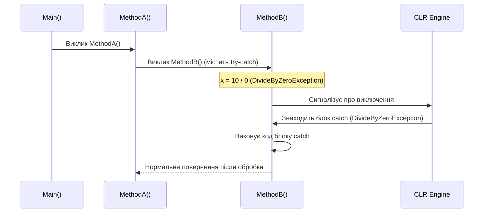

# Основи обробки виключень: try, catch, finally та порядок фільтрації

## Вступ
Виключення (Exception) — це непередбачувана або аварійна ситуація, що виникає під час виконання програми та порушує нормальний потік виконання інструкцій. Платформа .NET надає структуровану модель обробки виключень (Structured Exception Handling — SEH), побудовану на блоках `try`, `catch` та `finally`.

---

## 1. Анатомія виключення та розгортання стеку (Stack Unwinding)

Коли виникає виключення:
1. CLR створює об'єкт виключення (екземпляр класу, похідного від `System.Exception`).
2. Поточне виконання методу негайно припиняється.
3. CLR починає процес **розгортання стеку (Stack Unwinding)**: пошук найближчого відповідного блоку `catch` у поточному методі або вгору по ланцюжку викликів (Call Stack).
4. Якщо відповідний блок `catch` не знайдено, програма аварійно завершується (Unhandled Exception Crash).



---

## 2. Порядок розташування блоків catch

При перехопленні кількох типів виключень блоки `catch` **обов'язково** розташовуються від найбільш специфічних (дочірніх класів) до найбільш загальних (батьківських класів, таких як `Exception`).

```csharp
try
{
    // Потенційно небезпечний код
    int num = int.Parse(Console.ReadLine()!);
    int result = 100 / num;
}
catch (DivideByZeroException ex) // Найбільш специфічне
{
    Console.WriteLine("Ділення на нуль неможливе!");
}
catch (FormatException ex)        // Інше специфічне
{
    Console.WriteLine("Введено нечислове значення!");
}
catch (Exception ex)             // Загальний випадок (перехоплює все інше)
{
    Console.WriteLine($"Непередбачена помилка: {ex.Message}");
}
```

> **Помилка компіляції:** Якщо розмістити `catch (Exception)` перед `catch (DivideByZeroException)`, компілятор видасть помилку `CS0160: A previous catch clause already catches all exceptions of this or of a super type`.

---

## 3. Гарантії блоку finally

Блок `finally` виконується **завжди**, незалежно від того:
- Чи виникло виключення взагалі.
- Чи було воно перехоплене блоком `catch`.
- Чи містив блок `try` оператори виходу (`return`, `break`, `goto`).

Єдиний випадок, коли `finally` не виконається — аварійне знищення процесу операційною системою або виклик `Environment.FailFast()`.

---

## 4. Проекти для практики

- [p660[SOLIS]](file:///03-Csharp-Mechanics/05-Exceptions-Handling/p660[SOLIS]/Program.cs) — Необроблене виключення, аварія процесу.
- [p662[SOLIS]](file:///03-Csharp-Mechanics/05-Exceptions-Handling/p662[SOLIS]/Program.cs) — Базовий захищений блок `try / catch`.
- [p666[SOLIS]](file:///03-Csharp-Mechanics/05-Exceptions-Handling/p666[SOLIS]/Program.cs) — Специфічний блок `catch (DivideByZeroException e)`.
- [example-Multiple-Catch-Blocks](file:///03-Csharp-Mechanics/05-Exceptions-Handling/example-Multiple-Catch-Blocks/Program.cs) — Множинні блоки `catch` для `DivideByZeroException`, `FormatException`, `OverflowException`.
- [p669[SOLIS]](file:///03-Csharp-Mechanics/05-Exceptions-Handling/p669[SOLIS]/Program.cs) — Гарантоване виконання `finally` при наявності `return` у блоці `try`.
