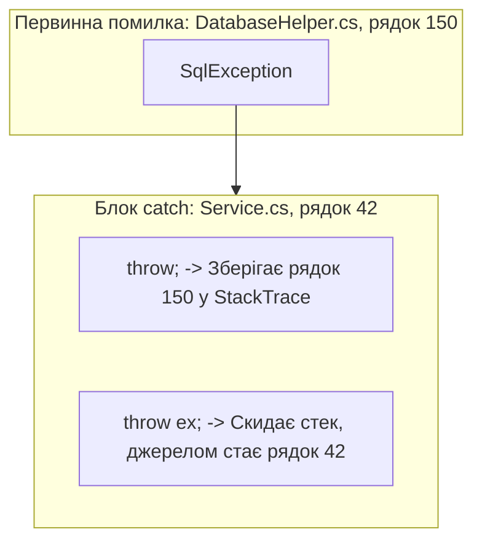

# Повторне викидання (Rethrowing) та вкладені виключення (InnerException)

## Вступ
При розробці багатошарових корпоративних додатків критично важливо правильно передавати інформацію про збої вгору по архітектурних шарах, не втрачаючи стек викликів та контекст первинної помилки.

---

## 1. Фатальна помилка: `throw;` проти `throw ex;`

У C# є два способи повторно викинути вже перехоплене виключення, але їхня поведінка кардинально відрізняється:

```csharp
try
{
    DatabaseHelper.Connect(); // Помилка виникла на рядку 150 всередині DatabaseHelper
}
catch (SqlException ex)
{
    Log(ex.Message);

    // ❌ АНТИПАТЕРН: Стек викликів скидається!
    // Тепер StackTrace вказуватиме на цей рядок, а інформація про рядок 150 буде ВТРАЧЕНА!
    // throw ex;

    // ✅ ПРАВИЛЬНО: Зберігає повний стек викликів від самого джерела помилки:
    throw;
}
```



---

## 2. Обгортання виключень та властивість InnerException

Принцип розділення шарів (Separation of Concerns) вимагає, щоб бізнес-шар не розкривав низькорівневих деталей (наприклад, роботу з базою даних або сокетами) користувацькому інтерфейсу.

Замість цього низькорівневі помилки огортаються у високорівневі бізнес-виключення з передачею оригіналу у властивість `InnerException`:

```csharp
try
{
    string data = File.ReadAllText("orders.json");
}
catch (FileNotFoundException ex)
{
    // Огортаємо технічну помилку файлової системи у зрозуміле доменне виключення
    throw new OrderServiceException("Не вдалося завантажити налаштування замовлень", ex);
}
```

При аналізі логів властивість `ex.InnerException` дозволяє розробнику побачити першопричину проблеми:
```csharp
Console.WriteLine($"Поточне виключення: {ex.Message}");
if (ex.InnerException != null)
{
    Console.WriteLine($"Першопричина (Root Cause): {ex.InnerException.Message}");
}
```

---

## 3. Проекти для практики

- [p676[SOLIS]](file:///03-Csharp-Mechanics/05-Exceptions-Handling/p676[SOLIS]/Program.cs) — Пряме викидання виключення через `throw new ArgumentNullException()`.
- [p677[SOLIS]](file:///03-Csharp-Mechanics/05-Exceptions-Handling/p677[SOLIS]/Program.cs) — Вкладений блок `try/catch` та збереження стеку викликів.
- [Example-Inner-Exception](file:///03-Csharp-Mechanics/05-Exceptions-Handling/Example-Inner-Exception/Program.cs) — Практичне використання `InnerException` для передачі низькорівневого виключення у зовнішній блок.
