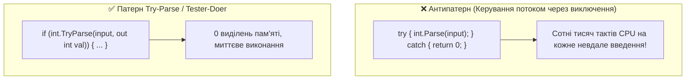

# Фільтри виключень (when) та проблема продуктивності (Performance Abuse)

## Вступ
Виключення призначені для виняткових (exceptional) ситуацій, а не для щоденної логіки розгалуження програми. Зловживання механізмом виключень може призвести до колосального падіння продуктивності системи.

---

## 1. Фільтри виключень (Exception Filters: `when`)

Починаючи з C# 6.0, блок `catch` підтримує умову `when (умова)`:
```csharp
try
{
    await httpClient.GetAsync("https://api.example.com/data");
}
catch (HttpRequestException ex) when (ex.StatusCode == HttpStatusCode.NotFound)
{
    Console.WriteLine("Ресурс не знайдено (404)");
}
catch (HttpRequestException ex) when (ex.StatusCode == HttpStatusCode.Unauthorized)
{
    Console.WriteLine("Помилка авторизації (401)");
}
```

### Чому `when` краще за `if` всередині `catch`?
При використанні `if` всередині `catch`:
```csharp
catch (HttpRequestException ex)
{
    if (ex.StatusCode == HttpStatusCode.NotFound) { ... }
    else throw; // Стек вже розгорнуто до цього блоку!
}
```
Фільтр `when` обчислюється **до того, як починається розгортання стеку (Stack Unwinding)**. Якщо умова `when` повертає `false`, стек взагалі не розгортається, а CLR продовжує пошук відповідного `catch` далі, зберігаючи повний стан системи для дампу пам'яті.

---

## 2. Ціна виключення: Чому не можна використовувати виключення для керування потоком

Створення та викидання виключення в .NET є надзвичайно ресурсомісткою операцією, оскільки:
1. CLR робить повний прохід по стеку викликів (Stack Walk).
2. Формується рядковий масив імен методів, файлів та номерів рядків для `StackTrace`.
3. Виділяється пам'ять під сам об'єкт виключення.



### Патерни оптимізації:
- **Try-Parse Pattern:** `int.TryParse`, `DateTime.TryParse`, `dictionary.TryGetValue`.
- **Tester-Doer Pattern:** Перевірка передумови перед виконанням дії (наприклад, `if (file.Exists) { ... }` або `if (queue.Count > 0) { queue.Dequeue(); }`).

---

## 3. Проекти для практики

- [Exception-Handling-Abuse](file:///03-Csharp-Mechanics/05-Exceptions-Handling/Exception-Handling-Abuse/Program.cs) — Порівняння підходів `int.Parse` всередині `try/catch` проти ефективного `int.TryParse`.
