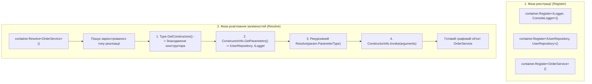

# 06. Frameworks & Dependency Injection: Загальний огляд та зріз методів

> **Solution-тег (Solution Folder)**: `06. Frameworks & Dependency Injection`  
> **Проєкти у тегу**:
> - [25.1-DependencyInjectionDemo](../../25.1-DependencyInjectionDemo/Program.cs) — Ультра-прозорий навчальний IoC-контейнер (~60 рядків коду), який демонструє 4 базові кроки рефлексії: `GetConstructors()[0]` -> `GetParameters()` -> рекурсивний `Resolve` -> `Invoke`.
> - [25.2-DependencyInjectionRealWorld](../../25.2-DependencyInjectionRealWorld/Program.cs) — Промисловий модульний IoC-контейнер із життєвими циклами (`Transient` vs `Singleton`), вибором конструктора (`[InjectConstructor]` / Greedy Constructor), Property Injection (`[InjectProperty]`), захистом від циклічних залежностей (`Stack<Type>`) та In-Memory базою даних.

---

## 1. Концептуальний зріз розділу

Контейнери інверсії керування (IoC / Dependency Injection) — це вершина практичного застосування рефлексії в корпоративній розробці на платформі .NET. Вони автоматизують створення графів об'єктів та керування часом їхнього життя:

### Ключові теми та відповідні документи:
- [ConstructorResolution.md](ConstructorResolution.md) — алгоритми інспекції та вибору конструкторів: перший конструктор (`25.1`), маркований через `[InjectConstructor]` або жадібний вибір (`25.2`).
- [DependencyInjectionLifecycle.md](DependencyInjectionLifecycle.md) — керування життєвим циклом об'єктів (`Transient` vs `Singleton`) та захист від циклічних залежностей за допомогою стеку активних викликів.

---

## 2. Зведена матриця методів та властивостей рефлексії для IoC/DI

| Клас | Метод / Властивість | Статус у курсі | Опис призначення | Приклад у коді | Документація MSDN |
| :--- | :--- | :---: | :--- | :--- | :--- |
| `Type` | `GetConstructors()` | Використано | Повертає масив усіх відкритих екземплярних конструкторів типу | [25.1-DependencyInjectionDemo/SimpleContainer.cs](../../25.1-DependencyInjectionDemo/SimpleContainer.cs) | [Type.GetConstructors](https://learn.microsoft.com/en-us/dotnet/api/system.type.getconstructors) |
| `Type` | `IsInterface` | Використано | Перевіряє, чи є тип інтерфейсом, перед реєстрацією сервісу | [25.2-DependencyInjectionRealWorld/Container/Container.cs](../../25.2-DependencyInjectionRealWorld/Container/Container.cs) | [Type.IsInterface](https://learn.microsoft.com/en-us/dotnet/api/system.type.isinterface) |
| `Type` | `IsAbstract` | Використано | Запобігає спробі інстанціювання абстрактних класів | [25.2-DependencyInjectionRealWorld/Container/Container.cs](../../25.2-DependencyInjectionRealWorld/Container/Container.cs) | [Type.IsAbstract](https://learn.microsoft.com/en-us/dotnet/api/system.type.isabstract) |
| `Type` | `IsAssignableFrom` | Використано | Валідує, чи реалізує клас відповідний інтерфейс сервісу | [25.2-DependencyInjectionRealWorld/Container/Container.cs](../../25.2-DependencyInjectionRealWorld/Container/Container.cs) | [Type.IsAssignableFrom](https://learn.microsoft.com/en-us/dotnet/api/system.type.isassignablefrom) |
| `ConstructorInfo`| `GetParameters()` | Використано | Зчитує метадані залежностей (параметрів), що необхідні для виклику конструктора | [25.1-DependencyInjectionDemo/SimpleContainer.cs](../../25.1-DependencyInjectionDemo/SimpleContainer.cs) | [MethodBase.GetParameters](https://learn.microsoft.com/en-us/dotnet/api/system.reflection.methodbase.getparameters) |
| `ConstructorInfo`| `Invoke(object?[])`| Використано | Створює новий екземпляр типу, підставляючи розв'язані залежності | [25.1-DependencyInjectionDemo/SimpleContainer.cs](../../25.1-DependencyInjectionDemo/SimpleContainer.cs) | [ConstructorInfo.Invoke](https://learn.microsoft.com/en-us/dotnet/api/system.reflection.constructorinfo.invoke) |
| `ParameterInfo` | `ParameterType` | Використано | Визначає `Type` кожної залежності для подальшого рекурсивного розв'язання | [25.1-DependencyInjectionDemo/SimpleContainer.cs](../../25.1-DependencyInjectionDemo/SimpleContainer.cs) | [ParameterInfo.ParameterType](https://learn.microsoft.com/en-us/dotnet/api/system.reflection.parameterinfo.parametertype) |
| `MemberInfo` | `GetCustomAttribute<T>()`| Використано | Виявляє конструктор з атрибутом `[InjectConstructor]` або властивість з `[InjectProperty]` | [25.2-DependencyInjectionRealWorld/Container/Container.cs](../../25.2-DependencyInjectionRealWorld/Container/Container.cs) | [CustomAttributeExtensions.GetCustomAttribute](https://learn.microsoft.com/en-us/dotnet/api/system.reflection.customattributeextensions.getcustomattribute) |
| `PropertyInfo` | `SetValue(object?, object?)` | Використано | Записує розв'язану залежність у властивість об'єкта при Property Injection | [25.2-DependencyInjectionRealWorld/Container/Container.cs](../../25.2-DependencyInjectionRealWorld/Container/Container.cs) | [PropertyInfo.SetValue](https://learn.microsoft.com/en-us/dotnet/api/system.reflection.propertyinfo.setvalue) |
| `ConstructorInfo`| `IsPublic` | Загальний BCL | Перевіряє модифікатор видимості конструктора | Довідник | [MethodBase.IsPublic](https://learn.microsoft.com/en-us/dotnet/api/system.reflection.methodbase.ispublic) |
| `Type` | `MakeGenericType` | Загальний BCL | Дозволяє розв'язувати відкриті узагальнені сервіси на зразок `IRepository<T>` | Довідник | [Type.MakeGenericType](https://learn.microsoft.com/en-us/dotnet/api/system.type.makegenerictype) |

---

## 3. Статистичний зріз охоплення API

- **Методів та властивостей досліджено в прикладах**: 9
- **Загальних методів API BCL задокументовано додатково**: 2
- **Сумарно в довіднику розділу**: 11 елементів
- **Відсоток фокусного практичного охоплення**: ~82%
