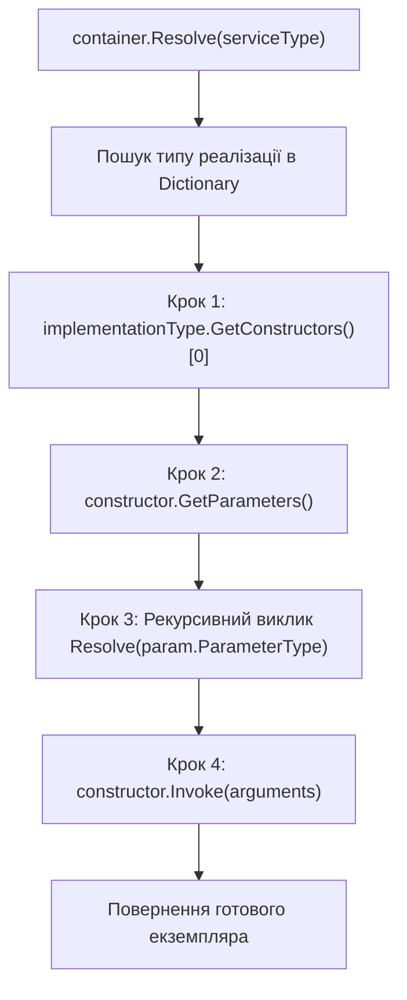
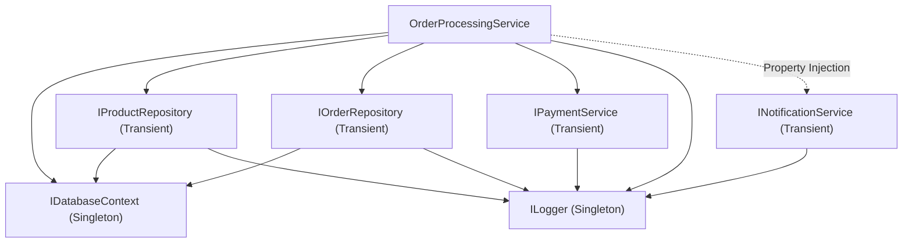

# 07. Фінальний проєкт: Власний IoC/DI Контейнер (IoC Container Deep Dive & Architecture)

> **Solution-тег (Solution Folder)**: `06. Frameworks & Dependency Injection`  
> **Проєкти у тегу**:
> - [25.1-DependencyInjectionDemo](../25.1-DependencyInjectionDemo/Program.cs) — Ультра-прозорий навчальний IoC-контейнер (~60 рядків коду), який демонструє 4 базові кроки рефлексії: `GetConstructors()[0]` -> `GetParameters()` -> рекурсивний `Resolve` -> `Invoke`.
> - [25.2-DependencyInjectionRealWorld](../25.2-DependencyInjectionRealWorld/Program.cs) — Промислова модульна архітектура: In-Memory база даних, репозиторії, сервіси, `Singleton` vs `Transient`, вибір конструктора (`[InjectConstructor]` / Greedy Ctor), Property Injection та захист від циклів (`Stack<Type>`).

Цей розділ є вершиною навчального модуля. Він демонструє практичне поєднання всіх вивчених концепцій рефлексії: інспекції типів, дослідження конструкторів і параметрів, аналізу атрибутів, роботи з інтерфейсами та динамічної активації об'єктів для побудови власного Dependency Injection контейнера.

Матеріал розбито на два послідовні дидактичні рівні:
1. **Рівень 1 (Проєкт 25.1)**: Максимально простий і прозорий контейнер (~60 рядків), де немає жодних зайвих деталей — лише словник `Dictionary<Type, Type>` та 4 рядки рефлексії для автоматичного конструювання графа об'єктів.
2. **Рівень 2 (Проєкт 25.2)**: Повнофункціональна модульна система з реальними бізнес-сервісами, контекстом бази даних, часами життя (`Singleton`/`Transient`), виявленням циклічних залежностей та вибором конструкторів.

---

## 1. Понятійний апарат: Архітектурні принципи IoC та DI

### 1.1. Що таке Inversion of Control (IoC)?
**Інверсія керування (Inversion of Control — IoC)** — це архітектурний принцип проєктування програмного забезпечення, за якого традиційний потік керування змінюється на протилежний: замість того, щоб користувацький код самостійно створював залежні компоненти (`new SqlDatabase()`), зовнішній каркас (контейнер) бере на себе керування створенням об'єктів.

### 1.2. Що таке Dependency Inversion Principle (DIP)?
**Принцип інверсії залежностей (DIP)** — це літера "D" у принципах SOLID:
1. Модулі високих рівнів не повинні залежати від модулів низьких рівнів. Обидва типи мають залежати від абстракцій (інтерфейсів).
2. Абстракції не повинні залежати від деталей. Деталі повинні залежати від абстракцій.

### 1.3. Що таке Dependency Injection (DI)?
**Впровадження залежностей (Dependency Injection — DI)** — це конкретний патерн проектування, що реалізує принцип IoC: залежності передаються в об'єкт ззовні (найчастіше через параметри конструктора — Constructor Injection або через властивості — Property Injection), а не створюються об'єктом самостійно.

---

## 2. Рівень 1: Прозорий навчальний IoC-контейнер (Проєкт 25.1)

Для первинного ознайомлення студентів створено проєкт [25.1-DependencyInjectionDemo](../25.1-DependencyInjectionDemo/Program.cs). Він демонструє, що в основі будь-якого IoC-контейнера лежать лише **чотири прості кроки рефлексії**:



### 2.1. Повний код методу `Resolve` у `SimpleContainer`

```csharp
// КРОК 1 (Рефлексія): Беремо перший публічний конструктор класу
ConstructorInfo constructor = implementationType.GetConstructors()[0];

// КРОК 2 (Рефлексія): Читаємо список параметрів, яких потребує цей конструктор
ParameterInfo[] parameters = constructor.GetParameters();
object[] arguments = new object[parameters.Length];

// КРОК 3 (Рекурсія): Для кожного параметра конструктора знову викликаємо Resolve(...)
for (int i = 0; i < parameters.Length; i++)
{
    arguments[i] = Resolve(parameters[i].ParameterType);
}

// КРОК 4 (Рефлексія): Викликаємо конструктор і передаємо в нього зібрані аргументи
return constructor.Invoke(arguments);
```

- Посилання на реалізацію простого контейнера: [25.1-DependencyInjectionDemo/SimpleContainer.cs](../25.1-DependencyInjectionDemo/SimpleContainer.cs).
- Посилання на консольну демонстрацію: [25.1-DependencyInjectionDemo/Program.cs](../25.1-DependencyInjectionDemo/Program.cs).

---

## 3. Рівень 2: Модульний промисловий DI-контейнер (Проєкт 25.2)

Після засвоєння базового механізму у проєкті 25.1, проєкт [25.2-DependencyInjectionRealWorld](../25.2-DependencyInjectionRealWorld/Program.cs) демонструє, як додати чотири реальні промислові можливості:



### 3.1. Захист від циклічних залежностей (`Stack<Type> _resolutionStack`)
Якщо класи взаємно залежать один від одного ($\text{ServiceA} \to \text{ServiceB} \to \text{ServiceC} \to \text{ServiceA}$), звичайна рекурсія впаде з неперехоплюваним `StackOverflowException`. Контейнер у проєкті `25.2` зберігає стек поточного ланцюжка створення `_resolutionStack` і при виявленні повтору кидає інформативний виняток `CircularDependencyException`:

```csharp
if (_resolutionStack.Contains(serviceType))
{
    var cycleChain = _resolutionStack.Reverse().Concat(new[] { serviceType }).Select(t => t.Name);
    string formattedChain = string.Join(" -> ", cycleChain);
    throw new CircularDependencyException($"Виявлено циклічну залежність! Ланцюжок: {formattedChain}");
}
```

### 3.2. Вибір конструктора та Property Injection
1. **Маркований конструктор**: якщо на одному з конструкторів стоїть атрибут `[InjectConstructor]`, обирається саме він.
2. **Жадібний вибір (Greedy Constructor)**: якщо атрибута немає, обирається конструктор із найбільшою кількістю параметрів (`OrderByDescending(c => c.GetParameters().Length).First()`).
3. **Property Injection (`[InjectProperty]`)**: після виклику конструктора контейнер автоматично заповнює публічні властивості, позначені атрибутом `[InjectProperty]`.

### 3.3. Керування життєвими циклами (`Transient` vs `Singleton`)

| Життєвий цикл | Поведінка в пам'яті | Сценарії застосування |
| :--- | :--- | :--- |
| **`Transient`** | Новий об'єкт створюється при кожному зверненні до `Resolve<T>()`. | Легковагові сервіси та репозиторії без внутрішнього стану (`OrderRepository`, `ProductRepository`). |
| **`Singleton`** | Створюється рівно один екземпляр при першому зверненні та кешується в `ServiceDescriptor.SingletonInstance`. | Контексти баз даних (`InMemoryDatabaseContext`), логери (`ConsoleLogger`). | - Посилання на вихідний код контейнера: [25.2-DependencyInjectionRealWorld/Container/Container.cs](../25.2-DependencyInjectionRealWorld/Container/Container.cs).
- Посилання на контракт контейнера: [25.2-DependencyInjectionRealWorld/Container/IContainer.cs](../25.2-DependencyInjectionRealWorld/Container/IContainer.cs).
- Посилання на емуляцію бази даних: [25.2-DependencyInjectionRealWorld/Data/InMemoryDatabaseContext.cs](../25.2-DependencyInjectionRealWorld/Data/InMemoryDatabaseContext.cs).
- Посилання на бізнес-сервіс замовлень: [25.2-DependencyInjectionRealWorld/Services/Orders/OrderProcessingService.cs](../25.2-DependencyInjectionRealWorld/Services/Orders/OrderProcessingService.cs).
- Посилання на консольну демонстраційну програму: [25.2-DependencyInjectionRealWorld/Program.cs](../25.2-DependencyInjectionRealWorld/Program.cs).
