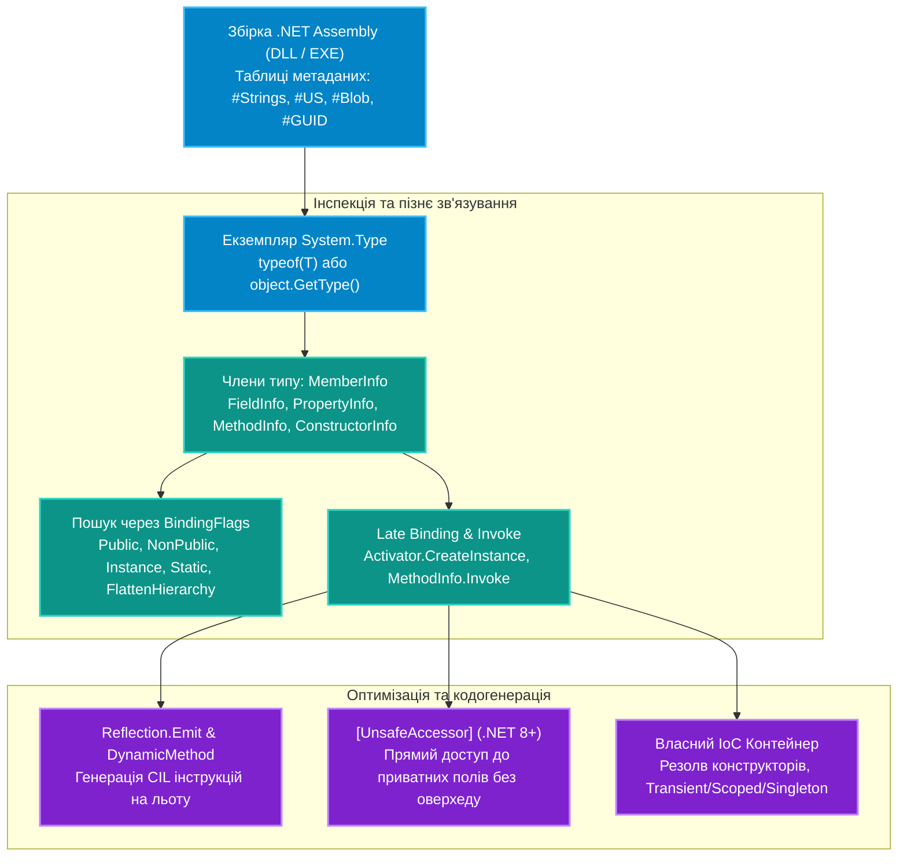

# Підмодуль 01: Рефлексія, інспекція метаданих та власний IoC-контейнер (`OOP - Reflection.sln`)

Цей підмодуль присвячений комплексному дослідженню системи типів Common Language Runtime (CLR) у рантаймі (`System.Reflection`): динамічній інспекції збірок, дослідженню закритих і відкритих членів через бітові прапорці `BindingFlags`, пізньому зв'язуванню об'єктів (`Activator.CreateInstance`), рефлексії узагальнених типів (`Generics`) та їхньої варіантності, низькорівневій генерації байткоду CIL на льоту (`System.Reflection.Emit`), ультрашвидкому доступу через `[UnsafeAccessor]` (.NET 8+) та проектуванню власного повноцінного **IoC / Dependency Injection контейнера**.

---

## Архітектурний конвеєр рефлексії та метаданих CLR



---

## Навігація по навчальних посібниках (`Docs`)

| № | Посібник | Ключові теми та системні інструменти | Посилання на документ |
|:---:|:---|:---|:---|
| 01 | **Система типів та інспекція метаданих** | Класи `Type`, `Assembly`, порівняння `typeof`, `GetType` та `Type.GetType`, аналіз таблиць метаданих | [Docs/01_Type_System_And_Metadata_Inspection.md](Docs/01_Type_System_And_Metadata_Inspection.md) |
| 02 | **Члени типу та бітові прапорці `BindingFlags`** | `MemberInfo`, бітові комбінації пошуку `BindingFlags`, інспекція приватних полів, методів, параметрів | [Docs/02_Members_And_BindingFlags.md](Docs/02_Members_And_BindingFlags.md) |
| 03 | **Пізнє зв'язування, дженерики та варіантність** | `Activator.CreateInstance`, `MakeGenericType`, `MakeGenericMethod`, коваріантність (`out`) та контраваріантність (`in`) | [Docs/03_Late_Binding_And_Generics.md](Docs/03_Late_Binding_And_Generics.md) |
| 04 | **Генерація CIL коду через `Reflection.Emit`** | Динамічні методи `DynamicMethod`, генератор опкодів `ILGenerator`, компіляція високошвидкісних делегатів | [Docs/04_IL_Generation_And_Reflection_Emit.md](Docs/04_IL_Generation_And_Reflection_Emit.md) |
| 05 | **Оптимізація швидкодії та Native AOT** | Ціна рефлексії, боксинг аргументів, атрибут `[UnsafeAccessor]`, оптимізація під тримінг і Native AOT | [Docs/05_Performance_Optimization_And_Native_AOT.md](Docs/05_Performance_Optimization_And_Native_AOT.md) |
| 06 | **Архітектура власного IoC/DI контейнера** | Проєктування IoC контейнера з нуля: рекурсивний резолв конструкторів, реєстрація залежностей, детекція циклів | [Docs/06_IoC_Container_Deep_Dive.md](Docs/06_IoC_Container_Deep_Dive.md) |

---

## Структура Solution-тек у рішенні `OOP - Reflection.sln` (33 проєкти)

* **`01. Система типів та інспекція метаданих`**:
  * Отримання `Type` трьома способами, властивості типу, дослідження збірок `Assembly` та карти інтерфейсів `GetInterfaceMap`.
  * Проєкти: `00-Shared`, `p696[SOLIS]`, `p698[SOLIS]`, `example-intro`, `01-TypeofDemo` .. `06-GetInterfacesDemo`.
* **`02. Члени типу, інкапсуляція та прапорці пошуку`**:
  * Пошук відкритих і приватних членів через бітові маски `BindingFlags`, інспекція полів, властивостей, методів, конструкторів.
  * Проєкти: `ex-04` .. `ex-10`, `07-GetFieldsPropertiesDemo` .. `11-GetEventsDemo`.
* **`03. Рефлексія узагальнень та варіантності`**:
  * Конструювання закритих generic-типів у рантаймі (`MakeGenericType`), аналіз коваріантності (`out`) та контраваріантності (`in`).
  * Проєкти: `12-GenericsReflectionDemo`, `13.1-CovarianceAndContravarianceDemo`, `13.2-VarianceReflectionInspectionDemo`.
* **`04. Пізнє зв'язування, Reflection.Emit та UnsafeAccessor`**:
  * Динамічне створення екземплярів (`Activator`), плагінна архітектура, генерація IL-інструкцій (`ILGenerator`) та нульовий оверхед `[UnsafeAccessor]`.
  * Проєкти: `14-LateBindingDemo`, `example-intro-02` .. `example-intro-03`, `16-UnsafeAccessorDemo`.
* **`05. Побудова власного IoC та DI контейнера`**:
  * Автоматичне розв'язання графа залежностей конструкторів, життєві цикли `Transient`/`Scoped`/`Singleton` та виявлення циклічних залежностей.
  * Проєкти: `25.1-DependencyInjectionDemo`, `25.2-DependencyInjectionRealWorld`.

---

## Збірка та тестування рішення

```powershell
dotnet build "04-Advanced-CSharp/01-Reflection/OOP - Reflection.sln" -c Release
```
