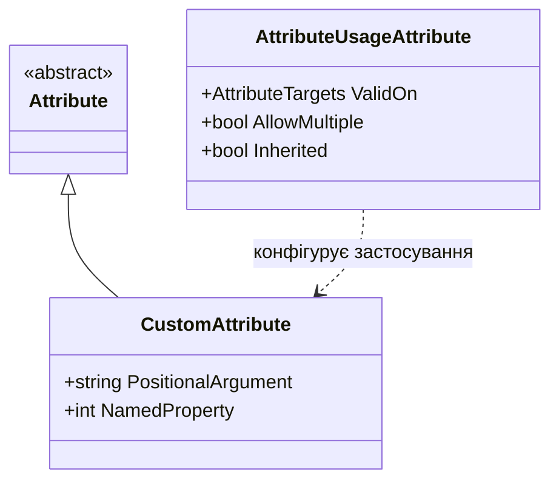

# Основи створення користувацьких атрибутів (Custom Attributes)

**Атрибути (Attributes)** в C# — це спеціальні декларативні теги, які дозволяють додавати структуровані метадані до елементів коду (класів, методів, властивостей, полів, параметрів тощо) та зчитувати їх під час виконання за допомогою рефлексії або під час компіляції (Source Generators, розаналізатори).

---

## 1. Створення власного класу атрибута

Будь-який користувацький атрибут є звичайним класом, який успадковується від базового класу `System.Attribute`:

```csharp
[AttributeUsage(AttributeTargets.Class | AttributeTargets.Struct, AllowMultiple = false, Inherited = true)]
public sealed class AuthorAttribute : Attribute
{
    // Позиційний параметр (обов'язковий)
    public string Name { get; }
    
    // Іменований параметр (опціональний)
    public int Version { get; set; } = 1;

    public AuthorAttribute(string name)
    {
        Name = name;
    }
}
```

> [!NOTE]
> За конвенцією іменування .NET назва класу атрибута завжди повинна закінчуватися суфіксом `Attribute` (наприклад, `AuthorAttribute`). Під час використання в коді суфікс можна опускати: `[Author("Юрій")]`.

---

## 2. Атрибут `[AttributeUsage]`

Клас `AttributeUsageAttribute` задає правила застосування атрибута:
- **`AttributeTargets`**: бітова маска, що визначає цільові елементи:
  - `AttributeTargets.Class`
  - `AttributeTargets.Method`
  - `AttributeTargets.Property`
  - `AttributeTargets.Parameter`
  - `AttributeTargets.All`
- **`AllowMultiple`**: `bool` — чи дозволено застосовувати атрибут кілька разів до одного й того самого елемента.
- **`Inherited`**: `bool` — чи успадковується атрибут похідними класами та перевизначеними методами.



---

## 3. Позиційні та іменовані параметри

- **Позиційні параметри** передаються через параметри конструктора атрибута:
  ```csharp
  public CustomAttribute(string description) { ... }
  ```
- **Іменовані параметри** відповідають публічним нестатичним властивостям або полям атрибута:
  ```csharp
  [Custom("Опис функціоналу", Priority = 5, IsActive = true)]
  public void ProcessOrder() { ... }
  ```

---

## 4. Системні атрибути компілятора Roslyn

Компілятор C# постачається із вбудованими атрибутами, які змінюють процес компіляції та поведінку генерованого IL-коду:

### 4.1. `[Obsolete]` — Керування життєвим циклом API
Маркує застарілі типи та члени, попереджаючи розробників про плановане вилучення:
```csharp
// Попередження під час збірки (CS0618):
[Obsolete("Використовуйте NewMethodAsync замість застарілого синхронного API")]
public void OldMethod() { }

// Помилка компіляції (CS0619) — заборона збірки проєкту:
[Obsolete("Цей метод небезпечний і заблокований", error: true)]
public void BrokenMethod() { }
```

### 4.2. `[Conditional]` — Умовне вилучення викликів
Інструктує компілятор повністю **вилучати інструкцію виклику (call-site)** з IL-коду, якщо відповідний умовний символ відсутній:
```csharp
[Conditional("DEBUG")]
public static void LogDiagnostic(string message) => Console.WriteLine(message);
```
> [!IMPORTANT]
> Метод з атрибутом `[Conditional]` зобов'язаний повертати `void`, не може бути реалізацією інтерфейсу та не може мати `out`-параметрів.

### 4.3. Caller Info Attributes — Нульові накладні витрати на трасування
Підставляють інформацію про місце виклику безпосередньо **під час компіляції**:
* `[CallerMemberName]` — назва викликаючого методу або властивості.
* `[CallerFilePath]` — повний абсолютний шлях до файлу вихідного коду.
* `[CallerLineNumber]` — номер рядка у вихідному файлі.
* `[CallerArgumentExpression("param")]` (C# 10+) — рядок виразу, переданого в зазначений аргумент.

```csharp
public static void AssertNotNull(object? value, [CallerArgumentExpression("value")] string? expr = null)
{
    if (value is null)
        throw new ArgumentNullException(expr, $"Вираз '{expr}' не може бути null!");
}
```

---

## 5. Порівняння: Компіляторні атрибути vs Runtime-атрибути

| Критерій | Компіляторні атрибути (`Obsolete`, `Conditional`, `CallerInfo`) | Runtime-атрибути (`Author`, `Table`, `Validation`) |
|:---|:---|:---|
| **Хто обробляє** | Компілятор Roslyn під час побудови IL | Рантайм CLR через `System.Reflection` |
| **Вплив на IL** | Змінюють генерований код (вилучають виклики, підставляють константи) | Зберігаються як бінарні дані у купі `#Blob` |
| **Накладні витрати в рантаймі** | **0%** (відсутні виклики рефлексії) | Виділення пам'яті в Heap під час виклику `GetCustomAttribute<T>()` |
