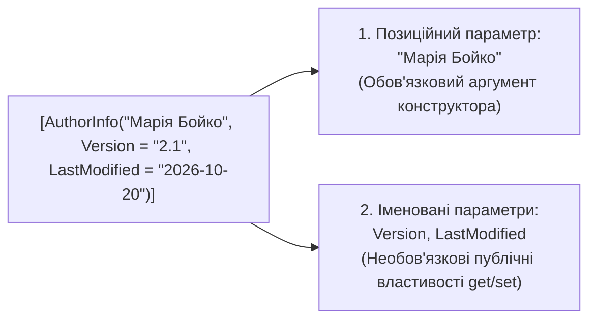

# Класи System.Attribute, AttributeUsageAttribute та CustomAttributeData

> **Простір імен**: `System`, `System.Reflection`  
> **Збірка**: `System.Private.CoreLib.dll`  
> **Базовий проєкт**: [17-AttributesBasicsDemo](../../17-AttributesBasicsDemo/Program.cs)  
> **Офіційна документація**: [Attributes in C# (Microsoft Learn)](https://learn.microsoft.com/en-us/dotnet/csharp/advanced-topics/reflection-and-attributes/)

Атрибути в C# та .NET — це спосіб прикріпити додаткову інформацію (метадані) до будь-якого елемента коду: класу, методу, властивості, поля або параметра.

---

## 1. Навіщо потрібні атрибути? (Пояснення на реальних прикладах)

Уявіть собі звичайну коробку з товаром на складі. Сама коробка — це ваш **клас або метод**. На коробку наклеюють **стікери (ярлики)**: «Крихке», «Зберігати при -18C», «Тільки для персоналу». Сам паперовий стікер нічого не робить, але коли працівник складу або автоматичний сканер (**рефлексія**) бачить цей стікер, він змінює спосіб обробки коробки.

У проєкті [17-AttributesBasicsDemo](../../17-AttributesBasicsDemo/Program.cs) показано 4 головні причини, для чого створюють атрибути:

1. **Підказки компілятору**: атрибут `[Obsolete]` попереджає розробника, що метод застарів, а `[CallerMemberName]` автоматично підставляє ім'я методу, звідки відбувся виклик.
2. **Паспортизація та документування коду**: атрибут `[AuthorInfo("Олександр Коваленко", Version = "2.1")]` зберігає історію авторів і версій прямо всередині скомпільованого `.dll` файлу.
3. **Автоматична маршрутизація (побудова меню команд або веб-ендпоінтів)**: атрибут `[ConsoleCommand("status", "...")]` дозволяє програмі самій знайти всі методи-команди без громіздких конструкцій `switch-case`.
4. **Декларативна безпека та авторизація**: атрибут `[RequiresPermission("Admin")]` дозволяє перевірити роль поточного користувача перед викликом методу через `Invoke`.

---

## 2. Позиційні проти Іменованих параметрів атрибута

---

## 3. Властивості для роботи з атрибутами (Properties)

| Властивість | Сигнатура | Опис призначення | Статус у курсі | Приклад у коді | Документація MSDN |
| :--- | :--- | :--- | :---: | :--- | :--- |
| **`AttributeType`** | `Type AttributeType { get; }` | Тип атрибута, збережений у дескрипторі `CustomAttributeData` | Використано | [17-AttributesBasicsDemo/Program.cs](../../17-AttributesBasicsDemo/Program.cs#L71) | [CustomAttributeData.AttributeType](https://learn.microsoft.com/en-us/dotnet/api/system.reflection.customattributedata.attributetype) |
| **`ConstructorArguments`** | `IList<CustomAttributeTypedArgument> ConstructorArguments { get; }` | Список позиційних аргументів, переданих у конструктор атрибута | Використано | [17-AttributesBasicsDemo/Program.cs](../../17-AttributesBasicsDemo/Program.cs#L72) | [CustomAttributeData.ConstructorArguments](https://learn.microsoft.com/en-us/dotnet/api/system.reflection.customattributedata.constructorarguments) |
| **`NamedArguments`** | `IList<CustomAttributeNamedArgument> NamedArguments { get; }` | Список іменованих аргументів (властивостей/полів), встановлених при застосуванні атрибута | Використано | [17-AttributesBasicsDemo/Program.cs](../../17-AttributesBasicsDemo/Program.cs#L76) | [CustomAttributeData.NamedArguments](https://learn.microsoft.com/en-us/dotnet/api/system.reflection.customattributedata.namedarguments) |
| **`ValidOn`** | `AttributeTargets ValidOn { get; }` | Бітова маска цілей коду (`Class`, `Method`, `Property`), до яких дозволено застосовувати атрибут | Використано | [17-AttributesBasicsDemo/CustomAttributes.cs](../../17-AttributesBasicsDemo/CustomAttributes.cs#L10) | [AttributeUsageAttribute.ValidOn](https://learn.microsoft.com/en-us/dotnet/api/system.attributeusageattribute.validon) |
| **`AllowMultiple`** | `bool AllowMultiple { get; }` | Дозволяє застосовувати той самий атрибут до одного елемента коду декілька разів | Використано | [17-AttributesBasicsDemo/CustomAttributes.cs](../../17-AttributesBasicsDemo/CustomAttributes.cs#L10) | [AttributeUsageAttribute.AllowMultiple](https://learn.microsoft.com/en-us/dotnet/api/system.attributeusageattribute.allowmultiple) |
| **`Inherited`** | `bool Inherited { get; }` | Визначає, чи успадковується атрибут похідними класами та перевизначеними методами | Використано | [17-AttributesBasicsDemo/CustomAttributes.cs](../../17-AttributesBasicsDemo/CustomAttributes.cs#L42) | [AttributeUsageAttribute.Inherited](https://learn.microsoft.com/en-us/dotnet/api/system.attributeusageattribute.inherited) |

---

## 4. Методи для роботи з атрибутами (Methods)

| Метод | Сигнатура | Опис призначення | Статус у курсі | Приклад у коді | Документація MSDN |
| :--- | :--- | :--- | :---: | :--- | :--- |
| **`IsDefined`** | `bool IsDefined(Type attributeType, bool inherit)` | Швидко перевіряє факт наявності атрибута без виклику його конструктора | Використано | [17-AttributesBasicsDemo/Program.cs](../../17-AttributesBasicsDemo/Program.cs#L50) | [MemberInfo.IsDefined](https://learn.microsoft.com/en-us/dotnet/api/system.reflection.memberinfo.isdefined) |
| **`GetCustomAttribute<T>`** | `static T? GetCustomAttribute<T>(this MemberInfo element)` | Повертає один типізований екземпляр атрибута заданого типу `T` | Використано | [17-AttributesBasicsDemo/Program.cs](../../17-AttributesBasicsDemo/Program.cs#L52) | [CustomAttributeExtensions.GetCustomAttribute](https://learn.microsoft.com/en-us/dotnet/api/system.reflection.customattributeextensions.getcustomattribute) |
| **`GetCustomAttributes<T>`** | `static IEnumerable<T> GetCustomAttributes<T>(this MemberInfo element)` | Повертає всі екземпляри атрибута `T` (коли `AllowMultiple = true`) | Використано | [17-AttributesBasicsDemo/Program.cs](../../17-AttributesBasicsDemo/Program.cs#L32) | [CustomAttributeExtensions.GetCustomAttributes](https://learn.microsoft.com/en-us/dotnet/api/system.reflection.customattributeextensions.getcustomattributes) |
| **`GetCustomAttributesData`**| `IList<CustomAttributeData> GetCustomAttributesData()` | Зчитує сирі метадані атрибутів із `#Blob` без інстанціювання їхніх об'єктів | Використано | [17-AttributesBasicsDemo/Program.cs](../../17-AttributesBasicsDemo/Program.cs#L69) | [MemberInfo.GetCustomAttributesData](https://learn.microsoft.com/en-us/dotnet/api/system.reflection.memberinfo.getcustomattributesdata) | 