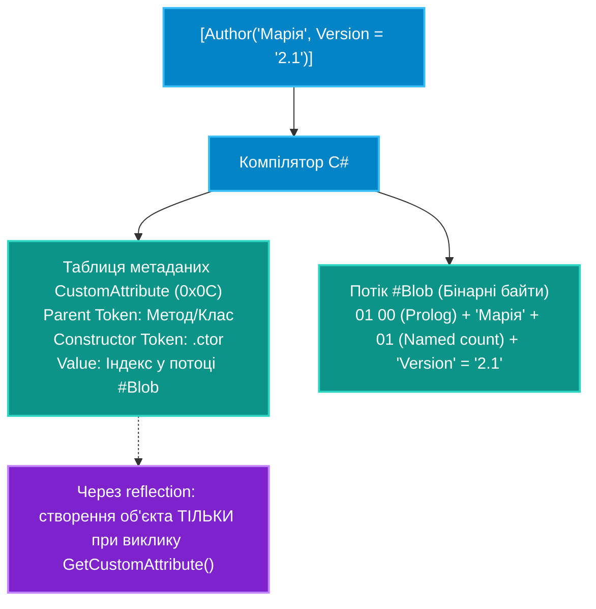

# 04. Поглиблений розбір кастомних атрибутів, `AttributeUsage` та потоку `#Blob`

## 1. Внутрішній устрій: Як атрибути зберігаються у збірці .NET

Атрибути в C# не є звичайними об'єктами, що постійно існують в пам'яті. При компіляції вихідного коду компілятор Roslyn не створює екземпляр класу атрибута. Натомість він записує в таблицю метаданих **`CustomAttribute` (таблиця 0x0C)** посилання на конструктор атрибута та бінарний серіалізований масив аргументів у купу **`#Blob`**:



Об'єкт класу атрибута інстанціюється **виключно у той момент**, коли код викликає метод `GetCustomAttribute<T>()`. Якщо атрибут ніколи не запитується рефлексією, його екземпляр у купі ніколи не буде створено!

---

## 2. Обмеження типів параметрів конструктора атрибутів

Оскільки аргументи атрибута повинні бути записані в бінарний потік метаданих на етапі компіляції, специфікація CLI накладає суворе обмеження на типи даних, які дозволено передавати в конструктор:

* **Дозволені типи**:
  1. Примітивні типи (`bool`, `byte`, `char`, `short`, `int`, `long`, `float`, `double`).
  2. Рядки (`string`).
  3. Типи `System.Type` (передаються через оператор `typeof(...)`).
  4. Перелічення (`enum`).
  5. Одновимірні масиви з перерахованих вище типів (наприклад, `int[]` або `string[]`).
* **Заборонені типи**:
  * Довільні складні об'єкти (класи), інтерфейси, структури, значення `decimal` та багатовимірні масиви. Спроба оголосити такий аргумент призведе до помилки компіляції `CS0182`.

---

## 3. Керування застосуванням через `[AttributeUsage]`

Клас `AttributeUsageAttribute` визначає, де і як саме компілятор дозволяє застосовувати ваш кастомний атрибут:

```csharp
[AttributeUsage(
    AttributeTargets.Class | AttributeTargets.Struct, // Дозволено лише для типів
    AllowMultiple = false,                          // Заборонено дублювати на одному класі
    Inherited = true)]                              // Нащадки автоматично успадкують цей атрибут
public sealed class DomainEntityAttribute : Attribute
{
    public string TableName { get; }
    public DomainEntityAttribute(string tableName) => TableName = tableName;
}
```

### Параметри `AttributeUsage`:
1. **`ValidOn (AttributeTargets)`** — бітова маска: `Class`, `Method`, `Property`, `Field`, `Parameter`, `ReturnValue`, `Assembly` тощо.
2. **`AllowMultiple`** — якщо `true`, атрибут можна вказувати декілька разів над одним елементом коду.
3. **`Inherited`** — якщо `true`, запит атрибута у похідного класу через `type.GetCustomAttribute<T>(inherit: true)` знайде атрибут, визначений на базовому класі.

---

## 4. Високопродуктивне зчитування: `CustomAttributeData`

Коли потрібно лише прочитати метадані без виконання коду конструктора атрибута (наприклад, в утилітах статичного аналізу або для запобігання запуску побічних дій у конструкторі), використовується клас **`CustomAttributeData`**:

```csharp
// Зчитує метадані напряму з потоку #Blob БЕЗ інстанціювання екземпляра атрибута:
IList<CustomAttributeData> attributes = typeof(Customer).GetCustomAttributesData();

foreach (CustomAttributeData attr in attributes)
{
    Console.WriteLine($"Тип атрибута: {attr.AttributeType.FullName}");
    
    // Позиційні аргументи:
    foreach (var ctorArg in attr.ConstructorArguments)
    {
        Console.WriteLine($"  Ctor arg ({ctorArg.ArgumentType}): {ctorArg.Value}");
    }

    // Іменовані параметри:
    foreach (var namedArg in attr.NamedArguments)
    {
        Console.WriteLine($"  Named arg {namedArg.MemberName} = {namedArg.TypedValue.Value}");
    }
}
```

---

## 5. Порівняльна таблиця методів доступу до атрибутів

| Метод | Інстанціює об'єкт? | Швидкодія | Коли використовувати |
|:---|:---:|:---:|:---|
| **`MemberInfo.IsDefined(type)`** | Ні | Максимальна (перевіряє лише наявність запису в таблиці 0x0C) | Швидкі фільтри: перевірити, чи є клас командою |
| **`MemberInfo.GetCustomAttribute<T>()`** | **Так** (викликає `.ctor`) | Середня (виділяє пам'ять у heap) | Стандартне прикладне читання значень у бізнес-коді |
| **`CustomAttributeData.GetCustomAttributesData()`** | Ні | Висока | Інспекція збірок, плагінів без завантаження залежностей |

---

## 6. Матриця проєкту цієї секції

| Проєкт | Посилання на вихідний код | Що демонструє під капотом |
|:---|:---|:---|
| [`17-AttributesBasicsDemo`](../17-AttributesBasicsDemo/Program.cs) | [Program.cs](../17-AttributesBasicsDemo/Program.cs) | Оголошення кастомних атрибутів, робота з позиційними та іменованими параметрами, перевірка `IsDefined` та читання дескрипторів `CustomAttributeData`. |
