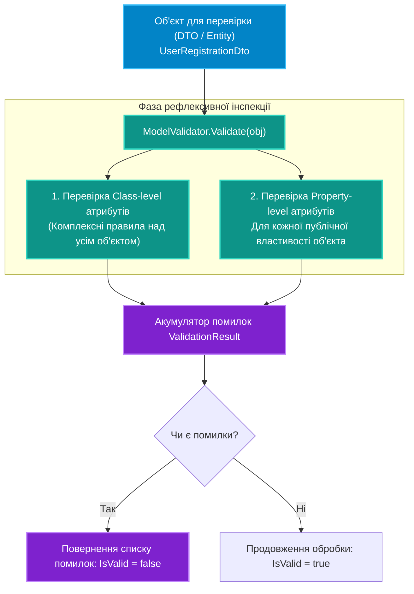

# 05. Архітектура рушія валідації на рівні класу та властивостей

## 1. Патерн декларативного валідатора в архітектурі .NET

У промислових застосунках валідація вхідних моделей (DTO, запитів, конфігурацій) не повинна бути "розмазана" по бізнес-методах у вигляді сотень одноманітних блоків `if (string.IsNullOrEmpty(...))`.

Декларативний підхід полягає у розмітці моделей атрибутами:
* **Валідація властивостей (`Property-level`)**: перевірка окремого атомарного поля (`[Required]`, `[Range]`, `[EmailAddress]`).
* **Валідація класу (`Class-level`)**: перевірка взаємозв'язку між декількома полями (наприклад, `DateEnd > DateStart` або наявність хоча б одного способу зв'язку).



---

## 2. Реалізація базових валідаційних атрибутів

```csharp
// Базовий абстрактний атрибут для всіх перевірок властивостей:
[AttributeUsage(AttributeTargets.Property, AllowMultiple = false)]
public abstract class PropertyValidationAttribute : Attribute
{
    public string ErrorMessage { get; set; } = "Значення поля є невалідним.";
    public abstract bool IsValid(object? value);
}

// Конкретний валідатор обов'язкового рядка:
public class RequiredStringAttribute : PropertyValidationAttribute
{
    public override bool IsValid(object? value) =>
        value is string s && !string.IsNullOrWhiteSpace(s);
}

// Конкретний валідатор діапазону чисел:
public class NumberRangeAttribute : PropertyValidationAttribute
{
    public int Min { get; }
    public int Max { get; }

    public NumberRangeAttribute(int min, int max)
    {
        Min = min;
        Max = max;
        ErrorMessage = $"Значення має перебувати в межах від {min} до {max}.";
    }

    public override bool IsValid(object? value) =>
        value is int number && number >= Min && number <= Max;
}
```

---

## 3. Архітектура рефлексивного рушія перевірки

```csharp
public record ValidationError(string PropertyName, string ErrorMessage);

public static class ModelValidator
{
    public static List<ValidationError> Validate(object? model)
    {
        var errors = new List<ValidationError>();
        if (model == null)
        {
            errors.Add(new ValidationError(string.Empty, "Об'єкт перевірки є null."));
            return errors;
        }

        Type type = model.GetType();

        // 1. Інспекція властивостей
        PropertyInfo[] properties = type.GetProperties(BindingFlags.Public | BindingFlags.Instance);
        foreach (PropertyInfo prop in properties)
        {
            var attributes = prop.GetCustomAttributes<PropertyValidationAttribute>(inherit: true);
            foreach (var attr in attributes)
            {
                object? value = prop.GetValue(model);
                if (!attr.IsValid(value))
                {
                    errors.Add(new ValidationError(prop.Name, attr.ErrorMessage));
                }
            }
        }

        return errors;
    }
}
```

---

## 4. Оптимізація продуктивності: Кешування метаданих

Прямий виклик `type.GetProperties()` та `prop.GetCustomAttributes()` при кожній валідації тисяч запитів на секунду призводить до зайвих алокацій масивів у пам'яті.

Професійні рушії (такі як `FluentValidation` або `System.ComponentModel.DataAnnotations`) використовують **статичний кеш метаданих**:

```csharp
// Потокобезпечний кеш списку валідаторів для кожного типу
private static readonly ConcurrentDictionary<Type, List<(PropertyInfo Prop, PropertyValidationAttribute Attr)>> _cache = new();

private static List<(PropertyInfo, PropertyValidationAttribute)> GetValidatorsForType(Type type)
{
    return _cache.GetOrAdd(type, t =>
    {
        var list = new List<(PropertyInfo, PropertyValidationAttribute)>();
        foreach (var prop in t.GetProperties(BindingFlags.Public | BindingFlags.Instance))
        {
            foreach (var attr in prop.GetCustomAttributes<PropertyValidationAttribute>(inherit: true))
            {
                list.Add((prop, attr));
            }
        }
        return list;
    });
}
```

---

## 5. Порівняння підходів до валідації в .NET

| Параметр | Ручний код (`if-else`) | DataAnnotations / Кастомні Атрибути | FluentValidation |
|:---|:---|:---|:---|
| **Місце опису правил** | Всередині сервісів або конструкторів | Декларативно над властивостями моделі | В окремих класах `AbstractValidator<T>` |
| **Зв'язність з моделлю** | Відсутня | Модель розмічена атрибутами | Модель залишається 100% чистим POCO |
| **Підтримка складних БД-правил**| Так | Складно (немає прямого доступу до DI) | Так (ін'єкція `DbContext` у валідатор) |
| **Швидкість розробки** | Низька (рутина) | Дуже висока (один атрибут) | Висока |

---

## 6. Матриця проєкту цієї секції

| Проєкт | Посилання на вихідний код | Що демонструє під капотом |
|:---|:---|:---|
| [`18-AttributesValidationDemo`](../18-AttributesValidationDemo/Program.cs) | [Program.cs](../18-AttributesValidationDemo/Program.cs) | Повна реалізація декларативного рушія валідації моделей на рівні властивостей і класів з детальним виводом звіту помилок. |
