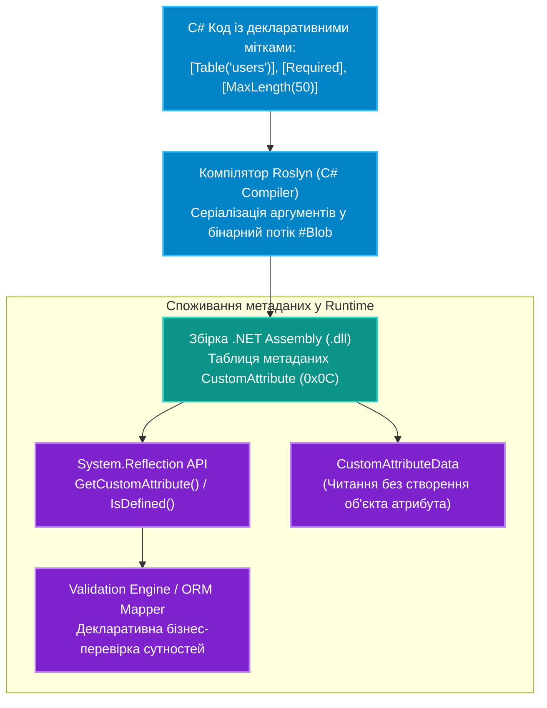

# Підмодуль 02: Метадані та Користувацькі Атрибути (`OOP-Attributes-And-Metadata.sln`)

Цей підмодуль присвячений концепції декларативного програмування в .NET: проектуванню користувацьких атрибутів (`System.Attribute`), вивченню формату збереження метаданих у потоці `#Blob` скомпільованої збірки, правилам спадкування атрибутів через `[AttributeUsage]`, швидкісному зчитуванню через `CustomAttributeData` та розробці власного декларативного **рушія валідації сутностей** у рантаймі.

---

## Архітектурний конвеєр декларативних атрибутів



---

## Навігація по навчальних посібниках (`Docs`)

| № | Посібник | Ключові теми та системні інструменти | Посилання на документ |
|:---:|:---|:---|:---|
| 01 | **Системні атрибути компілятора та основи створення власних атрибутів** | `[Obsolete]`, умовна компіляція `[Conditional]`, атрибути інфо виклику `[CallerMemberName]`, `[CallerFilePath]` | [Docs/01_Custom_Attributes_Fundamentals.md](Docs/01_Custom_Attributes_Fundamentals.md) |
| 02 | **Зчитування та обробка метаданих атрибутів у Runtime** | `MemberInfo.GetCustomAttributes`, `IsDefined`, читання позиційних та іменованих параметрів | [Docs/02_Metadata_Querying_And_Runtime_Processing.md](Docs/02_Metadata_Querying_And_Runtime_Processing.md) |
| 03 | **Метадані та декларативна валідація моделей** | Концепція декларативної валідації сутностей, створення `ValidationAttribute`, правила цілісності | [Docs/03_Attributes_And_Metadata_Validation.md](Docs/03_Attributes_And_Metadata_Validation.md) |
| 04 | **Поглиблений розбір кастомних атрибутів та потоку `#Blob`** | Клас `System.Attribute`, правила `[AttributeUsage]` (`AllowMultiple`, `Inherited`), читання сирих байтів через `CustomAttributeData` | [Docs/04_Custom_Attributes_Deep_Dive.md](Docs/04_Custom_Attributes_Deep_Dive.md) |
| 05 | **Архітектура рушія валідації на рівні класу та властивостей** | Проєктування масштабованого рушія перевірок, рекурсивна валідація складних графів об'єктів, оптимізація через кешування | [Docs/05_Class_And_Property_Validation_Engine.md](Docs/05_Class_And_Property_Validation_Engine.md) |

---

## Структура Solution-тек у рішенні `OOP-Attributes-And-Metadata.sln` (12 проєктів)

* **`01. Системні атрибути компілятора та Caller Info`**:
  * Атрибути `[Obsolete]`, умовна компіляція `[Conditional]`, трасування викликів `[CallerFilePath]`, `[CallerLineNumber]`, `[CallerMemberName]`.
  * Проєкти: `p701[SOLIS]`, `p703[SOLIS]`, `p704[SOLIS]`, `attribute-exmple-02`.
* **`02. Проєктування власних атрибутів та таблиці метаданих`**:
  * Успадкування від `Attribute`, конфігурація `[AttributeUsage]`, позиційні та іменовані параметри, перевірка `IsDefined`, читання `GetCustomAttributes<T>()` та `CustomAttributeData`.
  * Проєкти: `00-Shared`, `p717[SOLIS]`, `p718[SOLIS]`, `Attributes-Example-01`, `attribute-example-03`, `attribute-example-04`, `17-AttributesBasicsDemo`.
* **`03. Декларативна валідація моделей та правил у Runtime`**:
  * Розробка власних валідаційних атрибутів на рівні властивостей (`Property`) і класу (`Class`) та універсального рефлексивного валідатора.
  * Проєкт: `18-AttributesValidationDemo`.

---

## Ключові теоретичні висновки підмодуля

1. **Компілятор проти Рантайму**:
   * Системні атрибути компілятора (`[Obsolete]`, `[Conditional]`, `[CallerMemberName]`) обробляються компілятором Roslyn безпосередньо під час побудови IL-коду і не несуть накладних витрат у рантаймі.
   * Користувацькі атрибути серіалізуються в метадані збірки (таблиця `CustomAttribute` 0x0C та потік `#Blob`) і зчитуються через `Reflection`.
2. **Продуктивність зчитування**:
   * Для перевірки наявності мітки завжди використовуйте `IsDefined()` — це запобігає алокаціям об'єктів у купі.
   * Для інтенсивної обробки (ORM, валідація, DTO) використовуйте потокобезпечне кешування через `ConcurrentDictionary`.
3. **Обмеження CLI**:
   * Параметрами атрибутів можуть бути лише константи компіляції: примітиви, рядки, `Type`, `enum` та їх одновимірні масиви. Складні об'єкти та `decimal` заборонені.

---

## Збірка та запуск

```powershell
dotnet build "04-Advanced-CSharp/02-Attributes-And-Metadata/OOP-Attributes-And-Metadata.sln" -c Release
```
