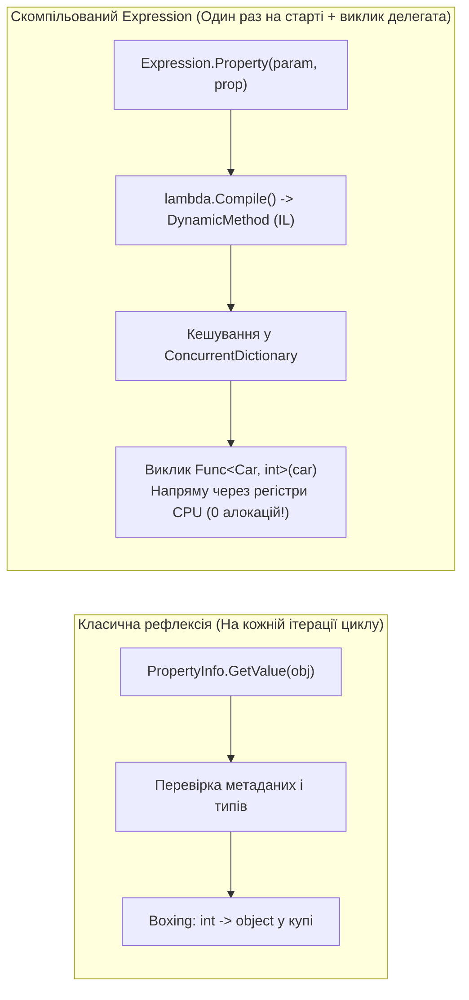
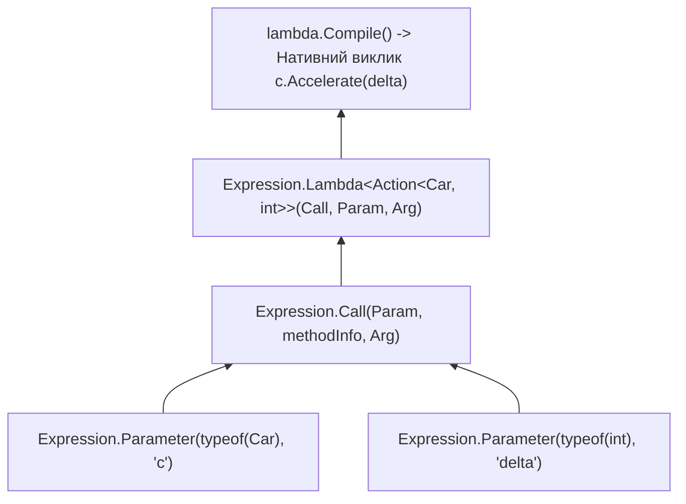

# 02. Компіляція швидких делегатів та прискорення рефлексії (Expression Trees vs Invoke)

> **Простір імен**: `System.Linq.Expressions`  
> **Збірка**: `System.Linq.Expressions.dll`  
> **Базові проєкти**:
> - [`15.2-ExpressionTreesMemberAccessDemo`](../15.2-ExpressionTreesMemberAccessDemo/Program.cs) — Генерація геттерів, сеттерів, викликів методів і конструкторів.
> - [`15.3-ReflectionPerformanceDemo`](../15.3-ReflectionPerformanceDemo/Program.cs) — Порівняльний бенчмарк швидкодії рефлексії та скомпільованих виразів.
> - [`Car.cs`](../00-Shared/Common/Car.cs) — Доменна модель для тестування динамічного доступу.  
> **Офіційна документація**: [Expression Class (Microsoft Learn)](https://learn.microsoft.com/en-us/dotnet/api/system.linq.expressions.expression)

---

## 1. Чому класична рефлексія повільна у гарячих циклах?

Класичні методи рефлексії (`PropertyInfo.GetValue`, `PropertyInfo.SetValue`, `MethodInfo.Invoke`, `Activator.CreateInstance`) чудово підходять для одноразових викликів під час старту програми. Проте при обробці сотень тисяч об'єктів (наприклад, при читанні рядків із `DbDataReader` у Dapper/EF Core або серіалізації великого масиву у JSON) вони стають вузьким місцем через:
1. **Пакування (Boxing/Unboxing)**: сигнатура `object? GetValue(object? obj)` змушує пакувати кожне значуще поле (`int`, `decimal`, `DateTime`, `bool`) у купу (Managed Heap), створюючи колосальний тиск на Garbage Collector.
2. **Пакування аргументів у масив**: виклик `method.Invoke(instance, new object[] { 60 })` щоразу алокує новий масив `object[]`.
3. **Перевірки безпеки та типів у Runtime**: під час кожного виклику `Invoke` середовище CLR наново перевіряє сумісність типів аргументів і права доступу.

Дерева виразів дозволяють виконати всі перевірки **один раз**, побудувати строго типізоване AST-дерево і викликати `.Compile()`, що генерує нативний IL-код у пам'яті через `DynamicMethod`.



---

## 2. Покрокова компіляція геттерів, сеттерів та фабрик

### 2.1. Генерація строго типізованого геттера `Func<T, TProp>` та сеттера `Action<T, TProp>`

Замість повільного `PropertyInfo.GetValue` / `SetValue` сконструюємо скомпільовані делегати (див. [`15.2-ExpressionTreesMemberAccessDemo/Program.cs`](../15.2-ExpressionTreesMemberAccessDemo/Program.cs)):

```csharp
// Погано: повільний нетипізований доступ із пакуванням int -> object на кожному кроці
PropertyInfo speedProp = typeof(Car).GetProperty(nameof(Car.CurrentSpeed))!;
for (int i = 0; i < 1_000_000; i++)
{
    int current = (int)speedProp.GetValue(car)!; // Boxing + Cast
    speedProp.SetValue(car, current + 1);        // Boxing аргументу
}

// Добре: одноразова компіляція типізованих делегатів через Expression Trees
public static Func<T, TProp> CreateGetter<T, TProp>(string propertyName)
{
    // 1. Вхідний параметр: (T instance)
    ParameterExpression instanceParam = Expression.Parameter(typeof(T), "instance");

    // 2. Звернення до властивості: instance.PropertyName
    MemberExpression propertyAccess = Expression.Property(instanceParam, propertyName);

    // 3. Пакування в лямбду: instance => instance.PropertyName та компіляція в IL
    return Expression.Lambda<Func<T, TProp>>(propertyAccess, instanceParam).Compile();
}

public static Action<T, TProp> CreateSetter<T, TProp>(string propertyName)
{
    ParameterExpression instanceParam = Expression.Parameter(typeof(T), "instance");
    ParameterExpression valueParam = Expression.Parameter(typeof(TProp), "value");

    // Будуємо вузол присвоєння: instance.PropertyName = value
    MemberExpression propertyAccess = Expression.Property(instanceParam, propertyName);
    BinaryExpression assignExpr = Expression.Assign(propertyAccess, valueParam);

    return Expression.Lambda<Action<T, TProp>>(assignExpr, instanceParam, valueParam).Compile();
}
```

### 2.2. Універсальний нетипізований аксесор `Func<object, object?>` (для серіалізаторів)

Коли тип `T` невідомий на етапі компіляції (наприклад, ми пишемо універсальний JSON-серіалізатор, який приймає `object`), у дерево додаються вузли приведення типів `Expression.Convert`:

```csharp
public static Func<object, object?> CreateUntypedGetter(Type targetType, PropertyInfo propertyInfo)
{
    // Параметр має тип object: (object obj)
    ParameterExpression objParam = Expression.Parameter(typeof(object), "obj");

    // Кастимо: ((Car)obj)
    UnaryExpression typedInstance = Expression.Convert(objParam, targetType);

    // Читаємо властивість: ((Car)obj).PetName
    MemberExpression propAccess = Expression.Property(typedInstance, propertyInfo);

    // Кастимо результат у object: (object?)((Car)obj).PetName
    UnaryExpression boxedResult = Expression.Convert(propAccess, typeof(object));

    return Expression.Lambda<Func<object, object?>>(boxedResult, objParam).Compile();
}
```

### 2.3. Компіляція виклику методу (`Expression.Call`) та конструктора (`Expression.New`)

Аналогічно замінюються `MethodInfo.Invoke` та `Activator.CreateInstance`:



```csharp
// Заміна Activator.CreateInstance: компіляція фабрики new Car(name, maxSpeed, currSpeed)
ConstructorInfo ctor = typeof(Car).GetConstructor(new[] { typeof(string), typeof(int), typeof(int) })!;
ParameterExpression pName = Expression.Parameter(typeof(string), "name");
ParameterExpression pMax  = Expression.Parameter(typeof(int), "maxSpeed");
ParameterExpression pCurr = Expression.Parameter(typeof(int), "currSpeed");

NewExpression newCarExpr = Expression.New(ctor, pName, pMax, pCurr);
var carFactory = Expression.Lambda<Func<string, int, int, Car>>(newCarExpr, pName, pMax, pCurr).Compile();

Car turboCar = carFactory("Porsche 911", 310, 0); // Працює зі швидкістю звичайного оператора new!
```

---

## 3. Золоте правило: Кешування скомпільованих делегатів

> [!WARNING]
> **Сам виклик `.Compile()` є відносно важкою операцією** (він запускає генератор CIL та JIT-компілятор, що займає від десятків мікросекунд до мілісекунди). Якщо викликати `.Compile()` всередині циклу на кожній ітерації, програма працюватиме **повільніше** за звичайну рефлексію!

Скомпільований делегат обов'язково кешується у статичному потокобезпечному словнику `ConcurrentDictionary`:

```csharp
private static readonly ConcurrentDictionary<(Type, string), Delegate> GetterCache = new();
```

---

## 4. Порівняння швидкодії (5 000 000 викликів у Release)

Результати експерименту з проєкту [`15.3-ReflectionPerformanceDemo/Program.cs`](../15.3-ReflectionPerformanceDemo/Program.cs):

| Спосіб виклику методу / читання властивості | Відносний час виконання | Алокації в купі (GC) | Коли застосовувати |
| :--- | :--- | :--- | :--- |
| **1. Прямий виклик C# (`car.SpeedUp(10)`)** | `~1.0x` (Еталон — ~3 мс) | `0 Байт` | Коли всі типи відомі під час компіляції |
| **2. Скомпільований `Expression.Compile()`** | `~1.2x – 1.5x` (~4–5 мс) | `0 Байт` | ORM (EF Core, Dapper), серіалізатори, AutoMapper |
| **3. Кешований `MethodInfo.CreateDelegate`** | `~1.2x – 1.5x` (~4–5 мс) | `0 Байт` | Коли сигнатура методу точно відома заздалегідь |
| **4. Класичний `MethodInfo.Invoke` / `GetValue`** | `~35x – 80x` (~140–250 мс) | Сотні МБ (`object[]` + boxing) | Лише для поодиноких рідкісних викликів |

---

## 5. Довідник фабричних методів класу `Expression`

| Метод | Сигнатура | Опис призначення | Приклад у коді | Документація MSDN |
| :--- | :--- | :--- | :--- | :--- |
| **`Parameter`** | `static ParameterExpression Parameter(Type type, string? name)` | Створює вузол вхідного параметра методу чи лямбди | [15.1-ExpressionTreesBuildingDemo/Program.cs](../15.1-ExpressionTreesBuildingDemo/Program.cs#L16) | [Expression.Parameter](https://learn.microsoft.com/en-us/dotnet/api/system.linq.expressions.expression.parameter) |
| **`Constant`** | `static ConstantExpression Constant(object? value, Type type)` | Створює вузол фіксованої константи (числа, рядка) | [15.1-ExpressionTreesBuildingDemo/Program.cs](../15.1-ExpressionTreesBuildingDemo/Program.cs#L19) | [Expression.Constant](https://learn.microsoft.com/en-us/dotnet/api/system.linq.expressions.expression.constant) |
| **`Multiply`** | `static BinaryExpression Multiply(Expression left, Expression right)` | Створює бінарну операцію множення | [15.1-ExpressionTreesBuildingDemo/Program.cs](../15.1-ExpressionTreesBuildingDemo/Program.cs#L23) | [Expression.Multiply](https://learn.microsoft.com/en-us/dotnet/api/system.linq.expressions.expression.multiply) |
| **`Add`** | `static BinaryExpression Add(Expression left, Expression right)` | Створює бінарну операцію додавання | [15.1-ExpressionTreesBuildingDemo/Program.cs](../15.1-ExpressionTreesBuildingDemo/Program.cs#L26) | [Expression.Add](https://learn.microsoft.com/en-us/dotnet/api/system.linq.expressions.expression.add) |
| **`Condition`** | `static ConditionalExpression Condition(Expression test, Expression ifTrue, Expression ifFalse)` | Створює тернарний умовний вузол (`if-then-else`) | [15.1-ExpressionTreesBuildingDemo/Program.cs](../15.1-ExpressionTreesBuildingDemo/Program.cs#L71) | [Expression.Condition](https://learn.microsoft.com/en-us/dotnet/api/system.linq.expressions.expression.condition) |
| **`Property`** | `static MemberExpression Property(Expression expression, PropertyInfo property)` | Створює вузол звернення до властивості | [15.2-ExpressionTreesMemberAccessDemo/Program.cs](../15.2-ExpressionTreesMemberAccessDemo/Program.cs#L27) | [Expression.Property](https://learn.microsoft.com/en-us/dotnet/api/system.linq.expressions.expression.property) |
| **`Assign`** | `static BinaryExpression Assign(Expression left, Expression right)` | Створює вузол запису значення у властивість або змінну | [15.2-ExpressionTreesMemberAccessDemo/Program.cs](../15.2-ExpressionTreesMemberAccessDemo/Program.cs#L40) | [Expression.Assign](https://learn.microsoft.com/en-us/dotnet/api/system.linq.expressions.expression.assign) |
| **`Call`** | `static MethodCallExpression Call(Expression instance, MethodInfo method, params Expression[] arguments)` | Створює вузол динамічного виклику методу | [15.2-ExpressionTreesMemberAccessDemo/Program.cs](../15.2-ExpressionTreesMemberAccessDemo/Program.cs#L53) | [Expression.Call](https://learn.microsoft.com/en-us/dotnet/api/system.linq.expressions.expression.call) |
| **`New`** | `static NewExpression New(ConstructorInfo constructor, params Expression[] arguments)` | Створює вузол виклику конструктора для інстанціювання типу | [15.2-ExpressionTreesMemberAccessDemo/Program.cs](../15.2-ExpressionTreesMemberAccessDemo/Program.cs#L81) | [Expression.New](https://learn.microsoft.com/en-us/dotnet/api/system.linq.expressions.expression.new) |
| **`Lambda`** | `static Expression<TDelegate> Lambda<TDelegate>(Expression body, params ParameterExpression[] parameters)` | Створює типізоване кореневе лямбда-дерево | [15.0-ExpressionTreesBasicsDemo/Program.cs](../15.0-ExpressionTreesBasicsDemo/Program.cs#L26) | [Expression.Lambda](https://learn.microsoft.com/en-us/dotnet/api/system.linq.expressions.lambda) |
| **`Compile`** | `TDelegate Compile()` | Транслює AST-дерево в новий блок IL-коду в пам'яті через `DynamicMethod` і JIT-компілює його | [15.0-ExpressionTreesBasicsDemo/Program.cs](../15.0-ExpressionTreesBasicsDemo/Program.cs#L83) | [LambdaExpression.Compile](https://learn.microsoft.com/en-us/dotnet/api/system.linq.expressions.lambdaexpression.compile) |
| **`Convert`** | `static UnaryExpression Convert(Expression expression, Type type)` | Створює вузол явного приведення типу даних (Cast / Boxing) | [15.1-ExpressionTreesBuildingDemo/Program.cs](../15.1-ExpressionTreesBuildingDemo/Program.cs#L57) | [Expression.Convert](https://learn.microsoft.com/en-us/dotnet/api/system.linq.expressions.expression.convert) |
| **`GreaterThanOrEqual`** | `static BinaryExpression GreaterThanOrEqual(Expression left, Expression right)` | Операція логічного порівняння `>=` | [15.1-ExpressionTreesBuildingDemo/Program.cs](../15.1-ExpressionTreesBuildingDemo/Program.cs#L64) | [Expression.GreaterThanOrEqual](https://learn.microsoft.com/en-us/dotnet/api/system.linq.expressions.expression.greaterthanorequal) |
