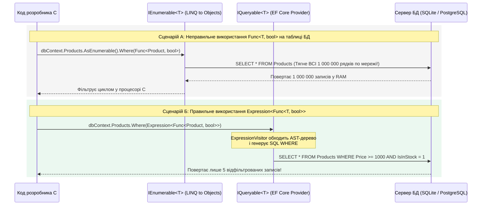
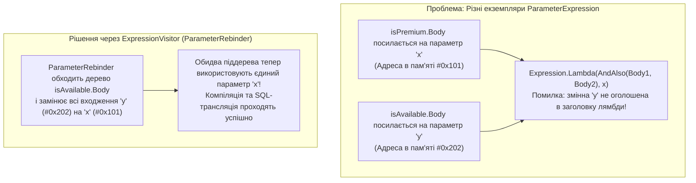

# 03. Динамічні LINQ-запити, комбінування предикатів та ExpressionVisitor (Місток до IQueryable)

> **Базовий проєкт**: [`15.4-DynamicLinqPredicateBuilderDemo`](../15.4-DynamicLinqPredicateBuilderDemo/Program.cs)  
> **Ключові типи**: `IQueryable<T>`, `Expression<Func<T, bool>>`, `ExpressionVisitor`, `BinaryExpression`, `MemberExpression`

Цей розділ з'єднує **LINQ** (підмодуль `03-LINQ`), **Дерева виразів (`04-Expression-Trees`)** та майбутній розділ **Entity Framework Core (`07-DataAccess-EFCore`)** у єдину цілісну архітектурну картину.

---

## 1. Головна архітектурна відмінність: `IEnumerable<T>` проти `IQueryable<T>`

Коли ви пишете лямбда-вираз `p => p.Price >= 1000m && p.IsInStock`, компілятор C# перетворює його у дві кардинально різні речі залежно від того, на чому викликано метод `.Where(...)`:



### Порівняльна таблиця `IEnumerable<T>` та `IQueryable<T>`

| Характеристика | `IEnumerable<T>.Where(Func<T, bool>)` | `IQueryable<T>.Where(Expression<Func<T, bool>>)` |
| :--- | :--- | :--- |
| **Простір імен розширень** | `System.Linq.Enumerable` | `System.Linq.Queryable` |
| **Тип параметра предиката** | Скомпільований делегат `Func<T, bool>` | Дерево виразів `Expression<Func<T, bool>>` |
| **Що генерує компілятор C#** | Анонімний метод із CIL байт-кодом (непрозорий чорний ящик) | Дерево об'єктів AST (`BinaryExpression`, `MemberExpression`, `ConstantExpression`) |
| **Де виконується фільтрація** | Виключно в оперативній пам'яті процесу .NET (In-Memory) | Транслюється провайдером (`IQueryProvider`) у нативний запит зовнішнього джерела (SQL) |
| **Наслідки передачі `Func` у запит БД** | Повне вивантаження всієї таблиці БД у пам'ять клієнта (Client-Side Evaluation) | Серверна фільтрація за індексами таблиці БД (Server-Side Evaluation) |

---

## 2. Динамічна побудова пошукових фільтрів у Runtime

У реальних корпоративних системах (e-commerce каталоги, CRM, фінансовий моніторинг) користувач може заповнити будь-яку комбінацію полів фільтра: категорію, діапазон цін `[MinPrice..MaxPrice]`, наявність на складі або сортування за назвою стовпця, обраною у випадаючому списку UI.

Склеювати SQL-рядки вручну небезпечно через ризик SQL-ін'єкцій та втрату типобезпеки. Замість цього ми динамічно конструюємо дерево `Expression<Func<Product, bool>>` вузол за вузлом (див. [`15.4-DynamicLinqPredicateBuilderDemo/Program.cs`](../15.4-DynamicLinqPredicateBuilderDemo/Program.cs)):

```csharp
public static Expression<Func<Product, bool>> BuildDynamicFilter(ProductSearchFilter filter)
{
    // Спільний параметр лямбди: (Product p)
    ParameterExpression param = Expression.Parameter(typeof(Product), "p");
    Expression body = Expression.Constant(true); // Початкова нейтральна умова

    // 1. Якщо задано категорію: p.Category == filter.Category
    if (!string.IsNullOrWhiteSpace(filter.Category))
    {
        MemberExpression categoryProp = Expression.Property(param, nameof(Product.Category));
        ConstantExpression categoryVal = Expression.Constant(filter.Category, typeof(string));
        BinaryExpression eqExpr = Expression.Equal(categoryProp, categoryVal);
        body = Expression.AndAlso(body, eqExpr);
    }

    // 2. Якщо задано мінімальну ціну: p.Price >= filter.MinPrice.Value
    if (filter.MinPrice.HasValue)
    {
        MemberExpression priceProp = Expression.Property(param, nameof(Product.Price));
        ConstantExpression minPriceVal = Expression.Constant(filter.MinPrice.Value, typeof(decimal));
        BinaryExpression geExpr = Expression.GreaterThanOrEqual(priceProp, minPriceVal);
        body = Expression.AndAlso(body, geExpr);
    }

    // 3. Якщо позначено "Тільки в наявності": p.IsInStock == true
    if (filter.OnlyInStock)
    {
        MemberExpression stockProp = Expression.Property(param, nameof(Product.IsInStock));
        body = Expression.AndAlso(body, stockProp);
    }

    // Повертаємо готове дерево виразів p => (true && p.Category == "...") && p.Price >= ...
    return Expression.Lambda<Func<Product, bool>>(body, param);
}
```

---

## 3. Патерн `ExpressionVisitor` та об'єднання предикатів (`ParameterRebinder`)

Часто у архітектурі Domain-Driven Design (патерн **Specification**) ми вже маємо два готові незалежні вирази:
- `Expression<Func<Product, bool>> isPremium = x => x.Price >= 25000m;`
- `Expression<Func<Product, bool>> isAvailable = y => y.IsInStock && y.Rating >= 4.5;`

Чому не можна просто написати `Expression.AndAlso(isPremium.Body, isAvailable.Body)`?



Оскільки дерева виразів у .NET є **незмінними (Immutable)**, для заміни параметра `y` на `x` ми успадковуємо системний клас `ExpressionVisitor` і перевизначаємо метод `VisitParameter`:

```csharp
public sealed class ParameterRebinder : ExpressionVisitor
{
    private readonly ParameterExpression _oldParam;
    private readonly ParameterExpression _newParam;

    public ParameterRebinder(ParameterExpression oldParam, ParameterExpression newParam)
    {
        _oldParam = oldParam;
        _newParam = newParam;
    }

    protected override Expression VisitParameter(ParameterExpression node)
        => node == _oldParam ? _newParam : base.VisitParameter(node);
}

public static class PredicateBuilder
{
    public static Expression<Func<T, bool>> And<T>(
        this Expression<Func<T, bool>> left,
        Expression<Func<T, bool>> right)
    {
        ParameterExpression unifiedParam = left.Parameters[0];
        var rebinder = new ParameterRebinder(right.Parameters[0], unifiedParam);
        Expression reboundRightBody = rebinder.Visit(right.Body);

        return Expression.Lambda<Func<T, bool>>(
            Expression.AndAlso(left.Body, reboundRightBody),
            unifiedParam);
    }
}
```

---

## 4. Як працює транслятор EF Core під капотом (`SqlWhereTranslator`)

У проєкті [`15.4-DynamicLinqPredicateBuilderDemo/Program.cs`](../15.4-DynamicLinqPredicateBuilderDemo/Program.cs) реалізовано власний міні-транслятор `SqlWhereTranslator : ExpressionVisitor`, який перетворює будь-який комбінований C# вираз у безпечний параметризований SQL-рядок:

| Вузол дерева C# (`Expression`) | Метод `ExpressionVisitor` | Згенерований фрагмент SQL |
| :--- | :--- | :--- |
| `BinaryExpression` (`NodeType.AndAlso`) | `VisitBinary` | `(<лівий вираз> AND <правий вираз>)` |
| `BinaryExpression` (`NodeType.OrElse`) | `VisitBinary` | `(<лівий вираз> OR <правий вираз>)` |
| `BinaryExpression` (`NodeType.GreaterThanOrEqual`) | `VisitBinary` | `(<стовпець> >= <значення>)` |
| `MemberExpression` (`p.Price`) | `VisitMember` | Назва стовпця таблиці `[Price]` |
| `ConstantExpression` (`"Laptops"`, `25000m`) | `VisitConstant` | Літерал або SQL-параметр `'Laptops'`, `25000` |
| `MethodCallExpression` (`p.Name.Contains("Pro")`) | `VisitMethodCall` | `[Name] LIKE '%Pro%'` |

---

## Матриця проєктів цієї секції

| Проєкт | Призначення та ключові концепції | Вихідний код |
| :--- | :--- | :--- |
| **`15.4-DynamicLinqPredicateBuilderDemo`** | Порівняння `Func` vs `Expression<Func>`, динамічний конструктор фільтрів `DynamicProductFilter`, комбінатор специфікацій `And`/`Or` через `ParameterRebinder` та власний транслятор `SqlWhereTranslator` у SQL | [`Program.cs`](../15.4-DynamicLinqPredicateBuilderDemo/Program.cs) |
