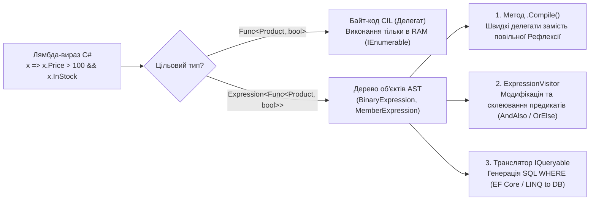
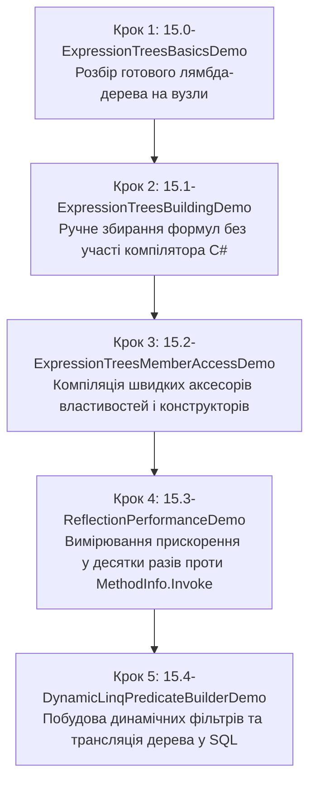

# Підмодуль 04: Дерева виразів (Expression Trees) та Динамічний LINQ

Цей підмодуль логічно завершує розділ **`04-Advanced-CSharp`**, поєднуючи **Рефлексію** (`01-Reflection`) та **LINQ** (`03-LINQ`). Тут розглядається фундаментальна концепція метапрограмування **«Код як дані» (Code as Data)** через абстрактні синтаксичні дерева (`System.Linq.Expressions`).

---

## Архітектура та призначення Дерев виразів у .NET

Коли компілятор C# бачить звичайний лямбда-вираз, прив'язаний до делегата `Func<T, bool>`, він одразу компілює його у проміжний байт-код CIL (чорний ящик для нашої програми). Проте, якщо той самий лямбда-вираз присвоїти типу `Expression<Func<T, bool>>`, компілятор генерує граф об'єктів у пам'яті — **Абстрактне Синтаксичне Дерево (AST)**.



У промисловій розробці дерева виразів вирішують три ключові задачі:
1. **Трансляція запитів (`IQueryable<T>`)**: ORM-фреймворки (Entity Framework Core, Dapper Extensions, MongoDB Driver) розбирають дерево виразів C# і перекладають його на мову цільової СКБД (SQL).
2. **Прискорення рефлексії (Reflection Boosting)**: серіалізатори, IoC-контейнери (Dependency Injection) та мапери об'єктів (AutoMapper, Mapster) один раз будують дерево читання/запису властивості або виклику конструктора і компілюють його через `.Compile()` у надшвидкий делегат, уникаючи повільного `PropertyInfo.GetValue` або `Activator.CreateInstance`.
3. **Динамічна генерація бізнес-правил у Runtime**: побудова складних пошукових фільтрів та конвеєрів розрахунку на льоту на основі налаштувань користувача без склеювання SQL-рядків.

---

## Навігація по навчальних матеріалах (`Docs`)

1. **[01. Анатомія дерев виразів (AST) та конструювання виразів у Runtime](Docs/01_Expression_Trees_AST_And_Dynamic_Building.md)**
   - Різниця між `Func<T>` та `Expression<Func<T>>`, рекурсивний обхід вузлів `NodeType`, `Parameters`, `Body` та ручне конструювання математичних і логічних розгалужень (`Condition`, `Block`).
2. **[02. Компіляція швидких делегатів та прискорення рефлексії (Expression Trees vs Invoke)](Docs/02_Compiled_Delegates_And_Reflection_Boosting.md)**
   - Генерація типізованих геттерів `Func<T, TProp>` та сеттерів `Action<T, TProp>`, заміна `MethodInfo.Invoke` і `Activator.CreateInstance`, кешування делегатів та бенчмарки швидкодії.
3. **[03. Динамічні LINQ-запити, комбінування предикатів та ExpressionVisitor (Місток до IQueryable)](Docs/03_Dynamic_LINQ_Predicates_And_IQueryable_Translation.md)**
   - Внутрішня будова `IQueryable<T>`, динамічний конструктор фільтрів для пошукових форм, об'єднання предикатів через `ExpressionVisitor` (`ParameterRebinder`) та написання власного транслятора C# AST у SQL `WHERE`.

---

## Структура Solution-тек у рішенні `OOP - Expression Trees.sln`

| Solution-тека | Проєкт | Ключові теми та API | Вихідний код |
| :--- | :--- | :--- | :--- |
| **`01. Анатомія дерев виразів (AST) та ручне конструювання`** | `15.0-ExpressionTreesBasicsDemo` | `Func<T>` проти `Expression<Func<T>>`, інспекція вузлів `NodeType`, `Parameters`, `Body`, метод `.Compile()` | [`Program.cs`](15.0-ExpressionTreesBasicsDemo/Program.cs) |
| **`01. Анатомія дерев виразів (AST) та ручне конструювання`** | `15.1-ExpressionTreesBuildingDemo` | Побудова AST з нуля: `Parameter`, `Constant`, `Multiply`, `Add`, `Condition` (`if-else`) | [`Program.cs`](15.1-ExpressionTreesBuildingDemo/Program.cs) |
| **`02. Компіляція швидких делегатів та бустінг рефлексії`** | `00-Shared` | Спільні доменні моделі (`Car`, `SportsCar`, `ICar`) | [`Car.cs`](00-Shared/Common/Car.cs) |
| **`02. Компіляція швидких делегатів та бустінг рефлексії`** | `15.2-ExpressionTreesMemberAccessDemo` | Генерація швидких геттерів/сеттерів `Expression.Property`, викликів методів `Expression.Call` та фабрик `Expression.New` | [`Program.cs`](15.2-ExpressionTreesMemberAccessDemo/Program.cs) |
| **`02. Компіляція швидких делегатів та бустінг рефлексії`** | `15.3-ReflectionPerformanceDemo` | Бенчмарк швидкодії: прямий виклик vs делегат vs скомпільований `Expression` vs `MethodInfo.Invoke` | [`Program.cs`](15.3-ReflectionPerformanceDemo/Program.cs) |
| **`03. Динамічні LINQ-предикати та трансляція IQueryable`** | `15.4-DynamicLinqPredicateBuilderDemo` | Динамічний фільтр для `IQueryable<T>`, об'єднання предикатів (`And`/`Or`) через `ExpressionVisitor` та власний транслятор у SQL `WHERE` | [`Program.cs`](15.4-DynamicLinqPredicateBuilderDemo/Program.cs) |

---

## Рекомендований порядок опрацювання



---

## Збірка та запуск

```powershell
# Компіляція всього рішення в режимі Release (обов'язково для чесних замірів швидкодії в 15.3)
dotnet build "04-Advanced-CSharp/04-Expression-Trees/OOP - Expression Trees.sln" -c Release

# Запуск jednotlivých демонстраційних проєктів
dotnet run --project "04-Advanced-CSharp/04-Expression-Trees/15.0-ExpressionTreesBasicsDemo/15.0-ExpressionTreesBasicsDemo.csproj"
dotnet run --project "04-Advanced-CSharp/04-Expression-Trees/15.1-ExpressionTreesBuildingDemo/15.1-ExpressionTreesBuildingDemo.csproj"
dotnet run --project "04-Advanced-CSharp/04-Expression-Trees/15.2-ExpressionTreesMemberAccessDemo/15.2-ExpressionTreesMemberAccessDemo.csproj"
dotnet run -c Release --project "04-Advanced-CSharp/04-Expression-Trees/15.3-ReflectionPerformanceDemo/15.3-ReflectionPerformanceDemo.csproj"
dotnet run --project "04-Advanced-CSharp/04-Expression-Trees/15.4-DynamicLinqPredicateBuilderDemo/15.4-DynamicLinqPredicateBuilderDemo.csproj"
```
