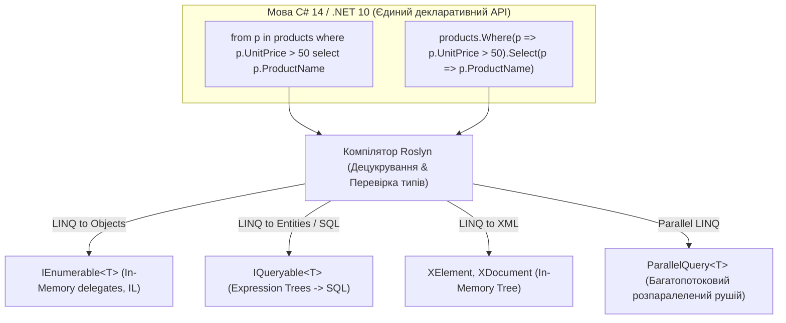
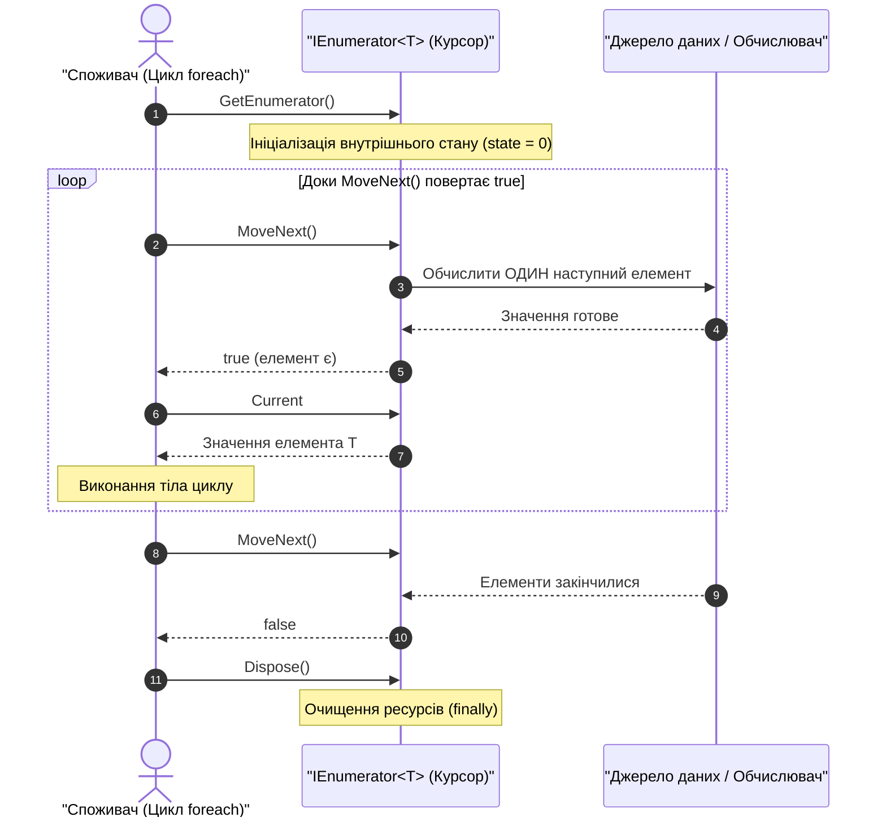
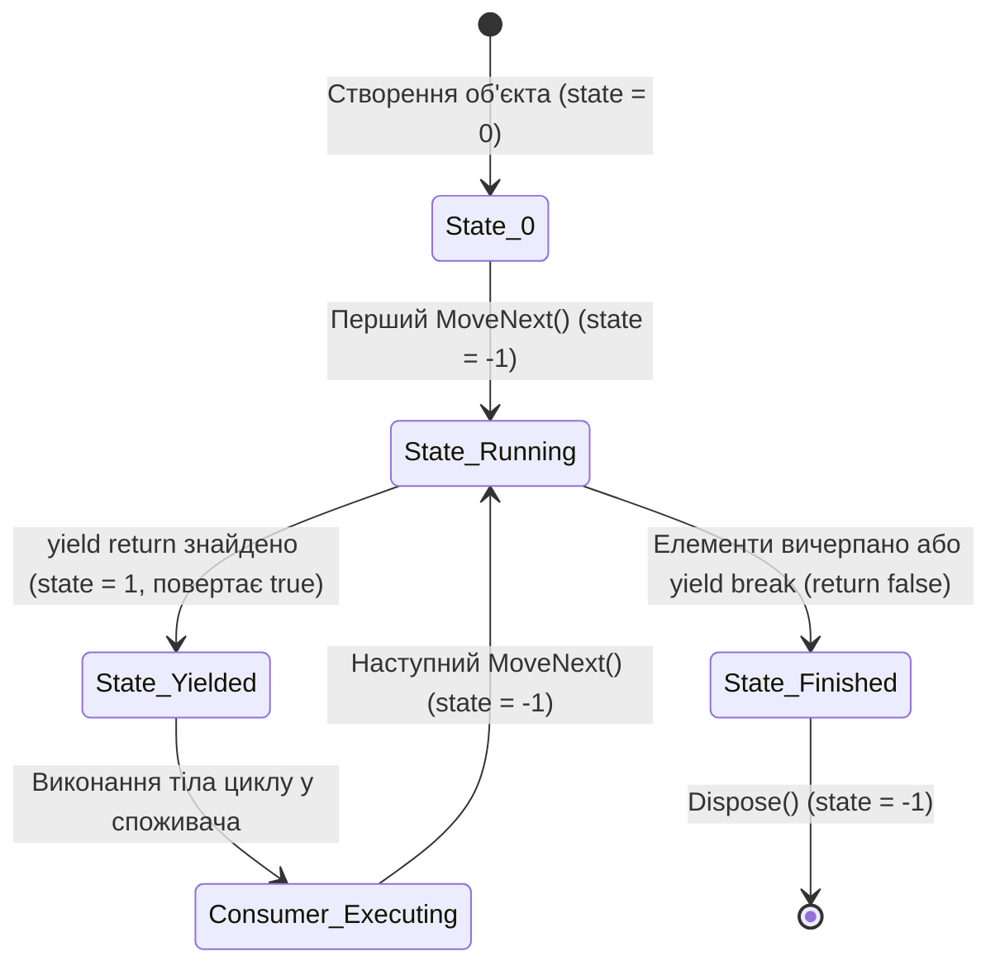
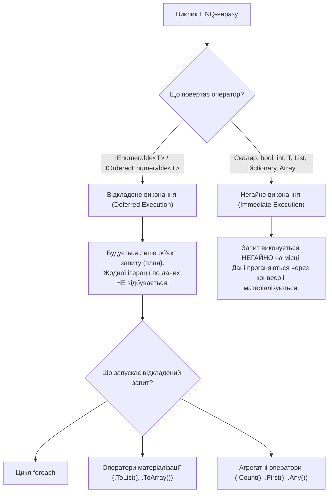
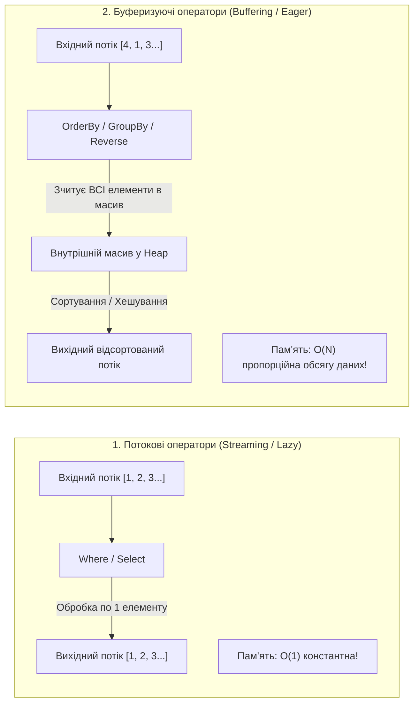
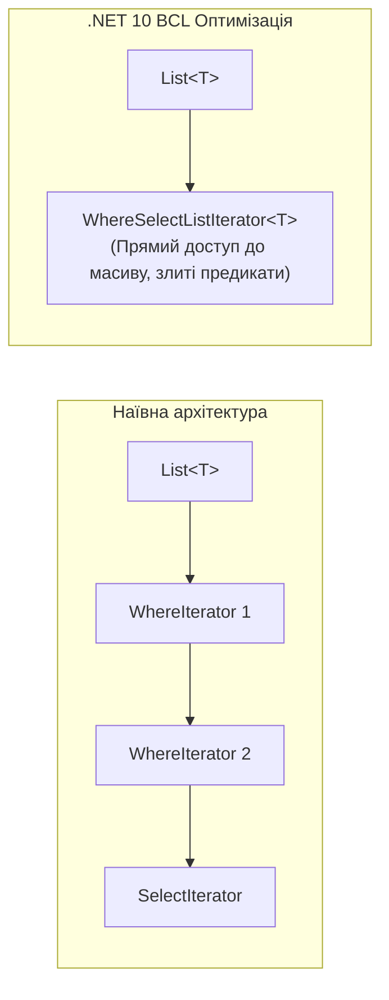
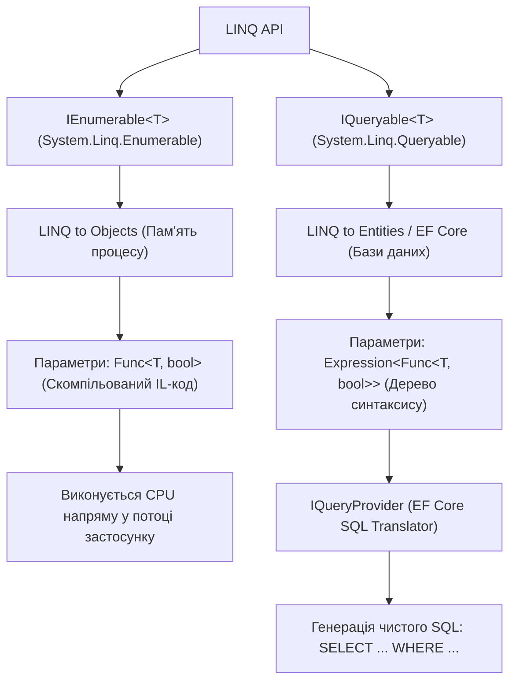

# 📘 Підручник 1. Архітектура LINQ та Механізми Виконання Запитів
## Фундаментальні основи, внутрішній устрій `IEnumerable<T>`, компіляторний автомат станів `yield return`, конвеєризація, Streaming проти Buffering, дерева виразів Expression Trees та оптимізації .NET 10

> **Модуль курсу:** Архітектура платформи .NET та функціональні розширення мови C#  
> **Цільова версія:** .NET 10 LTS / C# 14  
> **Практичні приклади репозиторію:** Категорія 14 (`LINQ - Query Execution`) та допоміжні класи  
> **Ключові вихідні файли:** [`LinqSamplesQueryExecution`](..%5CProgram.cs), [`Linq99.cs`](..%5C..%5CLINQ%20-%20Query%20Execution%5CC%23%5CQueryExecution%5CLinqSamples%5CLinq99.cs), [`Linq100.cs`](..%5C..%5CLINQ%20-%20Query%20Execution%5CC%23%5CQueryExecution%5CLinqSamples%5CLinq100.cs), [`Linq101.cs`](..%5C..%5CLINQ%20-%20Query%20Execution%5CC%23%5CQueryExecution%5CLinqSamples%5CLinq101.cs), [`ExtensionMethods.cs`](..%5C..%5CLinqSamplesCommon%5CExtensionMethods.cs)

---

<a id="toc"></a>
## 📑 Зміст Розділу

1. [Історія виникнення LINQ та проблема Impedance Mismatch](#section-1)
2. [Фундаментальні контракти: `IEnumerable<T>`, `IEnumerator<T>` та Pull-модель ітерації](#section-2)
3. [Анатомія `yield return`: Як компілятор Roslyn генерує автомат станів (State Machine)](#section-3)
4. [Моделі виконання: Відкладене (Deferred) проти Негайного (Immediate)](#section-4)
5. [Класифікація операторів: Потокові (Streaming) проти Буферизуючих (Buffering)](#section-5)
6. [Спеціалізовані внутрішні ітератори .NET BCL (Speed & Memory Optimizations)](#section-6)
7. [Дві гілки абстракції: `IEnumerable<T>` (Делегати в пам'яті) проти `IQueryable<T>` (Дерева виразів)](#section-7)
8. [Виробничі пастки та антипатерни: Multiple Enumeration та витоки замикань (Closures)](#section-8)
9. [Детальний розбір коду та практичні приклади репозиторію](#section-9)
10. [Контрольні питання та архітектурні завдання](#section-10)

---

<a id="section-1"></a>
## 1. Історія виникнення LINQ та проблема Impedance Mismatch

До релізу **.NET Framework 3.5 та C# 3.0 (2007–2008 роки)** розробка корпоративного програмного забезпечення страждала від фундаментальної проблеми, відомої в комп'ютерних науках як **Object-Relational Impedance Mismatch (Імпедансний розрив даних)**.

### Суть проблеми розриву парадигм:
1. **Різні моделі даних:**
   * Програми на C# оперують **об'єктно-орієнтованими графами** у пам'яті (класи, наслідування, інкапсуляція, посилання на об'єкти).
   * Реляційні СКБД (SQL Server, Oracle, PostgreSQL) оперують **реляційними кортежами** (таблиці, рядки, зовнішні ключі, нормальні форми).
   * Документи XML/JSON оперують **ієрархічними деревами вузлів**.
2. **Відсутність єдиної мови маніпуляції:**
   * Для обробки масивів та списків у пам'яті писалися вкладені цикли `for`/`foreach` із прапорцями стану та проміжними списками.
   * Для бази даних писалися рядки SQL: `string sql = "SELECT * FROM Products WHERE UnitPrice > " + price;`.
   * Для XML використовувалися рядки XPath або важкий DOM API (`XmlDocument`).
3. **Повна втрата контролю типів під час компіляції:**
   * SQL-запити та XPath-вирази були звичайними рядками. Якщо розробник робив друкарську помилку в назві поля (`UnitPric` замість `UnitPrice`), компілятор C# не міг про це знати. Помилка виникала лише в продакшені під час виконання (`Runtime Exception`).

### Архітектурний прорив LINQ:
Команда під керівництвом **Андерса Гейлсберга (Anders Hejlsberg)** інтегрувала запити безпосередньо в синтаксис та систему типів мови C#.



> **Ключовий висновок:**  
> **LINQ (Language Integrated Query)** — це не просто синтаксичний цукор. Це уніфікований набір компонентів платформи, що об'єднує:
> * Методи розширення (Extension Methods);
> * Лямбда-вирази (Lambda Expressions);
> * Дерева виразів (Expression Trees);
> * Анонімні типи та кортежі (Anonymous Types & Tuples);
> * Ініціалізатори об'єктів та колекцій.

---

<a id="section-2"></a>
## 2. Фундаментальні контракти: `IEnumerable<T>`, `IEnumerator<T>` та Pull-модель ітерації

В основі роботи LINQ to Objects лежать два ключових узагальнених інтерфейси з простору імен `System.Collections.Generic`:

```csharp
namespace System.Collections.Generic
{
    // Інтерфейс-контейнер, що повідомляє компілятору: "Мене можна перебирати"
    public interface IEnumerable<out T> : IEnumerable
    {
        IEnumerator<T> GetEnumerator();
    }

    // Інтерфейс-курсор, що безпосередньо здійснює навігацію по елементах
    public interface IEnumerator<out T> : IDisposable, IEnumerator
    {
        bool MoveNext();      // Зсуває курсор на один елемент уперед
        T Current { get; }    // Повертає поточний елемент
        void Reset();         // Успадкований метод, для сучасних колекцій часто кидає NotSupportedException
    }
}
```

### Pull-модель (тягнуча архітектура) проти Push-моделі (штовхаючої)

У програмуванні існує дві полярні концепції обробки послідовностей:
1. **Push-модель (Reactive Streams / `IObservable<T>`):** Джерело самостійно генерує події і "штовхає" їх до підписника (`Observer.OnNext(item)`). Підписник не контролює швидкість надходження даних (потрібен backpressure).
2. **Pull-модель (LINQ to Objects / `IEnumerable<T>`):** **Споживач повністю керує швидкістю читання**. Джерело даних ніколи не обчислює наступний елемент, доки споживач явно не викличе метод `MoveNext()`.



### Що насправді робить компілятор з циклом `foreach`?
Цикл `foreach` — це чистий синтаксичний цукор. Ось як компілятор транслює звичайний перебір:

```csharp
// Оригінальний код розробника:
foreach (var item in collection)
{
    Console.WriteLine(item);
}

// У що це розгортає компілятор C# (децукрування):
IEnumerator<T> enumerator = collection.GetEnumerator();
try
{
    while (enumerator.MoveNext())
    {
        T item = enumerator.Current;
        Console.WriteLine(item);
    }
}
finally
{
    if (enumerator != null)
    {
        enumerator.Dispose();
    }
}
```

> [!IMPORTANT]
> Блок `finally` є критично важливим! Якщо всередині циклу трапиться `break`, `return` або необроблений виняток (`throw`), компілятор гарантує виклик `Dispose()`, що закриє відкриті файли, дескриптори або з'єднання з базами даних.

---

<a id="section-3"></a>
## 3. Анатомія `yield return`: Як компілятор Roslyn генерує автомат станів (State Machine)

Конструкція `yield return` дозволяє створювати ліниві ітератори без ручного написання класу з методами `MoveNext()` та `Current`.

### Приклад коду генератора:
```csharp
public static IEnumerable<int> GenerateEvenNumbers(int max)
{
    Console.WriteLine("--> Старт методу");
    for (int i = 0; i < max; i++)
    {
        if (i % 2 == 0)
        {
            Console.WriteLine($"--> Перед yield return {i}");
            yield return i;
            Console.WriteLine($"--> Після повернення з yield {i}");
        }
    }
    Console.WriteLine("--> Завершення методу");
}
```

### Що відбувається під капотом під час компіляції?
Компілятор C# **повністю видаляє** початкове тіло методу `GenerateEvenNumbers` і замінює його на інстанціювання згенерованого компілятором класу.

Усередині компілятор створює структуру, еквівалентну наступній:

```csharp
[CompilerGenerated]
private sealed class <GenerateEvenNumbers>d__0 : IEnumerable<int>, IEnumerator<int>
{
    private int <>1__state;         // Номер поточного стану автомата (-1, 0, 1, 2...)
    private int <>2__current;       // Поле для зберігання Current
    private int <>l__initialThreadId;
    public int max;                 // Захоплений параметр методу
    private int <i>5__1;            // Локальна змінна циклу i піднята в поле класу!

    public <GenerateEvenNumbers>d__0(int <>1__state)
    {
        this.<>1__state = <>1__state;
        this.<>l__initialThreadId = Environment.CurrentManagedThreadId;
    }

    public bool MoveNext()
    {
        switch (this.<>1__state)
        {
            case 0: // Перший виклик MoveNext()
                this.<>1__state = -1;
                Console.WriteLine("--> Старт методу");
                this.<i>5__1 = 0;
                break;
            case 1: // Продовження після yield return
                this.<>1__state = -1;
                Console.WriteLine($"--> Після повернення з yield {this.<i>5__1}");
                this.<i>5__1++;
                break;
            default:
                return false;
        }

        while (this.<i>5__1 < this.max)
        {
            if (this.<i>5__1 % 2 == 0)
            {
                Console.WriteLine($"--> Перед yield return {this.<i>5__1}");
                this.<>2__current = this.<i>5__1;
                this.<>1__state = 1; // Запам'ятовуємо стан призупинки!
                return true;         // Передаємо керування споживачеві!
            }
            this.<i>5__1++;
        }

        Console.WriteLine("--> Завершення методу");
        return false;
    }

    public int Current => this.<>2__current;
    public void Dispose() { this.<>1__state = -1; }
    // Реалізація GetEnumerator()...
}
```



> [!NOTE]
> Локальні змінні методу з `yield return` стають **полями об'єкта в купі (Heap)**. Завдяки цьому стан методу не втрачається при виході з `MoveNext()` і відновлюється при наступному зверненні.

---

<a id="section-4"></a>
## 4. Моделі виконання: Відкладене (Deferred) проти Негайного (Immediate)

Всі оператори LINQ чітко діляться на дві категорії за часом їхнього фактичного виконання:



### Матриця класифікації операторів за моделлю виконання:

| Модель виконання | Оператори LINQ | Повертаємий тип | Коли виділяється пам'ять / виконується код |
| :--- | :--- | :--- | :--- |
| **Відкладене (Deferred)** | `Where`, `Select`, `SelectMany`, `Take`, `Skip`, `OrderBy`, `GroupBy`, `Distinct`, `Join` | `IEnumerable<T>`, `IOrderedEnumerable<T>` | Лише при зверненні до `GetEnumerator()` та виклику `MoveNext()` |
| **Негайне (Immediate)** | `ToList`, `ToArray`, `ToDictionary`, `ToHashSet`, `ToLookup` | `List<T>`, `T[]`, `Dictionary<K,V>` | Негайно при виклику методу (матеріалізація колекції) |
| **Негайне скалярне (Immediate Scalar)** | `Count`, `LongCount`, `Sum`, `Average`, `Min`, `Max`, `Aggregate` | Скалярне число або об'єкт `T` | Негайно. Потребує повного проходу по всій послідовності |
| **Негайне кванторне (Immediate Quantifier)** | `Any`, `All`, `Contains`, `SequenceEqual` | `bool` | Негайно. Працює в режимі Short-circuiting (зупинка на першому результаті) |
| **Негайне елементне (Immediate Element)** | `First`, `FirstOrDefault`, `Single`, `SingleOrDefault`, `Last`, `ElementAt` | `T` або `default(T)` | Негайно. Вибирає цільовий елемент або викидає виняток |

---

<a id="section-5"></a>
## 5. Класифікація операторів: Потокові (Streaming) проти Буферизуючих (Buffering)

Навіть якщо оператор належить до категорії **відкладених (Deferred)**, спосіб його роботи з пам'яттю кардинально відрізняється:



### Детальне порівняння:

1. **Потокові оператори (Streaming Operators):**
   * **Приклади:** `Where`, `Select`, `SelectMany`, `Take`, `Skip`, `TakeWhile`, `SkipWhile`, `Cast`, `OfType`, `Concat`.
   * **Механіка:** Для видачі першого елемента споживачеві оператор зчитує з вхідного джерела рівно стільки елементів, скільки потрібно для формування одного результату.
   * **Споживання пам'яті:** **$O(1)$ (константне)**. Оператор не зберігає в пам'яті всю послідовність.
   * **Підтримка нескінченних потоків:** Працюють коректно. Вираз `InfiniteStream().Where(x => x % 2 == 0).Take(5)` відпрацює миттєво і поверне 5 елементів.

2. **Буферизуючі оператори (Buffering Operators):**
   * **Приклади:** `OrderBy`, `OrderByDescending`, `ThenBy`, `Reverse`, `GroupBy`, `Distinct`.
   * **Механіка:** Щоб видати перший відсортований елемент за зростанням, алгоритм зобов'язаний спочатку прочитати **всі без винятку елементи послідовності до самого кінця**. Адже останній елемент у послідовності теоретично може виявитися найменшим!
   * **Споживання пам'яті:** **$O(N)$ (лінійне)**. Створюється внутрішній масив або хеш-таблиця, куди копіюється вся послідовність.
   * **Підтримка нескінченних потоків:** **Категорично не підтримуються**. Вираз `InfiniteStream().OrderBy(x => x).Take(5)` призведе до нескінченного циклу або аварійного завершення програми з `OutOfMemoryException`.

---

<a id="section-6"></a>
## 6. Спеціалізовані внутрішні ітератори .NET BCL (Speed & Memory Optimizations)

У сучасних версіях .NET (.NET 8, 9 та 10) реалізація LINQ to Objects зазнала глибокої оптимізації. Замість наївного використання загального `yield return` для кожного оператора, BCL використовує спеціалізовані структури та класи.

### Оптимізація злиття конвеєрів (Iterator Folding):
Коли ви пишете:
```csharp
var query = list
    .Where(x => x.IsActive)
    .Where(x => x.Age > 18)
    .Select(x => x.Name);
```
Наївний підхід створив би три окремих класи-обгортки в пам'яті, що викликали б один одного через інтерфейсні методи `MoveNext()`.

Натомість BCL впроваджує спеціалізовані типи:
* `WhereListIterator<T>` / `WhereArrayIterator<T>`: Якщо джерелом є `List<T>` або масив `T[]`, LINQ напряму індексує внутрішній масив за допомогою розгорнутих циклів, уникаючи віртуальних викликів через інтерфейс `IEnumerator<T>`.
* `WhereSelectEnumerableIterator<TSource, TResult>`: Якщо за `Where` одразу слідує `Select`, компілятор об'єднує їх в один єдиний об'єкт ітератора, де фільтрація і проекція виконуються в межах одного методу `MoveNext()`.



---

<a id="section-7"></a>
## 7. Дві гілки абстракції: `IEnumerable<T>` (Делегати в пам'яті) проти `IQueryable<T>` (Дерева виразів)

У .NET існують два споріднені, але принципово різні інтерфейси запитів:



### Порівняльна таблиця архітектурних відмінностей:

| Критерій | `IEnumerable<T>` | `IQueryable<T>` |
| :--- | :--- | :--- |
| **Цільове середовище** | Колекції в пам'яті (`List<T>`, масиви, файли в пам'яті) | Віддалені джерела даних (SQL бази, CosmosDB, OData) |
| **Тип параметрів** | Звичайні делегати: `Func<T, bool>` | Дерева виразів: `Expression<Func<T, bool>>` |
| **Форма представлення** | Скомпільований байт-код IL (чорна скринька) | Об'єктна структура даних (AST — абстрактне дерево синтаксису) |
| **Хто виконує код** | Середовище CLR вашого комп'ютера | Віддалений сервер бази даних після трансляції в SQL |
| **Небезпека змішування** | — | **Випадковий виклик `AsEnumerable()`** або клієнтська оцінка: стягує мільйони рядків у пам'ять |

#### Приклад: Як дерево виразів передається провайдеру
Коли ви передаєте вираз у `IQueryable`:
```csharp
// Для IQueryable це НЕ просто скомпільований метод, а дерево об'єктів:
Expression<Func<Product, bool>> expr = p => p.UnitPrice > 50;
```
Провайдер бази даних (наприклад, EF Core) аналізує це дерево:
1. `expr.Body` — це `BinaryExpression` (операція `>`).
2. Ліва частина (`Left`) — `MemberExpression` (доступ до властивості `p.UnitPrice`).
3. Права частина (`Right`) — `ConstantExpression` (число `50`).
4. На основі цих об'єктів провайдер генерує SQL: `WHERE [p].[UnitPrice] > 50.0`.

---

<a id="section-8"></a>
## 8. Виробничі пастки та антипатерни: Multiple Enumeration та витоки замикань (Closures)

### Пастка 1: Антипатерн Multiple Enumeration (Подвійна або багаторазова ітерація)
Якщо метод приймає `IEnumerable<T>` і кілька разів звертається до нього, кожен перегляд запускає весь ланцюжок відкладених обчислень заново.

```csharp
// ❌ НЕПРАВИЛЬНО: Подвійне виконання важкого запиту
public async Task<int> ProcessOrdersAsync(IEnumerable<Order> orders)
{
    // 1-й прохід: orders.Any() надсилає запит до бази SELECT COUNT(*) чи читає файл!
    if (!orders.Any())
    {
        return 0;
    }

    // 2-й прохід: orders.Count() надсилає ЩЕ ОДИН важкий запит!
    Console.WriteLine($"Всього замовлень: {orders.Count()}");

    // 3-й прохід: foreach заново стягує всі дані по мережі!
    foreach (var o in orders)
    {
        await ProcessSingleOrderAsync(o);
    }
    return orders.Count();
}

//  ПРАВИЛЬНО: Матеріалізація на вході методу (якщо потрібен повторний доступ)
public async Task<int> ProcessOrdersFixedAsync(IEnumerable<Order> orders)
{
    // Фіксуємо послідовність у пам'яті один раз:
    var orderList = orders as IReadOnlyCollection<Order> ?? orders.ToList();

    if (orderList.Count == 0)
        return 0;

    Console.WriteLine($"Всього замовлень: {orderList.Count}");
    foreach (var o in orderList)
    {
        await ProcessSingleOrderAsync(o);
    }
    return orderList.Count;
}
```

> [!TIP]
> У сучасних версіях .NET додано метод розширення `orders.TryGetNonEnumeratedCount(out int count)`. Він перевіряє, чи можна дізнатися розмір колекції без запуску ітерації (наприклад, якщо під `IEnumerable<T>` приховано `List<T>` або масив).

---

### Пастка 2: Захоплення змінних замиканням (Variable Capture in Closures)
Лямбда-вирази захоплюють змінні **за посиланням**, а не за значенням на момент оголошення:

```csharp
int threshold = 10;
var query = numbers.Where(n => n > threshold);

threshold = 50; // Зміна змінної ПЕРЕД виконанням запиту!

// Коли виконається foreach, умова буде "n > 50", а НЕ "n > 10"!
foreach (var item in query)
{
    Console.WriteLine(item);
}
```

---

<a id="section-9"></a>
## 9. Детальний розбір коду та практичні приклади репозиторію

Концепції даного розділу демонструються у проєкті [`LINQ - Query Execution`](..%5CProgram.cs):

### 1. [`Linq99.cs`](..%5C..%5CLINQ%20-%20Query%20Execution%5CC%23%5CQueryExecution%5CLinqSamples%5CLinq99.cs) — Відкладене виконання (Deferred Execution)
* **Концепція:** Показник того, що оголошення запиту не змінює стан змінних.
* **Аналіз коду:**
  ```csharp
  int[] numbers = { 5, 4, 1, 3, 9, 8, 6, 7, 2, 0 };
  int i = 0;
  var q = from n in numbers
          select ++i;

  // На цьому етапі i досі дорівнює 0!
  Console.WriteLine($"i після оголошення запиту: {i}"); // 0

  // Змінна i змінюється ТІЛЬКИ тут, коли foreach викликає MoveNext():
  foreach (var v in q)
  {
      Console.WriteLine($"v = {v}, i = {i}");
  }
  ```

---

### 2. [`Linq100.cs`](..%5C..%5CLINQ%20-%20Query%20Execution%5CC%23%5CQueryExecution%5CLinqSamples%5CLinq100.cs) — Негайне виконання (Immediate Execution)
* **Концепція:** Матеріалізація через `.ToList()` примусово виконує весь запит на місці.
* **Аналіз коду:**
  ```csharp
  int[] numbers = { 5, 4, 1, 3, 9, 8, 6, 7, 2, 0 };
  int i = 0;
  var q = (from n in numbers
           select ++i).ToList(); // Негайне виконання!

  // i вже дорівнює 10 ДО початку виводу на екран:
  Console.WriteLine($"i після ToList: {i}"); // 10
  ```

---

### 3. [`Linq101.cs`](..%5C..%5CLINQ%20-%20Query%20Execution%5CC%23%5CQueryExecution%5CLinqSamples%5CLinq101.cs) — Повторне виконання запиту (Query Re-evaluation)
* **Концепція:** Відкладений запит не кешує результати. Якщо базові дані змінилися, повторний прохід видасть нові значення.
* **Аналіз коду:**
  ```csharp
  int[] numbers = { 5, 4, 1, 3, 9, 8, 6, 7, 2, 0 };
  var lowNumbers = from n in numbers
                   where n <= 3
                   select n;

  // 1-й прохід: [1, 3, 2, 0]
  // Модифікація вихідного масиву:
  for (int i = 0; i < 10; i++) numbers[i] = -numbers[i];

  // 2-й прохід тим самим запитом: повертає ВСІ 10 чисел, бо вони тепер від'ємні!
  ```

---

<a id="section-10"></a>
## 10. Контрольні питання та архітектурні завдання

1. **Питання на співбесіді:** Чому ключове слово `yield return` заборонено використовувати всередині блоку `try` з блоком `catch`?
   * *Відповідь:* Автомат станів розбиває метод на шматки. Якщо виникає виняток у споживача під час паузи, CLR не може гарантувати детерміноване передавання контексту винятку в середину перерваного блоку `catch`.
2. **Аналіз складності:** Яке споживання пам'яті матиме вираз `data.OrderBy(x => x.Id).Where(x => x.IsActive).Take(5)` над послідовністю з 10 000 000 елементів?
   * *Відповідь:* $O(N)$ пам'яті (близько 80 МБ+), оскільки оператор `OrderBy` є буферизуючим і завантажить усі 10 мільйонів елементів у внутрішній масив перед тим, як `Take(5)` зможе отримати перший елемент.
3. **Архітектурний рефакторинг:** Як оптимізувати попередній запит?
   * *Відповідь:* Поміняти місцями фільтрацію і сортування: `data.Where(x => x.IsActive).OrderBy(x => x.Id).Take(5)` — якщо активних записів лише 1 000, буферизуватися буде в 10 000 разів менше даних!

---
[⬆ До змісту](#toc) • [Наступний розділ: Фільтрація та Проекція ➡](./02-Filtering-and-Projections.md)
