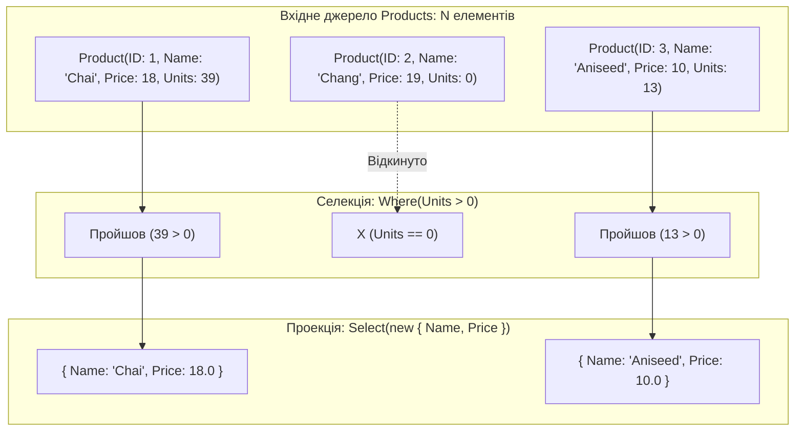
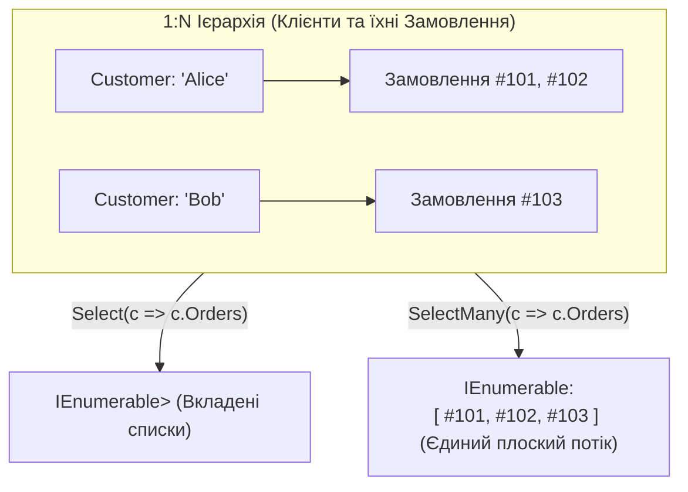

# 📘 Підручник 2. Оператори Фільтрації та Проекції (Restriction & Projection)
## Математичні засади Where, OfType, Select, SelectMany, Compound From, пропозиція let та комбінатори 1:N

> **Модуль курсу:** Конвеєри трансформації даних у LINQ  
> **Цільова версія:** .NET 10 LTS / C# 14  
> **Практичні приклади репозиторію:** Категорія 1 (`RestrictionOperators`) та Категорія 2 (`ProjectionOperators`)  
> **Ключові вихідні файли:** [`LinqSamplesRestrictionOperators`](..%5CProgram.cs), [`LinqSamplesProjectionOperators`](..%5CProgram.cs), приклади [`Linq1.cs` – `Linq6.cs`](../../LINQ%20-%20Restriction%20Operators/C%23/RestrictionOperators/LinqSamples/), [`Linq7.cs` – `Linq20.cs`](../../LINQ%20-%20Projection%20Operators/C%23/ProjectionOperators/LinqSamples/)

---

<a id="toc"></a>
## 📑 Зміст Розділу

1. [Теоретичні основи: Реляційна алгебра та функціональні функтори](#section-1)
2. [Оператор `Where`: Простий та індексований синтаксис](#section-2)
3. [Оператор `OfType<T>` проти `Cast<T>`: Безпека типів та поліморфізм](#section-3)
4. [Оператор `Select`: Проекції, анонімні типи, Records та новий метод `Index()` у .NET 9+](#section-4)
5. [Оператор `SelectMany`: Монадний FlatMap, сплощення ієрархій 1:N та декартовий добуток](#section-5)
6. [Конструкції Query Syntax: Множинні `from` та оператор `let` (Transparent Identifiers)](#section-6)
7. [Детальний розбір коду та практичні приклади репозиторію (Linq1 – Linq20)](#section-7)
8. [Підводні камені, продуктивність та типові помилки на співбесідах](#section-8)

---

<a id="section-1"></a>
## 1. Теоретичні основи: Реляційна алгебра та функціональні функтори

Усі перетворення даних у LINQ базуються на математичних моделях реляційної алгебри Едгара Кодда та функціонального числення:

1. **Селекція / Обмеження ($\sigma_{predicate}(R)$):**
   * Горизонтальний зріз множини.
   * Відбирає підмножину кортежів, для яких логічний предикат повертає істину.
   * Кількість властивостей (полів) у кожному елементі не змінюється, але загальна кількість елементів у послідовності зменшується або залишається незмінною ($0 \le M \le N$).
   * У LINQ представлена оператором `Where`.

2. **Проекція ($\pi_{a_1, a_2, ...}(R)$):**
   * Вертикальний зріз та функціональне перетворення (Functor Map $f: A \to B$).
   * Застосовує функцію-трансформатор до кожного вхідного елемента.
   * Кількість елементів суворо зберігається ($M = N$), але форма, структура та тип елементів можуть повністю змінитися.
   * У LINQ представлена оператором `Select`.



---

<a id="section-2"></a>
## 2. Оператор `Where`: Простий та індексований синтаксис

### 1. Простий `Where(Func<TSource, bool> predicate)`
Приймає чисту функцію-предикат. Оператор є **потоковим (Streaming)** і споживає константну пам'ять $O(1)$.

```csharp
// Method Syntax:
var activeProducts = products.Where(p => p.UnitsInStock > 0);

// Query Syntax:
var activeProductsQuery = from p in products
                          where p.UnitsInStock > 0
                          select p;
```

### 2. Індексований `Where(Func<TSource, int, bool> predicate)`
Передає в лямбда-вираз другий параметр — ціле число `int index`, що відображає порядковий номер поточного елемента у вхідному потоці (починаючи з 0):

```csharp
// Вибір лише тих чисел, чиє значення менше за їхній власний індекс у масиві:
int[] numbers = { 0, 3, 1, 8, 4 };
var result = numbers.Where((num, index) => num < index);
// Індекс 0: 0 < 0 (false)
// Індекс 1: 3 < 1 (false)
// Індекс 2: 1 < 2 (true)  -> береться 1
// Індекс 3: 8 < 3 (false)
// Індекс 4: 4 < 4 (false)
// Результат: [1]
```

> [!WARNING]
> **Обмеження Query Syntax:**  
> Індексована фільтрація можлива **виключно в Method Syntax**. Ключове слово `where` у синтаксисі запитів не надає доступу до лічильника індексу.

---

<a id="section-3"></a>
## 3. Оператор `OfType<T>` проти `Cast<T>`: Безпека типів та поліморфізм

При роботі зі слабкотипізованими колекціями (`ArrayList`, `object[]`) або поліморфними ієрархіями класів постає завдання відфільтрувати або перетворити типи:

```mermaid
flowchart TD
    Mixed["Колекція об'єктів: [ 1, 'текст', 3.14, 'hello', null ]"] --> Choice{Який метод використати?}

    Choice -->|Cast&lt;string&gt;()| CastOp["Жорстке приведення: (T)item"]
    Choice -->|OfType&lt;string&gt;()| OfTypeOp["Безпечна фільтрація: item is T"]

    CastOp --> CastFail["💥 InvalidCastException при першому невідповідному типі (на числі 1)"]
    OfTypeOp --> OfTypeSuccess["✅ Повертає лише рядки: ['текст', 'hello'] (ігнорує числа та null)"]
```

### Порівняльний аналіз на рівні байт-коду IL:

| Критерій | `Cast<T>()` | `OfType<T>()` |
| :--- | :--- | :--- |
| **Інструкція IL** | `castclass T` або `unbox.any T` | `isinst T` |
| **Реакція на невідповідний тип** | Викидає `InvalidCastException` | Пропускає елемент (не додає у вихідний потік) |
| **Реакція на `null`** | Пропускає або приводить до `null` | Відкидає `null`-значення (оскільки `null is T` повертає `false`) |
| **Основне застосування** | Міграція старого legacy-коду (`ArrayList` -> `IEnumerable<T>`) | Поліморфна диспетчеризація (наприклад, знайти всі кнопки `Button` серед списку `UIElement`) |

---

<a id="section-4"></a>
## 4. Оператор `Select`: Проекції, анонімні типи, Records та новий метод `Index()` у .NET 9+

Оператор `Select` виконує одновимірне перетворення кожного елемента послідовності.

### Варіанти цільових типів проекції:
1. **Примітивне скалярне значення:**
   ```csharp
   IEnumerable<string> names = products.Select(p => p.ProductName);
   ```
2. **Анонімний тип (Anonymous Type):**
   ```csharp
   var dtoList = products.Select(p => new {
       Name = p.ProductName,
       InStock = p.UnitsInStock > 0
   });
   ```
   * *Що робить Roslyn:* Генерує внутрішній узагальнений клас із незмінними (`readonly`) властивостями та перевизначеними методами `Equals`, `GetHashCode` та `ToString`.
3. **C# Records / Strongly-typed DTOs:**
   ```csharp
   public record ProductDto(string Name, decimal Price);
   var dtos = products.Select(p => new ProductDto(p.ProductName, p.UnitPrice));
   ```
4. **Іменовані кортежі (Value Tuples):**
   ```csharp
   var tuples = products.Select(p => (p.ProductName, p.UnitPrice));
   ```

### Індексований `Select` та нововведення .NET 9 `Index()`
Раніше для отримання елемента разом з індексом використовувався метод:
```csharp
var indexedItems = products.Select((p, index) => new { Index = index, Item = p });
```
Починаючи з **.NET 9 LTS та .NET 10**, до BCL додано офіційний метод розширення `Index()`:
```csharp
// Новий синтаксис .NET 9 / .NET 10:
foreach (var (index, product) in products.Index())
{
    Console.WriteLine($"{index + 1}. {product.ProductName}");
}
```

---

<a id="section-5"></a>
## 5. Оператор `SelectMany`: Монадний FlatMap, сплощення ієрархій 1:N та декартовий добуток

`SelectMany` — це один із найпотужніших операторів LINQ. У функціональному програмуванні та теорії категорій він відповідає монадній операції **`bind`** (або **`flatMap`** у Java/Scala/JS).

### Призначення:
Якщо `Select` перетворює кожен елемент $T$ у колекцію $IEnumerable<R>$, результатом буде вкладена послідовність:
`IEnumerable<IEnumerable<R>>`.  
**`SelectMany` автоматично розгортає всі внутрішні підколекції в єдиний плоский потік:**
`IEnumerable<R>`.



### Перевантаження з селектором результату (`resultSelector`)
`SelectMany` дозволяє зберегти доступ до батьківського об'єкта під час розгортання дочірніх:
```csharp
var orderDetails = customers.SelectMany(
    customer => customer.Orders,                 // Колекція 1:N
    (customer, order) => new {                   // Комбінація батька і дитини
        customer.CustomerID,
        order.OrderID,
        order.Total
    }
);
```

### Декартів добуток (Cross Join)
Якщо передати незалежну колекцію як джерело для кожного елемента, `SelectMany` створює декартовий добуток:
```csharp
int[] numbersA = { 0, 2, 4 };
int[] numbersB = { 1, 3, 5 };

var pairs = numbersA.SelectMany(
    a => numbersB,
    (a, b) => (A: a, B: b)
);
// Результат: (0,1), (0,3), (0,5), (2,1), (2,3), (2,5), (4,1), (4,3), (4,5)
```

---

<a id="section-6"></a>
## 6. Конструкції Query Syntax: Множинні `from` та оператор `let` (Transparent Identifiers)

### 1. Множинні пропозиції `from` (Compound From)
У синтаксисі запитів запис двох і більше `from` компілятор автоматично транслює у виклик `SelectMany`:

```csharp
// Query Syntax:
var query = from c in customers
            from o in c.Orders
            where o.Total < 500M
            select new { c.CustomerID, o.OrderID, o.Total };

// У що це децукрує Roslyn:
var methodSyntax = customers
    .SelectMany(c => c.Orders, (c, o) => new { c, o })
    .Where(x => x.o.Total < 500M)
    .Select(x => new { x.c.CustomerID, x.o.OrderID, x.o.Total });
```

### 2. Оператор `let` та механіка Transparent Identifiers
Ключове слово `let` дозволяє ввести проміжну змінну всередині запиту, щоб уникнути повторних обчислень виразів.

```csharp
var query = from p in products
            let discountPrice = p.UnitPrice * 0.9m   // Проміжне значення
            where discountPrice > 30m
            select new { p.ProductName, discountPrice };
```

#### Як компілятор реалізує `let` під капотом:
Компілятор створює анонімний тип-обгортку, що об'єднує попередній контекст із новою змінною:
```csharp
// Децукрування let компілятором Roslyn:
var query = products
    .Select(p => new { p = p, discountPrice = p.UnitPrice * 0.9m }) // Прозорий ідентифікатор
    .Where(t => t.discountPrice > 30m)
    .Select(t => new { t.p.ProductName, t.discountPrice });
```

---

<a id="section-7"></a>
## 7. Детальний розбір коду та практичні приклади репозиторію (Linq1 – Linq20)

### Категорія 1: Restriction Operators (Фільтрація)
* [`Linq1.cs`](..%5C..%5CLINQ%20-%20Restriction%20Operators%5CC%23%5CRestrictionOperators%5CLinqSamples%5CLinq1.cs): Базовий `Where` для відбору чисел менших за 5.
* [`Linq2.cs`](..%5C..%5CLINQ%20-%20Restriction%20Operators%5CC%23%5CRestrictionOperators%5CLinqSamples%5CLinq2.cs): Фільтрація товарів, яких немає на складі (`UnitsInStock == 0`).
* [`Linq3.cs`](..%5C..%5CLINQ%20-%20Restriction%20Operators%5CC%23%5CRestrictionOperators%5CLinqSamples%5CLinq3.cs): Складений логічний предикат (`UnitPrice > 3.00M && UnitsInStock > 0`).
* [`Linq4.cs`](..%5C..%5CLINQ%20-%20Restriction%20Operators%5CC%23%5CRestrictionOperators%5CLinqSamples%5CLinq4.cs): Фільтрація об'єктного графа замовлень клієнтів із Вашингтона (`Region == "WA"`).
* [`Linq5.cs`](..%5C..%5CLINQ%20-%20Restriction%20Operators%5CC%23%5CRestrictionOperators%5CLinqSamples%5CLinq5.cs): Індексований `Where((digit, index) => digit.Length < index)` — порівняння довжини назви числа з його порядковим номером.

---

### Категорія 2: Projection Operators (Проекція та трансформація)
* [`Linq7.cs`](..%5C..%5CLINQ%20-%20Projection%20Operators%5CC%23%5CProjectionOperators%5CLinqSamples%5CDataSetLinq7.cs): Проста проекція математичного виразу `numbers.Select(n => n + 1)`.
* [`Linq8.cs`](..%5C..%5CLINQ%20-%20Projection%20Operators%5CC%23%5CProjectionOperators%5CLinqSamples%5CDataSetLinq8.cs): Проекція поля сутності у строковий список назв товарів.
* [`Linq9.cs`](..%5C..%5CLINQ%20-%20Projection%20Operators%5CC%23%5CProjectionOperators%5CLinqSamples%5CDataSetLinq9.cs): Трансформація цілих чисел у рядки слів за допомогою масиву словника.
* [`Linq10.cs`](..%5C..%5CLINQ%20-%20Projection%20Operators%5CC%23%5CProjectionOperators%5CLinqSamples%5CDataSetLinq10.cs): Проекція в анонімний тип із властивостями `Upper = w.ToUpper()` та `Lower = w.ToLower()`.
* [`Linq11.cs`](..%5C..%5CLINQ%20-%20Projection%20Operators%5CC%23%5CProjectionOperators%5CLinqSamples%5CDataSetLinq11.cs): Калькуляційна проекція з перейменуванням властивостей (`Price = p.UnitPrice`).
* [`Linq12.cs`](..%5C..%5CLINQ%20-%20Projection%20Operators%5CC%23%5CProjectionOperators%5CLinqSamples%5CDataSetLinq12.cs): Індексований `Select`: зіставлення числа та відповідності його парності позиції.
* [`Linq14.cs`](..%5C..%5CLINQ%20-%20Projection%20Operators%5CC%23%5CProjectionOperators%5CLinqSamples%5CDataSetLinq14.cs): Декартів добуток двох масивів чисел через парні `from a in numbersA, from b in numbersB`.
* [`Linq15.cs`](..%5C..%5CLINQ%20-%20Projection%20Operators%5CC%23%5CProjectionOperators%5CLinqSamples%5CDataSetLinq15.cs): З'єднання клієнтів та замовлень через складений `from` з фільтрацією замовлень на суму менше 500$.
* [`Linq16.cs`](..%5C..%5CLINQ%20-%20Projection%20Operators%5CC%23%5CProjectionOperators%5CLinqSamples%5CDataSetLinq16.cs): `SelectMany` для вибірки замовлень, оформлених починаючи з 1998 року.
* [`Linq18.cs`](..%5C..%5CLINQ%20-%20Projection%20Operators%5CC%23%5CProjectionOperators%5CLinqSamples%5CDataSetLinq18.cs): Багаторівневе сплощення: вибірка всіх ліній замовлень (`OrderDetails`) для клієнтів з Вашингтона.

---

<a id="section-8"></a>
## 8. Підводні камені, продуктивність та типові помилки на співбесідах

1. **Непотрібні алокації в `Select`:**
   * Якщо всередині `Select(x => new MyDto(x))` створюються важкі об'єкти, а далі слідує `Take(5)`, все гаразд (потокове обчислення).
   * Але якщо після цього стоїть `OrderBy(...)`, буде створено мільйон об'єктів DTO в Heap, які потім ще й сортуватимуться.
   * *Золоте правило:* Спочатку фільтруйте (`Where`), потім обрізайте (`Take`), і лише потім проектуйте у важкі DTO.
2. **Виклик методів із побічними ефектами у предикатах:**
   * Предикати у `Where` повинні бути **чистими функціями (Pure Functions)**. Вони не повинні змінювати зовнішні змінні або викликати I/O операції. Якщо запит буде переоцінено, побічний ефект повториться двічі.
3. **Питання на співбесіді:** Чим принципово відрізняється робота `SelectMany` від вкладеного виклику двох циклів `foreach`?
   * *Відповідь:* `SelectMany` повертає лінивий потоковий ітератор $O(1)$ пам'яті. Він не створює проміжних списків у пам'яті, на відміну від наївного коду з `resultList.AddRange(...)`.

---
[⬆ До змісту](#toc) • [Попередній розділ: Архітектура та виконання ⬅](./01-LINQ-Architecture-and-Execution.md) • [Наступний розділ: Секціонування та Сортування ➡](./03-Partitioning-and-Ordering.md)
