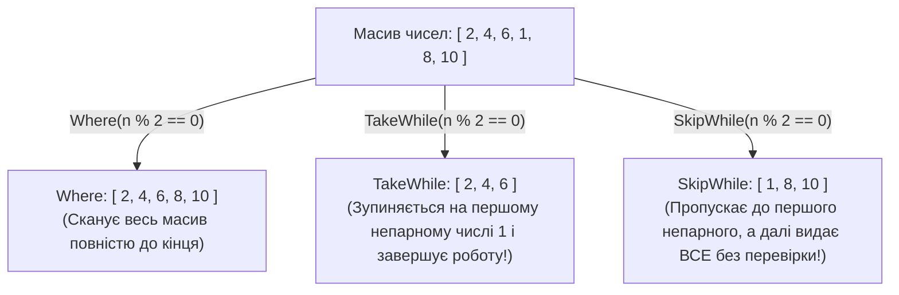
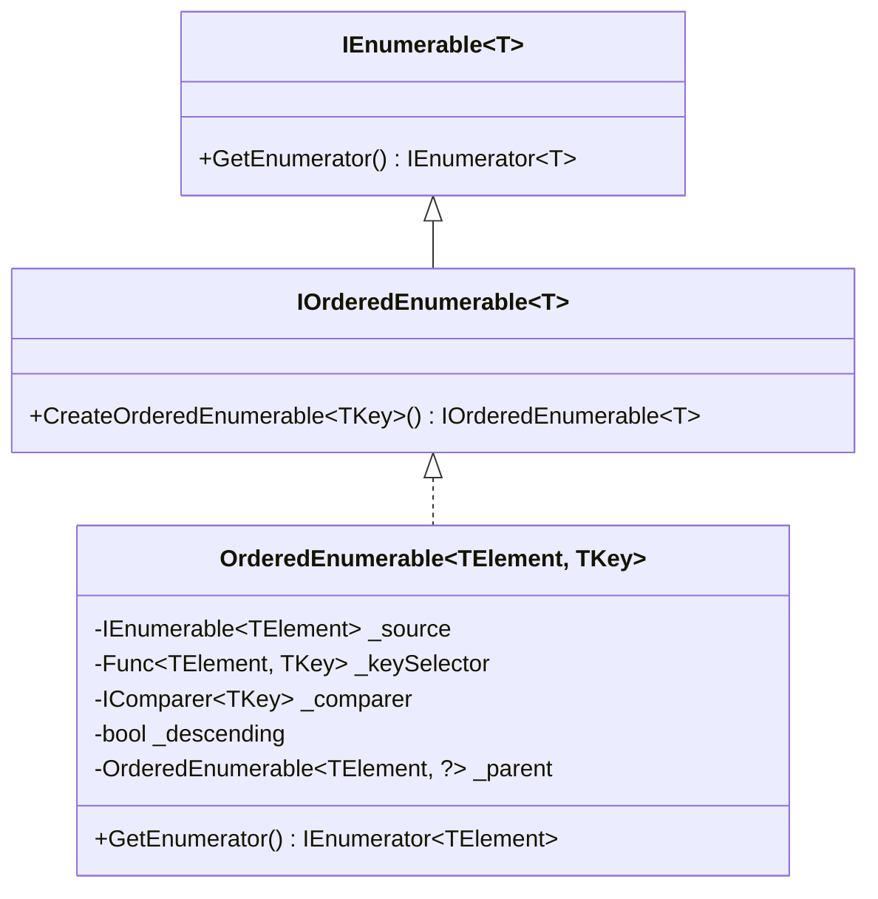
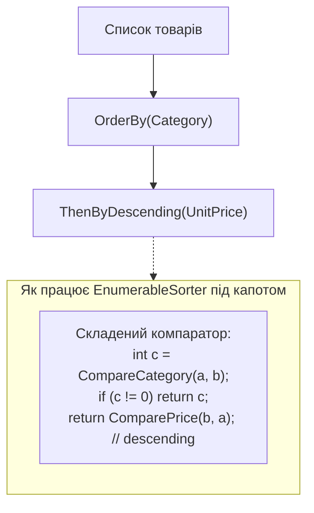

# 📘 Підручник 3. Оператори Секціонування та Сортування (Partitioning & Ordering)
## Пагінація, ліниві зрізи, пакети Chunk, архітектура IOrderedEnumerable, стабільне сортування та пастка повторного OrderBy

> **Модуль курсу:** Керування потоками даних та алгоритми впорядкування в LINQ  
> **Цільова версія:** .NET 10 LTS / C# 14  
> **Практичні приклади репозиторію:** Категорія 3 (`PartitioningOperators`) та Категорія 4 (`OrderingOperators`)  
> **Ключові вихідні файли:** [`LinqSamplesPartitioningOperators`](..%5CProgram.cs), [`LinqSamplesOrderingOperators`](..%5CProgram.cs), приклади [`Linq20.cs` – `Linq27.cs`](../../LINQ%20-%20Partitioning%20Operators/C%23/PartitioningOperators/LinqSamples/), [`Linq28.cs` – `Linq39.cs`](../../LINQ%20-%20Ordering%20Operators/C%23/OrderingOperators/LinqSamples/)

---

<a id="toc"></a>
## 📑 Зміст Розділу

1. [Секціонування даних: Take, Skip та архітектура посторінкової пагінації](#section-1)
2. [Предикатне секціонування: TakeWhile та SkipWhile проти звичайного Where](#section-2)
3. [Сучасні розширення: C# Ranges (`..`, `^`) та пакетування `Chunk(size)`](#section-3)
4. [Внутрішній устрій сортування: Інтерфейс `IOrderedEnumerable<T>` та клас `EnumerableSorter`](#section-4)
5. [Багаторівневе сортування: `ThenBy` проти критичної помилки повторного `OrderBy`](#section-5)
6. [Користувацькі компаратори `IComparer<T>` та інверсія порядку `Reverse`](#section-6)
7. [Детальний розбір прикладів коду в репозиторії (Linq20 – Linq39)](#section-7)
8. [Антипатерни продуктивності, аналіз Big-O та завдання на співбесідах](#section-8)

---

<a id="section-1"></a>
## 1. Секціонування даних: Take, Skip та архітектура посторінкової пагінації

Секціонування (Partitioning) дозволяє отримати фіксований зріз послідовності без необхідності читати або зберігати всю колекцію.

### 1. `Take(int count)`
* Повертає перші `count` елементів послідовності.
* **Механіка зупинки (Short-circuiting):** Як тільки лічильник досягає `count`, оператор негайно припиняє ітерацію і викликає `Dispose()` для вхідного enumerator.
* **Безпека меж:** Якщо в колекції менше елементів, ніж `count`, метод видасть усі наявні елементи без винятку `ArgumentOutOfRangeException`.
* Якщо `count <= 0`, метод повертає порожню послідовність.

### 2. `Skip(int count)`
* Пропускає перші `count` елементів послідовності і повертає решту елементів до кінця потоку.
* Якщо `count <= 0`, елементи не пропускаються. Якщо `count` перевищує довжину колекції, повертається порожня послідовність.

```mermaid
flowchart LR
    subgraph Stream["Вхідний потік (100 елементів)"]
        S1["Елементи 1..20"]
        S2["Елементи 21..30"]
        S3["Елементи 31..100"]
    end

    subgraph Pipeline["Конвеєр: Skip(20).Take(10)"]
        S1 -.->|Skip 20 (проігноровано)| Drop["Пропуск"]
        S2 -->|Take 10 (прочитано)| Page["Сторінка 3: елементи 21..30"]
        S3 -.->|Short-circuit (не читається взагалі!)| Stop["Зупинка ітератора"]
    end
```

### Корпоративний патерн посторінкової пагінації (Pagination Pattern):
У реальних бекенд-сервісах (REST API, GraphQL, gRPC) посторінкова видача реалізується формулою:
$$\text{SkipCount} = (\text{PageNumber} - 1) \times \text{PageSize}$$

```csharp
public static class EnumerablePaginationExtensions
{
    public static IEnumerable<T> ToPagedResult<T>(
        this IEnumerable<T> source, 
        int pageNumber, 
        int pageSize)
    {
        ArgumentNullException.ThrowIfNull(source);
        if (pageNumber < 1) pageNumber = 1;
        if (pageSize < 1) pageSize = 10;

        return source
            .Skip((pageNumber - 1) * pageSize)
            .Take(pageSize);
    }
}
```

> [!CRITICAL]
> **Золоте правило пагінації:**  
> Пагінація через `Skip/Take` у реляційних базах даних **ЗАВЖДИ вимагає детермінованого сортування (`OrderBy`)**. Без явного `OrderBy` СКБД не гарантує однаковий порядок рядків між окремими HTTP-запитами, і клієнт може отримати дублікати або пропустити рядки!

---

<a id="section-2"></a>
## 2. Предикатне секціонування: TakeWhile та SkipWhile проти звичайного Where

На відміну від `Where`, який **завжди** сканує всю послідовність від першого до останнього елемента, предикатні оператори секціонування орієнтуються на **перший момент порушення умови**:



### Порівняльна таблиця семантики операторів:

| Оператор | Поведінка | Коли зупиняється перевірка предикату |
| :--- | :--- | :--- |
| **`Where`** | Фільтрує кожен елемент | Ніколи (перевіряє всі елементи $N$ разів) |
| **`TakeWhile`** | Видає елементи, доки умова істинна | При **першому** `false` (short-circuit, повна зупинка) |
| **`SkipWhile`** | Пропускає елементи, доки умова істинна | При **першому** `false` (перемикає режим і далі видає все поспіль) |

### Індексоване предикатне секціонування:
Обидва оператори мають перевантаження з індексом: `(item, index) => bool`.
```csharp
// Видавати числа, доки їх значення перевищує їх власний порядковий номер:
int[] numbers = { 5, 4, 3, 2, 0 };
var result = numbers.TakeWhile((n, index) => n >= index);
// 5 >= 0 (true)
// 4 >= 1 (true)
// 3 >= 2 (true)
// 2 >= 3 (false -> ЗУПИНКА)
// Результат: [5, 4, 3]
```

---

<a id="section-3"></a>
## 3. Сучасні розширення: C# Ranges (`..`, `^`) та пакетування `Chunk(size)`

### 1. Синтаксис діапазонів (C# Index & Range) у LINQ
Починаючи з .NET 6+, метод `Take` отримав перевантаження, що приймає структуру `Range`:
```csharp
int[] numbers = [10, 20, 30, 40, 50, 60, 70];

// Перші 3 елементи:
var firstThree = numbers.Take(..3); // [10, 20, 30]

// Останні 2 елементи (індекс з кінця ^):
var lastTwo = numbers.Take(^2..);   // [60, 70]

// Діапазон посередині:
var middle = numbers.Take(2..5);    // [30, 40, 50]
```

### 2. Пакетування великих потоків даних: `Chunk(int size)`
До появи .NET 6 розбиття послідовності на пакети (бачі) вимагало незграбних конструкцій на зразок `.Select((x, i) => new { x, i }).GroupBy(x => x.i / size)`.

Тепер метод `Chunk` вбудовано в BCL. Він повертає `IEnumerable<T[]>`:
```csharp
// Масова вставка замовлень у базу пачками по 50 штук:
foreach (var batch in orders.Chunk(50))
{
    // batch має тип Order[] розміром до 50 елементів
    await dbContext.Orders.AddRangeAsync(batch);
    await dbContext.SaveChangesAsync();
}
```

---

<a id="section-4"></a>
## 4. Внутрішній устрій сортування: Інтерфейс `IOrderedEnumerable<T>` та клас `EnumerableSorter`

Сортування в LINQ to Objects реалізовано через окремий інтерфейс:

```csharp
public interface IOrderedEnumerable<out TElement> : IEnumerable<TElement>
{
    IOrderedEnumerable<TElement> CreateOrderedEnumerable<TKey>(
        Func<TElement, TKey> keySelector,
        IComparer<TKey>? comparer,
        bool descending);
}
```



### Чому `OrderBy` є буферизуючим ($O(N)$ пам'яті, $O(N \log N)$ часу):
1. Коли викликається `var sorted = products.OrderBy(p => p.UnitPrice);`, **жоден елемент не сортується**. Створюється лише об'єкт `OrderedEnumerable`.
2. Коли споживач викликає перший `MoveNext()`, алгоритм:
   * Копіює **всі** $N$ елементів у внутрішній масив у купі (Heap).
   * Створює масив індексів `int[] map = [0, 1, ..., N-1]`.
   * Застосовує модифікований алгоритм швидкого сортування (QuickSort / TimSort) **до масиву індексів**, обчислюючи ключі через `keySelector`.
   * Тільки після повного сортування починає повертати елементи по одному через зсув за відсортованим масивом індексів.

> [!NOTE]
> Сортування в LINQ є **стабільним (Stable Sort)**: якщо два елементи мають однаковий ключ, їхній початковий відносний порядок у колекції гарантовано зберігається.

---

<a id="section-5"></a>
## 5. Багаторівневе сортування: `ThenBy` проти критичної помилки повторного `OrderBy`

Одна з найпоширеніших помилок розробників-початківців:

```csharp
// ❌ ГРУБА ПОМИЛКА: повторний виклик OrderBy
var wrong = products
    .OrderBy(p => p.Category)
    .OrderBy(p => p.UnitPrice); // Повністю ЗНИЩУЄ сортування за Category!
```

### Чому повторний `OrderBy` ламає сортування:
Кожен виклик `OrderBy` створює **новий незалежний** об'єкт `OrderedEnumerable`, який заново з нуля пересортовує всю послідовність за новим ключем, руйнуючи попередню структуру.

### Правильний підхід: використання `ThenBy`:
```csharp
//  ПРАВИЛЬНО: композитне сортування через ThenBy
var correct = products
    .OrderBy(p => p.Category)                 // Первинний ключ
    .ThenByDescending(p => p.UnitPrice);      // Вторинний ключ у межах тієї самої категорії
```



---

<a id="section-6"></a>
## 6. Користувацькі компаратори `IComparer<T>` та інверсія порядку `Reverse`

### 1. Кастомні компаратори (`IComparer<T>`)
Коли стандартного порівняння недостатньо (наприклад, сортування без урахування регістру або за спеціальною локаллю), оператори приймають реалізацію `IComparer<TKey>`:

```csharp
string[] words = { "aPPLE", "AbAcUs", "bRaNcH", "BlUeBeRrY", "ClOvEr" };

// Сортування без урахування регістру:
var sortedWords = words.OrderBy(w => w, StringComparer.OrdinalIgnoreCase);
```

### 2. Метод `Reverse()`
Оператор `Reverse()` розгортає послідовність у зворотному напрямку.  
* **Важлива особливість:** `Reverse()` є **буферизуючим**: щоб видати перший елемент розгорнутої колекції, він зобов'язаний вичитати всі елементи до самого кінця у внутрішній буфер.

---

<a id="section-7"></a>
## 7. Детальний розбір прикладів коду в репозиторії (Linq20 – Linq39)

### Категорія 3: Partitioning Operators (Секціонування)
* [`Linq20.cs`](..%5C..%5CLINQ%20-%20Partitioning%20Operators%5CC%23%5CPartitioningOperators%5CLinqSamples%5CLinq20.cs): Базовий `Take(3)` для вибірки перших трьох чисел масиву.
* [`Linq21.cs`](..%5C..%5CLINQ%20-%20Partitioning%20Operators%5CC%23%5CPartitioningOperators%5CLinqSamples%5CLinq21.cs): Вибірка перших трьох замовлень клієнтів з Вашингтона.
* [`Linq22.cs`](..%5C..%5CLINQ%20-%20Partitioning%20Operators%5CC%23%5CPartitioningOperators%5CLinqSamples%5CLinq22.cs): Пропуск перших чотирьох чисел за допомогою `Skip(4)`.
* [`Linq23.cs`](..%5C..%5CLINQ%20-%20Partitioning%20Operators%5CC%23%5CPartitioningOperators%5CLinqSamples%5CLinq23.cs): Пропуск перших двох замовлень для кожного клієнта з Вашингтона.
* [`Linq24.cs`](..%5C..%5CLINQ%20-%20Partitioning%20Operators%5CC%23%5CPartitioningOperators%5CLinqSamples%5CLinq24.cs): `TakeWhile` з простим предикатом `n < 6`.
* [`Linq25.cs`](..%5C..%5CLINQ%20-%20Partitioning%20Operators%5CC%23%5CPartitioningOperators%5CLinqSamples%5CLinq25.cs): Індексований `TakeWhile((n, index) => n >= index)`.
* [`Linq26.cs`](..%5C..%5CLINQ%20-%20Partitioning%20Operators%5CC%23%5CPartitioningOperators%5CLinqSamples%5CLinq26.cs): `SkipWhile` для пропуску чисел, що не діляться на 3.
* [`Linq27.cs`](..%5C..%5CLINQ%20-%20Partitioning%20Operators%5CC%23%5CPartitioningOperators%5CLinqSamples%5CLinq27.cs): Індексований `SkipWhile((n, index) => n >= index)`.

---

### Категорія 4: Ordering Operators (Сортування)
* [`Linq28.cs`](..%5C..%5CLINQ%20-%20Ordering%20Operators%5CC%23%5COrderingOperators%5CLinqSamples%5CLinq28.cs): Базовий `OrderBy` для впорядкування слів за алфавітом.
* [`Linq29.cs`](..%5C..%5CLINQ%20-%20Ordering%20Operators%5CC%23%5COrderingOperators%5CLinqSamples%5CLinq29.cs): Сортування слів за довжиною `w.Length`.
* [`Linq30.cs`](..%5C..%5CLINQ%20-%20Ordering%20Operators%5CC%23%5COrderingOperators%5CLinqSamples%5CLinq30.cs): Сортування сутностей товарів за назвою `p.ProductName`.
* [`Linq31.cs`](..%5C..%5CLINQ%20-%20Ordering%20Operators%5CC%23%5COrderingOperators%5CLinqSamples%5CLinq31.cs): Сортування з кастомним компаратором `CaseInsensitiveComparer`.
* [`Linq32.cs`](..%5C..%5CLINQ%20-%20Ordering%20Operators%5CC%23%5COrderingOperators%5CLinqSamples%5CLinq32.cs): Сортування чисел з плаваючою крапкою за спаданням `OrderByDescending`.
* [`Linq34.cs`](..%5C..%5CLINQ%20-%20Ordering%20Operators%5CC%23%5COrderingOperators%5CLinqSamples%5CLinq34.cs): Сортування слів за спаданням з кастомним компаратором.
* [`Linq35.cs`](..%5C..%5CLINQ%20-%20Ordering%20Operators%5CC%23%5COrderingOperators%5CLinqSamples%5CLinq35.cs): Багаторівневе сортування: спочатку за довжиною слова `w.Length`, а потім за алфавітом `ThenBy(w => w)`.
* [`Linq37.cs`](..%5C..%5CLINQ%20-%20Ordering%20Operators%5CC%23%5COrderingOperators%5CLinqSamples%5CLinq37.cs): Композитне сортування: `OrderBy(w.Length)` + `ThenByDescending(w, comparer)`.
* [`Linq38.cs`](..%5C..%5CLINQ%20-%20Ordering%20Operators%5CC%23%5COrderingOperators%5CLinqSamples%5CLinq38.cs): Багаторівневе сортування товарів: спочатку за категорією `p.Category`, потім за спаданням ціни `ThenByDescending(p.UnitPrice)`.
* [`Linq39.cs`](..%5C..%5CLINQ%20-%20Ordering%20Operators%5CC%23%5COrderingOperators%5CLinqSamples%5CLinq39.cs): Метод `Reverse()` над масивом слів.

---

<a id="section-8"></a>
## 8. Антипатерни продуктивності, аналіз Big-O та завдання на співбесідах

### Складності за часом і пам'яттю (Time & Space Complexity):

| Оператор | Часова складність (Time) | Просторова складність (Memory) | Тип буферизації |
| :--- | :--- | :--- | :--- |
| `Take(n)` | $O(\min(n, N))$ | $O(1)$ | Streaming |
| `Skip(n)` | $O(N)$ | $O(1)$ | Streaming |
| `TakeWhile` | $O(k)$, де $k$ — індекс першого `false` | $O(1)$ | Streaming |
| `Chunk(size)` | $O(N)$ | $O(\text{size})$ для кожного масиву | Chunk Streaming |
| `OrderBy` | $O(N \log N)$ | $O(N)$ — повне завантаження колекції | **Buffering** |
| `OrderBy + ThenBy` | $O(N \log N)$ | $O(N)$ — один масив індексів | **Buffering** |
| `Reverse` | $O(N)$ | $O(N)$ — буферизація всього потоку | **Buffering** |

### Питання з технічних інтерв'ю:
1. **Чому сортування в базі даних (LINQ to Entities) кардинально відрізняється від сортування в пам'яті (LINQ to Objects)?**
   * *Відповідь:* У базі даних `OrderBy` транслюється у `ORDER BY` на рівні SQL. Якщо по колонці є індекс (B-Tree), база віддає вже впорядковані дані без $O(N \log N)$ сортування. У пам'яті LINQ to Objects змушений копіювати все в масив і сортувати алгоритмом QuickSort.
2. **Що станеться при виклику `numbers.Skip(100).Take(5)`, якщо джерелом є `List<int>`?**
   * *Відповідь:* У .NET 7+ оптимізований ітератор BCL розпізнає `IList<T>` і не виконує 100 викликів `MoveNext()`, а миттєво зсуває внутрішній індекс на 100 за $O(1)$ часу!

---
[⬆ До змісту](#toc) • [Попередній розділ: Фільтрація та Проекція ⬅](./02-Filtering-and-Projections.md) • [Наступний розділ: Групування та Множини ➡](./04-Grouping-and-Set-Operators.md)
