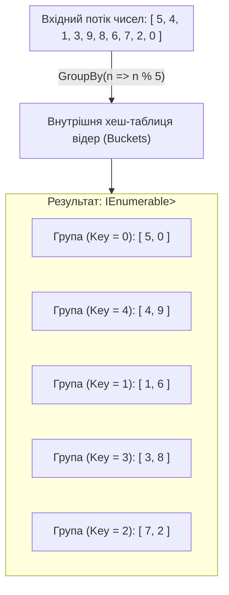
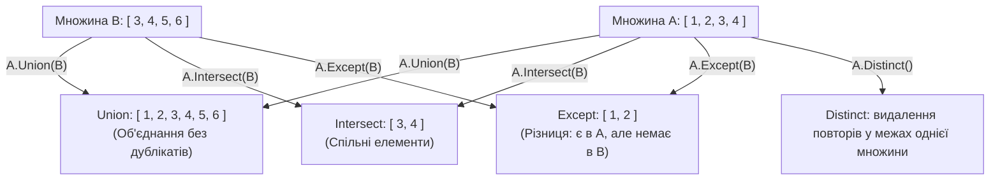

# 📘 Підручник 4. Оператори Групування та Множини (Grouping & Set Operators)
## Анатомія GroupBy, хешування ключів, ILookup кешування, нові методи CountBy/AggregateBy у .NET 9/10 та операції над множинами

> **Модуль курсу:** Агрегація даних, хеш-структури та реляційна алгебра множин у LINQ  
> **Цільова версія:** .NET 10 LTS / C# 14  
> **Практичні приклади репозиторію:** Категорія 5 (`GroupingOperators`) та Категорія 6 (`SetOperators`)  
> **Ключові вихідні файли:** [`LinqSamplesGroupingOperators`](..%5CProgram.cs), [`LinqSamplesSetOperators`](..%5CProgram.cs), приклади [`Linq40.cs` – `Linq45.cs`](../../LINQ%20%20-%20Grouping%20Operators/C%23/GroupingOperators/LinqSamples/), [`Linq46.cs` – `Linq53.cs`](../../LINQ%20-%20Set%20Operators/C%23/SetOperators/LinqSamples/)

---

<a id="toc"></a>
## 📑 Зміст Розділу

1. [Анатомія `GroupBy`: Інтерфейс `IGrouping<TKey, TElement>` та фізика хешування](#section-1)
2. [Перевантаження `GroupBy`: Селектори ключів, елементів та агрегація груп](#section-2)
3. [Архітектурна битва: `GroupBy` проти `ToLookup` (Deferred проти Immediate)](#section-3)
4. [Нова ера оптимізації .NET 9/10: Оператори `CountBy` та `AggregateBy`](#section-4)
5. [Операції над множинами: `Distinct`, `Union`, `Intersect`, `Except`](#section-5)
6. [Сучасні розширення з ключем: `DistinctBy`, `UnionBy`, `IntersectBy`, `ExceptBy`](#section-6)
7. [Контракт `IEqualityComparer<T>`: Як не зламати хеш-таблицю](#section-7)
8. [Детальний розбір прикладів коду в репозиторії (Linq40 – Linq53)](#section-8)
9. [Аналіз складності Big-O та завдання на співбесідах](#section-9)

---

<a id="section-1"></a>
## 1. Анатомія `GroupBy`: Інтерфейс `IGrouping<TKey, TElement>` та фізика хешування

Оператор `GroupBy` розбиває послідовність на підгрупи за спільним значенням ключа.

```csharp
public interface IGrouping<out TKey, out TElement> : IEnumerable<TElement>
{
    TKey Key { get; }
}
```

Кожна група `IGrouping<TKey, TElement>` є **повноцінною колекцією**, яка додатково містить властивість `Key`.



### Як `GroupBy` працює під капотом (Фізика пам'яті):
1. **Буферизація ($O(N)$ пам'яті):** Хоча `GroupBy` є відкладеним оператором, при першому зверненні до `MoveNext()` він зобов'язаний вичитати **всі елементи джерела** до самого кінця. Не можна дізнатися склад групи, доки не перевірено останній елемент послідовності.
2. **Побудова хеш-таблиці:** У пам'яті створюється масив хеш-відер (Hash Buckets). Кожен елемент хешується за своїм ключем: `key.GetHashCode()`.
3. **Збереження порядку:** `GroupBy` у LINQ гарантує збереження початкового відносного порядку як самих груп (за порядком першої появи ключа), так і елементів всередині кожної групи.

---

<a id="section-2"></a>
## 2. Перевантаження `GroupBy`: Селектори ключів, елементів та агрегація груп

Метод `GroupBy` має 8 перевантажень, що розв'язують чотири основні задачі:

### 1. Просте групування за ключем:
```csharp
var groups = words.GroupBy(w => w[0]); // Групування за першою літерою
```

### 2. Групування з проекцією значень (`elementSelector`):
Дозволяє поміщати у групу не весь вихідний об'єкт, а трансформоване значення:
```csharp
// Ключ: перша літера; Значення у групі: слово у верхньому регістрі
var groups = words.GroupBy(
    w => w[0], 
    w => w.ToUpper());
```

### 3. Групування з підсумковою агрегацією (`resultSelector`):
Дозволяє уникнути повернення важких об'єктів `IGrouping` і одразу порахувати скалярну статистику:
```csharp
var categoryStats = products.GroupBy(
    p => p.Category,
    (category, prods) => new {
        Category = category,
        Count = prods.Count(),
        TotalValue = prods.Sum(p => p.UnitPrice * p.UnitsInStock)
    }
);
```

### 4. Query Syntax з пропозицією `into`:
```csharp
var query = from p in products
            group p by p.Category into g
            where g.Count() >= 5
            select new { Category = g.Key, ProductCount = g.Count() };
```

---

<a id="section-3"></a>
## 3. Архітектурна битва: `GroupBy` проти `ToLookup` (Deferred проти Immediate)

Розробники часто плутають `GroupBy` та `ToLookup`. Це принципово різні архітектурні інструменти:

```mermaid
flowchart LR
    Source["Джерело даних"] --> Choice{Що вибрати?}

    Choice -->|GroupBy(key)| GB["IEnumerable&lt;IGrouping&lt;K, V&gt;&gt;"]
    Choice -->|ToLookup(key)| TL["ILookup&lt;K, V&gt; (Lookup&lt;K, V&gt;)"]

    GB --> GB_Prop["• Відкладене виконання (Deferred)\n• Результати НЕ кешуються при повторному обході\n• Немає швидкого індексатора [key]"]
    TL --> TL_Prop["• Негайне виконання (Immediate)\n• Незмінна структура даних у Heap (Кеш)\n• Швидкий O(1) доступ: lookup[key]\n• Якщо ключа немає — повертає empty, без винятків!"]
```

### Порівняльна таблиця:

| Характеристика | `GroupBy` | `ToLookup` |
| :--- | :--- | :--- |
| **Модель виконання** | Відкладена (Deferred Execution) | Негайна (Immediate Execution) |
| **Повертаємий тип** | `IEnumerable<IGrouping<TKey, TElement>>` | `ILookup<TKey, TElement>` |
| **Індексатор за ключем** | Немає (потрібен повторний лінійний пошук) | **Є: `lookup[key]` за $O(1)$ часу** |
| **Поведінка при відсутності ключа** | — | **Повертає `Enumerable.Empty<T>()`** (ніколи не кидає `KeyNotFoundException`!) |
| **Сценарій використання** | Одноразовий конвеєр усередині запиту | Створення довгоживучого словника-кешу $1:N$ |

---

<a id="section-4"></a>
## 4. Нова ера оптимізації .NET 9/10: Оператори `CountBy` та `AggregateBy`

У високонавантажених системах `GroupBy` мав серйозну проблему: для підрахунку кількості записів у категоріях він створював списки для кожної групи, алокуючи тисячі непотрібних об'єктів у Heap.

### 1. `CountBy` (.NET 9+ / .NET 10 LTS):
Підраховує частоту ключів за один прохід, зберігаючи лише лічильник у хеш-таблиці:
```csharp
// Раніше (повільно, зайва пам'ять):
var oldWay = words.GroupBy(w => w).Select(g => new { Word = g.Key, Count = g.Count() });

// Тепер у .NET 10 (миттєво, нуль проміжних груп):
IEnumerable<KeyValuePair<string, int>> counts = words.CountBy(w => w);
```

### 2. `AggregateBy` (.NET 9+ / .NET 10 LTS):
Виконує згортання значень у межах групи без створення колекцій `IGrouping`:
```csharp
// Розрахунок сумарної вартості складу по категоріях без виділення пам'яті під списки:
var categoryTotals = products.AggregateBy(
    keySelector: p => p.Category,
    seed: 0m,
    func: (accumulatedSum, product) => accumulatedSum + product.UnitPrice
);
```

---

<a id="section-5"></a>
## 5. Операції над множинами: `Distinct`, `Union`, `Intersect`, `Except`

Усі операції над множинами в LINQ базуються на математичній теорії множин і усувають дублікати:



### `Union` проти `Concat`:
* **`Concat` (Конкатенація):** Просто приєднує другу послідовність до кінця першої. **Зберігає всі дублікати**. Пам'ять $O(1)$.
* **`Union` (Об'єднання множин):** Видає лише унікальні елементи. **Усуває дублікати** за допомогою внутрішнього `Set<T>`.

---

<a id="section-6"></a>
## 6. Сучасні розширення з ключем: `DistinctBy`, `UnionBy`, `IntersectBy`, `ExceptBy`

Починаючи з .NET 6, для унікальності за конкретною властивістю більше не потрібно писати громіздкі `IEqualityComparer<T>` або `GroupBy(x => x.Id).Select(g => g.First())`:

```csharp
// Залишити лише унікальні товари за назвою:
var uniqueProducts = products.DistinctBy(p => p.ProductName);

// Знайти клієнтів, у яких унікальний номер телефону збігається зі списком контактів:
var commonClients = clientsA.IntersectBy(clientsB.Select(b => b.Phone), a => a.Phone);
```

---

<a id="section-7"></a>
## 7. Контракт `IEqualityComparer<T>`: Як не зламати хеш-таблицю

Усі операції множин та групування підтримують користувацькі компаратори рівності:

```csharp
public class ProductComparer : IEqualityComparer<Product>
{
    public bool Equals(Product? x, Product? y)
    {
        if (ReferenceEquals(x, y)) return true;
        if (x is null || y is null) return false;
        return x.ProductID == y.ProductID;
    }

    public int GetHashCode(Product obj)
    {
        return obj.ProductID.GetHashCode();
    }
}
```

> [!CRITICAL]
> **Непорушний контракт GetHashCode():**  
> Якщо `Equals(x, y) == true`, то `GetHashCode(x)` **ЗОБОВ'ЯЗАНИЙ дорівнювати** `GetHashCode(y)`! Якщо це правило порушено, хеш-таблиця помістить об'єкти в різні відра (buckets), і оператори `Distinct`/`Intersect` не зможуть виявити дублікати.

---

<a id="section-8"></a>
## 8. Детальний розбір прикладів коду в репозиторії (Linq40 – Linq53)

### Категорія 5: Grouping Operators (Групування)
* [`Linq40.cs`](..%5C..%5CLINQ%20%20-%20Grouping%20Operators%5CC%23%5CGroupingOperators%5CLinqSamples%5CDataSetLinq40.cs): Групування чисел за залишком від ділення на 5 (`n % 5`).
* [`Linq41.cs`](..%5C..%5CLINQ%20%20-%20Grouping%20Operators%5CC%23%5CGroupingOperators%5CLinqSamples%5CDataSetLinq41.cs): Групування масиву слів за першою літерою `w[0]`.
* [`Linq42.cs`](..%5C..%5CLINQ%20%20-%20Grouping%20Operators%5CC%23%5CGroupingOperators%5CLinqSamples%5CDataSetLinq42.cs): Групування каталогу товарів за категорією `p.Category`.
* [`Linq43.cs`](..%5C..%5CLINQ%20%20-%20Grouping%20Operators%5CC%23%5CGroupingOperators%5CLinqSamples%5CDataSetLinq43.cs): Дворівневе групування: клієнти за роком, а потім за місяцем замовлення.
* [`Linq44.cs`](..%5C..%5CLINQ%20%20-%20Grouping%20Operators%5CC%23%5CGroupingOperators%5CLinqSamples%5CDataSetLinq44.cs): `GroupBy` з кастомним компаратором довжини слів.
* [`Linq45.cs`](..%5C..%5CLINQ%20%20-%20Grouping%20Operators%5CC%23%5CGroupingOperators%5CLinqSamples%5CDataSetLinq45.cs): `GroupBy` з проекцією значень у верхній регістр.

---

### Категорія 6: Set Operators (Операції над множинами)
* [`Linq46.cs`](..%5C..%5CLINQ%20-%20Set%20Operators%5CC%23%5CSetOperators%5CLinqSamples%5CLinq46.cs): `Distinct` для усунення дублювання факторів чисел.
* [`Linq47.cs`](..%5C..%5CLINQ%20-%20Set%20Operators%5CC%23%5CSetOperators%5CLinqSamples%5CLinq47.cs): `Distinct` для вибірки унікальних категорій товарів.
* [`Linq48.cs`](..%5C..%5CLINQ%20-%20Set%20Operators%5CC%23%5CSetOperators%5CLinqSamples%5CLinq48.cs): `Union` для об'єднання двох масивів чисел без дублікатів.
* [`Linq49.cs`](..%5C..%5CLINQ%20-%20Set%20Operators%5CC%23%5CSetOperators%5CLinqSamples%5CLinq49.cs): `Union` перших літер назв товарів та імен клієнтів.
* [`Linq50.cs`](..%5C..%5CLINQ%20-%20Set%20Operators%5CC%23%5CSetOperators%5CLinqSamples%5CLinq50.cs): `Intersect` для знаходження спільних чисел у двох послідовностях.
* [`Linq51.cs`](..%5C..%5CLINQ%20-%20Set%20Operators%5CC%23%5CSetOperators%5CLinqSamples%5CLinq51.cs): `Intersect` спільних літер назв товарів та імен замовників.
* [`Linq52.cs`](..%5C..%5CLINQ%20-%20Set%20Operators%5CC%23%5CSetOperators%5CLinqSamples%5CLinq52.cs): `Except` для знаходження чисел із першого масиву, яких немає у другому.
* [`Linq53.cs`](..%5C..%5CLINQ%20-%20Set%20Operators%5CC%23%5CSetOperators%5CLinqSamples%5CLinq53.cs): `Except` для виявлення літер назв товарів, яких немає в іменах клієнтів.

---

<a id="section-9"></a>
## 9. Аналіз складності Big-O та завдання на співбесідах

| Оператор | Time Complexity | Space Complexity | Механіка збереження стану |
| :--- | :--- | :--- | :--- |
| `GroupBy` | $O(N)$ | $O(N)$ | Буферизує всі групи у внутрішню хеш-таблицю |
| `ToLookup` | $O(N)$ | $O(N)$ | Матеріалізує незмінний `Lookup` у Heap |
| `CountBy` (.NET 9+) | $O(N)$ | $O(K)$, де $K$ — кількість ключів | Зберігає лише пари `Key -> int`, без елементів |
| `Distinct` | $O(N)$ | $O(U)$, де $U$ — унікальні елементи | Ліниво наповнює внутрішній `Set<T>` |
| `Union` | $O(N + M)$ | $O(N + M)$ | Послідовно наповнює `Set<T>` |
| `Intersect` | $O(N + M)$ | $O(M)$ (розмір 2-ї послідовності) | Будує `Set` з другої послідовності |
| `Except` | $O(N + M)$ | $O(M)$ | Будує `Set` з другої послідовності |

### Питання з технічних співбесід:
1. **Чому `Distinct` є напівпотоковим (Semi-streaming)?**
   * *Відповідь:* На відміну від `OrderBy`, `Distinct` не повинен чекати вичитування всієї послідовності, щоб видати перший елемент. Перший елемент видається одразу ($O(1)$ часу) і кладеться в `Set<T>`. Наступні елементи видаються ліниво, якщо їх ще немає в множині.
2. **Що швидше для групування: `GroupBy` чи `ToLookup`?**
   * *Відповідь:* Якщо результат потрібен лише для однієї ітерації `foreach`, вони практично еквівалентні. Якщо ж потрібен багаторазовий швидкий пошук за ключем, `ToLookup` значно ефективніший, оскільки створює готовий $O(1)$ індекс.

---
[⬆ До змісту](#toc) • [Попередній розділ: Секціонування та Сортування ⬅](./03-Partitioning-and-Ordering.md) • [Наступний розділ: Реляційні З'єднання та Агрегати ➡](./05-Joins-and-Aggregate-Operators.md)
