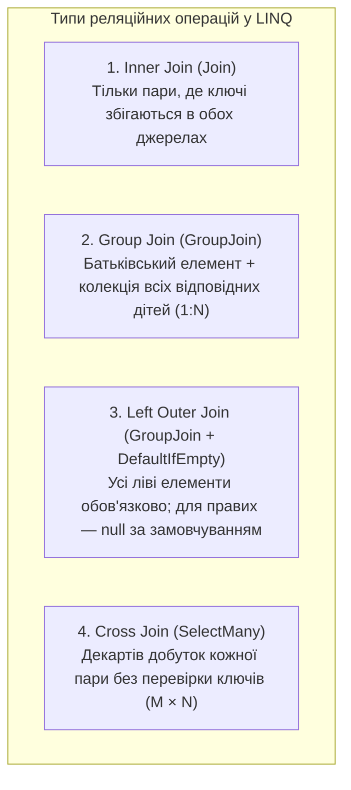
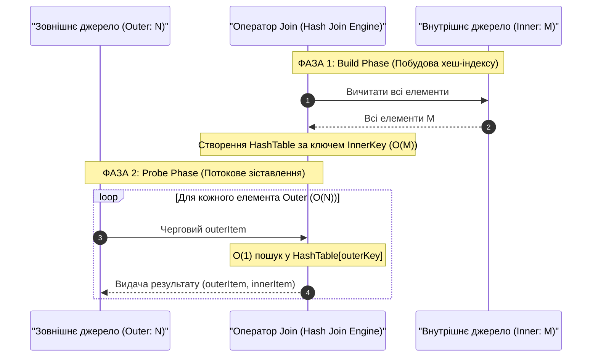
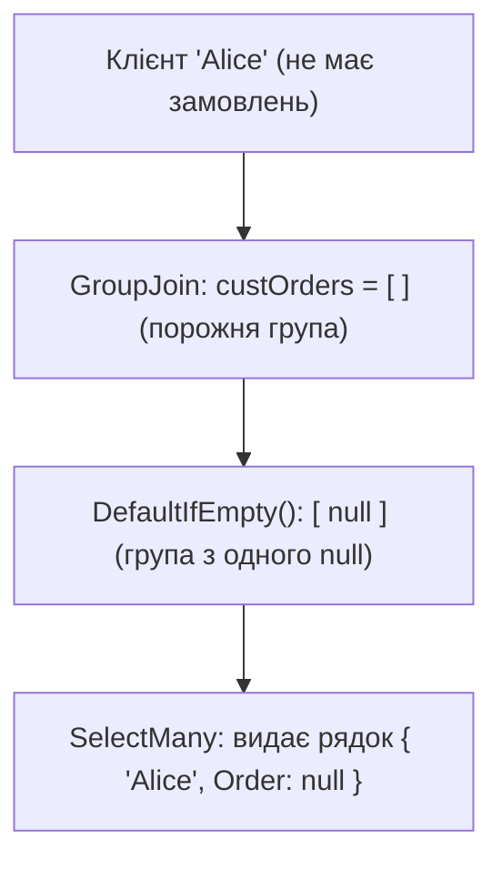
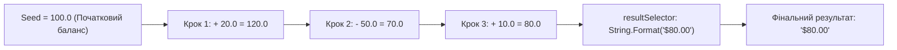

# 📘 Підручник 5. Реляційні З'єднання та Агрегатні Оператори (Joins & Aggregate Operators)
## Алгоритм Hash Join, ієрархічні GroupJoin, емуляція Left Outer Join, скалярні агрегати, MinBy/MaxBy та універсальний згортач Aggregate (Fold)

> **Модуль курсу:** Реляційні зв'язки, агрегація та функціональні редюсери в LINQ  
> **Цільова версія:** .NET 10 LTS / C# 14  
> **Практичні приклади репозиторію:** Категорія 15 (`JoinOperators`) та Категорія 11 (`AggregateOperators`)  
> **Ключові вихідні файли:** [`LinqSamplesJoinOperators`](..%5CProgram.cs), [`LinqSamplesAggregateOperators`](..%5CProgram.cs), приклади [`Linq102.cs` – `Linq105.cs`](../../LINQ%20-%20Join%20Operators/C%23/JoinOperators/LinqSamples/), [`Linq73.cs` – `Linq91.cs`](../../LINQ%20-%20Aggregate%20Operators/C%23/AggregateOperators/LinqSamples/)

---

<a id="toc"></a>
## 📑 Зміст Розділу

1. [Теорія реляційних зв'язків: Inner, Outer, Group та Cross Joins](#section-1)
2. [Фізика алгоритму Hash Join у LINQ to Objects ($O(N + M)$ проти вкладених циклів)](#section-2)
3. [Оператор `Join` (Внутрішнє з'єднання 1:1) та складені ключі](#section-3)
4. [Оператор `GroupJoin`: Ієрархічне з'єднання 1:N](#section-4)
5. [Реалізація Left Outer Join через комбінацію `GroupJoin` + `DefaultIfEmpty`](#section-5)
6. [Базові скалярні агрегати: `Count`, `Sum`, `Average`, `Min`, `Max` та пастки порожніх списків](#section-6)
7. [Сучасні оператори пошуку екстремумів: `MinBy` та `MaxBy` (.NET 6+)](#section-7)
8. [Функціональний редюсер `Aggregate` (Fold / Catamorphism)](#section-8)
9. [Детальний розбір прикладів коду в репозиторії (Linq102 – Linq105, Linq73 – Linq91)](#section-9)
10. [Продуктивність, Big-O та запитання на співбесідах](#section-10)

---

<a id="section-1"></a>
## 1. Теорія реляційних зв'язків: Inner, Outer, Group та Cross Joins

У реляційних базах даних зв'язування таблиць є ключовою операцією. LINQ пропонує еквівалентні оператори для всіх типів реляційних з'єднань:



---

<a id="section-2"></a>
## 2. Фізика алгоритму Hash Join у LINQ to Objects ($O(N + M)$ проти вкладених циклів)

Наївна реалізація з'єднання двох колекцій виглядає як подвійний вкладений цикл:
```csharp
// ❌ Наївне з'єднання: O(Outer × Inner) квадратична складність!
foreach (var outer in outerList)
    foreach (var inner in innerList)
        if (outer.Key == inner.Key)
            yield return (outer, inner);
```
Для 10 000 клієнтів і 100 000 замовлень такий цикл виконає **1 000 000 000 операцій порівняння**!

### Як працює оптимізований Hash Join у LINQ:
LINQ to Objects використовує високоефективний алгоритм **Hash Join**:
1. **Фаза побудови (Build Phase):** Оператор вичитує **внутрішню (inner)** послідовність у внутрішню хеш-таблицю в пам'яті за $O(M)$ часу.
2. **Фаза зондування (Probe Phase):** Зовнішня (outer) послідовність ітерується у потоковому режимі. Для кожного елемента обчислюється хеш його ключа, і в хеш-таблиці миттєво ($O(1)$) знаходяться всі відповідні внутрішні записи.
3. **Підсумкова складність:** Лінійна **$O(N + M)$** замість $O(N \times M)$!



---

<a id="section-3"></a>
## 3. Оператор `Join` (Внутрішнє з'єднання 1:1) та складені ключі

Оператор `Join` зіставляє елементи двох джерел за рівністю ключів:

```csharp
// Method Syntax:
var query = categories.Join(
    products,                         // Внутрішня колекція
    c => c.CategoryName,              // Ключ зовнішньої колекції (Outer Key)
    p => p.Category,                  // Ключ внутрішньої колекції (Inner Key)
    (c, p) => new { c.CategoryName, p.ProductName } // Селектор результату
);

// Query Syntax:
var querySyntax = from c in categories
                  join p in products on c.CategoryName equals p.Category
                  select new { c.CategoryName, p.ProductName };
```

> [!WARNING]
> У Query Syntax для порівняння ключів використовується ключове слово **`equals`**, а НЕ оператор `==`. Ключове слово `equals` гарантує використання семантики порівняння за значенням через `EqualityComparer<T>.Default`.

### Складені ключі (Composite Keys):
Якщо з'єднання має відбуватися за кількома полями одночасно, використовують **анонімні типи**:
```csharp
var query = from p in purchases
            join s in sales on new { p.ShopId, p.Year } equals new { s.ShopId, s.Year }
            select new { p, s };
```
*Компілятор Roslyn генерує методи `Equals` та `GetHashCode` для анонімних типів за всіма полями автоматично, тому композитний ключ працює бездоганно!*

---

<a id="section-4"></a>
## 4. Оператор `GroupJoin`: Ієрархічне з'єднання 1:N

На відміну від `Join`, який дублює зовнішній елемент для кожного відповідного внутрішнього, `GroupJoin` повертає **один** зовнішній елемент і **всю колекцію** знайдених для нього внутрішніх елементів:

```csharp
// Method Syntax:
var customerOrders = customers.GroupJoin(
    orders,
    c => c.CustomerID,
    o => o.CustomerID,
    (c, custOrders) => new {
        CustomerName = c.CompanyName,
        Orders = custOrders // IEnumerable<Order>
    }
);

// Query Syntax (використовує ключове слово into):
var query = from c in customers
            join o in orders on c.CustomerID equals o.CustomerID into custOrders
            select new { Customer = c.CompanyName, Orders = custOrders };
```

---

<a id="section-5"></a>
## 5. Реалізація Left Outer Join через комбінацію `GroupJoin` + `DefaultIfEmpty`

У стандартному SQL операція `LEFT OUTER JOIN` повертає всі рядки з лівої таблиці, навіть якщо у правій таблиці для них немає відповідностей (у такому разі поля правої таблиці заповнюються значенням `NULL`).

У LINQ немає окремого ключового слова `left join`. Left Outer Join конструюється комбінацією:
1. `GroupJoin` (з'єднання в групу);
2. `DefaultIfEmpty()` (якщо група порожня, підставляється дефолтне значення `null`);
3. `SelectMany` (розгортання групи).

```csharp
var leftOuterJoin = 
    from c in customers
    join o in orders on c.CustomerID equals o.CustomerID into custOrders
    from o in custOrders.DefaultIfEmpty() // Якщо замовлень немає — підставляє null!
    select new {
        CustomerName = c.CompanyName,
        OrderID = o?.OrderID ?? -1,
        Total = o?.Total ?? 0.0M
    };
```



---

<a id="section-6"></a>
## 6. Базові скалярні агрегати: `Count`, `Sum`, `Average`, `Min`, `Max` та пастки порожніх списків

Агрегатні оператори згортають усю послідовність у єдине скалярне значення. Вони належать до **негайних операторів (Immediate Execution)**.

### Матриця поведінки агрегатів на порожній послідовності:

| Оператор | Поведінка над порожньою колекцією `[]` | Поведінка над колекцією з `null` елементами |
| :--- | :--- | :--- |
| **`Count()`** | Повертає `0` | Рахує всі елементи (включно з `null`) |
| **`Sum()`** | Повертає `0` (або `null` для nullable типів `int?`) | Ігнорує `null` значення |
| **`Average()`** | 💥 **Викидає `InvalidOperationException`** | Ігнорує `null`, рахує середнє решти |
| **`Min()` / `Max()`** | 💥 **Викидає `InvalidOperationException`** | Ігнорує `null`, якщо тип nullable |

> [!CRITICAL]
> **Золоте правило безпеки:**  
> Ніколи не викликайте `Average()`, `Min()` або `Max()` над числовими послідовностями, якщо є ймовірність, що колекція порожня!  
> Використовуйте перевірку: `items.Any() ? items.Average() : 0` або приведення до nullable типу: `items.Cast<double?>().Average() ?? 0.0`.

---

<a id="section-7"></a>
## 7. Сучасні оператори пошуку екстремумів: `MinBy` та `MaxBy` (.NET 6+)

До появи .NET 6 знаходження об'єкта з максимальною ціною вимагало неефективного коду:
```csharp
// ❌ Старий неефективний підхід:
// 1) Окремо шукається максимальна ціна:
decimal maxPrice = products.Max(p => p.UnitPrice);
// 2) Потім повним проходом шукається сам товар:
Product mostExpensive = products.First(p => p.UnitPrice == maxPrice); // ДВА ПРОХОДИ!

// Або через важке сортування:
Product mostExpensive2 = products.OrderByDescending(p => p.UnitPrice).First(); // O(N log N)!
```

### Сучасне рішення .NET 6+ / .NET 10:
Оператори `MinBy` та `MaxBy` знаходять **цілий об'єкт** за один лінійний прохід **$O(N)$ часу** без виділення пам'яті:
```csharp
//  Сучасно, чисто та блискавично:
Product? mostExpensive = products.MaxBy(p => p.UnitPrice);
Product? cheapest = products.MinBy(p => p.UnitPrice);
```

---

<a id="section-8"></a>
## 8. Функціональний редюсер `Aggregate` (Fold / Catamorphism)

Оператор `Aggregate` — це універсальний математичний акумулятор (відомий як `foldl` у Haskell або `reduce` у JavaScript). Всі інші агрегати (`Sum`, `Average`, `Count`, `Min`, `Max`) є лише окремими випадками оператора `Aggregate`.

### Три перевантаження методу `Aggregate`:

1. **Без початкового значення (Seedless):**
   `TSource Aggregate(Func<TSource, TSource, TSource> func)`
   * Перший елемент послідовності автоматично стає початковим значенням акумулятора.
   * 💥 Викидає `InvalidOperationException`, якщо послідовність порожня.

2. **З початковим значенням (With Seed):**
   `TAccumulate Aggregate<TSource, TAccumulate>(TAccumulate seed, Func<TAccumulate, TSource, TAccumulate> func)`
   * Працює навіть над порожньою послідовністю (повертає `seed`).
   * Дозволяє акумулятору мати тип, відмінний від елементів джерела.

3. **З початковим значенням та проектором результату (With Result Selector):**
   `TResult Aggregate<TSource, TAccumulate, TResult>(seed, func, resultSelector)`



#### Практичний приклад: Розрахунок залишку банківського рахунку:
```csharp
double initialBalance = 100.0;
int[] transactions = { 20, -50, 10, -20 };

double finalBalance = transactions.Aggregate(
    initialBalance,
    (currentBalance, transaction) => currentBalance + transaction
);
// 100 + 20 = 120 -> 120 - 50 = 70 -> 70 + 10 = 80 -> 80 - 20 = 60
```

---

<a id="section-9"></a>
## 9. Детальний розбір прикладів коду в репозиторії (Linq102 – Linq105, Linq73 – Linq91)

### Категорія 15: Join Operators (З'єднання)
* [`Linq102.cs`](..%5C..%5CLINQ%20-%20Join%20Operators%5CC%23%5CJoinOperators%5CLinqSamples%5CLinq102.cs): Внутрішній `Join` категорій та товарів (`c.CategoryName == p.Category`).
* [`Linq103.cs`](..%5C..%5CLINQ%20-%20Join%20Operators%5CC%23%5CJoinOperators%5CLinqSamples%5CLinq103.cs): Ієрархічний `GroupJoin` клієнтів та їх замовлень (`join into`).
* [`Linq104.cs`](..%5C..%5CLINQ%20-%20Join%20Operators%5CC%23%5CJoinOperators%5CLinqSamples%5CLinq104.cs): Повноцінний `Left Outer Join` клієнтів та замовлень через `DefaultIfEmpty()`.
* [`Linq105.cs`](..%5C..%5CLINQ%20-%20Join%20Operators%5CC%23%5CJoinOperators%5CLinqSamples%5CLinq105.cs): З'єднання зі складеним ключем через анонімні типи.

---

### Категорія 11: Aggregate Operators (Агрегація)
* [`Linq73.cs`](..%5C..%5CLINQ%20-%20Aggregate%20Operators%5CC%23%5CAggregateOperators%5CLinqSamples%5CLinq73.cs): Базовий `Count()` кількості унікальних факторів числа.
* [`Linq74.cs`](..%5C..%5CLINQ%20-%20Aggregate%20Operators%5CC%23%5CAggregateOperators%5CLinqSamples%5CLinq74.cs): `Count()` з предикатом: підрахунок непарних чисел у масиві.
* [`Linq76.cs`](..%5C..%5CLINQ%20-%20Aggregate%20Operators%5CC%23%5CAggregateOperators%5CLinqSamples%5CLinq76.cs): Вкладений `Count()` кількості замовлень для кожного клієнта.
* [`Linq77.cs`](..%5C..%5CLINQ%20-%20Aggregate%20Operators%5CC%23%5CAggregateOperators%5CLinqSamples%5CLinq77.cs): Групування та `Count()`: кількість товарів у кожній категорії.
* [`Linq78.cs`](..%5C..%5CLINQ%20-%20Aggregate%20Operators%5CC%23%5CAggregateOperators%5CLinqSamples%5CLinq78.cs): Базова сума чисел `numbers.Sum()`.
* [`Linq80.cs`](..%5C..%5CLINQ%20-%20Aggregate%20Operators%5CC%23%5CAggregateOperators%5CLinqSamples%5CLinq80.cs): `Sum()` вартості залишків на складі: `Sum(p => p.UnitPrice * p.UnitsInStock)`.
* [`Linq81.cs`](..%5C..%5CLINQ%20-%20Aggregate%20Operators%5CC%23%5CAggregateOperators%5CLinqSamples%5CLinq81.cs): Сумарна кількість замовлень по клієнтах за рік.
* [`Linq83.cs`](..%5C..%5CLINQ%20-%20Aggregate%20Operators%5CC%23%5CAggregateOperators%5CLinqSamples%5CLinq83.cs): `Min()` довжини слів у масиві.
* [`Linq84.cs`](..%5C..%5CLINQ%20-%20Aggregate%20Operators%5CC%23%5CAggregateOperators%5CLinqSamples%5CLinq84.cs): Знаходження найнижчої ціни товару в кожній категорії.
* [`Linq88.cs`](..%5C..%5CLINQ%20-%20Aggregate%20Operators%5CC%23%5CAggregateOperators%5CLinqSamples%5CLinq88.cs): `Average()` середньої довжини слів.
* [`Linq89.cs`](..%5C..%5CLINQ%20-%20Aggregate%20Operators%5CC%23%5CAggregateOperators%5CLinqSamples%5CLinq89.cs): `Average()` вартості товару по категоріях.
* [`Linq90.cs`](..%5C..%5CLINQ%20-%20Aggregate%20Operators%5CC%23%5CAggregateOperators%5CLinqSamples%5CLinq90.cs): Згортач `Aggregate()` для розрахунку добутку всіх чисел масиву ($a \times b$).
* [`Linq91.cs`](..%5C..%5CLINQ%20-%20Aggregate%20Operators%5CC%23%5CAggregateOperators%5CLinqSamples%5CLinq91.cs): `Aggregate()` з початковим балансом рахунку (Seed).

---

<a id="section-10"></a>
## 10. Продуктивність, Big-O та запитання на співбесідах

| Оператор | Часова складність (Time) | Просторова складність (Space) | Примітки |
| :--- | :--- | :--- | :--- |
| `Join` (Hash Join) | $O(N + M)$ | $O(M)$ | Будує хеш-таблицю для Inner послідовності |
| `GroupJoin` | $O(N + M)$ | $O(M)$ | Створює внутрішній `Lookup` за $O(M)$ |
| `Count`, `Sum`, `Average` | $O(N)$ | $O(1)$ | Однопрохідні лінійні сканери |
| `MinBy`, `MaxBy` | $O(N)$ | $O(1)$ | Знаходять екстремальний об'єкт за 1 прохід |
| `Aggregate` | $O(N)$ | $O(1)$ | Універсальне згортання за один прохід |

### Питання з технічних співбесід:
1. **Чому в `Join` рекомендується меншу за розміром колекцію передавати як внутрішню (`inner`)?**
   * *Відповідь:* LINQ будує хеш-таблицю саме для внутрішньої колекції. Якщо внутрішня колекція містить 100 елементів, а зовнішня 1 000 000, хеш-таблиця займе мізерні байти пам'яті. Якщо зробити навпаки — хеш-таблиця займе десятки мегабайт у купі (Heap).
2. **Як працює `DefaultIfEmpty()` всередині Left Outer Join?**
   * *Відповідь:* Якщо знайдена підгрупа замовлень клієнта порожня, `DefaultIfEmpty()` генерує ітератор з одного дефолтного значення (`null`). Завдяки цьому зовнішній клієнт не губиться при сплощенні через `SelectMany`.

---
[⬆ До змісту](#toc) • [Попередній розділ: Групування та Множини ⬅](./04-Grouping-and-Set-Operators.md) • [Наступний розділ: Квантори, Елементи та Конвертації ➡](./06-Quantifiers-Elements-Conversion-and-Custom.md)
