# 🏛️ Лекційна Презентація-Шпаргалка: Магія та Архітектура LINQ у .NET 10
## Повний конспект лекції на 25 слайдів: від інтерфейсів `IEnumerable<T>` до складних реляційних з'єднань та оптимізації продуктивності

> **Автор конспекту:** Enterprise Solutions Architect & .NET Tech Lead  
> **Аудиторія:** Студенти комп'ютерних наук, .NET-інженери, викладачі  
> **Стек:** .NET 10 LTS | C# 13 | LINQ to Objects | Functional Programming  
> **Практична основа:** Проєкт `101 LINQ Samples (.NET 10 Modernized)`

---

<a id="toc"></a>
## 📋 Зміст Лекційних Слайдів

* [Слайд 1. Вступ: Парадигма Декларативного Програмування та Еволюція LINQ у C#](#slide-1)
* [Слайд 2. Огляд Екосистеми LINQ: LINQ to Objects vs LINQ to Entities (EF Core) vs LINQ to XML](#slide-2)
* [Слайд 3. Фундаментальний дует: `IEnumerable<T>` та `IEnumerator<T>` (Pull-модель ітерації)](#slide-3)
* [Слайд 4. Магія `yield return`: Компіляторний автомат станів та оптимізація пам'яті](#slide-4)
* [Слайд 5. Анатомія Запитів: Query Syntax проти Method (Lambda) Syntax](#slide-5)
* [Слайд 6. Моделі Виконання: Відкладене (Deferred) проти Негайного (Immediate)](#slide-6)
* [Слайд 7. Потоковість проти Буферизації: Фізика Streaming ($O(1)$) проти Buffering ($O(N)$)](#slide-7)
* [Слайд 8. Restriction Operators: Фільтрація через `Where`, індексований `Where` та `OfType`](#slide-8)
* [Слайд 9. Projection Operators: Одновимірна трансформація через `Select`, індекси та анонімні типи](#slide-9)
* [Слайд 10. Сплющення Ієрархій: Оператор `SelectMany` та Декартовий Добуток](#slide-10)
* [Слайд 11. Можливості Query Syntax: Множинні `from` та кешування змінних через `let`](#slide-11)
* [Слайд 12. Partitioning: Посторінкова пагінація за допомогою `Take`, `Skip` та C# Ranges](#slide-12)
* [Слайд 13. Conditional Partitioning: Логіка переривання `TakeWhile` та `SkipWhile`](#slide-13)
* [Слайд 14. Ordering Operators: Сортування `OrderBy`, інтерфейс `IOrderedEnumerable` та пастка повторного `OrderBy`](#slide-14)
* [Слайд 15. Багаторівневе Сортування: Вторинні ключі через `ThenBy`, компаратори `IComparer` та `Reverse`](#slide-15)
* [Слайд 16. Grouping Operators: Розбиття на категорії через `GroupBy` та анатомія `IGrouping<K, V>`](#slide-16)
* [Слайд 17. Спеціалізоване Групування: `elementSelector`, складені ключі та кастомний `IEqualityComparer`](#slide-17)
* [Слайд 18. Set Operators: Теорія множин у LINQ — `Distinct`, `Union`, `Intersect`, `Except`](#slide-18)
* [Слайд 19. Conversion & Materialization: Збереження в пам'ять через `ToArray`, `ToList` та `ToDictionary`](#slide-19)
* [Слайд 20. Element Operators: Скалярний вибір — `First`, `FirstOrDefault`, `Single`, `ElementAt`](#slide-20)
* [Слайд 21. Quantifiers & Generation: `Any` проти `Count() > 0`, `All`, `Range`, `Repeat`](#slide-21)
* [Слайд 22. Aggregate Operators: Скалярна статистика — `Count`, `Sum`, `Min`, `Max`, `Average`](#slide-22)
* [Слайд 23. Функціональна Згортка: Потужність оператора `Aggregate` (Fold / Reduce) зі `seed`](#slide-23)
* [Слайд 24. Join Operators: Реляційні об'єднання — `Inner Join`, `Group Join` та емуляція `Left Outer Join`](#slide-24)
* [Слайд 25. Розширюваність та Висновки: Створення власних операторів (`Combine`/`Zip`), пам'ять та Enterprise Best Practices](#slide-25)

---

<a id="slide-1"></a>
### Слайд 1. Вступ: Парадигма Декларативного Програмування та Еволюція LINQ у C#

#### 1. Теоретичне ядро
* **Суть:** До появи C# 3.0 обробка будь-яких наборів даних була *імперативною* — розробник писав зовнішні цикли `for`, створював тимчасові списки, вручну фільтрував та заповнював буфери.
* **Декларативний підхід:** Замість того, щоб вказувати комп'ютеру *як саме покроково* бігти по масиву, розробник декларує *що саме* він хоче отримати в результаті.
* **Життєва аналогія:** Імперативний підхід — це власноруч варити каву на кухні (насипати зерна, змолоти, підігріти воду, відфільтрувати). Декларативний підхід — натиснути кнопку в кавомашині: "Приготувати лате з цукром".

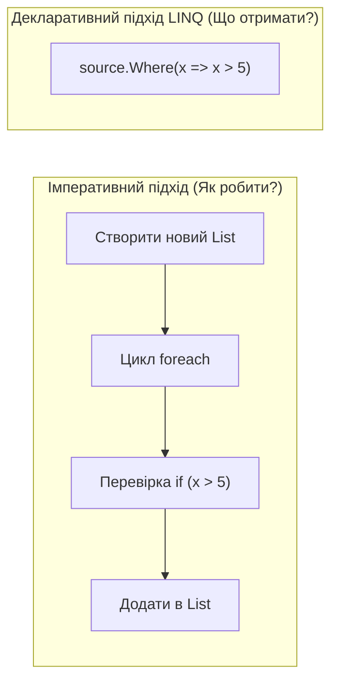

#### 2. Посилання на код у репозиторії
👉 [Program.cs](..%5CProgram.cs) 📍 (рядки 25–40 — огляд запуску прикладів фільтрації)

---
[⬆ До змісту](#toc) • [Наступний слайд ➡](#slide-2)

---

<a id="slide-2"></a>
### Слайд 2. Огляд Екосистеми LINQ: LINQ to Objects vs LINQ to Entities vs LINQ to XML

#### 1. Теоретичне ядро
* **Єдиний інтерфейс:** LINQ надає спільний синтаксис запитів, але працює з різними фізичними джерелами за допомогою різних провайдерів:
  * **LINQ to Objects:** Оперує об'єктами в пам'яті через `IEnumerable<T>`. Виконує скомпільований IL-код і делегати `Func<...>`.
  * **LINQ to Entities (EF Core):** Оперує віддаленими базами через `IQueryable<T>`. Транслює дерево виразів (`Expression Trees`) у чистий діалект SQL для СУБД.
  * **LINQ to XML:** Забезпечує навігацію та модифікацію XML-структур через класи `XDocument`, `XElement`.

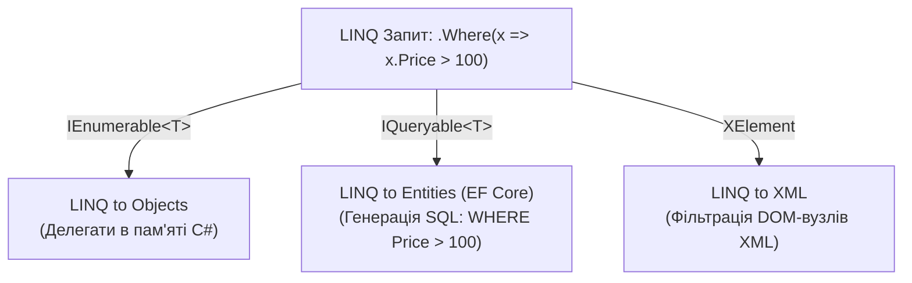

#### 2. Посилання на код у репозиторії
👉 [Customers.cs](..%5C..%5CLinqSamplesCommon%5CModel%5CCustomers.cs) 📍 (рядки 20–45 — приклад використання LINQ to XML для завантаження клієнтів із `Customers.xml`)

---
[⬅ Попередній слайд](#slide-1) • [⬆ До змісту](#toc) • [Наступний слайд ➡](#slide-3)

---

<a id="slide-3"></a>
### Слайд 3. Фундаментальний дует: `IEnumerable<T>` та `IEnumerator<T>` (Pull-модель ітерації)

#### 1. Теоретичне ядро
* **Архітектура:** Будь-який запит LINQ to Objects базується на парі інтерфейсів `IEnumerable<T>` (фабрика перелічувачів) та `IEnumerator<T>` (курсор перебору).
* **Pull-модель (тягнуча):** На відміну від Push-моделі подій (де джерело "штовхає" дані клієнту), у LINQ споживач сам "витягує" дані викликом `MoveNext()`.
* Якщо споживач припиняє викликати `MoveNext()`, генерація даних негайно заморожується.

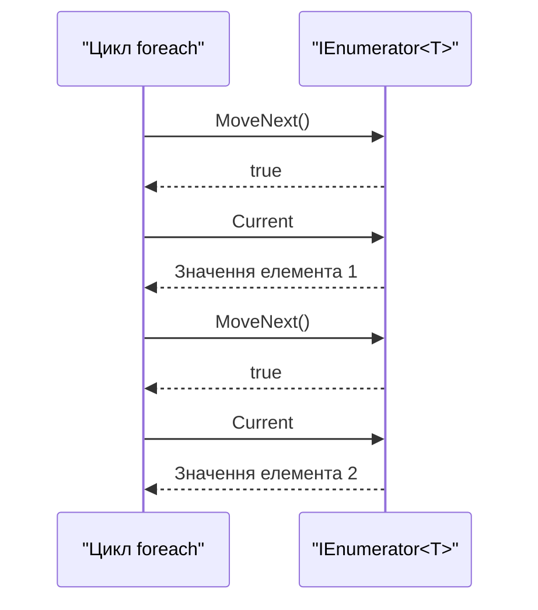

#### 2. Посилання на код у репозиторії
👉 [ExtensionMethods.cs](..%5C..%5CLinqSamplesCommon%5CExtensionMethods.cs) 📍 (рядки 8–24 — оголошення методів розширення над `this IEnumerable<T>`)

---
[⬅ Попередній слайд](#slide-2) • [⬆ До змісту](#toc) • [Наступний слайд ➡](#slide-4)

---

<a id="slide-4"></a>
### Слайд 4. Магія `yield return`: Компіляторний автомат станів та оптимізація пам'яті

#### 1. Теоретичне ядро
* **Суть:** Ключове слово `yield return` дозволяє писати ітератори без створення проміжних списків `new List<T>()`.
* **Що робить компілятор Roslyn:** Створює прихований клас-автомат станів (`State Machine`), що запам'ятовує точку виходу з методу через внутрішній лічильник `state`.
* Метод повертає управління викликаючому коду, зберігаючи значення локальних змінних у купі (heap).

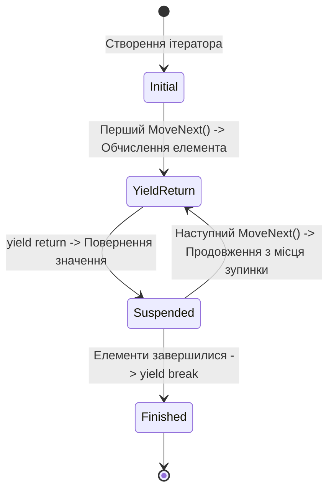

#### 2. Посилання на код у репозиторії
👉 [DataSetLinq98.cs](..%5C..%5CLINQ%20-%20Custom%20Sequence%20Operators%5CC%23%5CCustomSequenceOperators%5CLinqSamples%5CDataSetLinq98.cs) 📍 (рядки 11–20 — реалізація методу `Combine` за допомогою `yield return`)

---
[⬅ Попередній слайд](#slide-3) • [⬆ До змісту](#toc) • [Наступний слайд ➡](#slide-5)

---

<a id="slide-5"></a>
### Слайд 5. Анатомія Запитів: Query Syntax проти Method (Lambda) Syntax

#### 1. Теоретичне ядро
* **Query Syntax:** Декларативний синтаксис, схожий на SQL (`from ... in ... where ... select`).
* **Method Syntax (Fluent API):** Ланцюжок викликів методів розширення з передачею лямбда-виразів (`.Where(x => ...).Select(...)`).
* **Децукрування (Syntactic Desugaring):** Компілятор C# завжди транслює Query Syntax у Method Syntax на ранньому етапі компіляції. Вони мають ідентичну продуктивність!

```csharp
// Query Syntax (зручно для складних Join та Group By)
var q = from p in products
        where p.UnitPrice > 20
        select p.ProductName;

// Method Syntax (зручно для більшості ланцюжків)
var m = products.Where(p => p.UnitPrice > 20).Select(p => p.ProductName);
```

#### 2. Посилання на код у репозиторії
👉 [Linq1.cs](..%5C..%5CLINQ%20-%20Restriction%20Operators%5CC%23%5CRestrictionOperators%5CLinqSamples%5CLinq1.cs) 📍 (рядки 25–34 проти 45–55 — пряме порівняння `Linq1` та `Linq1A`)

---
[⬅ Попередній слайд](#slide-4) • [⬆ До змісту](#toc) • [Наступний слайд ➡](#slide-6)

---

<a id="slide-6"></a>
### Слайд 6. Моделі Виконання: Відкладене (Deferred) проти Негайного (Immediate)

#### 1. Теоретичне ядро
* **Відкладене виконання (Deferred Execution):** Створення запиту **НЕ виконує** обчислення. Створюється лише "рецепт" або конвеєр. Обчислення починається ТІЛЬКИ тоді, коли хтось запускає перебір (`foreach`, `ToList()`).
* **Негайне виконання (Immediate Execution):** Методи конверсії (`ToList`, `ToArray`) або скаляри (`Count`, `Max`, `First`) негайно проганяють весь конвеєр і фіксують результат у пам'яті.

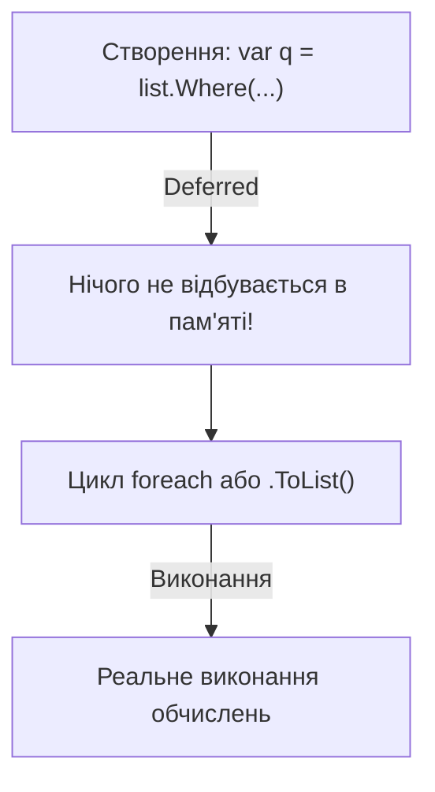

#### 2. Посилання на код у репозиторії
👉 [Linq99.cs](..%5C..%5CLINQ%20-%20Query%20Execution%5CC%23%5CQueryExecution%5CLinqSamples%5CLinq99.cs) 📍 (рядки 22–35 — демонстрація відкладеного виконання: змінна `i` не змінюється до циклу `foreach`)  
👉 [Linq100.cs](..%5C..%5CLINQ%20-%20Query%20Execution%5CC%23%5CQueryExecution%5CLinqSamples%5CLinq100.cs) 📍 (рядки 17–28 — негайне виконання через `ToList()`)

---
[⬅ Попередній слайд](#slide-5) • [⬆ До змісту](#toc) • [Наступний слайд ➡](#slide-7)

---

<a id="slide-7"></a>
### Слайд 7. Потоковість проти Буферизації: Фізика Streaming ($O(1)$) проти Buffering ($O(N)$)

#### 1. Теоретичне ядро
* **Потокові оператори (Streaming / Lazy):** Обробляють дані елемент за елементом. Виділяють пам'ять лише під один поточний елемент ($O(1)$). Приклади: `Where`, `Select`, `Take`, `Skip`.
* **Буферизуючі оператори (Buffering / Eager):** Змушені спочатку завантажити **всю** вхідну колекцію у внутрішній масив ($O(N)$ пам'яті), перш ніж віддати перший результат. Приклади: `OrderBy`, `GroupBy`, `Reverse`.

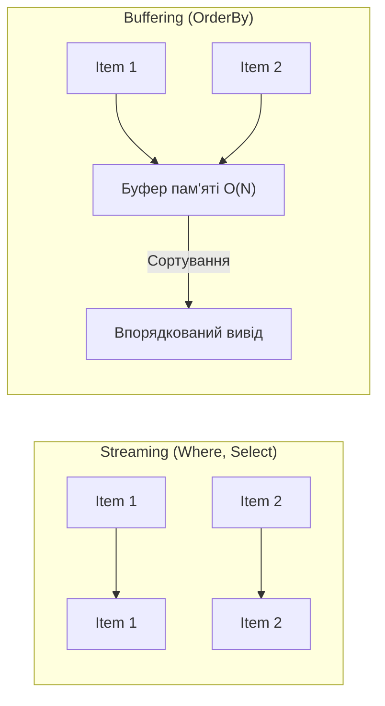

#### 2. Посилання на код у репозиторії
👉 [Linq39.cs](..%5C..%5CLINQ%20-%20Ordering%20Operators%5CC%23%5COrderingOperators%5CLinqSamples%5CLinq39.cs) 📍 (рядки 25–35 — виклик `Reverse()`, що буферизує відфільтровані дані)

---
[⬅ Попередній слайд](#slide-6) • [⬆ До змісту](#toc) • [Наступний слайд ➡](#slide-8)

---

<a id="slide-8"></a>
### Слайд 8. Restriction Operators: Фільтрація через `Where`, індексований `Where` та `OfType`

#### 1. Теоретичне ядро
* `Where` фільтрує елементи за предикатом `Func<T, bool>`.
* **Індексований Where:** Передає в предикат індекс елемента в послідовності: `Where((item, index) => ...)` (доступний тільки в Method Syntax).
* **`OfType<T>()`:** Безпечно вибирає з колекції елементи лише вказаного типу, ігноруючи інші без винятку `InvalidCastException`.

```csharp
// Безпечний відбір чисел з object[]
object[] mixed = { "Київ", 42, 3.14, 100, "Львів" };
var numbersOnly = mixed.OfType<int>(); // Результат: [42, 100]
```

#### 2. Посилання на код у репозиторії
👉 [Linq1.cs](..%5C..%5CLINQ%20-%20Restriction%20Operators%5CC%23%5CRestrictionOperators%5CLinqSamples%5CLinq1.cs) 📍 (рядки 25–34 — базовий Where)  
👉 [Linq5.cs](..%5C..%5CLINQ%20-%20Restriction%20Operators%5CC%23%5CRestrictionOperators%5CLinqSamples%5CLinq5.cs) 📍 (рядки 25–35 — індексований Where)  
👉 [OfTypeLinq5A.cs](..%5C..%5CLINQ%20-%20Restriction%20Operators%5CC%23%5CRestrictionOperators%5CLinqSamples%5COfTypeLinq5A.cs) 📍 (рядки 24–36 — використання OfType)

---
[⬅ Попередній слайд](#slide-7) • [⬆ До змісту](#toc) • [Наступний слайд ➡](#slide-9)

---

<a id="slide-9"></a>
### Слайд 9. Projection Operators: Одновимірна трансформація через `Select`, індекси та анонімні типи

#### 1. Теоретичне ядро
* `Select` виконує відображення $1 \to 1$.
* **Анонімні типи:** Створюють незмінні легковагові об'єкти на льоту: `select new { p.ProductName, p.UnitPrice }`. Компілятор автоматично генерує `Equals` та `GetHashCode`.
* **Індексований Select:** `Select((item, index) => new { item, Index = index })`.

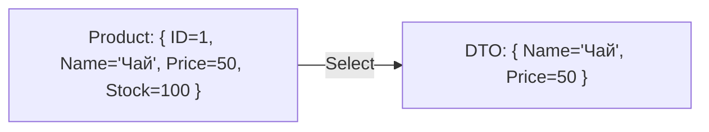

#### 2. Посилання на код у репозиторії
👉 [DataSetLinq10.cs](..%5C..%5CLINQ%20-%20Projection%20Operators%5CC%23%5CProjectionOperators%5CLinqSamples%5CDataSetLinq10.cs) 📍 (рядки 24–37 — проекція в анонімний тип)  
👉 [DataSetLinq12.cs](..%5C..%5CLINQ%20-%20Projection%20Operators%5CC%23%5CProjectionOperators%5CLinqSamples%5CDataSetLinq12.cs) 📍 (рядки 24–35 — індексований Select)

---
[⬅ Попередній слайд](#slide-8) • [⬆ До змісту](#toc) • [Наступний слайд ➡](#slide-10)

---

<a id="slide-10"></a>
### Слайд 10. Сплющення Ієрархій: Оператор `SelectMany` та Декартовий Добуток

#### 1. Теоретичне ядро
* **`SelectMany` ($1 \to N$):** Розгортає деревоподібні або вкладені структури в єдиний плаский лінійний потік.
* **Різниця:**
  * `customers.Select(c => c.Orders)` повертає `IEnumerable<List<Order>>` (список списків).
  * `customers.SelectMany(c => c.Orders)` повертає `IEnumerable<Order>` (єдиний плаский потік замовлень).
* Якщо застосувати до двох незалежних колекцій — формує **Декартовий добуток** (Cartesian Product).

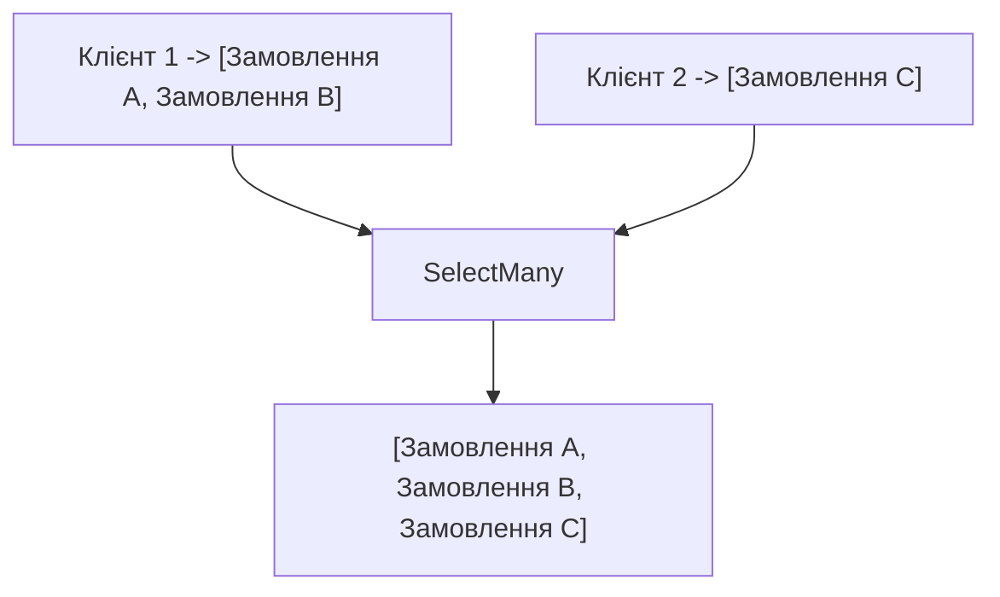

#### 2. Посилання на код у репозиторії
👉 [DataSetLinq14.cs](..%5C..%5CLINQ%20-%20Projection%20Operators%5CC%23%5CProjectionOperators%5CLinqSamples%5CDataSetLinq14.cs) 📍 (рядки 26–42 — Декартовий добуток чисел)  
👉 [DataSetLinq15.cs](..%5C..%5CLINQ%20-%20Projection%20Operators%5CC%23%5CProjectionOperators%5CLinqSamples%5CDataSetLinq15.cs) 📍 (рядки 25–40 — сплющення замовлень клієнтів)

---
[⬅ Попередній слайд](#slide-9) • [⬆ До змісту](#toc) • [Наступний слайд ➡](#slide-11)

---

<a id="slide-11"></a>
### Слайд 11. Можливості Query Syntax: Множинні `from` та кешування змінних через `let`

#### 1. Теоретичне ядро
* **Множинні `from`:** У синтаксисі запитів запис із двома `from` автоматично компілюється в оператор `SelectMany`:
  `from c in customers from o in c.Orders select o`.
* **Оператор `let`:** Дозволяє зберегти проміжне обчислення в локальну змінну всередині запиту, уникаючи дублювання важких обчислень у блоках `where` та `select`.

```csharp
var query =
    from c in customers
    let totalSpent = c.Orders.Sum(o => o.Total) // Обчислюється один раз!
    where totalSpent > 10000
    select new { c.CompanyName, Total = totalSpent };
```

#### 2. Посилання на код у репозиторії
👉 [DataSetLinq16.cs](..%5C..%5CLINQ%20-%20Projection%20Operators%5CC%23%5CProjectionOperators%5CLinqSamples%5CDataSetLinq16.cs) 📍 (рядки 25–38 — множинні from)  
👉 [Linq84.cs](..%5C..%5CLINQ%20-%20Aggregate%20Operators%5CC%23%5CAggregateOperators%5CLinqSamples%5CLinq84.cs) 📍 (рядки 20–30 — використання `let minPrice = ...`)

---
[⬅ Попередній слайд](#slide-10) • [⬆ До змісту](#toc) • [Наступний слайд ➡](#slide-12)

---

<a id="slide-12"></a>
### Слайд 12. Partitioning: Посторінкова пагінація за допомогою `Take`, `Skip` та C# Ranges

#### 1. Теоретичне ядро
* `Take(n)` — вибирає перші $n$ елементів та відсікає решту.
* `Skip(n)` — ігнорує перші $n$ елементів та транслює всі наступні.
* **Канонічна формула пагінації:**
  `source.Skip((pageNumber - 1) * pageSize).Take(pageSize)`.
* Завдяки short-circuiting решта джерела даних навіть не зчитується!

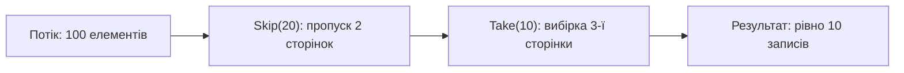

#### 2. Посилання на код у репозиторії
👉 [Linq20.cs](..%5C..%5CLINQ%20-%20Partitioning%20Operators%5CC%23%5CPartitioningOperators%5CLinqSamples%5CLinq20.cs) 📍 (рядки 25–35 — виклик Take)  
👉 [Linq22.cs](..%5C..%5CLINQ%20-%20Partitioning%20Operators%5CC%23%5CPartitioningOperators%5CLinqSamples%5CLinq22.cs) 📍 (рядки 25–35 — виклик Skip)

---
[⬅ Попередній слайд](#slide-11) • [⬆ До змісту](#toc) • [Наступний слайд ➡](#slide-13)

---

<a id="slide-13"></a>
### Слайд 13. Conditional Partitioning: Логіка переривання `TakeWhile` та `SkipWhile`

#### 1. Теоретичне ядро
* На відміну від `Where`, який перевіряє всю колекцію, `TakeWhile` та `SkipWhile` керуються **першим фактом хибності умови**:
  * `TakeWhile(pred)`: читає елементи, доки виконується умова. При першому ж `false` — **повна зупинка**.
  * `SkipWhile(pred)`: пропускає елементи, доки виконується умова. При першому ж `false` — повертає цей і **всі наступні** елементи без перевірок.

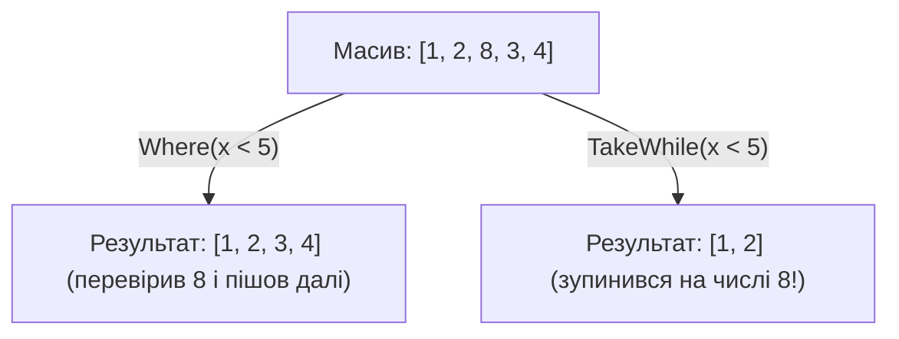

#### 2. Посилання на код у репозиторії
👉 [Linq24.cs](..%5C..%5CLINQ%20-%20Partitioning%20Operators%5CC%23%5CPartitioningOperators%5CLinqSamples%5CLinq24.cs) 📍 (рядки 24–35 — TakeWhile)  
👉 [Linq26.cs](..%5C..%5CLINQ%20-%20Partitioning%20Operators%5CC%23%5CPartitioningOperators%5CLinqSamples%5CLinq26.cs) 📍 (рядки 24–35 — SkipWhile)

---
[⬅ Попередній слайд](#slide-12) • [⬆ До змісту](#toc) • [Наступний слайд ➡](#slide-14)

---

<a id="slide-14"></a>
### Слайд 14. Ordering Operators: Сортування `OrderBy`, інтерфейс `IOrderedEnumerable` та пастка повторного `OrderBy`

#### 1. Теоретичне ядро
* `OrderBy` повертає `IOrderedEnumerable<T>`.
* **Критична помилка:** Подвійний виклик `OrderBy` скидає попереднє сортування!
  `list.OrderBy(x => x.A).OrderBy(x => x.B)` — сортування за `A` повністю знищується!
* Для вторинного сортування необхідно викликати **`ThenBy`** або **`ThenByDescending`**.


#### 2. Посилання на код у репозиторії
👉 [Linq28.cs](..%5C..%5CLINQ%20-%20Ordering%20Operators%5CC%23%5COrderingOperators%5CLinqSamples%5CLinq28.cs) 📍 (рядки 24–35 — базовий OrderBy)  
👉 [Linq35.cs](..%5C..%5CLINQ%20-%20Ordering%20Operators%5CC%23%5COrderingOperators%5CLinqSamples%5CLinq35.cs) 📍 (рядки 24–35 — поєднання OrderBy та ThenBy)

---
[⬅ Попередній слайд](#slide-13) • [⬆ До змісту](#toc) • [Наступний слайд ➡](#slide-15)

---

<a id="slide-15"></a>
### Слайд 15. Багаторівневе Сортування: Вторинні ключі через `ThenBy`, компаратори `IComparer` та `Reverse`

#### 1. Теоретичне ядро
* **`IComparer<T>`:** Дозволяє налаштувати спеціалізоване порівняння (наприклад, нечутливе до регістру `CaseInsensitiveComparer`).
* **`Reverse()`:** Інвертує порядок послідовності. Є буферизуючим оператором ($O(N)$ пам'яті).

#### 2. Посилання на код у репозиторії
👉 [Linq31.cs](..%5C..%5CLINQ%20-%20Ordering%20Operators%5CC%23%5COrderingOperators%5CLinqSamples%5CLinq31.cs) 📍 (рядки 24–38 — сортування з `CaseInsensitiveComparer`)  
👉 [Linq37.cs](..%5C..%5CLINQ%20-%20Ordering%20Operators%5CC%23%5COrderingOperators%5CLinqSamples%5CLinq37.cs) 📍 (рядки 24–38 — ThenByDescending по спаданню ціни)  
👉 [Linq39.cs](..%5C..%5CLINQ%20-%20Ordering%20Operators%5CC%23%5COrderingOperators%5CLinqSamples%5CLinq39.cs) 📍 (рядки 24–35 — виклик Reverse)

---
[⬅ Попередній слайд](#slide-14) • [⬆ До змісту](#toc) • [Наступний слайд ➡](#slide-16)

---

<a id="slide-16"></a>
### Слайд 16. Grouping Operators: Розбиття на категорії через `GroupBy` та анатомія `IGrouping<K, V>`

#### 1. Теоретичне ядро
* `GroupBy` розбиває потік на підмножини.
* Кожна група реалізує інтерфейс `IGrouping<TKey, TElement>` — вона має ключ `Key` і сама є перелічувачем `IEnumerable<TElement>`.
* Еквівалент SQL: `SELECT ... GROUP BY Category`.

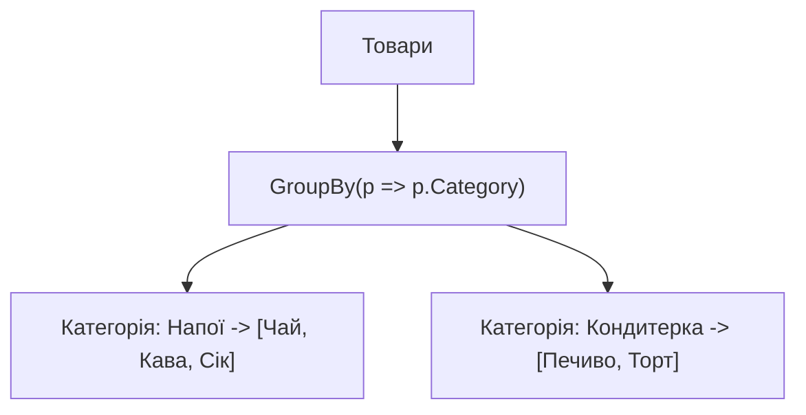

#### 2. Посилання на код у репозиторії
👉 [DataSetLinq40.cs](..%5C..%5CLINQ%20%20-%20Grouping%20Operators%5CC%23%5CGroupingOperators%5CLinqSamples%5CDataSetLinq40.cs) 📍 (рядки 25–35 — групування чисел за залишком `n % 5`)  
👉 [DataSetLinq42.cs](..%5C..%5CLINQ%20%20-%20Grouping%20Operators%5CC%23%5CGroupingOperators%5CLinqSamples%5CDataSetLinq42.cs) 📍 (рядки 25–35 — групування товарів за категорією)

---
[⬅ Попередній слайд](#slide-15) • [⬆ До змісту](#toc) • [Наступний слайд ➡](#slide-17)

---

<a id="slide-17"></a>
### Слайд 17. Спеціалізоване Групування: `elementSelector`, складені ключі та кастомний `IEqualityComparer`

#### 1. Теоретичне ядро
* **`elementSelector`:** Дозволяє під час групування трансформувати тип значень групи (наприклад, замість об'єкта `Product` зберігати в групі лише назву `ProductName`).
* **Кастомний `IEqualityComparer<T>`:** Дозволяє групувати за нетривіальними ознаками (наприклад, анаграми).

#### 2. Посилання на код у репозиторії
👉 [DataSetLinq43.cs](..%5C..%5CLINQ%20%20-%20Grouping%20Operators%5CC%23%5CGroupingOperators%5CLinqSamples%5CDataSetLinq43.cs) 📍 (рядки 25–40 — дворівневе групування: Рік -> Місяць)  
👉 [DataSetLinq44.cs](..%5C..%5CLINQ%20%20-%20Grouping%20Operators%5CC%23%5CGroupingOperators%5CLinqSamples%5CDataSetLinq44.cs) 📍 (рядки 44–65 — групування анаграм з `AnagramEqualityComparer`)

---
[⬅ Попередній слайд](#slide-16) • [⬆ До змісту](#toc) • [Наступний слайд ➡](#slide-18)

---

<a id="slide-18"></a>
### Слайд 18. Set Operators: Теорія множин у LINQ — `Distinct`, `Union`, `Intersect`, `Except`

#### 1. Теоретичне ядро
* Усі оператори множин працюють через внутрішню хеш-множину `Set<T>` ($O(N + M)$ складності).
* **`Distinct`:** Видаляє дублікати всередині однієї колекції.
* **`Union`:** Поєднує дві колекції без дублікатів (на відміну від `Concat`).
* **`Intersect`:** Знаходить спільні елементи двох колекцій.
* **`Except`:** Віднімає елементи другої колекції від першої.

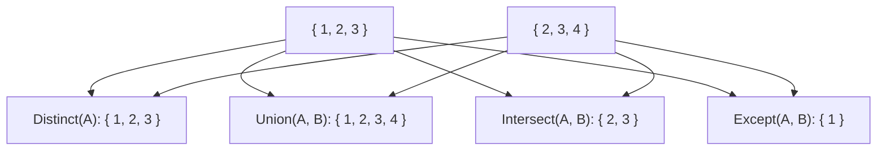

#### 2. Посилання на код у репозиторії
👉 [Linq46.cs](..%5C..%5CLINQ%20-%20Set%20Operators%5CC%23%5CSetOperators%5CLinqSamples%5CLinq46.cs) 📍 (рядки 23–35 — Distinct)  
👉 [Linq48.cs](..%5C..%5CLINQ%20-%20Set%20Operators%5CC%23%5CSetOperators%5CLinqSamples%5CLinq48.cs) 📍 (рядки 24–35 — Union)  
👉 [Linq50.cs](..%5C..%5CLINQ%20-%20Set%20Operators%5CC%23%5CSetOperators%5CLinqSamples%5CLinq50.cs) 📍 (рядки 24–35 — Intersect)  
👉 [Linq52.cs](..%5C..%5CLINQ%20-%20Set%20Operators%5CC%23%5CSetOperators%5CLinqSamples%5CLinq52.cs) 📍 (рядки 24–35 — Except)

---
[⬅ Попередній слайд](#slide-17) • [⬆ До змісту](#toc) • [Наступний слайд ➡](#slide-19)

---

<a id="slide-19"></a>
### Слайд 19. Conversion & Materialization: Збереження в пам'ять через `ToArray`, `ToList` та `ToDictionary`

#### 1. Теоретичне ядро
* Виконують **негайну матеріалізацію (Immediate Execution)**.
* **`ToDictionary`:** Вимагає гарантії унікальності ключів. При дублікаті викидає `ArgumentException`.
* **`AsEnumerable`:** Корисний у EF Core для розриву SQL-трансляції: усе до `AsEnumerable()` виконується в SQL Server, усе після — в пам'яті C#.

#### 2. Посилання на код у репозиторії
👉 [Linq54.cs](..%5C..%5CLINQ%20-%20Conversion%20Operators%5CC%23%5CConversionOperators%5CLinqSamples%5CLinq54.cs) 📍 (рядки 25–35 — ToArray)  
👉 [Linq55.cs](..%5C..%5CLINQ%20-%20Conversion%20Operators%5CC%23%5CConversionOperators%5CLinqSamples%5CLinq55.cs) 📍 (рядки 25–35 — ToList)  
👉 [Linq56.cs](..%5C..%5CLINQ%20-%20Conversion%20Operators%5CC%23%5CConversionOperators%5CLinqSamples%5CLinq56.cs) 📍 (рядки 24–35 — ToDictionary)

---
[⬅ Попередній слайд](#slide-18) • [⬆ До змісту](#toc) • [Наступний слайд ➡](#slide-20)

---

<a id="slide-20"></a>
### Слайд 20. Element Operators: Скалярний вибір — `First`, `FirstOrDefault`, `Single`, `ElementAt`

#### 1. Теоретичне ядро
* **`First()` проти `FirstOrDefault()`:**
  * `First()` викидає `InvalidOperationException`, якщо елемент не знайдено.
  * `FirstOrDefault()` безпечно повертає `null` або `0`.
* **`Single()`:** Перевіряє, що елемент строго один. Якщо знайдено два елементи — викидає виняток. Сканує колекцію до кінця!
* **`ElementAt(i)`:** Доступ за індексом ($O(1)$ для `IList<T>`, $O(N)$ для звичайного `IEnumerable`).

#### 2. Посилання на код у репозиторії
👉 [Linq58.cs](..%5C..%5CLINQ%20-%20Element%20Operators%5CC%23%5CElementOperators%5CLinqSamples%5CLinq58.cs) 📍 (рядки 25–35 — First)  
👉 [Linq61.cs](..%5C..%5CLINQ%20-%20Element%20Operators%5CC%23%5CElementOperators%5CLinqSamples%5CLinq61.cs) 📍 (рядки 23–35 — FirstOrDefault на порожньому масиві)  
👉 [Linq64.cs](..%5C..%5CLINQ%20-%20Element%20Operators%5CC%23%5CElementOperators%5CLinqSamples%5CLinq64.cs) 📍 (рядки 23–35 — ElementAt(1))

---
[⬅ Попередній слайд](#slide-19) • [⬆ До змісту](#toc) • [Наступний слайд ➡](#slide-21)

---

<a id="slide-21"></a>
### Слайд 21. Quantifiers & Generation: `Any` проти `Count() > 0`, `All`, `Range`, `Repeat`

#### 1. Теоретичне ядро
* **Антипатерн `Count() > 0`:** Метод `Count()` рахує всю колекцію до кінця. Метод `Any()` зупиняється на першому знайденому елементі ($O(1)$).
* **`All`:** Перевіряє всіх. Для порожньої колекції повертає `true` (Vacuous truth).
* **`Range` / `Repeat`:** Генерація без виділення масивів у пам'яті.

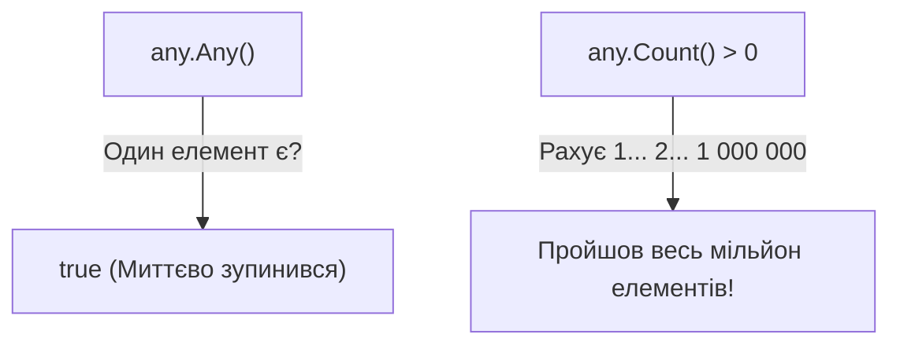

#### 2. Посилання на код у репозиторії
👉 [Linq67.cs](..%5C..%5CLINQ%20-%20Quantifiers%5CC%23%5CQuantifiers%5CLinqSamples%5CLinq67.cs) 📍 (рядки 23–33 — Any з предикатом)  
👉 [Linq70.cs](..%5C..%5CLINQ%20-%20Quantifiers%5CC%23%5CQuantifiers%5CLinqSamples%5CLinq70.cs) 📍 (рядки 23–33 — All з предикатом непарності)  
👉 [Linq65.cs](..%5C..%5CLINQ%20-%20Generation%20Operators%5CC%23%5CGenerationOperators%5CLinqSamples%5CLinq65.cs) 📍 (рядки 23–35 — Enumerable.Range)  
👉 [Linq66.cs](..%5C..%5CLINQ%20-%20Generation%20Operators%5CC%23%5CGenerationOperators%5CLinqSamples%5CLinq66.cs) 📍 (рядки 23–35 — Enumerable.Repeat)

---
[⬅ Попередній слайд](#slide-20) • [⬆ До змісту](#toc) • [Наступний слайд ➡](#slide-22)

---

<a id="slide-22"></a>
### Слайд 22. Aggregate Operators: Скалярна статистика — `Count`, `Sum`, `Min`, `Max`, `Average`

#### 1. Теоретичне ядро
* Скалярні оператори обчислюють єдине підсумкове число.
* Працюють як самостійно (`numbers.Sum()`), так і з селектором властивості (`words.Sum(w => w.Length)`).
* У згрупованих даних застосовуються до кожної підгрупи: `group.Average(p => p.UnitPrice)`.

#### 2. Посилання на код у репозиторії
👉 [Linq78.cs](..%5C..%5CLINQ%20-%20Aggregate%20Operators%5CC%23%5CAggregateOperators%5CLinqSamples%5CLinq78.cs) 📍 (рядки 21–25 — Sum)  
👉 [Linq81.cs](..%5C..%5CLINQ%20-%20Aggregate%20Operators%5CC%23%5CAggregateOperators%5CLinqSamples%5CLinq81.cs) 📍 (рядки 21–25 — Min)  
👉 [Linq85.cs](..%5C..%5CLINQ%20-%20Aggregate%20Operators%5CC%23%5CAggregateOperators%5CLinqSamples%5CLinq85.cs) 📍 (рядки 21–25 — Max)  
👉 [Linq89.cs](..%5C..%5CLINQ%20-%20Aggregate%20Operators%5CC%23%5CAggregateOperators%5CLinqSamples%5CLinq89.cs) 📍 (рядки 21–25 — Average)

---
[⬅ Попередній слайд](#slide-21) • [⬆ До змісту](#toc) • [Наступний слайд ➡](#slide-23)

---

<a id="slide-23"></a>
### Слайд 23. Функціональна Згортка: Потужність оператора `Aggregate` (Fold / Reduce) зі `seed`

#### 1. Теоретичне ядро
* `Aggregate` — це прабатько всіх агрегатних функцій.
* Послідовно накопичує стан за допомогою функції `(accumulator, next) => nextAccumulator`.
* Дозволяє вирішувати задачі будь-якої складності: обчислення добутку масиву, розрахунок складних відсотків, моделювання банківських транзакцій зі стартовим балансом (`seed`).

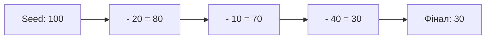

#### 2. Посилання на код у репозиторії
👉 [Linq92.cs](..%5C..%5CLINQ%20-%20Aggregate%20Operators%5CC%23%5CAggregateOperators%5CLinqSamples%5CLinq92.cs) 📍 (рядки 20–25 — добуток усіх чисел)  
👉 [Linq93.cs](..%5C..%5CLINQ%20-%20Aggregate%20Operators%5CC%23%5CAggregateOperators%5CLinqSamples%5CLinq93.cs) 📍 (рядки 20–30 — зняття коштів з рахунку зі `seed = 100.0`)

---
[⬅ Попередній слайд](#slide-22) • [⬆ До змісту](#toc) • [Наступний слайд ➡](#slide-24)

---

<a id="slide-24"></a>
### Слайд 24. Join Operators: Реляційні об'єднання — `Inner Join`, `Group Join` та емуляція `Left Outer Join`

#### 1. Теоретичне ядро
* **Hash Join ($O(N + M)$):** Будує хеш-таблицю правої колекції, забезпечуючи лінійний час виконання.
* **Inner Join:** Виводить лише рядки з точним збігом ключів в обох джерелах.
* **Group Join (`into`):** Створює ієрархічні списки 1:N.
* **Left Outer Join:** Реалізується комбінацією `join ... into g` та `from item in g.DefaultIfEmpty()`. Зберігає всі записи лівої таблиці, підставляючи `null` при відсутності збігу.

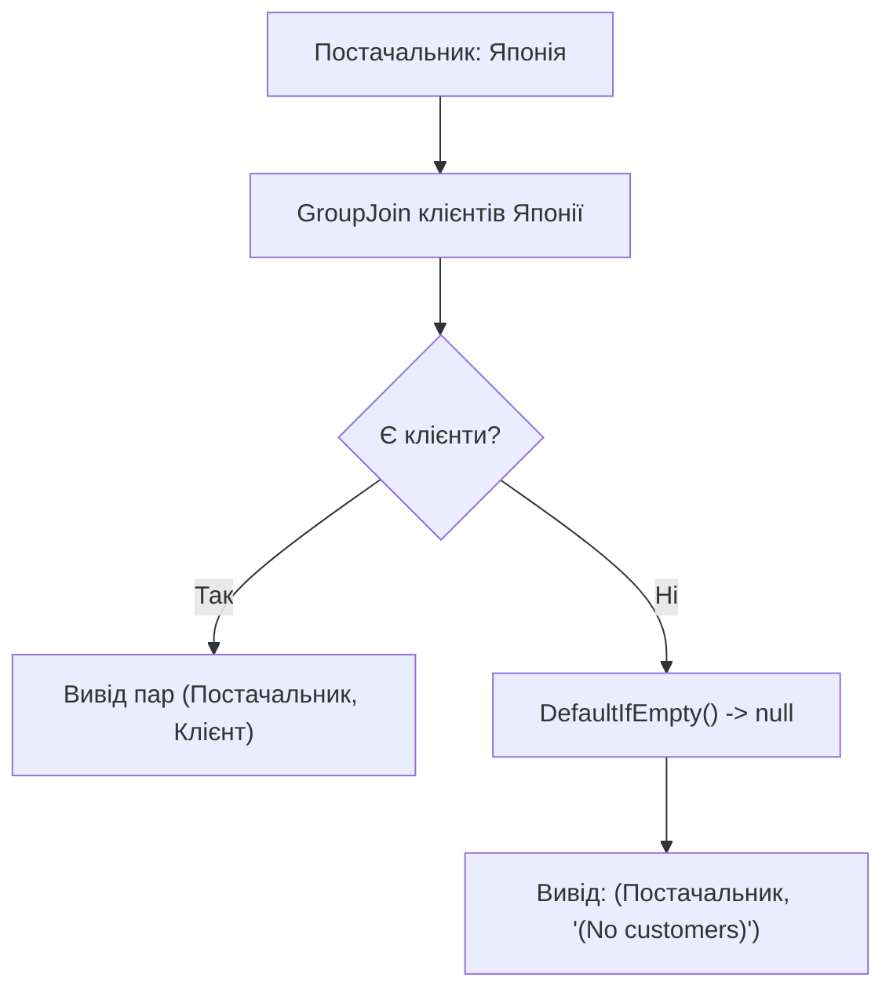

#### 2. Посилання на код у репозиторії
👉 [Linq102.cs](..%5C..%5CLINQ%20-%20Join%20Operators%5CC%23%5CJoinOperators%5CLinqSamples%5CLinq102.cs) 📍 (рядки 25–40 — Inner Join)  
👉 [Linq103.cs](..%5C..%5CLINQ%20-%20Join%20Operators%5CC%23%5CJoinOperators%5CLinqSamples%5CLinq103.cs) 📍 (рядки 20–35 — Group Join)  
👉 [Linq105.cs](..%5C..%5CLINQ%20-%20Join%20Operators%5CC%23%5CJoinOperators%5CLinqSamples%5CLinq105.cs) 📍 (рядки 20–40 — Left Outer Join)  
👉 [Linq107.cs](..%5C..%5CLINQ%20-%20Join%20Operators%5CC%23%5CJoinOperators%5CLinqSamples%5CLinq107.cs) 📍 (рядки 21–43 — Composite Key Join за містом і країною)

---
[⬅ Попередній слайд](#slide-23) • [⬆ До змісту](#toc) • [Наступний слайд ➡](#slide-25)

---

<a id="slide-25"></a>
### Слайд 25. Розширюваність та Висновки: Створення власних операторів, пам'ять та Enterprise Best Practices

#### 1. Теоретичне ядро
* **Власні оператори:** Будь-який метод розширення `public static IEnumerable<R> MyOp<T>(this IEnumerable<T> src)` з `yield return` стає повноцінним LINQ-оператором.
* **Золоті правила Enterprise LINQ:**
  1. Уникайте *Multiple Enumeration* (кешуйте через `ToList()`, якщо колекція використовується двічі).
  2. Використовуйте `Any()` замість `Count() > 0`.
  3. Не пишіть кілька `OrderBy()` поспіль — використовуйте `ThenBy()`.
  4. Пам'ятайте про буферизацію `OrderBy`, `GroupBy`, `Reverse` ($O(N)$ пам'яті).
  5. Для великих колекцій віддавайте перевагу потоковому обчисленню над матеріалізацією.

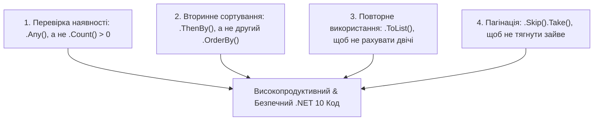

#### 2. Посилання на код у репозиторії
👉 [DataSetLinq98.cs](..%5C..%5CLINQ%20-%20Custom%20Sequence%20Operators%5CC%23%5CCustomSequenceOperators%5CLinqSamples%5CDataSetLinq98.cs) 📍 (рядки 11–20 та 35–50 — створення власного оператора `Combine` / `Zip`)

---
[⬆ До змісту](#toc) • [⬅ Попередній слайд](#slide-24)
