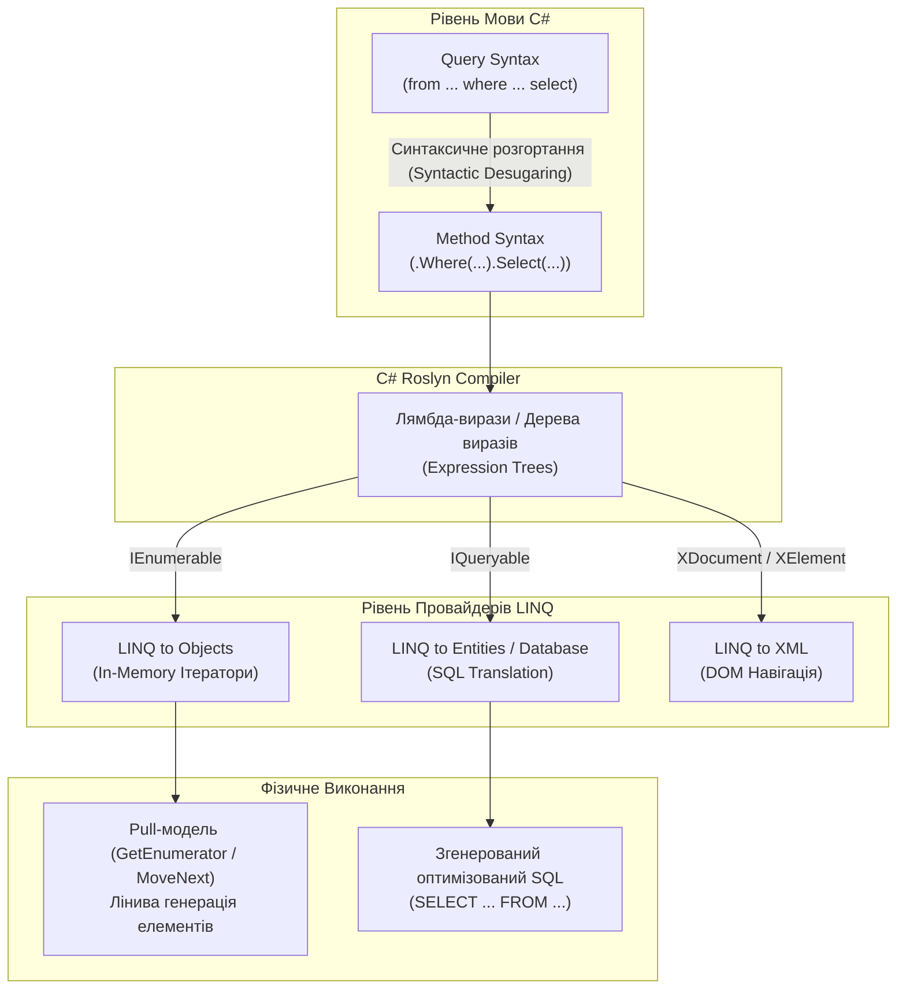

# 📚 Language Integrated Query (LINQ) у .NET 10: Повний Академічний та Архітектурний Довідник

> **Стек:** .NET 10 LTS | C# 13 | LINQ to Objects | Functional Programming  
> **Базовий репозиторій:** `101 LINQ Samples (.NET 10 Modernized)`  
> **Призначення:** Навчальний посібник, лекційний конспект та інтерактивна шпаргалка для студентів, викладачів та .NET-інженерів.

---

<a id="toc"></a>
## 📑 Навігатор Навчального Комплексу

Цей довідник складається з 6 тематичних підручників та повної лекційної презентації-шпаргалки на 25 слайдів:

| Модуль | Тематика та Зміст | Посилання на Підручник |
| :--- | :--- | :--- |
| **Вступ та Архітектура** | Архітектура LINQ, `IEnumerable<T>`, `IEnumerator<T>`, механізм `yield return`, конвеєризація, відкладене (Deferred) проти негайного (Immediate) виконання, потоковість (Streaming) та буферизація (Buffering). | 📖 [01-LINQ-Architecture-and-Execution.md](./01-LINQ-Architecture-and-Execution.md) |
| **Фільтрація та Проекція** | Категорії 1 та 2: Restriction (`Where`, indexed `Where`, `OfType`) та Projection (`Select`, indexed `Select`, анонімні типи, `SelectMany`, сплющення ієрархій, `let`). | 📖 [02-Filtering-and-Projections.md](./02-Filtering-and-Projections.md) |
| **Секціонування та Сортування** | Категорії 3 та 4: Partitioning (`Take`, `Skip`, `TakeWhile`, `SkipWhile`, діапазони) та Ordering (`OrderBy`, `OrderByDescending`, `ThenBy`, `ThenByDescending`, `Reverse`, компаратори). | 📖 [03-Partitioning-and-Ordering.md](./03-Partitioning-and-Ordering.md) |
| **Групування та Множини** | Категорії 5 та 6: Grouping (`GroupBy`, `IGrouping<K, V>`, складні ключі, агрегація груп) та Set Operators (`Distinct`, `Union`, `Intersect`, `Except`, хеш-множини). | 📖 [04-Grouping-and-Set-Operators.md](./04-Grouping-and-Set-Operators.md) |
| **З'єднання та Агрегація** | Категорії 11 та 15: Join Operators (Inner Join, Group Join, Cross Join, Left Outer Join, складені ключі) та Aggregate Operators (`Count`, `Sum`, `Min`, `Max`, `Average`, `Aggregate`). | 📖 [05-Joins-and-Aggregate-Operators.md](./05-Joins-and-Aggregate-Operators.md) |
| **Квантори, Елементи, Конверсія** | Категорії 7, 8, 9, 10, 12, 13: Conversion (`ToArray`, `ToList`, `ToDictionary`), Element (`First`, `FirstOrDefault`, `ElementAt`), Generation (`Range`, `Repeat`), Quantifiers (`Any`, `All`), Misc (`Concat`, `SequenceEqual`), Custom (`Combine`/`Zip`). | 📖 [06-Quantifiers-Elements-Conversion-and-Custom.md](./06-Quantifiers-Elements-Conversion-and-Custom.md) |
| **Лекційна Презентація** | Готова 25-слайдова інтерактивна презентація для аудиторних лекцій та експрес-повторення з візуальними схемами та життєвими аналогіями. | 🏛️ [LINQ-Lecture-Presentation.md](./LINQ-Lecture-Presentation.md) |

---

## 🏛️ Загальна Архітектура LINQ (Language Integrated Query)

LINQ інтегрує можливості декларативних запитів безпосередньо в мову C#, поєднуючи перевірку типів на етапі компіляції (Compile-Time Type Safety) з оптимізованими функціональними конвеєрами.



---

## 🧭 Матриця 15 Категорій Операторів LINQ

| № | Категорія | Ключові Оператори | Тип Виконання | Алгоритмічна Модель | Приклади в Репозиторії |
| :-: | :--- | :--- | :--- | :--- | :--- |
| **1** | **Restriction** | `Where`, `OfType` | Відкладене (Deferred) | Потокова фільтрація (Streaming) | 👉 [Linq1.cs](..%5C..%5CLINQ%20-%20Restriction%20Operators%5CC%23%5CRestrictionOperators%5CLinqSamples%5CLinq1.cs) – [OfTypeLinq5A.cs](..%5C..%5CLINQ%20-%20Restriction%20Operators%5CC%23%5CRestrictionOperators%5CLinqSamples%5COfTypeLinq5A.cs) |
| **2** | **Projection** | `Select`, `SelectMany` | Відкладене (Deferred) | Потокова трансформація (Streaming) | 👉 [DataSetLinq6.cs](..%5C..%5CLINQ%20-%20Projection%20Operators%5CC%23%5CProjectionOperators%5CLinqSamples%5CDataSetLinq6.cs) – [DataSetLinq19.cs](..%5C..%5CLINQ%20-%20Projection%20Operators%5CC%23%5CProjectionOperators%5CLinqSamples%5CDataSetLinq19.cs) |
| **3** | **Partitioning** | `Take`, `Skip`, `TakeWhile`, `SkipWhile` | Відкладене (Deferred) | Раннє переривання / зсув (Streaming) | 👉 [Linq20.cs](..%5C..%5CLINQ%20-%20Partitioning%20Operators%5CC%23%5CPartitioningOperators%5CLinqSamples%5CLinq20.cs) – [Linq27.cs](..%5C..%5CLINQ%20-%20Partitioning%20Operators%5CC%23%5CPartitioningOperators%5CLinqSamples%5CLinq27.cs) |
| **4** | **Ordering** | `OrderBy`, `OrderByDescending`, `ThenBy`, `Reverse` | Відкладене (Deferred) | **Буферизація** (Повне завантаження в пам'ять) | 👉 [Linq28.cs](..%5C..%5CLINQ%20-%20Ordering%20Operators%5CC%23%5COrderingOperators%5CLinqSamples%5CLinq28.cs) – [Linq39.cs](..%5C..%5CLINQ%20-%20Ordering%20Operators%5CC%23%5COrderingOperators%5CLinqSamples%5CLinq39.cs) |
| **5** | **Grouping** | `GroupBy`, `ToLookup` | Відкладене (Deferred) | **Буферизація** (Побудова Lookup-структури) | 👉 [DataSetLinq40.cs](..%5C..%5CLINQ%20%20-%20Grouping%20Operators%5CC%23%5CGroupingOperators%5CLinqSamples%5CDataSetLinq40.cs) – [DataSetLinq45.cs](..%5C..%5CLINQ%20%20-%20Grouping%20Operators%5CC%23%5CGroupingOperators%5CLinqSamples%5CDataSetLinq45.cs) |
| **6** | **Set Operators** | `Distinct`, `Union`, `Intersect`, `Except` | Відкладене (Deferred) | Хеш-множина (Set-based Streaming) | 👉 [Linq46.cs](..%5C..%5CLINQ%20-%20Set%20Operators%5CC%23%5CSetOperators%5CLinqSamples%5CLinq46.cs) – [Linq53.cs](..%5C..%5CLINQ%20-%20Set%20Operators%5CC%23%5CSetOperators%5CLinqSamples%5CLinq53.cs) |
| **7** | **Conversion** | `ToArray`, `ToList`, `ToDictionary`, `OfType` | **Негайне** (Immediate) | Матеріалізація в оперативну пам'ять | 👉 [Linq54.cs](..%5C..%5CLINQ%20-%20Conversion%20Operators%5CC%23%5CConversionOperators%5CLinqSamples%5CLinq54.cs) – [Linq57.cs](..%5C..%5CLINQ%20-%20Conversion%20Operators%5CC%23%5CConversionOperators%5CLinqSamples%5CLinq57.cs) |
| **8** | **Element** | `First`, `FirstOrDefault`, `ElementAt` | **Негайне** (Immediate) | Скалярний пошук (зупинка на першому збігу) | 👉 [Linq58.cs](..%5C..%5CLINQ%20-%20Element%20Operators%5CC%23%5CElementOperators%5CLinqSamples%5CLinq58.cs) – [Linq64.cs](..%5C..%5CLINQ%20-%20Element%20Operators%5CC%23%5CElementOperators%5CLinqSamples%5CLinq64.cs) |
| **9** | **Generation** | `Range`, `Repeat`, `Empty` | Відкладене (Deferred) | Генератор чисел/об'єктів на льоту | 👉 [Linq65.cs](..%5C..%5CLINQ%20-%20Generation%20Operators%5CC%23%5CGenerationOperators%5CLinqSamples%5CLinq65.cs) – [Linq66.cs](..%5C..%5CLINQ%20-%20Generation%20Operators%5CC%23%5CGenerationOperators%5CLinqSamples%5CLinq66.cs) |
| **10** | **Quantifiers** | `Any`, `All`, `Contains` | **Негайне** (Immediate) | Булева перевірка з коротким замиканням | 👉 [Linq67.cs](..%5C..%5CLINQ%20-%20Quantifiers%5CC%23%5CQuantifiers%5CLinqSamples%5CLinq67.cs) – [Linq72.cs](..%5C..%5CLINQ%20-%20Quantifiers%5CC%23%5CQuantifiers%5CLinqSamples%5CLinq72.cs) |
| **11** | **Aggregate** | `Count`, `Sum`, `Min`, `Max`, `Average`, `Aggregate` | **Негайне** (Immediate) | Згортка послідовності в одне число (Fold) | 👉 [Linq73.cs](..%5C..%5CLINQ%20-%20Aggregate%20Operators%5CC%23%5CAggregateOperators%5CLinqSamples%5CLinq73.cs) – [Linq93.cs](..%5C..%5CLINQ%20-%20Aggregate%20Operators%5CC%23%5CAggregateOperators%5CLinqSamples%5CLinq93.cs) |
| **12** | **Miscellaneous** | `Concat`, `SequenceEqual` | Відкладене (`Concat`) / Негайне (`SequenceEqual`) | Послідовне об'єднання / попарне порівняння | 👉 [Linq94.cs](..%5C..%5CLINQ%20-%20Miscellaneous%20Operators%5CC%23%5CMiscellaneousOperators%5CLinqSamples%5CLinq94.cs) – [Linq97.cs](..%5C..%5CLINQ%20-%20Miscellaneous%20Operators%5CC%23%5CMiscellaneousOperators%5CLinqSamples%5CLinq97.cs) |
| **13** | **Custom Sequence**| `Combine` (користувацький аналог `Zip`) | Відкладене (Deferred) | Паралельна ітерація двох перелічувачів | 👉 [DataSetLinq98.cs](..%5C..%5CLINQ%20-%20Custom%20Sequence%20Operators%5CC%23%5CCustomSequenceOperators%5CLinqSamples%5CDataSetLinq98.cs) |
| **14** | **Query Execution**| Deferred vs Immediate, Query Re-evaluation | Архітектурна модель | Життєвий цикл стану запиту | 👉 [Linq99.cs](..%5C..%5CLINQ%20-%20Query%20Execution%5CC%23%5CQueryExecution%5CLinqSamples%5CLinq99.cs) – [Linq101.cs](..%5C..%5CLINQ%20-%20Query%20Execution%5CC%23%5CQueryExecution%5CLinqSamples%5CLinq101.cs) |
| **15** | **Join Operators** | Inner `Join`, `GroupJoin`, Left Outer Join | Відкладене (Deferred) | Hash Join / Хеш-таблиця правої послідовності | 👉 [Linq102.cs](..%5C..%5CLINQ%20-%20Join%20Operators%5CC%23%5CJoinOperators%5CLinqSamples%5CLinq102.cs) – [Linq107.cs](..%5C..%5CLINQ%20-%20Join%20Operators%5CC%23%5CJoinOperators%5CLinqSamples%5CLinq107.cs) |

---

## ⚡ Query Syntax проти Method Syntax: Правило Архітектора

| Аспект | Query Syntax (Синтаксис запитів) | Method Syntax (Методний / Лямбда синтаксис) |
| :--- | :--- | :--- |
| **Форма запису** | Декларативна, нагадує SQL (`from ... where ... select`) | Функціональний ланцюжок методів розширення (`.Where().Select()`) |
| **Компіляція** | Транслюється компілятором Roslyn у виклики методів розширення | Компілюється безпосередньо у виклики методів |
| **Коли використовувати** | Складні `join`, множинні `group by`, використання `let` та кількох джерел `from` | Більшість операцій, оператори без аналогів у Query Syntax (`Take`, `Skip`, `Distinct`, `Count`, `Any`) |
| **Приклади в коді** | 👉 [Linq102.cs (Query Syntax)](..%5C..%5CLINQ%20-%20Join%20Operators%5CC%23%5CJoinOperators%5CLinqSamples%5CLinq102.cs) | 👉 [Linq102A.cs (Method Syntax)](..%5C..%5CLINQ%20-%20Join%20Operators%5CC%23%5CJoinOperators%5CLinqSamples%5CLinq102.cs#L39-L62) |

---

## 🛠️ Як Запускати та Експериментувати з Проєктом

Усі проєкти переведені на сучасний SDK-style формат **.NET 10 (`net10.0`)**.

```bash
# 1. Клонувати репозиторій або відкрити термінал у кореневій папці
cd "c:\Users\Yurii\source\repos\- Examples OOP\OOP - LINQ-Samples"

# 2. Збірка всього рішення
dotnet build "101 LINQ Samples.sln"

# 3. Запуск головної консольної програми
dotnet run --project "101 LINQ Samples\p_101 LINQ Samples.csproj"
```

> [!TIP]
> Щоб запустити конкретну категорію прикладів, відкрийте [Program.cs](..%5CProgram.cs), розкоментуйте виклик потрібного класу (наприклад, `samples_a.Linq1()`) та запустіть проєкт.
