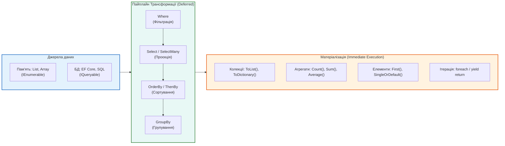
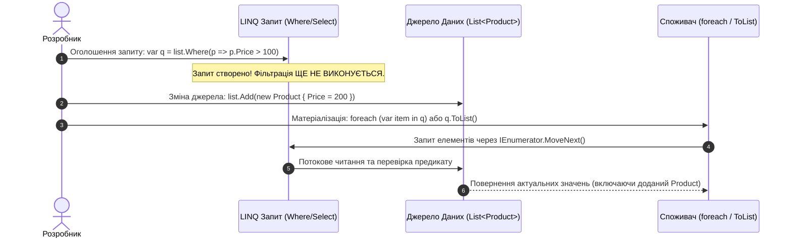

# 🌟 101 LINQ Samples (.NET 10 LTS Enterprise Edition)

> **Еталонний навчально-практичний комплекс з повним циклом вивчення Language Integrated Query (LINQ) у .NET 10**  
> **Платформа:** .NET 10 LTS | C# 14 | LINQ to Objects | Functional Programming | Clean Architecture  
> **Мова матеріалів:** 🇺🇦 Українська (теоретичні преамбули, коментарі, підручник та презентація) / 🇬🇧 Англійська (код і синтаксис C#)

---

## 🏛️ Швидка Навігація по Навчальних Матеріалах та Презентаціях

У репозиторії створено повноцінний інтерактивний навчальний комплекс, що включає конспекти лекцій, посібники, інтерактивну слайд-презентацію з діаграмами Mermaid та файл презентації PowerPoint.

| Матеріал | Формат | Опис та Зміст |
| :--- | :--- | :--- |
| 🎓 **[docs/README.md](docs/README.md)** | Навчальний Хаб і Каталог | Загальна карта курсу, матриця вивчення всіх 101 прикладів, класифікація операторів за категоріями та типами виконання. |
| 🎬 **[docs/LINQ-Lecture-Presentation.md](docs/LINQ-Lecture-Presentation.md)** | Інтерактивна Презентація (25 слайдів) | Повноцінна лекція з повною навігацією `⬅/⬆/➡`, Mermaid-діаграмами архітектури, пайплайнів даних та клікабельними посиланнями на код кожного прикладу. |
| 📊 **[pptx/101-LINQ-Architecture-and-Operators.pptx](pptx/101-LINQ-Architecture-and-Operators.pptx)** | Презентація PowerPoint (30 слайдів) | Професійна widescreen 16:9 лекційна презентація з 7 модулів для показу на заняттях у форматі Microsoft PowerPoint. |
| 📘 **[docs/01-LINQ-Architecture-and-Execution.md](docs/01-LINQ-Architecture-and-Execution.md)** | Підручник: Частина 1 | Архітектура LINQ: `IEnumerable<T>`, `IEnumerator<T>`, `yield return`, Відкладене (Deferred) vs Негайне (Immediate) виконання. |
| 📗 **[docs/02-Filtering-and-Projections.md](docs/02-Filtering-and-Projections.md)** | Підручник: Частина 2 | Фільтрація (`Where`) та Проєкції (`Select`, `SelectMany`, анонімні типи, трансформація кортежів). |
| 📙 **[docs/03-Partitioning-and-Ordering.md](docs/03-Partitioning-and-Ordering.md)** | Підручник: Частина 3 | Секціонування (`Take`, `Skip`, `TakeWhile`, `SkipWhile`, `Chunk`) та Сортування (`OrderBy`, `OrderByDescending`, `ThenBy`, `Reverse`). |
| 📕 **[docs/04-Grouping-and-Set-Operators.md](docs/04-Grouping-and-Set-Operators.md)** | Підручник: Частина 4 | Групування (`GroupBy`, `ILookup`) та Теоретико-множинні операції (`Distinct`, `Union`, `Intersect`, `Except`). |
| 📔 **[docs/05-Joins-and-Aggregate-Operators.md](docs/05-Joins-and-Aggregate-Operators.md)** | Підручник: Частина 5 | З'єднання послідовностей (`Join`, `GroupJoin`, Left Outer Join) та Агрегація (`Count`, `Sum`, `Min`, `Max`, `Average`, `Aggregate`). |
| 📓 **[docs/06-Quantifiers-Elements-Conversion-and-Custom.md](docs/06-Quantifiers-Elements-Conversion-and-Custom.md)** | Підручник: Частина 6 | Квантори (`Any`, `All`), Елементні оператори (`First`, `Single`), Конвертація (`ToList`, `ToDictionary`, `OfType`) та власні оператори послідовностей. |

> 📁 **Локальна копія в проєкті:** Усі матеріали також продубльовані безпосередньо в директорії консольного проєкту для зручного доступу з браузера та файлового провідника: [101 LINQ Samples/docs](101%20LINQ%20Samples/docs) та [101 LINQ Samples/pptx](101%20LINQ%20Samples/pptx).

---

## 🧭 Архітектура LINQ та Пайплайн Обробки Даних

LINQ побудований навколо декларативного підходу до трансформації потоків даних:



### Відкладене (Deferred) vs Негайне (Immediate) виконання



---

## 🗂️ Структура Рішення та Каталог Проєктів

Рішення **`101 LINQ Samples.sln`** переведено на **.NET 10** (`net10.0`) у сучасному SDK-style форматі та об'єднує 17 модульних проєктів:

```
OOP - LINQ-Samples/
├── 101 LINQ Samples.sln                            # Головне рішення Visual Studio (.NET 10)
├── README.md                                       # Цей документ — оглядова магістраль репозиторію
├── docs/                                           # Комплекс підручників та інтерактивна презентація
│   ├── README.md                                   # Навчальний хаб і детальна матриця 101 прикладу
│   ├── 01-LINQ-Architecture-and-Execution.md       # Розділ 1: Архітектура та моделі виконання
│   ├── 02-Filtering-and-Projections.md             # Розділ 2: Фільтрація та проєкції
│   ├── 03-Partitioning-and-Ordering.md             # Розділ 3: Секціонування та сортування
│   ├── 04-Grouping-and-Set-Operators.md            # Розділ 4: Групування та множини
│   ├── 05-Joins-and-Aggregate-Operators.md         # Розділ 5: З'єднання та агрегація
│   ├── 06-Quantifiers-Elements-Conversion-and-Custom.md # Розділ 6: Квантори, елементи, конвертація
│   └── LINQ-Lecture-Presentation.md                # 25 інтерактивних слайдів з Mermaid-діаграмами
├── pptx/                                           # Презентація PowerPoint
│   └── 101-LINQ-Architecture-and-Operators.pptx    # Widescreen 16:9 лекційна презентація (30 слайдів)
├── 101 LINQ Samples/                               # Головний запускний консольний проєкт
│   ├── Program.cs                                  # Інтерактивне консольне меню навігації по 15 категоріях
│   ├── docs/                                       # Локальна копія навчальних матеріалів
│   └── pptx/                                       # Локальна копія презентації PowerPoint
├── LinqSamplesCommon/                              # Спільна бібліотека даних та утиліт
│   └── LinqSamplesCommon/
│       ├── ObjectDumper.cs                         # Рекурсивний дамп об'єктів у консоль
│       └── TestData.cs                             # Доменні моделі (Customer, Order, Product)
└── LINQ - * (15 бібліотек операторів)              # Ізольовані бібліотеки з кодом 101 прикладу
```

---

## 📊 Матриця Операторів LINQ (15 Категорій, 101 Приклад)

Усі 101 приклад детально прокоментовані українською мовою з теоретичними преамбулами, що пояснюють призначення оператора, часову/просторову складність та сценарії використання:

| № | Категорія | Проєкт у рішенні | Файл коду | К-сть | Ключові оператори та механіки |
| :-: | :--- | :--- | :--- | :-: | :--- |
| **01** | **Restriction** | `a_RestrictionOperators` | 👉 [`RestrictionOperators.cs`](LINQ%20-%20Restriction%20Operators/C%23/RestrictionOperators/RestrictionOperators.cs) | 5 | `Where` (фільтрація за предикатом, індексований Where) |
| **02** | **Projection** | `b_ProjectionOperators` | 👉 [`ProjectionOperators.cs`](LINQ%20-%20Projection%20Operators/C%23/ProjectionOperators/ProjectionOperators.cs) | 14 | `Select`, `SelectMany` (сплощення 1:N), анонімні типи, проєкції кортежів |
| **03** | **Partitioning** | `c_PartitioningOperators` | 👉 [`PartitioningOperators.cs`](LINQ%20-%20Partitioning%20Operators/C%23/PartitioningOperators/PartitioningOperators.cs) | 6 | `Take`, `Skip`, `TakeWhile`, `SkipWhile`, пагінація |
| **04** | **Ordering** | `d_OrderingOperators` | 👉 [`OrderingOperators.cs`](LINQ%20-%20Ordering%20Operators/C%23/OrderingOperators/OrderingOperators.cs) | 14 | `OrderBy`, `OrderByDescending`, `ThenBy`, `ThenByDescending`, `Reverse`, компаратори `IComparer<T>` |
| **05** | **Grouping** | `e_GroupingOperators` | 👉 [`GroupingOperators.cs`](LINQ%20%20-%20Grouping%20Operators/C%23/GroupingOperators/GroupingOperators.cs) | 8 | `GroupBy`, селектори ключів, селектори елементів, кастомні компаратори |
| **06** | **Set** | `f_SetOperators` | 👉 [`SetOperators.cs`](LINQ%20-%20Set%20Operators/C%23/SetOperators/SetOperators.cs) | 8 | `Distinct`, `Union`, `Intersect`, `Except`, операції над множинами |
| **07** | **Conversion** | `g_ConversionOperators` | 👉 [`ConversionOperators.cs`](LINQ%20-%20Conversion%20Operators/C%23/ConversionOperators/ConversionOperators.cs) | 6 | `ToArray`, `ToList`, `ToDictionary`, `OfType` (фільтрація за типом) |
| **08** | **Element** | `h_ElementOperators` | 👉 [`ElementOperators.cs`](LINQ%20-%20Element%20Operators/C%23/ElementOperators/ElementOperators.cs) | 7 | `First`, `FirstOrDefault`, `ElementAt`, `Single`, дефолтні значення |
| **09** | **Generation** | `i_GenerationOperators` | 👉 [`GenerationOperators.cs`](LINQ%20-%20Generation%20Operators/C%23/GenerationOperators/GenerationOperators.cs) | 3 | `Range`, `Repeat`, `Empty`, генерація числових послідовностей |
| **10** | **Quantifiers** | `j_Quantifiers` | 👉 [`Quantifiers.cs`](LINQ%20-%20Quantifiers/C%23/Quantifiers/Quantifiers.cs) | 5 | `Any`, `All`, `SequenceEqual`, квантори існування та загальності |
| **11** | **Aggregate** | `k_AggregateOperators` | 👉 [`AggregateOperators.cs`](LINQ%20-%20Aggregate%20Operators/C%23/AggregateOperators/AggregateOperators.cs) | 16 | `Count`, `Sum`, `Min`, `Max`, `Average`, `Aggregate` (fold/reduce з акумулятором) |
| **12** | **Miscellaneous**| `l_MiscellaneousOperators` | 👉 [`MiscellaneousOperators.cs`](LINQ%20-%20Miscellaneous%20Operators/C%23/MiscellaneousOperators/MiscellaneousOperators.cs) | 3 | `Concat`, поелементне порівняння `EqualAll` |
| **13** | **Custom Sequence**| `m_CustomSequenceOperators`| 👉 [`CustomSequenceOperators.cs`](LINQ%20-%20Custom%20Sequence%20Operators/C%23/CustomSequenceOperators/CustomSequenceOperators.cs)| 2 | Власний розширюючий метод `Combine` (`Zip`), попарна обробка через `yield return` |
| **14** | **Query Execution**| `n_QueryExecution` | 👉 [`QueryExecution.cs`](LINQ%20-%20Query%20Execution/C%23/QueryExecution/QueryExecution.cs) | 3 | Механіки Deferred Execution, Immediate Execution, повторне виконання запиту |
| **15** | **Join** | `o_JoinOperators` | 👉 [`JoinOperators.cs`](LINQ%20-%20Join%20Operators/C%23/JoinOperators/JoinOperators.cs) | 5 | Inner `Join`, `GroupJoin` (ієрархічне з'єднання), Left Outer Join (`DefaultIfEmpty`) |

---

## 🛠️ Як Запустити та Тестувати

### Вимоги до Середовища
* **.NET 10 SDK** (або новіший). Перевірте версію командою:
  ```bash
  dotnet --version
  ```
* **IDE:** Visual Studio 2022 / 2026, JetBrains Rider або Visual Studio Code з C# Dev Kit.

### Збірка Рішення
Для збірки всіх 17 проєктів виконайте команду в корені репозиторію:
```bash
dotnet build "101 LINQ Samples.sln"
```
> Очікуваний результат: **`0 Помилок, 0 Попереджень`**.

### Запуск Інтерактивного Консольного Раннера
Для виклику консольного меню з можливістю запуску будь-якого зі 101 прикладів виконайте:
```bash
dotnet run --project "101 LINQ Samples/p_101 LINQ Samples.csproj"
```

Після запуску відкриється зручне текстове меню вибору розділів та конкретних прикладів:
```text
=== 101 LINQ Samples (.NET 10 Edition) ===
1. Restriction Operators (Where)
2. Projection Operators (Select, SelectMany)
3. Partitioning Operators (Take, Skip)
4. Ordering Operators (OrderBy, ThenBy)
5. Grouping Operators (GroupBy)
...
15. Join Operators (Join, GroupJoin)
```

---

## 💡 Доменна Модель Даних (Northwind Sample Data)

Усі приклади оперують тестовими даними, зосередженими у модулі [`LinqSamplesCommon`](LinqSamplesCommon/LinqSamplesCommon/TestData.cs):
* **`Customer`**: `CustomerID`, `CompanyName`, `Address`, `City`, `Region`, `PostalCode`, `Country`, `Phone`, `Orders`.
* **`Order`**: `OrderID`, `OrderDate`, `Total`.
* **`Product`**: `ProductID`, `ProductName`, `Category`, `UnitPrice`, `UnitsInStock`.
* **Примітивні колекції**: масиви чисел (`int[] numbers`), слів (`string[] words`), голосних та регістрів символів.

Рекурсивний вивід колекцій у консоль забезпечується оптимізованим класом [`ObjectDumper.cs`](LinqSamplesCommon/LinqSamplesCommon/ObjectDumper.cs).

---

## 👥 Авторство та Ліцензія
* **Модернізація та структурування:** .NET Solutions Architect & Tech Lead
* **Матеріали курсу:** Створено для викладання та вивчення LINQ у вищих навчальних закладах та на курсах підвищення кваліфікації.
* **Ліцензія:** Відкрита навчальна ліцензія (MIT / Educational use).
