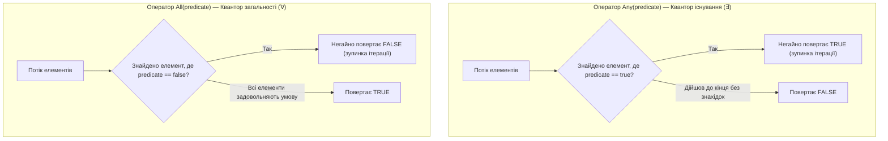

# 📘 Підручник 6. Квантори, Елементні Оператори, Конвертації та Створення Власних Операторів
## Квантори Any/All/Contains, матриця безпеки First проти Single, матеріалізація ToList/ToDictionary, генератори, Zip та патерн написання кастомних розширень

> **Модуль курсу:** Логічні квантори, навігація по елементах, серіалізація в пам'ять та розширення LINQ  
> **Цільова версія:** .NET 10 LTS / C# 14  
> **Практичні приклади репозиторію:** Категорії 7, 8, 9, 10, 12, 13  
> **Ключові вихідні файли:** [`Quantifiers`](..%5C101%20LINQ%20Samples%5CProgram.cs), [`ElementOperators`](..%5C101%20LINQ%20Samples%5CProgram.cs), [`ConversionOperators`](..%5C101%20LINQ%20Samples%5CProgram.cs), [`CustomSequenceOperators`](..%5C101%20LINQ%20Samples%5CProgram.cs)

---

<a id="toc"></a>
## 📑 Зміст Розділу

1. [Квантори математичної логіки: `Any`, `All`, `Contains` та пастка Vacuous Truth](#section-1)
2. [Матриця вибору елементних операторів: `First`, `Single`, `ElementAt` та пастки винятків](#section-2)
3. [Чому оператор `Single()` є прихованою загрозою продуктивності](#section-3)
4. [Оператори конвертації: `ToList`, `ToArray`, `ToDictionary`, `ToHashSet` та фрагментація LOH](#section-4)
5. [Оператор `AsEnumerable()` як межа клієнтського виконання в Entity Framework Core](#section-5)
6. [Генерація послідовностей: `Range`, `Repeat` та неаллокуючий `Empty<T>`](#section-6)
7. [Комбінатор `Zip`: Попарне зшивання двох і трьох послідовностей](#section-7)
8. [Розробка власних LINQ-операторів: Патерн безпечної валідації аргументів](#section-8)
9. [Детальний розбір прикладів коду в репозиторії (Linq54 – Linq98)](#section-9)
10. [Підсумковий чеклист розробника та питання на співбесідах](#section-10)

---

<a id="section-1"></a>
## 1. Квантори математичної логіки: `Any`, `All`, `Contains` та пастка Vacuous Truth

Квантори перевіряють виконання логічних предикатів над елементами послідовності та повертають `bool`. Вони працюють за принципом **Short-circuiting** (негайне дострокове переривання при першому доведеному факті).



### 1. `Any()` та `Any(Func<T, bool>)`
* `source.Any()`: Перевіряє, чи містить послідовність хоча б один елемент. Набагато ефективніше за `source.Count() > 0`, оскільки викликає лише один `MoveNext()` за $O(1)$ часу.
* `source.Any(p)`: Перевіряє, чи існує хоча б один елемент, що відповідає предикату.

### 2. `All(Func<T, bool>)`
* Перевіряє, чи виконується умова для **кожного** елемента.

> [!CAUTION]
> **Математична пастка порожньої множини (Vacuous Truth):**  
> Якщо послідовність порожня, виклик `emptyList.All(x => x > 100)` **ЗАВЖДИ ПОВЕРТАЄ `true`**!  
> *Чому так:* У формальній логіці твердження "Для кожного елемента порожньої множини виконується властивість $P$" є завжди істинним, оскільки не існує жодного контрприкладу, який міг би спростувати це твердження.

### 3. `Contains(item)`
* Перевіряє наявність конкретного елемента за рівністю значень (підтримує кастомний `IEqualityComparer<T>`).

---

<a id="section-2"></a>
## 2. Матриця вибору елементних операторів: `First`, `Single`, `ElementAt` та пастки винятків

Елементні оператори призначені для вилучення конкретного одиничного значення з послідовності:

| Оператор | Послідовність порожня | Рівно 1 збіг | 2 і більше збігів | Складність за часом |
| :--- | :--- | :--- | :--- | :--- |
| **`First()`** | 💥 `InvalidOperationException` | Повертає елемент | Повертає перший | $O(1)$ |
| **`FirstOrDefault()`** | Повертає `default(T)` | Повертає елемент | Повертає перший | $O(1)$ |
| **`Single()`** | 💥 `InvalidOperationException` | Повертає елемент | 💥 `InvalidOperationException` | **$O(N)$** |
| **`SingleOrDefault()`**| Повертає `default(T)` | Повертає елемент | 💥 `InvalidOperationException` | **$O(N)$** |
| **`ElementAt(i)`** | 💥 `ArgumentOutOfRangeException` | Повертає за індексом | Повертає за індексом | $O(1)$ для масивів, $O(i)$ для потоку |
| **`ElementAtOrDefault(i)`**| Повертає `default(T)` | Повертає за індексом | Повертає за індексом | $O(1)$ або $O(i)$ |

### Кастомні дефолтні значення у .NET 6+ / .NET 10:
Раніше `FirstOrDefault()` над масивом чисел повертав `0`, що не дозволяло відрізнити "знайдено число 0" від "нічого не знайдено".  
Тепер доступне перевантаження з явною передачею дефолтного значення:
```csharp
// Повернути -1, якщо число більше 100 відсутнє:
int result = numbers.FirstOrDefault(n => n > 100, defaultValue: -1);
```

---

<a id="section-3"></a>
## 3. Чому оператор `Single()` є прихованою загрозою продуктивності

Багато розробників помилково вважають, що `Single()` працює швидше або безпечніше за `First()`.

```csharp
// ❌ НЕБЕЗПЕКА ДЛЯ БАЗИ ДАНИХ ТА ПРОДУКТИВНОСТІ:
var user = dbContext.Users.SingleOrDefault(u => u.Email == email);
```

### Чому `Single()` повільніший:
1. `First()` викликає `MoveNext()` рівно **один раз**. Якщо елемент знайдено, ітерація миттєво завершується ($O(1)$). У SQL генерується `SELECT TOP(1)`.
2. `Single()` **ЗОБОВ'ЯЗАНИЙ перевірити, чи немає другого такого елемента**!
   * У базі даних EF Core змушений генерувати `SELECT TOP(2)`.
   * У LINQ to Objects він змушений викликати `MoveNext()` вдруге, щоб переконатися, що наступного елемента немає.
   * Якщо таблиця велика і не має унікального індексу, база даних сканує зайві сторінки пам'яті.

> [!TIP]
> Використовуйте `Single()` виключно тоді, коли наявність другого дубліката є **критичною аварійною помилкою цілісності даних бізнес-логіки**. Для звичайного пошуку сутності завжди використовуйте `FirstOrDefault()`.

---

<a id="section-4"></a>
## 4. Оператори конвертації: `ToList`, `ToArray`, `ToDictionary`, `ToHashSet` та фрагментація LOH

Оператори конвертації здійснюють **матеріалізацію** — вони перетворюють лінивий конвеєр `IEnumerable<T>` на конкретну структуру даних у пам'яті.

```mermaid
flowchart TD
    Stream["Лінивий потік IEnumerable<T>"] --> Choice{У яку структуру матеріалізувати?}

    Choice -->|ToList()| List["List<T>\nДинамічний масив (подвоєння пам'яті)"]
    Choice -->|ToArray()| Arr["T[]\nФіксований компактний масив"]
    Choice -->|ToDictionary()| Dict["Dictionary<TKey, TValue>\nХеш-індекс за унікальним ключем"]
    Choice -->|ToHashSet()| Set["HashSet<T>\nМножина унікальних значень O(1)"]
    Choice -->|ToLookup()| Look["ILookup<TKey, TElement>\nНезмінний індекс 1:N (мультисловник)"]
```

### Пастка подвоєння пам'яті та LOH (Large Object Heap):
* Клас `List<T>` під капотом містить звичайний масив `T[] _items`.
* Коли ви викликаєте `stream.ToList()`, розмір якого наперед невідомий, `List<T>` починає з масиву довжиною 4 і **подвоює свій розмір** при кожному переповненні ($4 \to 8 \to 16 \to 32 \to ... \to 65536 \to 131072$).
* Якщо розмір масиву перевищує **85 000 байт**, об'єкт автоматично виділяється у **Large Object Heap (LOH)**.
* Часті подвоєння у LOH спричиняють важку фрагментацію пам'яті та довгі паузи збирача сміття GC Gen 2!

---

<a id="section-5"></a>
## 5. Оператор `AsEnumerable()` як межа клієнтського виконання в Entity Framework Core

Коли ви працюєте з `IQueryable<T>` у Entity Framework Core, усі операції транслюються в SQL. Але деякі операції (наприклад, виклики власних C#-методів шифрування чи парсингу рядків) SQL-сервер виконати не здатний.

```csharp
// ❌ Виклик CustomDecrypt не може бути трансльований у SQL: Runtime Crash!
var users = dbContext.Users
    .Where(u => CustomDecrypt(u.EncryptedData) == "Secret")
    .ToList();

//  Правильне розмежування через AsEnumerable():
var usersFixed = dbContext.Users
    .Where(u => u.IsActive)           // Виконується на SQL сервері: WHERE IsActive = 1
    .AsEnumerable()                   // ПЕРЕХІДНА МЕЖА: далі йде LINQ to Objects у пам'яті C#!
    .Where(u => CustomDecrypt(u.EncryptedData) == "Secret") // Виконується процесором C#
    .ToList();
```

---

<a id="section-6"></a>
## 6. Генерація послідовностей: `Range`, `Repeat` та неаллокуючий `Empty<T>`

Статичні методи класу `Enumerable` дозволяють генерувати послідовності з нуля без виділення масивів:

1. **`Enumerable.Range(int start, int count)`:**
   Генерує послідовність цілих чисел. Споживає $O(1)$ пам'яті (чистий автомат станів).
   ```csharp
   // Генерація квадратів чисел від 1 до 10:
   var squares = Enumerable.Range(1, 10).Select(x => x * x);
   ```

2. **`Enumerable.Repeat(element, count)`:**
   Повторює один і той самий елемент задану кількість разів.
   ```csharp
   var defaultValues = Enumerable.Repeat("N/A", 5);
   ```

3. **`Enumerable.Empty<T>()`:**
   Повертає порожній кешований синглтон `IEnumerable<T>`.  
   *Ніколи не пишіть `new List<T>()` або `new T[0]` для повернення порожнього результату — використовуйте `Enumerable.Empty<T>()`, щоб не навантажувати Garbage Collector!*

---

<a id="section-7"></a>
## 7. Комбінатор `Zip`: Попарне зшивання двох і трьох послідовностей

Оператор `Zip` з'єднує дві або три послідовності за принципом "застібки-блискавки" (паралельне читання елементів з однаковими індексами):

```mermaid
flowchart TD
    A["Послідовність A: [ 1, 2, 3 ]"]
    B["Послідовність B: [ 'A', 'B', 'C' ]"]

    A & B -->|"A.Zip(B, (a, b) => $"{a}-{b}")"| Z["Zip Результат: [ '1-A', '2-B', '3-C' ]"]
```

* **Правило коротшої послідовності:** Якщо одна послідовність довша за іншу, `Zip` зупиняється, як тільки закінчується коротша з них.
* **Зшивання трьох послідовностей у .NET 6+:**
  ```csharp
  var triplets = first.Zip(second, third); // Повертає IEnumerable<(T1, T2, T3)>
  ```

---

<a id="section-8"></a>
## 8. Розробка власних LINQ-операторів: Патерн безпечної валідації аргументів

Створення власних методів розширення вимагає дотримання корпоративного стандарту архітектури BCL.

### Критична помилка наївної реалізації з `yield return`:
```csharp
// ❌ ГРУБА ПОМИЛКА: відкладена перевірка валідності аргументів
public static IEnumerable<T> BadFilter<T>(this IEnumerable<T> source, Func<T, bool> predicate)
{
    if (source == null) throw new ArgumentNullException(nameof(source));
    if (predicate == null) throw new ArgumentNullException(nameof(predicate));

    foreach (var item in source)
    {
        if (predicate(item)) yield return item;
    }
}
```
*Чому це погано:* Оскільки метод містить `yield return`, весь його код стає автоматом станів. Якщо передати `null`, виняток `ArgumentNullException` **НЕ БУДЕ викинуто** в точці виклику методу! Він вистрілить лише значно пізніше — під час першого виклику `foreach` в іншому кінці програми!

### Еталонний патерн BCL (Public Wrapper + Private Iterator):
```csharp
public static class CustomLinqExtensions
{
    // 1. Публічний метод негайно перевіряє аргументи в момент виклику:
    public static IEnumerable<T> SafeFilter<T>(this IEnumerable<T> source, Func<T, bool> predicate)
    {
        ArgumentNullException.ThrowIfNull(source);
        ArgumentNullException.ThrowIfNull(predicate);

        // 2. Виклик приватного ітератора з автоматом станів:
        return SafeFilterIterator(source, predicate);
    }

    private static IEnumerable<T> SafeFilterIterator<T>(IEnumerable<T> source, Func<T, bool> predicate)
    {
        foreach (var item in source)
        {
            if (predicate(item))
            {
                yield return item;
            }
        }
    }
}
```

---

<a id="section-9"></a>
## 9. Детальний розбір прикладів коду в репозиторії (Linq54 – Linq98)

### Категорія 7: Conversion Operators (Конвертація)
* [`Linq54.cs`](../LINQ%20-%20Conversion%20Operators/C%23/ConversionOperators/LinqSamples/Linq54.cs): `ToArray()` матеріалізація списку чисел з плаваючою крапкою.
* [`Linq55.cs`](../LINQ%20-%20Conversion%20Operators/C%23/ConversionOperators/LinqSamples/Linq55.cs): `ToList()` матеріалізація відсортованого списку слів.
* [`Linq56.cs`](../LINQ%20-%20Conversion%20Operators/C%23/ConversionOperators/LinqSamples/Linq56.cs): `ToDictionary()` за числовим ключем.
* [`Linq57.cs`](../LINQ%20-%20Conversion%20Operators/C%23/ConversionOperators/LinqSamples/Linq57.cs): `OfType<T>()` для безпечної вибірки чисел з різнотипного масиву.

---

### Категорія 8: Element Operators (Елементні оператори)
* [`Linq58.cs`](../LINQ%20-%20Element%20Operators/C%23/ElementOperators/LinqSamples/Linq58.cs): Базовий `First()` для отримання першого товару каталогу.
* [`Linq59.cs`](../LINQ%20-%20Element%20Operators/C%23/ElementOperators/LinqSamples/Linq59.cs): `First()` з предикатом: перше слово на літеру 'o'.
* [`Linq61.cs`](../LINQ%20-%20Element%20Operators/C%23/ElementOperators/LinqSamples/Linq61.cs): Безпечний `FirstOrDefault()` над порожнім масивом.
* [`Linq62.cs`](../LINQ%20-%20Element%20Operators/C%23/ElementOperators/LinqSamples/Linq62.cs): `FirstOrDefault()` для пошуку першого товару з ціною понад 100$.
* [`Linq64.cs`](../LINQ%20-%20Element%20Operators/C%23/ElementOperators/LinqSamples/Linq64.cs): `ElementAt()` для вибору другого числа, більшого за 5.

---

### Категорія 10: Quantifiers (Квантори)
* [`Linq67.cs`](../LINQ%20-%20Quantifiers/C%23/Quantifiers/LinqSamples/Linq67.cs): `Any()` для перевірки наявності хоча б одного слова з літерою 'i'.
* [`Linq69.cs`](../LINQ%20-%20Quantifiers/C%23/Quantifiers/LinqSamples/Linq69.cs): `Any()` для перевірки категорій, що мають хоча б один товар не на складі.
* [`Linq70.cs`](../LINQ%20-%20Quantifiers/C%23/Quantifiers/LinqSamples/Linq70.cs): `All()` для перевірки, чи всі числа масиву є непарними.
* [`Linq72.cs`](../LINQ%20-%20Quantifiers/C%23/Quantifiers/LinqSamples/Linq72.cs): `All()` для вибірки категорій, де ВСІ товари є на складі.

---

### Категорія 12 та 13: Miscellaneous та Custom Sequence Operators
* [`Linq92.cs`](..%5CLINQ%20-%20Aggregate%20Operators%5CC%23%5CAggregateOperators%5CLinqSamples%5CLinq92.cs): `Concat()` двох числових послідовностей.
* [`Linq93.cs`](..%5CLINQ%20-%20Aggregate%20Operators%5CC%23%5CAggregateOperators%5CLinqSamples%5CLinq93.cs): `Concat()` списку клієнтів та постачальників.
* [`Linq94.cs`](..%5CLINQ%20-%20Miscellaneous%20Operators%5CC%23%5CMiscellaneousOperators%5CLinqSamples%5CLinq94.cs): `SequenceEqual()` порівняння однакових послідовностей слів.
* [`Linq96.cs`](..%5CLINQ%20-%20Miscellaneous%20Operators%5CC%23%5CMiscellaneousOperators%5CLinqSamples%5CLinq96.cs): `Zip()` множення елементів двох масивів ($a \times b$).

---

<a id="section-10"></a>
## 10. Підсумковий чеклист розробника та питання на співбесідах

### Чеклист архітектури високопродуктивного коду на LINQ:
1. Завжди використовуйте `Any()` замість `Count() > 0`.
2. Віддавайте перевагу `FirstOrDefault()` над `SingleOrDefault()`, якщо не потрібна жорстка перевірка унікальності.
3. Застосовуйте `AsEnumerable()` для чіткого розмежування серверного SQL-коду та клієнтських C#-обчислень.
4. У кастомних LINQ-методах завжди відокремлюйте валідацію аргументів від `yield return` ітератора.
5. Для створення порожніх послідовностей використовуйте виключно `Enumerable.Empty<T>()`.

---
[⬆ До змісту](#toc) • [Попередній розділ: Реляційні З'єднання та Агрегати ⬅](./05-Joins-and-Aggregate-Operators.md) • [Головний навігатор курсу 🏠](./README.md)
