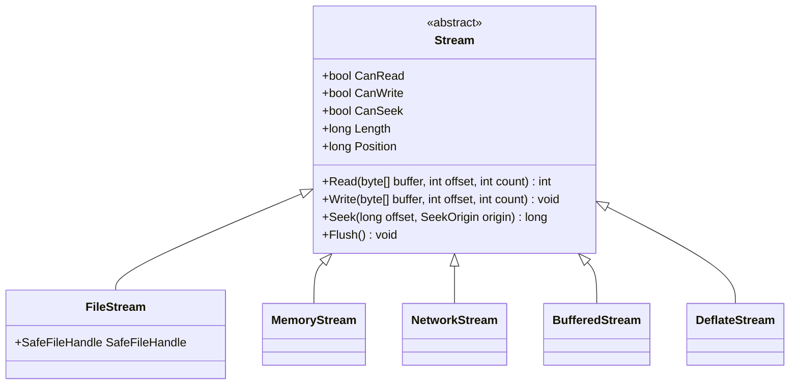

# Архітектура потоків (Streams) та робота з FileStream

## Вступ
Потік (`Stream`) у .NET — це абстракція послідовності байтів, яка забезпечує уніфікований інтерфейс для читання та запису даних незалежно від фізичного носія (файл на диску, оперативна пам'ять, мережевий сокет або канал між процесами).

---

## 1. Базовий клас System.IO.Stream

Всі потоки в .NET успадковуються від абстрактного класу `Stream`:



### Ключові властивості:
- `Position`: Поточна позиція курсора в потоці (байт, з якого почнеться наступне читання або запис).
- `CanSeek`: Показує, чи підтримує потік довільне переміщення курсора (`FileStream` — так, `NetworkStream` — ні).
- `Flush()`: Примусово записує вміст внутрішнього буфера потоку на фізичний носій.

---

## 2. FileStream: Режими доступу та відкриття файлів

При створенні екземпляра `FileStream` критично важливо правильно обрати конфігурацію:
1. **`FileMode`** (Що робити з файлом?):
   - `CreateNew`: Створити новий файл; якщо файл вже існує — кинути `IOException`.
   - `Create`: Створити новий або перезаписати існуючий файл.
   - `Open`: Відкрити існуючий файл; якщо файл відсутній — кинути `FileNotFoundException`.
   - `OpenOrCreate`: Відкрити існуючий або створити новий, якщо його ще немає.
   - `Append`: Відкрити існуючий і перемістити курсор у кінець, або створити новий.
2. **`FileAccess`** (Які операції дозволені?):
   - `Read`, `Write`, `ReadWrite`.
3. **`FileShare`** (Чи можуть інші процеси одночасно звертатися до файлу?):
   - `None`: Файл монопольно заблокований поточним процесом.
   - `Read`, `Write`, `ReadWrite`: Дозволяє спільний доступ.

### Патерн безпечного вивільнення ресурсів (using statement):
```csharp
// Некерований ресурс SafeFileHandle буде гарантовано звільнено
using (var fs = new FileStream("data.bin", FileMode.Create, FileAccess.Write, FileShare.None))
{
    byte[] info = new UTF8Encoding(true).GetBytes("Дані для збереження");
    fs.Write(info, 0, info.Length);
}
```

---

## 3. Проекти для практики

- [01-01-FileStream](file:///04-Data-And-IO/02-Files-And-Streams/01-01-FileStream/Program.cs) — Створення файлу, запис байтів та закриття потоку.
- [01-02-FileStream](file:///04-Data-And-IO/02-Files-And-Streams/01-02-FileStream/Program.cs) — Побайтове читання даних за допомогою `fs.ReadByte()`.
- [01-03-FileStream](file:///04-Data-And-IO/02-Files-And-Streams/01-03-FileStream/Program.cs) — Блокове читання та запис масиву байтів `byte[] buffer`.
