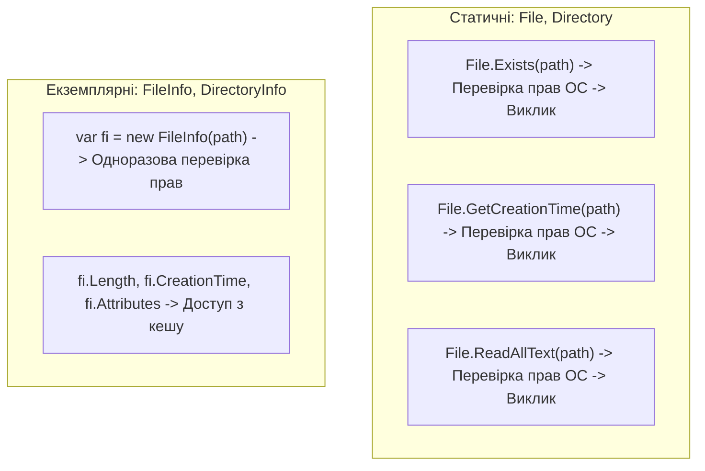

# Файлова система: File vs FileInfo, Directory vs DirectoryInfo

## Вступ
Для роботи з файловою системою простір імен `System.IO` надає дві паралельні ієрархії:
1. **Статичні утилітарні класи:** `File`, `Directory`, `Path`.
2. **Екземплярні стані класи:** `FileInfo`, `DirectoryInfo`, `DriveInfo`.

---

## 1. Порівняння: Статичні чи екземплярні класи?



| Критерій | `File` / `Directory` (Статичні) | `FileInfo` / `DirectoryInfo` (Екземплярні) |
| :--- | :--- | :--- |
| **Коли використовувати** | Одноразові операції (наприклад, швидко прочитати весь файл) | Багаторазові операції над одним і тим самим файлом/папкою |
| **Перевірка прав (Security)** | Перевіряє права безпеки ОС при **кожному** виклику методу | Перевіряє права один раз при ініціалізації об'єкта |
| **Кешування метаданих** | Метадані не кешуються, кожне звернення йде до диска | Кешує властивості (`Length`, `Attributes`); для оновлення потрібен `Refresh()` |
| **Спадкування** | Статичні класи, не успадковуються | Успадковуються від спільного предка `FileSystemInfo` |

---

## 2. Практичні операції

### Швидкі методи класу File:
```csharp
// Читання та запис усього вмісту в один рядок
string text = File.ReadAllText("input.txt");
File.WriteAllText("output.txt", text);

// Порядкова обробка
string[] lines = File.ReadAllLines("log.txt");
File.AppendAllLines("log.txt", new[] { "Новий запис логу" });
```

### Комплексний аналіз через FileInfo:
```csharp
var file = new FileInfo("report.pdf");
if (file.Exists)
{
    Console.WriteLine($"Розмір: {file.Length} байт");
    Console.WriteLine($"Створено: {file.CreationTime}");
    Console.WriteLine($"Розширення: {file.Extension}");
    Console.WriteLine($"Атрибути: {file.Attributes}");
}
```

---

## 3. Проекти для практики

- [03-01-FileClass](file:///04-Data-And-IO/02-Files-And-Streams/03-01-FileClass/Program.cs) — Створення та видалення файлів за допомогою `File.Create` / `File.Delete`.
- [03-02-FileClass](file:///04-Data-And-IO/02-Files-And-Streams/03-02-FileClass/Program.cs) — Перевірка існування `File.Exists`.
- [03-03-FileClass](file:///04-Data-And-IO/02-Files-And-Streams/03-03-FileClass/Program.cs) — Читання та запис рядків через `File.WriteAllText` / `File.ReadAllText`.
- [07-01-FileInfoClass](file:///04-Data-And-IO/02-Files-And-Streams/07-01-FileInfoClass/Program.cs) — Створення екземпляра `FileInfo` та перевірка стану.
- [07-08-FileInfoClass](file:///04-Data-And-IO/02-Files-And-Streams/07-08-FileInfoClass/Program.cs) — Комплексне переміщення, копіювання та робота з атрибутами файлу.
- [08-01-08-DirectoryInfoClass](file:///04-Data-And-IO/02-Files-And-Streams/08-01-08-DirectoryInfoClass/Program.cs) — Створення та навігація по папках через `DirectoryInfo`.
- [08-05-DirectoryInfoClass](file:///04-Data-And-IO/02-Files-And-Streams/08-05-DirectoryInfoClass/Program.cs) — Рекурсивний обхід піддиректорій та фільтрація файлів за маскою.
