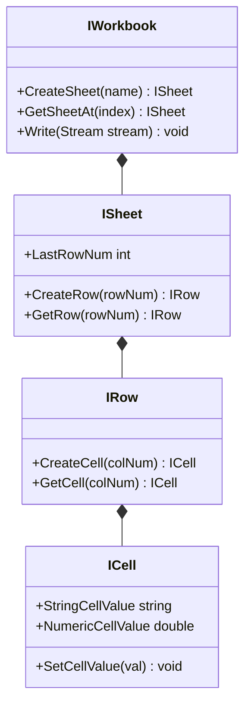

# Експорт та імпорт табличних даних: Робота з Excel (NPOI)

## Вступ
У практичній бізнес-розробці найпоширенішим форматом обміну звітами є електронні таблиці Microsoft Excel (`.xlsx`). У середовищі .NET бібліотека **NPOI** дозволяє читати та генерувати файли Excel без встановленого на сервері пакета Microsoft Office.

---

## 1. Об'єктна модель документа Excel в NPOI



---

## 2. Патерн експорту бізнес-сутностей

```csharp
public static void ExportEmployees(List<Employee> employees, string filePath)
{
    // 1. Створюємо книгу у форматі OpenXML (.xlsx)
    IWorkbook workbook = new XSSFWorkbook();
    ISheet sheet = workbook.CreateSheet("Співробітники");

    // 2. Створюємо рядок заголовків
    IRow headerRow = sheet.CreateRow(0);
    headerRow.CreateCell(0).SetCellValue("ID");
    headerRow.CreateCell(1).SetCellValue("Ім'я");
    headerRow.CreateCell(2).SetCellValue("Посада");
    headerRow.CreateCell(3).SetCellValue("Оклад");

    // 3. Заповнюємо таблицю даними
    for (int i = 0; i < employees.Count; i++)
    {
        IRow row = sheet.CreateRow(i + 1);
        row.CreateCell(0).SetCellValue(employees[i].Id);
        row.CreateCell(1).SetCellValue(employees[i].Name);
        row.CreateCell(2).SetCellValue(employees[i].Position);
        row.CreateCell(3).SetCellValue((double)employees[i].Salary);
    }

    // 4. Записуємо книгу у файловий потік
    using (var fs = new FileStream(filePath, FileMode.Create, FileAccess.Write))
    {
        workbook.Write(fs);
    }
}
```

---

## 3. Патерн імпорту та парсингу рядків

При читанні обов'язково враховувати можливість порожніх рядків та типів клітинок (число, текст, дата або формула):
```csharp
using var fs = new FileStream(filePath, FileMode.Open, FileAccess.Read);
IWorkbook workbook = new XSSFWorkbook(fs);
ISheet sheet = workbook.GetSheetAt(0);

for (int r = 1; r <= sheet.LastRowNum; r++)
{
    IRow row = sheet.GetRow(r);
    if (row == null) continue;

    int id = (int)row.GetCell(0).NumericCellValue;
    string name = row.GetCell(1).StringCellValue;
    // ...
}
```

---

## 4. Проекти для практики

- [09-01-ExportAndImportExcelData](file:///04-Data-And-IO/02-Files-And-Streams/09-01-ExportAndImportExcelData/Program.cs) — Повний цикл: генерація моделі `Employee`, стилізація клітинок, експорт у `.xlsx` та читання назад.
- [09-02-ExportAndImportExcelData](file:///04-Data-And-IO/02-Files-And-Streams/09-02-ExportAndImportExcelData/Program.cs) — Альтернативні сценарії парсингу та валідації Excel-таблиць.
