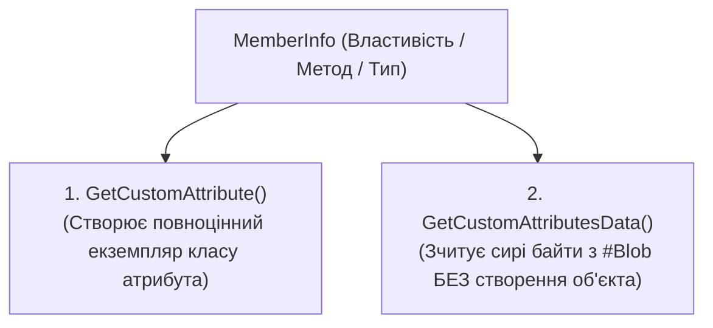
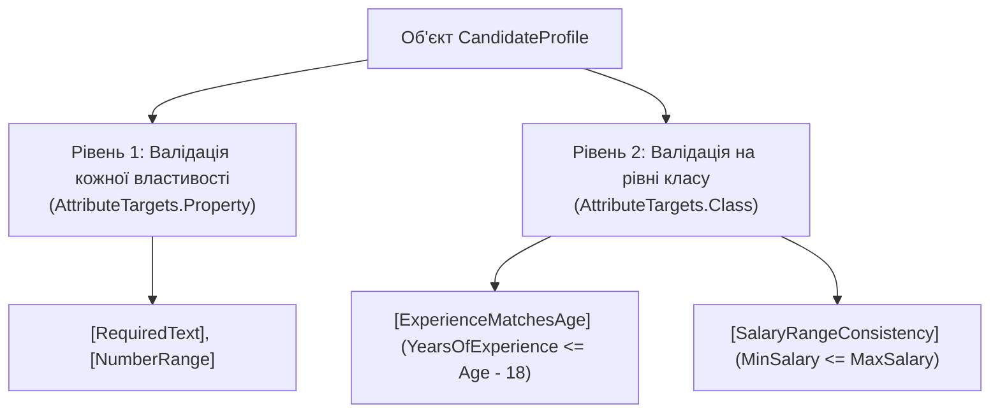

# 04. Метадані, атрибути, валідація на рівні класу та серіалізація (Attributes, Validation & Serialization)

> **Solution-тег (Solution Folder)**: `05. Attributes & Serialization`  
> **Проєкти у тегу (від простого до складного)**:
> - [17-AttributesBasicsDemo](../17-AttributesBasicsDemo/Program.cs) — Призначення атрибутів, вбудовані та власні атрибути (`[CodeAuthor]`, `[ConsoleCommand]`, `[RequireRole]`), низькорівневий потік `#Blob`.
> - [18-AttributesValidationDemo](../18-AttributesValidationDemo/Program.cs) — Дворівнева декларативна валідація: перевірка окремих властивостей та валідація узгодженості даних на рівні всього класу.
> - [19-SerializationBasicsJsonDemo](../19-SerializationBasicsJsonDemo/Program.cs) — Серіалізація-Десеріалізація — Базове розуміння формату JSON (`System.Text.Json`, `JsonDocument`).
> - [20-SerializationBasicsXmlDemo](../20-SerializationBasicsXmlDemo/Program.cs) — Серіалізація-Десеріалізація — Базове розуміння формату XML (`XmlSerializer`, `XDocument`).
> - [21-JsonSerializationDemo](../21-JsonSerializationDemo/Program.cs) — Рефлексивна Серіалізація JSON (`ReflectionJsonSerializer`).
> - [22-XmlSerializationDemo](../22-XmlSerializationDemo/Program.cs) — Рефлексивна Серіалізація XML (`ReflectionXmlSerializer`).
> - [23-JsonDeserializationDemo](../23-JsonDeserializationDemo/Program.cs) — Рефлексивна Десеріалізація JSON (`ReflectionJsonDeserializer`).
> - [24-XmlDeserializationDemo](../24-XmlDeserializationDemo/Program.cs) — Рефлексивна Десеріалізація XML (`ReflectionXmlDeserializer`).

**Атрибути (Attributes)** у .NET — це механізм декларативного метапрограмування, який дозволяє додавати описову інформацію безпосередньо до елементів програмного коду (збірок, модулів, типів, методів, властивостей, параметрів).

---

## 1. Понятійний апарат: Атрибути в системі типів CLR

### 1.1. Що таке атрибут і для чого він потрібен?
**Атрибут** — це спеціалізований клас, похідний від абстрактного базового класу `System.Attribute`, екземпляр якого компілятор серіалізує в двійкові метадані збірки як додаткову характеристику цільового програмного елемента.

Атрибути реалізують концепцію **розділення відповідальності (Separation of Concerns)**. У проєкті [17-AttributesBasicsDemo](../17-AttributesBasicsDemo/Program.cs) продемонстровано три типові сценарії застосування атрибутів:
1. **Технічна документація та аудит**: атрибут `[CodeAuthor("Іван Франко", Version = "2.1")]` зберігає відомості про автора та критичність безпосередньо у скомпільованому `.dll` файлі.
2. **Маршрутизація команд (Routing)**: атрибут `[ConsoleCommand("pay-invoice", "Провести оплату")]` дозволяє автоматично будувати таблицю команд без громіздких конструкцій `switch-case`.
3. **Контроль доступу (Security)**: атрибут `[RequireRole("Admin")]` дозволяє перевіряти права користувача перед викликом методу.

### 1.2. Фізичне збереження атрибутів у збірці (ECMA-335)

Коли компілятор обробляє атрибут, він виконує два кроки:
1. Додає запис у таблицю метаданих **`CustomAttribute` (ідентифікатор `0x0C`)**:
   - `Parent`: 32-бітний токен елемента-носія.
   - `Type`: 32-бітний токен конструктора атрибута.
   - `Value`: 4-байтне зміщення в бінарний потік **`#Blob`**.
2. **Серіалізація в двійковий потік `#Blob`**:
   - **Пролог (Prolog)**: перші два байти завжди містять константу `0x0001`.
   - **Позиційні параметри**: значення аргументів конструктора у бінарному вигляді.
   - **Іменовані параметри**: кількість іменованих властивостей/полів та пари «ім'я = значення».

```
+------------------+-------------------------------+-----------------------+
| Пролог (0x0001)  | Аргументи конструктора        | Іменовані властивості |
+------------------+-------------------------------+-----------------------+
```

---

## 2. Два рівні зчитування атрибутів через рефлексію

Платформа .NET надає два принципово різні механізми вилучення атрибутів із метаданих:



| Критерій | `GetCustomAttribute<T>()` | `GetCustomAttributesData()` |
| :--- | :--- | :--- |
| **Створення об'єкта** | **Так**, викликає конструктор атрибута | **Ні**, парсить бінарні дані з `#Blob` без виклику конструкторів |
| **Використання пам'яті** | Аллокує об'єкти в керованій купі | Повертає дескриптори `CustomAttributeData` |
| **Безпека виконання** | Виконує код конструктора атрибута | Безпечно для статичних аналізаторів та компіляторів |

- Посилання на приклад використання обох підходів: [17-AttributesBasicsDemo/Program.cs](../17-AttributesBasicsDemo/Program.cs).

---

## 3. Декларативна валідація даних: Рівень властивостей та Рівень класу

У реальних системах валідація поділяється на два рівні (проєкт [18-AttributesValidationDemo](../18-AttributesValidationDemo/Program.cs)):



1. **Рівень властивості (`AttributeTargets.Property`)**: перевіряє одне поле ізольовано (чи не порожній рядок, чи входить число в діапазон).
2. **Рівень класу (`AttributeTargets.Class`)**: перевіряє бізнес-узгодженість між декількома властивостями одночасно (наприклад, чи не перевищує стаж роботи вік кандидата мінус 18 років, або чи `MinSalary <= MaxSalary`).

- Посилання на атрибути валідації властивостей та класу: [18-AttributesValidationDemo/ValidationAttributes.cs](../18-AttributesValidationDemo/ValidationAttributes.cs).
- Посилання на двофазний валідаційний рушій: [18-AttributesValidationDemo/ClassAndPropertyValidator.cs](../18-AttributesValidationDemo/ClassAndPropertyValidator.cs).

---

## 4. Серіалізація та Десеріалізація: Від базового розуміння JSON/XML до власних рефлексивних рушіїв

Навчальний блок серіалізації побудований у шість послідовних кроків:

1. **Базове розуміння JSON** ([19-SerializationBasicsJsonDemo](../19-SerializationBasicsJsonDemo/Program.cs)): синтаксис пар `"ключ": значення`, типи даних JSON, атрибути `[JsonPropertyName]` та `[JsonIgnore]`, інспекція через `JsonDocument`.
2. **Базове розуміння XML** ([20-SerializationBasicsXmlDemo](../20-SerializationBasicsXmlDemo/Program.cs)): ієрархія тегів, різниця між XML-елементами (`[XmlElement]`) та XML-атрибутами (`[XmlAttribute]`), інспекція через `XDocument`.
3. **Власна Серіалізація JSON через рефлексію** ([21-JsonSerializationDemo](../21-JsonSerializationDemo/ReflectionJsonSerializer.cs)): читання графа властивостей через `Type.GetProperties()` та `PropertyInfo.GetValue()`, форматування рядків, чисел і логічних значень згідно з власними атрибутами `[JsonField]` та `[JsonExclude]`.
4. **Власна Серіалізація XML через рефлексію** ([22-XmlSerializationDemo](../22-XmlSerializationDemo/ReflectionXmlSerializer.cs)): генерація кореневого тегу з `[XmlRootTag]`, розподіл властивостей на атрибути відкриваючого тегу (`[XmlAttr]`) та вкладені дочірні елементи (`[XmlTag]`).
5. **Власна Десеріалізація JSON через рефлексію** ([23-JsonDeserializationDemo](../23-JsonDeserializationDemo/ReflectionJsonDeserializer.cs)): динамічне конструювання об'єкта через `Activator.CreateInstance<T>()`, зіставлення JSON-ключів із властивостями класу та запис значень через `PropertyInfo.SetValue()`.
6. **Власна Десеріалізація XML через рефлексію** ([24-XmlDeserializationDemo](../24-XmlDeserializationDemo/ReflectionXmlDeserializer.cs)): розбір XML-атрибутів і дочірніх тегів, конвертація рядків у цільовий тип властивості через `Convert.ChangeType()` та заповнення об'єкта через `PropertyInfo.SetValue()`.
