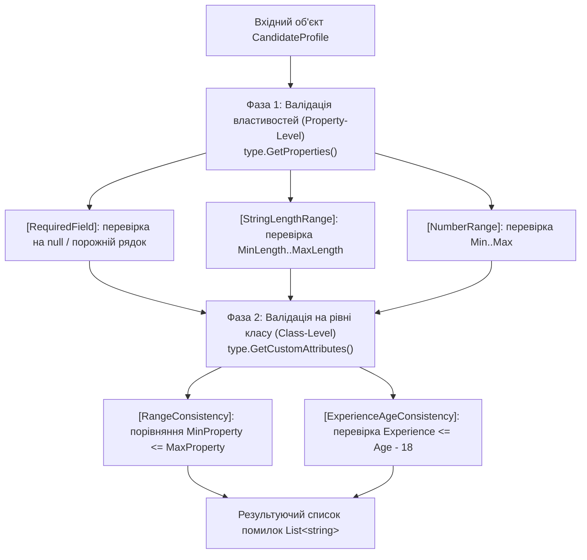

# Декларативна валідація даних на рівні класу та властивостей

> **Базовий проєкт**: [18-AttributesValidationDemo](../../18-AttributesValidationDemo/Program.cs)  
> **Ключові класи**: `System.Attribute`, `System.Type`, `System.Reflection.PropertyInfo`  
> **Офіційна документація**: [System.ComponentModel.DataAnnotations Namespace (Microsoft Learn)](https://learn.microsoft.com/en-us/dotnet/api/system.componentmodel.dataannotations)

У реальних програмних системах валідація вхідних даних поділяється на два рівні: **валідація окремих властивостей (Property-Level)** та **валідація бізнес-узгодженості всього класу (Class-Level)**.

---

## 1. Чому недостатньо валідувати лише окремі властивості?

Розглянемо профіль кандидата [`CandidateProfile`](../../18-AttributesValidationDemo/CandidateProfile.cs):
- `Age = 22` — окремо цілком валідний вік повнолітньої людини (`[NumberRange(18, 70)]`).
- `YearsOfExperience = 10` — окремо валідний стаж роботи (`[NumberRange(0, 50)]`).
- `ExpectedMinSalary = 4500` та `ExpectedMaxSalary = 3000` — кожне число окремо входить у допустимі межі зарплат.

Проте **на рівні всього класу** такий об'єкт є суперечливим: у 22 роки неможливо мати 10 років офіційного стажу (з 18 років), а мінімальна зарплата не може перевищувати максимальну. Саме для цього створюються атрибути з ціллю `AttributeTargets.Class`.

---

## 2. Двофазний пайплайн рефлексивного валідатора

---

## 3. Властивості рефлексії, задіяні у валідації (Properties)

| Властивість | Сигнатура | Опис призначення | Статус у курсі | Приклад у коді | Документація MSDN |
| :--- | :--- | :--- | :---: | :--- | :--- |
| **`Name`** | `string Name { get; }` | Назва властивості або класу для формування зрозумілого повідомлення про помилку | Використано | [18-AttributesValidationDemo/ClassAndPropertyValidator.cs](../../18-AttributesValidationDemo/ClassAndPropertyValidator.cs#L33) | [MemberInfo.Name](https://learn.microsoft.com/en-us/dotnet/api/system.reflection.memberinfo.name) |
| **`ValidOn`** | `AttributeTargets ValidOn { get; }` | Визначає рівень застосування атрибута: `AttributeTargets.Class` або `AttributeTargets.Property` | Використано | [18-AttributesValidationDemo/ValidationAttributes.cs](../../18-AttributesValidationDemo/ValidationAttributes.cs#L13) | [AttributeUsageAttribute.ValidOn](https://learn.microsoft.com/en-us/dotnet/api/system.attributeusageattribute.validon) |

---

## 4. Методи рефлексії, задіяні у валідації (Methods)

| Метод | Сигнатура | Опис призначення | Статус у курсі | Приклад у коді | Документація MSDN |
| :--- | :--- | :--- | :---: | :--- | :--- |
| **`GetProperties`** | `PropertyInfo[] GetProperties(BindingFlags bindingAttr)` | Отримує всі відкриті властивості об'єкта для почергової перевірки | Використано | [18-AttributesValidationDemo/ClassAndPropertyValidator.cs](../../18-AttributesValidationDemo/ClassAndPropertyValidator.cs#L21) | [Type.GetProperties](https://learn.microsoft.com/en-us/dotnet/api/system.type.getproperties) |
| **`GetProperty`** | `PropertyInfo? GetProperty(string name)` | Знаходить взаємопов'язані властивості за їхніми іменами під час валідації на рівні класу | Використано | [18-AttributesValidationDemo/ClassAndPropertyValidator.cs](../../18-AttributesValidationDemo/ClassAndPropertyValidator.cs#L68) | [Type.GetProperty](https://learn.microsoft.com/en-us/dotnet/api/system.type.getproperty) |
| **`GetValue`** | `object? GetValue(object? obj)` | Витягує фактичне значення поля з об'єкта для перевірки умови | Використано | [18-AttributesValidationDemo/ClassAndPropertyValidator.cs](../../18-AttributesValidationDemo/ClassAndPropertyValidator.cs#L25) | [PropertyInfo.GetValue](https://learn.microsoft.com/en-us/dotnet/api/system.reflection.propertyinfo.getvalue) |
| **`GetCustomAttributes<T>`**| `IEnumerable<T> GetCustomAttributes<T>(bool inherit)` | Зчитує всі валідаційні правила рівня класу з дескриптора `Type` | Використано | [18-AttributesValidationDemo/ClassAndPropertyValidator.cs](../../18-AttributesValidationDemo/ClassAndPropertyValidator.cs#L65) | [CustomAttributeExtensions.GetCustomAttributes](https://learn.microsoft.com/en-us/dotnet/api/system.reflection.customattributeextensions.getcustomattributes) |
