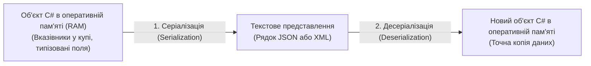

# Базове розуміння форматів JSON та XML у .NET

> **Базові проєкти**:
> - [19-SerializationBasicsJsonDemo](../../19-SerializationBasicsJsonDemo/Program.cs) — Структура та базове розуміння JSON.
> - [20-SerializationBasicsXmlDemo](../../20-SerializationBasicsXmlDemo/Program.cs) — Структура та базове розуміння XML.  
> **Офіційна документація**: [Serialization in .NET (Microsoft Learn)](https://learn.microsoft.com/en-us/dotnet/standard/serialization/)

Перш ніж створювати власні рефлексивні рушії серіалізації, необхідно чітко розуміти будову двох фундаментальних текстових форматів обміну даними: **JSON** та **XML**.

---

## 1. Що таке Серіалізація та Десеріалізація?

- **Серіалізація** — процес перетворення стану об'єкта з оперативної пам'яті у лінійний текстовий або байтовий потік для передачі по мережі або збереження на диск.
- **Десеріалізація** — зворотний процес розбору тексту та відновлення живого екземпляра об'єкта у пам'яті.

---

## 2. Порівняння анатомії JSON та XML

| Характеристика | Формат JSON (JavaScript Object Notation) | Формат XML (eXtensible Markup Language) |
| :--- | :--- | :--- |
| **Синтаксична основа** | Пари `"ключ": значення` всередині фігурних дужок `{ }` | Ієрархічне дерево відкриваючих `<Tag>` та закриваючих `</Tag>` тегів |
| **Кореневий елемент** | Безіменний об'єкт `{ ... }` або масив `[ ... ]` | Зобов'язаний мати рівно один іменований кореневий тег (наприклад, `<LibraryBook>`) |
| **Способи запису властивості** | Завжди як пара `"ключ": значення` | Два способи: або вкладений тег `<Year>2024</Year>`, або атрибут тегу `<Book year="2024">` |
| **Типізація значень у тексті** | Розрізняє рядки `"abc"`, числа `94.5`, логічні `true`/`false`, масиви `[]` та `null` | Усі значення за замовчуванням є текстом між тегами або в лапках атрибута |
| **Керуючі атрибути в .NET** | `[JsonPropertyName]`, `[JsonIgnore]` | `[XmlRoot]`, `[XmlElement]`, `[XmlAttribute]`, `[XmlArray]`, `[XmlIgnore]` |
| **Основна сфера застосування** | REST API, мікросервіси, веб-додатки, `appsettings.json` | Файли проєктів `.csproj`, банківські шлюзи, SOAP-сервіси, векторна графіка SVG |

---

## 3. Властивості класів DOM-аналізу JSON та XML (Properties)

| Властивість | Сигнатура | Опис призначення | Статус у курсі | Приклад у коді | Документація MSDN |
| :--- | :--- | :--- | :---: | :--- | :--- |
| **`RootElement`** | `JsonElement RootElement { get; }` | Кореневий вузол розпарсеного JSON-документа | Використано | [19-SerializationBasicsJsonDemo/Program.cs](../../19-SerializationBasicsJsonDemo/Program.cs#L58) | [JsonDocument.RootElement](https://learn.microsoft.com/en-us/dotnet/api/system.text.json.jsondocument.rootelement) |
| **`ValueKind`** | `JsonValueKind ValueKind { get; }` | Тип вузла JSON (`Object`, `Array`, `String`, `Number`, `True`, `False`, `Null`) | Використано | [19-SerializationBasicsJsonDemo/Program.cs](../../19-SerializationBasicsJsonDemo/Program.cs#L59) | [JsonElement.ValueKind](https://learn.microsoft.com/en-us/dotnet/api/system.text.json.jsonelement.valuekind) |
| **`Root`** | `XElement? Root { get; }` | Кореневий XML-елемент документа `XDocument` | Використано | [20-SerializationBasicsXmlDemo/Program.cs](../../20-SerializationBasicsXmlDemo/Program.cs#L58) | [XDocument.Root](https://learn.microsoft.com/en-us/dotnet/api/system.xml.linq.xdocument.root) |
| **`HasElements`** | `bool HasElements { get; }` | Визначає, чи містить поточний XML-тег вкладені дочірні теги | Використано | [20-SerializationBasicsXmlDemo/Program.cs](../../20-SerializationBasicsXmlDemo/Program.cs#L72) | [XElement.HasElements](https://learn.microsoft.com/en-us/dotnet/api/system.xml.linq.xelement.haselements) |

---

## 4. Методи стандартної роботи з JSON та XML (Methods)

| Метод | Сигнатура | Опис призначення | Статус у курсі | Приклад у коді | Документація MSDN |
| :--- | :--- | :--- | :---: | :--- | :--- |
| **`JsonSerializer.Serialize`** | `static string Serialize<TValue>(TValue value, JsonSerializerOptions? options)` | Перетворює об'єкт у рядок формату JSON | Використано | [19-SerializationBasicsJsonDemo/Program.cs](../../19-SerializationBasicsJsonDemo/Program.cs#L43) | [JsonSerializer.Serialize](https://learn.microsoft.com/en-us/dotnet/api/system.text.json.jsonserializer.serialize) |
| **`JsonSerializer.Deserialize`** | `static TValue? Deserialize<TValue>(string json, JsonSerializerOptions? options)` | Відновлює типізований об'єкт із рядка JSON | Використано | [19-SerializationBasicsJsonDemo/Program.cs](../../19-SerializationBasicsJsonDemo/Program.cs#L72) | [JsonSerializer.Deserialize](https://learn.microsoft.com/en-us/dotnet/api/system.text.json.jsonserializer.deserialize) |
| **`JsonDocument.Parse`** | `static JsonDocument Parse(string json)` | Будує дерево вузлів JSON у пам'яті для покрокового огляду структури | Використано | [19-SerializationBasicsJsonDemo/Program.cs](../../19-SerializationBasicsJsonDemo/Program.cs#L56) | [JsonDocument.Parse](https://learn.microsoft.com/en-us/dotnet/api/system.text.json.jsondocument.parse) |
| **`XmlSerializer.Serialize`** | `void Serialize(TextWriter textWriter, object? o)` | Серіалізує об'єкт у потік XML з урахуванням XML-атрибутів | Використано | [20-SerializationBasicsXmlDemo/Program.cs](../../20-SerializationBasicsXmlDemo/Program.cs#L41) | [XmlSerializer.Serialize](https://learn.microsoft.com/en-us/dotnet/api/system.xml.serialization.xmlserializer.serialize) |
| **`XDocument.Parse`** | `static XDocument Parse(string text)` | Будує DOM-дерево XML для аналізу атрибутів та дочірніх тегів | Використано | [20-SerializationBasicsXmlDemo/Program.cs](../../20-SerializationBasicsXmlDemo/Program.cs#L57) | [XDocument.Parse](https://learn.microsoft.com/en-us/dotnet/api/system.xml.linq.xdocument.parse) |
