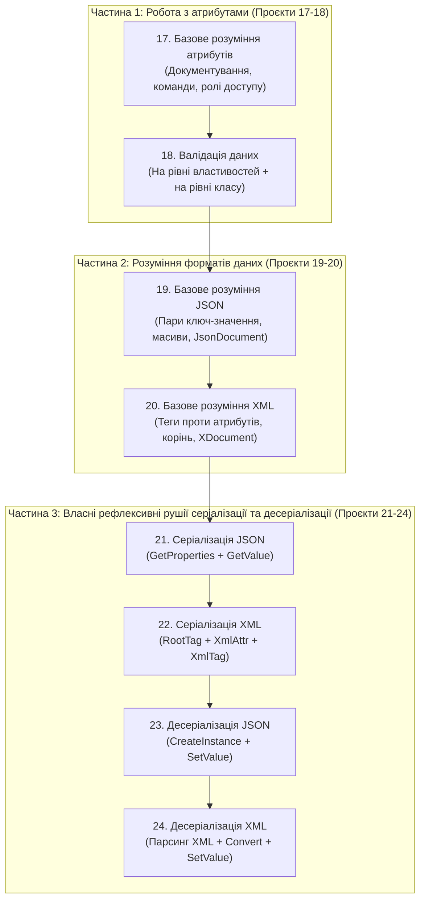

# 05. Attributes & Serialization: Загальний огляд та зріз методів

> **Solution-тег (Solution Folder)**: `05. Attributes & Serialization`  
> **Проєкти у тегу (послідовно від простого до складного)**:
> - [17-AttributesBasicsDemo/Program.cs](../../17-AttributesBasicsDemo/Program.cs) — Базове розуміння атрибутів: для чого потрібні атрибути, позиційні та іменовані параметри, побудова меню команд та перевірка доступу.
> - [18-AttributesValidationDemo/Program.cs](../../18-AttributesValidationDemo/Program.cs) — Декларативна валідація даних на рівні окремих властивостей та на рівні всього класу (`AttributeTargets.Class`).
> - [19-SerializationBasicsJsonDemo/Program.cs](../../19-SerializationBasicsJsonDemo/Program.cs) — Серіалізація та десеріалізація: базове розуміння формату JSON, структура вузлів `JsonDocument`, атрибути `[JsonPropertyName]` та `[JsonIgnore]`.
> - [20-SerializationBasicsXmlDemo/Program.cs](../../20-SerializationBasicsXmlDemo/Program.cs) — Серіалізація та десеріалізація: базове розуміння формату XML, кореневий тег, різниця між XML-елементами та XML-атрибутами, дерево `XDocument`.
> - [21-JsonSerializationDemo/Program.cs](../../21-JsonSerializationDemo/Program.cs) — Серіалізація в JSON через рефлексію: власний рушій `ReflectionJsonSerializer` на базі `GetProperties()` та `GetValue()`.
> - [22-XmlSerializationDemo/Program.cs](../../22-XmlSerializationDemo/Program.cs) — Серіалізація в XML через рефлексію: власний рушій `ReflectionXmlSerializer` з підтримкою `[XmlRootTag]`, `[XmlAttr]`, `[XmlTag]` та `[XmlExclude]`.
> - [23-JsonDeserializationDemo/Program.cs](../../23-JsonDeserializationDemo/Program.cs) — Десеріалізація з JSON через рефлексію: власний рушій `ReflectionJsonDeserializer` на базі `Activator.CreateInstance` та `PropertyInfo.SetValue()`.
> - [24-XmlDeserializationDemo/Program.cs](../../24-XmlDeserializationDemo/Program.cs) — Десеріалізація з XML через рефлексію: власний рушій `ReflectionXmlDeserializer` з конвертацією типів та записом через `PropertyInfo.SetValue()`.

---

## 1. Концептуальний маршрут розділу (Від простого до складного)

### Тематичні довідники розділу:
- [CustomAttributes.md](CustomAttributes.md) — основи атрибутів, сценарії використання, класи `Attribute`, `AttributeUsageAttribute` та `CustomAttributeData` (Проєкт 17).
- [ClassAndPropertyValidation.md](ClassAndPropertyValidation.md) — архітектура валідації на рівні властивостей та міжпольової валідації на рівні класу (Проєкт 18).
- [JsonAndXmlFundamentals.md](JsonAndXmlFundamentals.md) — анатомія форматів JSON та XML, порівняльний аналіз і стандартні інструменти платформи .NET (Проєкти 19–20).
- [ReflectionSerialization.md](ReflectionSerialization.md) — побудова власних рефлексивних серіалізаторів та десеріалізаторів для JSON і XML (Проєкти 21–24).

---

## 2. Зведена матриця методів атрибутів та серіалізації

| Клас | Метод / Властивість | Статус у курсі | Опис призначення | Приклад у коді | Документація MSDN |
| :--- | :--- | :---: | :--- | :--- | :--- |
| `MemberInfo` | `IsDefined(Type, bool)` | Використано | Швидко перевіряє наявність атрибута на класі, методі чи властивості без створення об'єкта | [17-AttributesBasicsDemo/Program.cs](../../17-AttributesBasicsDemo/Program.cs#L50) | [MemberInfo.IsDefined](https://learn.microsoft.com/en-us/dotnet/api/system.reflection.memberinfo.isdefined) |
| `MemberInfo` | `GetCustomAttribute<T>()` | Використано | Створює та повертає одиночний типізований екземпляр атрибута | [17-AttributesBasicsDemo/Program.cs](../../17-AttributesBasicsDemo/Program.cs#L52) | [CustomAttributeExtensions.GetCustomAttribute](https://learn.microsoft.com/en-us/dotnet/api/system.reflection.customattributeextensions.getcustomattribute) |
| `MemberInfo` | `GetCustomAttributes<T>()` | Використано | Повертає колекцію атрибутів, коли дозволено `AllowMultiple = true` (зокрема на рівні класу) | [18-AttributesValidationDemo/ClassAndPropertyValidator.cs](../../18-AttributesValidationDemo/ClassAndPropertyValidator.cs#L65) | [CustomAttributeExtensions.GetCustomAttributes](https://learn.microsoft.com/en-us/dotnet/api/system.reflection.customattributeextensions.getcustomattributes) |
| `MemberInfo` | `GetCustomAttributesData()` | Використано | Повертає дескриптори `CustomAttributeData` із потоку `#Blob` без виклику конструктора атрибута | [17-AttributesBasicsDemo/Program.cs](../../17-AttributesBasicsDemo/Program.cs#L69) | [MemberInfo.GetCustomAttributesData](https://learn.microsoft.com/en-us/dotnet/api/system.reflection.memberinfo.getcustomattributesdata) |
| `CustomAttributeData` | `AttributeType` | Використано | Дескриптор `Type` атрибута, зчитаний із метаданих | [17-AttributesBasicsDemo/Program.cs](../../17-AttributesBasicsDemo/Program.cs#L71) | [CustomAttributeData.AttributeType](https://learn.microsoft.com/en-us/dotnet/api/system.reflection.customattributedata.attributetype) |
| `CustomAttributeData` | `ConstructorArguments` | Використано | Список позиційних аргументів, переданих у конструктор атрибута | [17-AttributesBasicsDemo/Program.cs](../../17-AttributesBasicsDemo/Program.cs#L72) | [CustomAttributeData.ConstructorArguments](https://learn.microsoft.com/en-us/dotnet/api/system.reflection.customattributedata.constructorarguments) |
| `CustomAttributeData` | `NamedArguments` | Використано | Список іменованих властивостей або полів, встановлених в атрибуті | [17-AttributesBasicsDemo/Program.cs](../../17-AttributesBasicsDemo/Program.cs#L76) | [CustomAttributeData.NamedArguments](https://learn.microsoft.com/en-us/dotnet/api/system.reflection.customattributedata.namedarguments) |
| `Type` | `GetProperties(BindingFlags)` | Використано | Повертає масив властивостей для валідації або обходу під час серіалізації | [21-JsonSerializationDemo/ReflectionJsonSerializer.cs](../../21-JsonSerializationDemo/ReflectionJsonSerializer.cs#L18) | [Type.GetProperties](https://learn.microsoft.com/en-us/dotnet/api/system.type.getproperties) |
| `Type` | `GetProperty(string)` | Використано | Знаходить конкретну властивість за ім'ям для міжпольової валідації класу | [18-AttributesValidationDemo/ClassAndPropertyValidator.cs](../../18-AttributesValidationDemo/ClassAndPropertyValidator.cs#L68) | [Type.GetProperty](https://learn.microsoft.com/en-us/dotnet/api/system.type.getproperty) |
| `PropertyInfo` | `GetValue(object?)` | Використано | Зчитує поточне значення властивості об'єкта під час валідації чи серіалізації | [21-JsonSerializationDemo/ReflectionJsonSerializer.cs](../../21-JsonSerializationDemo/ReflectionJsonSerializer.cs#L41) | [PropertyInfo.GetValue](https://learn.microsoft.com/en-us/dotnet/api/system.reflection.propertyinfo.getvalue) |
| `PropertyInfo` | `SetValue(object?, object?)` | Використано | Записує відновлене та сконвертоване значення у властивість під час десеріалізації | [23-JsonDeserializationDemo/ReflectionJsonDeserializer.cs](../../23-JsonDeserializationDemo/ReflectionJsonDeserializer.cs#L64) | [PropertyInfo.SetValue](https://learn.microsoft.com/en-us/dotnet/api/system.reflection.propertyinfo.setvalue) |
| `PropertyInfo` | `PropertyType` | Використано | Визначає цільовий тип даних властивості для правильної конвертації при десеріалізації | [24-XmlDeserializationDemo/ReflectionXmlDeserializer.cs](../../24-XmlDeserializationDemo/ReflectionXmlDeserializer.cs#L78) | [PropertyInfo.PropertyType](https://learn.microsoft.com/en-us/dotnet/api/system.reflection.propertyinfo.propertytype) |
| `Activator` | `CreateInstance(Type)` | Використано | Створює новий екземпляр цільового класу перед заповненням властивостей десеріалізатором | [23-JsonDeserializationDemo/ReflectionJsonDeserializer.cs](../../23-JsonDeserializationDemo/ReflectionJsonDeserializer.cs#L18) | [Activator.CreateInstance](https://learn.microsoft.com/en-us/dotnet/api/system.activator.createinstance) |
| `Convert` | `ChangeType(object?, Type)` | Використано | Перетворює текстове значення з XML/JSON у цільовий примітивний тип властивості | [24-XmlDeserializationDemo/ReflectionXmlDeserializer.cs](../../24-XmlDeserializationDemo/ReflectionXmlDeserializer.cs#L95) | [Convert.ChangeType](https://learn.microsoft.com/en-us/dotnet/api/system.convert.changetype) |

---

## 3. Статистичний зріз охоплення API

- **Навчальних проєктів у розділі**: 8 (`17` – `24`)
- **Методів та властивостей досліджено на практиці**: 14
- **Відсоток практичного охоплення**: 100%
