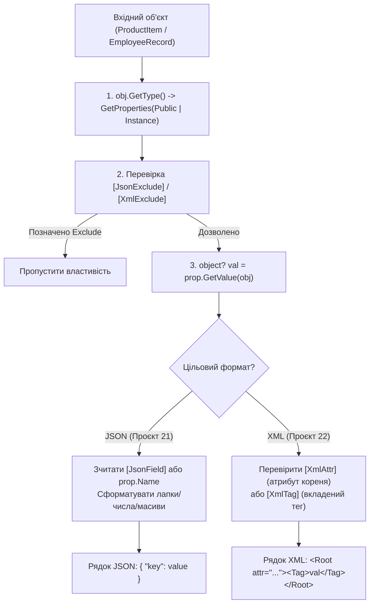
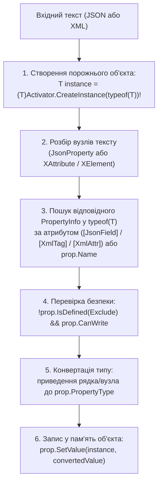

# Рефлексивна серіалізація та десеріалізація JSON і XML (Власні рушії)

> **Практичні проєкти розділу**:
> - [21-JsonSerializationDemo](../../21-JsonSerializationDemo/Program.cs) — Власний рефлексивний JSON-серіалізатор.
> - [22-XmlSerializationDemo](../../22-XmlSerializationDemo/Program.cs) — Власний рефлексивний XML-серіалізатор.
> - [23-JsonDeserializationDemo](../../23-JsonDeserializationDemo/Program.cs) — Власний рефлексивний JSON-десеріалізатор.
> - [24-XmlDeserializationDemo](../../24-XmlDeserializationDemo/Program.cs) — Власний рефлексивний XML-десеріалізатор.  
> **Ключові класи**: `System.Type`, `System.Reflection.PropertyInfo`, `System.Activator`, `System.Convert`

Цей документ пояснює внутрішню механіку того, як за допомогою рефлексії реалізуються власні серіалізатори та десеріалізатори для форматів **JSON** та **XML**.

---

## 1. Архітектура рефлексивної СЕРІАЛІЗАЦІЇ (Проєкти 21 та 22)

Під час серіалізації ми маємо готовий об'єкт у пам'яті й повинні вичитати всі його публічні властивості через `PropertyInfo.GetValue`:

---

## 2. Архітектура рефлексивної ДЕСЕРІАЛІЗАЦІЇ (Проєкти 23 та 24)

Під час десеріалізації ми отримуємо лише текст (JSON або XML) та тип `T`, який потрібно створити і заповнити через `PropertyInfo.SetValue`:

---

## 3. Властивості, задіяні в серіалізації та десеріалізації (Properties)

| Властивість | Сигнатура | Опис призначення | Статус у курсі | Приклад у коді | Документація MSDN |
| :--- | :--- | :--- | :---: | :--- | :--- |
| **`PropertyType`** | `Type PropertyType { get; }` | Визначає точний тип властивості C# (`int`, `double`, `bool`, `string[]`), у який потрібно сконвертувати текст при десеріалізації | Використано | [23-JsonDeserializationDemo/ReflectionJsonDeserializer.cs](../../23-JsonDeserializationDemo/ReflectionJsonDeserializer.cs#L61) | [PropertyInfo.PropertyType](https://learn.microsoft.com/en-us/dotnet/api/system.reflection.propertyinfo.propertytype) |
| **`CanRead`** | `bool CanRead { get; }` | Перевіряє наявність аксесора `get` перед зчитуванням властивості у серіалізаторі | Використано | [21-JsonSerializationDemo/ReflectionJsonSerializer.cs](../../21-JsonSerializationDemo/ReflectionJsonSerializer.cs#L29) | [PropertyInfo.CanRead](https://learn.microsoft.com/en-us/dotnet/api/system.reflection.propertyinfo.canread) |
| **`CanWrite`** | `bool CanWrite { get; }` | Перевіряє наявність аксесора `set` перед записом значення у десеріалізаторі | Використано | [23-JsonDeserializationDemo/ReflectionJsonDeserializer.cs](../../23-JsonDeserializationDemo/ReflectionJsonDeserializer.cs#L52) | [PropertyInfo.CanWrite](https://learn.microsoft.com/en-us/dotnet/api/system.reflection.propertyinfo.canwrite) |
| **`Name`** | `string Name { get; }` | Ім'я властивості чи класу за замовчуванням, якщо не вказано перейменовуючий атрибут | Використано | [22-XmlSerializationDemo/ReflectionXmlSerializer.cs](../../22-XmlSerializationDemo/ReflectionXmlSerializer.cs#L20) | [MemberInfo.Name](https://learn.microsoft.com/en-us/dotnet/api/system.reflection.memberinfo.name) |

---

## 4. Методи, задіяні в серіалізації та десеріалізації (Methods)

| Метод | Сигнатура | Опис призначення | Статус у курсі | Приклад у коді | Документація MSDN |
| :--- | :--- | :--- | :---: | :--- | :--- |
| **`GetProperties`** | `PropertyInfo[] GetProperties(BindingFlags bindingAttr)` | Повертає всі публічні властивості екземпляра для серіалізації або зіставлення ключів | Використано | [21-JsonSerializationDemo/ReflectionJsonSerializer.cs](../../21-JsonSerializationDemo/ReflectionJsonSerializer.cs#L18) | [Type.GetProperties](https://learn.microsoft.com/en-us/dotnet/api/system.type.getproperties) |
| **`GetValue`** | `object? GetValue(object? obj)` | Витягує значення властивості з об'єкта під час JSON та XML серіалізації | Використано | [22-XmlSerializationDemo/ReflectionXmlSerializer.cs](../../22-XmlSerializationDemo/ReflectionXmlSerializer.cs#L43) | [PropertyInfo.GetValue](https://learn.microsoft.com/en-us/dotnet/api/system.reflection.propertyinfo.getvalue) |
| **`SetValue`** | `void SetValue(object? obj, object? value)` | Записує відновлене значення у відповідну властивість створеного об'єкта при десеріалізації | Використано | [24-XmlDeserializationDemo/ReflectionXmlDeserializer.cs](../../24-XmlDeserializationDemo/ReflectionXmlDeserializer.cs#L46) | [PropertyInfo.SetValue](https://learn.microsoft.com/en-us/dotnet/api/system.reflection.propertyinfo.setvalue) |
| **`CreateInstance`** | `static object? CreateInstance(Type type)` | Динамічно інстанціює цільовий клас `T` перед початком заповнення його властивостей | Використано | [23-JsonDeserializationDemo/ReflectionJsonDeserializer.cs](../../23-JsonDeserializationDemo/ReflectionJsonDeserializer.cs#L18) | [Activator.CreateInstance](https://learn.microsoft.com/en-us/dotnet/api/system.activator.createinstance) |
| **`ChangeType`** | `static object? ChangeType(object? value, Type conversionType, IFormatProvider? provider)` | Універсально приводить рядкове представлення значення до цільового типу властивості | Використано | [24-XmlDeserializationDemo/ReflectionXmlDeserializer.cs](../../24-XmlDeserializationDemo/ReflectionXmlDeserializer.cs#L95) | [Convert.ChangeType](https://learn.microsoft.com/en-us/dotnet/api/system.convert.changetype) |
