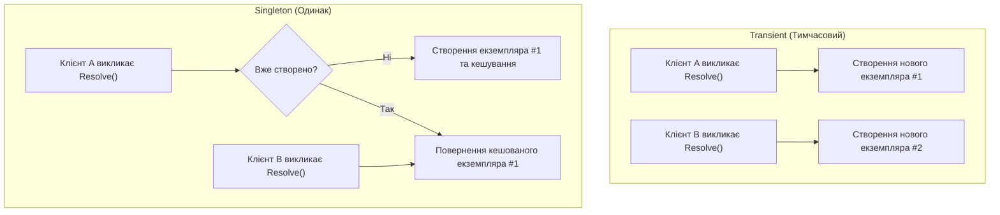
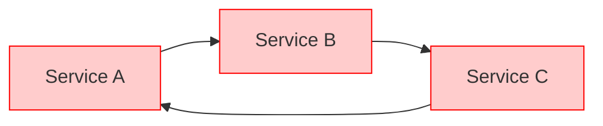

# Життєвий цикл сервісів та виявлення циклічних залежностей

> **Ключові концепції**: `ServiceLifetime` (`Transient`, `Singleton`), `Circular Dependency Detection`  
> **Офіційна документація**: [Service lifetimes in .NET (Microsoft Learn)](https://learn.microsoft.com/en-us/dotnet/core/extensions/dependency-injection#service-lifetimes)

Управління часом життя (Service Lifetime) та гарантія ациклічності графу залежностей — два критичні завдання будь-якого промислового контейнера інверсії керування (проєкт [25.2-DependencyInjectionRealWorld](../../25.2-DependencyInjectionRealWorld/Program.cs)).

---

## 1. Порівняння часів життя сервісів (Lifetimes)



1. **`Transient`**: Кожен виклик `Resolve` або кожне інжектування в залежність породжує новий об'єкт у керованій купі. Рекомендовано для легковагових stateless сервісів та репозиторіїв.
2. **`Singleton`**: Екземпляр створюється один раз при першому зверненні і живе протягом усього часу роботи програми (наприклад, `InMemoryDatabaseContext` або `ConsoleLogger`).

---

## 2. Захист від циклічних залежностей (Cycle Detection)

Якщо сервіс `A` залежить від `B`, а сервіс `B` — від `A`, пряма рекурсивна рефлексія призведе до фатального `StackOverflowException`.



### Алгоритм захисту через стек активних викликів (`_resolutionStack`):
```csharp
private readonly Stack<Type> _resolutionStack = new();

public object Resolve(Type serviceType)
{
    // 1. Перевірка: якщо тип вже присутній у стеку поточного розв'язання — знайдено цикл!
    if (_resolutionStack.Contains(serviceType))
    {
        var cycleChain = _resolutionStack.Reverse().Concat(new[] { serviceType }).Select(t => t.Name);
        throw new CircularDependencyException($"Виявлено циклічну залежність! Ланцюжок: {string.Join(" -> ", cycleChain)}");
    }

    _resolutionStack.Push(serviceType);
    try
    {
        // 2. Рекурсивне створення об'єкта та його залежностей
        return CreateInstanceViaReflection(serviceType);
    }
    finally
    {
        // 3. Обов'язкове звільнення типу зі стеку після завершення гілки
        _resolutionStack.Pop();
    }
}
```

---

## 3. Властивості та типи, задіяні в управлінні життєвим циклом (Properties & Types)

| Властивість / Тип | Сигнатура | Опис призначення | Статус у курсі | Приклад у коді | Документація MSDN |
| :--- | :--- | :--- | :---: | :--- | :--- |
| **`ServiceLifetime`** | `enum ServiceLifetime { Transient, Singleton }` | Перерахування, що визначає стратегію збереження та повторного використання екземпляра | Використано | [25.2-DependencyInjectionRealWorld/Container/ServiceLifetime.cs](../../25.2-DependencyInjectionRealWorld/Container/ServiceLifetime.cs) | [ServiceLifetime Enum](https://learn.microsoft.com/en-us/dotnet/api/microsoft.extensions.dependencyinjection.servicelifetime) |
| **`ImplementationType`**| `Type ImplementationType { get; }` | Конкретний клас реалізації, зареєстрований для даного інтерфейсу | Використано | [25.2-DependencyInjectionRealWorld/Container/ServiceDescriptor.cs](../../25.2-DependencyInjectionRealWorld/Container/ServiceDescriptor.cs) | [ServiceDescriptor.ImplementationType](https://learn.microsoft.com/en-us/dotnet/api/microsoft.extensions.dependencyinjection.servicedescriptor.implementationtype) |
| **`SingletonInstance`**| `object? SingletonInstance { get; set; }` | Кешований готовий екземпляр сервісу для `Singleton` часу життя | Використано | [25.2-DependencyInjectionRealWorld/Container/ServiceDescriptor.cs](../../25.2-DependencyInjectionRealWorld/Container/ServiceDescriptor.cs) | [ServiceDescriptor.ImplementationInstance](https://learn.microsoft.com/en-us/dotnet/api/microsoft.extensions.dependencyinjection.servicedescriptor.implementationinstance) |

---

## 4. Методи, задіяні в управлінні життєвим циклом (Methods)

| Метод | Сигнатура | Опис призначення | Статус у курсі | Приклад у коді | Документація MSDN |
| :--- | :--- | :--- | :---: | :--- | :--- |
| **`RegisterTransient`** | `void RegisterTransient<TService, TImplementation>()` | Реєструє зіставлення типів із постійним створенням нових екземплярів при кожному зверненні | Використано | [25.2-DependencyInjectionRealWorld/Container/Container.cs](../../25.2-DependencyInjectionRealWorld/Container/Container.cs) | [ServiceCollectionServiceExtensions.AddTransient](https://learn.microsoft.com/en-us/dotnet/api/microsoft.extensions.dependencyinjection.servicecollectionserviceextensions.addtransient) |
| **`RegisterSingleton`** | `void RegisterSingleton<TService, TImplementation>()` | Реєструє сервіс як одинак, кешуючи перший створений екземпляр для всіх наступних викликів | Використано | [25.2-DependencyInjectionRealWorld/Container/Container.cs](../../25.2-DependencyInjectionRealWorld/Container/Container.cs) | [ServiceCollectionServiceExtensions.AddSingleton](https://learn.microsoft.com/en-us/dotnet/api/microsoft.extensions.dependencyinjection.servicecollectionserviceextensions.addsingleton) |
| **`Stack<T>.Contains`** | `bool Contains(T item)` | Перевіряє, чи тип уже перебуває в активному ланцюжку створення об'єкта (виявлення циклу) | Використано | [25.2-DependencyInjectionRealWorld/Container/Container.cs](../../25.2-DependencyInjectionRealWorld/Container/Container.cs) | [Stack.Contains](https://learn.microsoft.com/en-us/dotnet/api/system.collections.generic.stack-1.contains) |
| **`Stack<T>.Push` / `Pop`** | `void Push(T item)` / `T Pop()` | Додає поточний тип у стек перед конструюванням та знімає його в блоці `finally` | Використано | [25.2-DependencyInjectionRealWorld/Container/Container.cs](../../25.2-DependencyInjectionRealWorld/Container/Container.cs) | [Stack.Push](https://learn.microsoft.com/en-us/dotnet/api/system.collections.generic.stack-1.push) |
