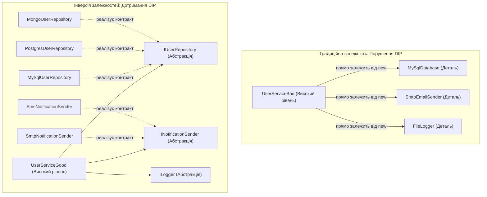
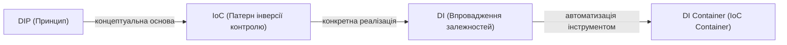
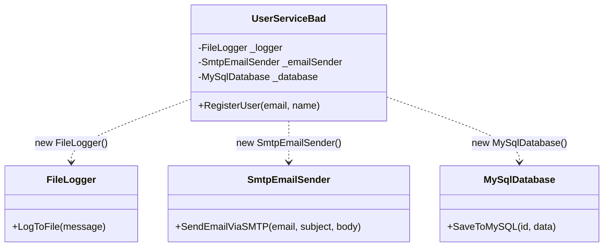
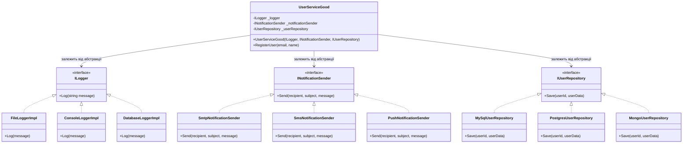
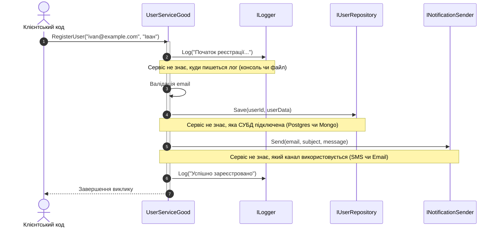

# Лекція 5. Принцип інверсії залежностей (Dependency Inversion Principle — DIP)

> **1. "High-level modules should not depend on low-level modules. Both should depend on abstractions."**  
> **2. "Abstractions should not depend on details. Details should depend on abstractions."**  
> *— Роберт С. Мартін (Uncle Bob)*

---

### 🧭 Швидка навігація до коду (Кнопки переходу до файлів цієї теми):

| Тип прикладу | Клас / Компонент | Роль в архітектурі | Посилання на вихідний код |
| :--- | :--- | :--- | :---: |
| ❌ **Порушення (Bad)** | **`UserServiceBad`** | Жорстка прив'язка через `new MySQLDatabase()` | [👉 Відкрити `UserServiceBad.cs` (рядок 12)](DIPBadExample/UserServiceBad.cs) |
| ❌ **Порушення (Bad)** | **`MySqlDatabase`** | Низькорівневий модуль: жорстка реалізація СУБД | [👉 Відкрити `MySqlDatabase.cs` (рядок 9)](DIPBadExample/MySqlDatabase.cs) |
| ❌ **Порушення (Bad)** | **`SmtpEmailSender`** | Низькорівневий модуль: поштовий сервіс | [👉 Відкрити `SmtpEmailSender.cs` (рядок 9)](DIPBadExample/SmtpEmailSender.cs) |
| 🎮 **Демонстрація** | **`DipBadExampleCommand`** | Консольний запуск сценарію з жорсткими залежностями | [👉 Відкрити `DipBadExampleCommand.cs` (рядок 15)](DipBadExampleCommand.cs) |
| ✅ **Еталон DIP (Контракти)** | **`IUserRepository`** | Абстракція доступу до даних (Сховище) | [👉 Відкрити `IUserRepository.cs` (рядок 9)](DIPGoodExample/Contracts/IUserRepository.cs) |
| ✅ **Еталон DIP (Контракти)** | **`INotificationSender`** | Абстракція каналу сповіщень | [👉 Відкрити `INotificationSender.cs` (рядок 9)](DIPGoodExample/Contracts/INotificationSender.cs) |
| ✅ **Еталон DIP (Контракти)** | **`ILogger`** | Абстракція аудиту та логування | [👉 Відкрити `ILogger.cs` (рядок 9)](DIPGoodExample/Contracts/ILogger.cs) |
| ✅ **Еталон DIP (Good)** | **`UserServiceGood`** | Високорівневий бізнес-сервіс (чисті абстракції) | [👉 Відкрити `UserServiceGood.cs` (рядок 11)](DIPGoodExample/UserServiceGood.cs) |
| ✅ **Провайдер БД** | **`MySqlUserRepository`** | Реалізація для MySQL | [👉 Відкрити `MySqlUserRepository.cs` (рядок 11)](DIPGoodExample/Repositories/MySqlUserRepository.cs) |
| ✅ **Провайдер БД** | **`PostgresUserRepository`** | Реалізація для PostgreSQL | [👉 Відкрити `PostgresUserRepository.cs` (рядок 11)](DIPGoodExample/Repositories/PostgresUserRepository.cs) |
| ✅ **Провайдер БД** | **`MongoUserRepository`** | Реалізація для MongoDB | [👉 Відкрити `MongoUserRepository.cs` (рядок 11)](DIPGoodExample/Repositories/MongoUserRepository.cs) |
| ✅ **Провайдер логування** | **`ConsoleLoggerImpl`** | Логер у консоль | [👉 Відкрити `ConsoleLoggerImpl.cs` (рядок 11)](DIPGoodExample/Loggers/ConsoleLoggerImpl.cs) |
| ✅ **Провайдер логування** | **`FileLoggerImpl`** | Логер у файл | [👉 Відкрити `FileLoggerImpl.cs` (рядок 11)](DIPGoodExample/Loggers/FileLoggerImpl.cs) |
| ✅ **Провайдер логування** | **`DatabaseLoggerImpl`** | Логер у базу даних | [👉 Відкрити `DatabaseLoggerImpl.cs` (рядок 11)](DIPGoodExample/Loggers/DatabaseLoggerImpl.cs) |
| ✅ **Провайдер сповіщень** | **`SmtpNotificationSender`** | Email сповіщення | [👉 Відкрити `SmtpNotificationSender.cs` (рядок 11)](DIPGoodExample/Notifications/SmtpNotificationSender.cs) |
| ✅ **Провайдер сповіщень** | **`SmsNotificationSender`** | SMS сповіщення | [👉 Відкрити `SmsNotificationSender.cs` (рядок 11)](DIPGoodExample/Notifications/SmsNotificationSender.cs) |
| ✅ **Провайдер сповіщень** | **`PushNotificationSender`** | Push сповіщення | [👉 Відкрити `PushNotificationSender.cs` (рядок 11)](DIPGoodExample/Notifications/PushNotificationSender.cs) |
| 🎮 **Демонстрація** | **`DipGoodExampleCommand`** | Консольний запуск еталонного сценарію через DI | [👉 Відкрити `DipGoodExampleCommand.cs` (рядок 17)](DipGoodExampleCommand.cs) |
| 📁 **Модуль еволюції** | **`DIP_IoC_DI_Evolution`** | Окрема папка архітектурного практикуму | [👉 Відкрити `README.md`](../DIP_IoC_DI_Evolution/README.md) |
| 🚀 **Еволюція (Практикум)**| **`DipEvolutionCommand`** | Повний ланцюжок: DIP -> Abstract Factory -> DI -> Container | [👉 Відкрити `DipEvolutionCommand.cs`](../DIP_IoC_DI_Evolution/DipEvolutionCommand.cs) |
| 📚 **Базова лекція** | **`05_Dependency_Inversion_Principle.md`** | Академічна лекція з DIP | [👉 Читати лекцію](../Docs/05_Dependency_Inversion_Principle.md) |
| 🔬 **Глибокий практикум** | **`06_DIP_IoC_DI_Containers_DeepDive.md`** | Майстер-клас: DIP, IoC, Abstract Factory, DI, Lifetimes | [👉 Читати практикум](../Docs/06_DIP_IoC_DI_Containers_DeepDive.md) |

---

## 1. Фундаментальна теорія та походження принципу

### 1.1. Що таке "Високий рівень" та "Низький рівень"?
Для глибокого розуміння DIP необхідно чітко розрізняти два поняття в програмній інженерії:
* **Модулі високого рівня (High-Level Modules):**  
  Це серце вашої програми — **чиста бізнес-логіка, правила предметної області (Domain Rules)** та політика застосунку. Наприклад: як відбувається реєстрація нового користувача, коли нараховується знижка, за якими правилами списується баланс. Високорівнева логіка визначає саму суть існування бізнесу і не повинна залежати від того, яку базу даних чи який екран ви використовуєте.
* **Модулі низького рівня (Low-Level Modules):**  
  Це технічні **деталі реалізації та інфраструктура (Infrastructure / I/O)**. Наприклад: запис байтів у файл на диску, виконання SQL-запитів до MySQL 8.0, відправка мережевих TCP-пакетів через SMTP-сервер Google, звернення до кешу Redis.

### 1.2. У чому полягає "Інверсія" (Inversion)?
У класичному процедурному програмуванні або в поганому ООП потік залежностей іде зверху вниз:
> **Бізнес-логіка ➔ Конкретна СУБД MySQL ➔ Драйвер файлової системи**

Якщо змінюється версія бази або ви вирішили перейти на хмарне сховище — вам доводиться переписувати бізнес-логіку!

**Принцип DIP інвертує цей напрямок:**
Бізнес-логіка не знає про існування MySQL. Вона оголошує свій власний контракт: *"Мені потрібен сервіс, який вміє зберігати дані за контрактом `IUserRepository`"*. А вже конкретний адаптер бази даних реалізує цей інтерфейс.



---

## 2. Розмежування термінів: DIP vs IoC vs DI vs DI-контейнер

Студенти та початківці часто плутають ці чотири поняття, вважаючи їх синонімами. Насправді між ними існує чітка ієрархія:



1. **DIP (Dependency Inversion Principle) — Архітектурний принцип:**  
   Правило про те, що класи повинні залежати від абстракцій (інтерфейсів), а не від конкретних типів.
2. **IoC (Inversion of Control) — Архітектурний шаблон:**  
   Ширша філософія, відома як *"Голлівудський принцип"* (*"Не дзвоніть нам, ми самі вам зателефонуємо"*). Замість того, щоб об'єкт сам контролював створення своїх помічників, керування цим процесом передається зовнішньому середовищу.
3. **DI (Dependency Injection) — Шаблон проєктування:**  
   Конкретна техніка передачі готових залежностей об'єкту ззовні (найчастіше через параметри конструктора: *Constructor Injection*).
4. **IoC/DI Контейнер — Програмна бібліотека:**  
   Інструмент (наприклад, `Microsoft.Extensions.DependencyInjection`, `Autofac`), який автоматично створює об'єкти, резолвить їхнє дерево залежностей та контролює їхній життєвий цикл.

---

## 3. Детальний аналіз Поганого прикладу (Bad Example)

### 3.1. Архітектурна схема проблеми
Клас `UserServiceBad` самостійно створює всі низькорівневі інфраструктурні об'єкти через ключове слово `new`:



### 3.2. Фрагмент вихідного коду з дефектом
У файлі `UserServiceBad.cs`:
```csharp
public class UserServiceBad
{
    private FileLogger _logger;
    private SmtpEmailSender _emailSender;
    private MySqlDatabase _database;

    public UserServiceBad()
    {
        // Жорстке зв'язування (Tight Coupling)!
        // Клас сам керує життєвим циклом інфраструктурних сервісів
        _logger = new FileLogger();
        _emailSender = new SmtpEmailSender();
        _database = new MySqlDatabase();
    }

    public void RegisterUser(string email, string name)
    {
        _logger.LogToFile($"Реєстрація: {email}");
        _database.SaveToMySQL(Guid.NewGuid().ToString(), $"Name: {name}");
        _emailSender.SendEmailViaSMTP(email, "Вітаємо!", "Акаунт створено");
    }
}
```

**Катастрофічні наслідки для проєкту:**
* **Неможливість написати Unit-тести:** Щоб перевірити, чи правильно `UserServiceBad` валідує порожній email, тест створить реальний файл на диску `C:\logs`, спробує підключитися до реального сервера `localhost:3306` і надіслати реальний email через інтернет.
* **Жорстка залежність від постачальників (Vendor Lock-in):** Якщо компанія вирішить мігрувати з MySQL на PostgreSQL чи MongoDB, доведеться переписувати та заново стабілізувати бізнес-клас `UserServiceBad`.
* **Відсутність гнучкості:** Неможливо вимкнути запис у файл або переключитися на логування в консоль для локального середовища розробника.

---

## 4. Проєктування через інверсію: Гарний приклад (Good Example)

Щоб побудувати стабільну, чисту архітектуру, ми виділяємо три абстрактні інтерфейси, які описують контракти потреб бізнес-сервісу:
* `ILogger` — контракт аудиту та логування подій;
* `INotificationSender` — контракт доставки повідомлень користувачам;
* `IUserRepository` — контракт постійного збереження даних користувачів.

Клас `UserServiceGood` залежить **виключно від цих інтерфейсів** і отримує їх ззовні через конструктор (Constructor Dependency Injection).

### 4.1. Діаграма класів (UML Class Diagram)



### 4.2. Принцип Plug-and-Play у дії
Завдяки DIP бізнес-сервіс `UserServiceGood` стає універсальним конструктором, який можна запускати в будь-якій комбінації оточень:

```csharp
// Конфігурація 1: Продакшн-сервер (MySQL + SMTP + FileLogger)
var prodService = new UserServiceGood(
    new FileLoggerImpl(),
    new SmtpNotificationSender(),
    new MySqlUserRepository()
);

// Конфігурація 2: Мобільний клієнт (PostgreSQL + SMS + ConsoleLogger)
var mobileService = new UserServiceGood(
    new ConsoleLoggerImpl(),
    new SmsNotificationSender(),
    new PostgresUserRepository()
);

// Конфігурація 3: Хмарний бекенд (MongoDB + Push + DatabaseLogger)
var cloudService = new UserServiceGood(
    new DatabaseLoggerImpl(),
    new PushNotificationSender(),
    new MongoUserRepository()
);
```

### 4.3. Діаграма взаємодії (Sequence Diagram)



---

## 5. Порівняльний аналіз архітектурних метрик

| Критерій оцінки | Поганий приклад (`UserServiceBad`) | Гарний приклад (`UserServiceGood`) |
| :--- | :--- | :--- |
| **Рівень зв'язності (Coupling)** | Жорстке зв'язування (Tight Coupling) | **Слабке зв'язування (Loose Coupling)** |
| **Здатність до Unit-тестування** | Неможливе без підняття всієї інфраструктури | **100% ізольоване** з використанням Mock-об'єктів |
| **Заміна СУБД чи провайдера** | Вимагає модифікації та перекомпcompіляції сервісу | **0 змін у сервісі** (додається новий клас адаптера) |
| **Контроль життєвого циклу** | Клас сам інстанціює залежності | Контролюється ззовні (Inversion of Control) |
| **Чистота архітектури** | Бізнес-код забруднений деталями SQL та SMTP | **Чистий доменний шар**, захищений інтерфейсами |

---

## 6. Поради викладача-практика: Патерни, DI-контейнери та життєві цикли

### 6.1. Життєві цикли залежностей у .NET (Service Lifetimes)
Під час використання DI-контейнерів у C#/.NET розробник зобов'язаний розуміти, як створюються зареєстровані сервіси:
1. **Transient (`AddTransient`):** Новий екземпляр створюється щоразу, коли хтось запитує цей сервіс. Ідеально для легковажних операцій без збереження стану.
2. **Scoped (`AddScoped`):** Один екземпляр створюється на весь життєвий цикл одного HTTP-запиту. Стандарт для контекстів баз даних (`DbContext`) та репозиторіїв.
3. **Singleton (`AddSingleton`):** Створюється один єдиний екземпляр на весь час роботи застосунку. Використовується для кешів у пам'яті або важких пулів з'єднань.

### 6.2. Коли оператор `new` є нормальним, а коли шкідливим?
Студенти часто запитують: *"Невже тепер заборонено писати `new` взагалі?"*
> **Правило викладача:**  
> Абстрагувати через інтерфейси потрібно **сервіси, які мають побічні ефекти (I/O, база, мережа, час, файли)** або бізнес-алгоритми, що можуть змінюватися.  
> Використовувати `new` абсолютно безпечно і правильно для:
> * Моделей даних, DTO, Entity (`var order = new Order()`);
> * Структур даних стандартної бібліотеки (`new List<string>()`, `new StringBuilder()`);
> * Значущих об'єктів (Value Objects) без побічних ефектів (`new Money(100, "UAH")`).

---

## 7. Контрольні запитання та лабораторні завдання

### 7.1. Питання для самоперевірки
1. Чому модулі високого рівня мають більшу бізнес-цінність, ніж модулі низького рівня?
2. У чому полягає принципова різниця між патерном Dependency Injection та архітектурним принципом Dependency Inversion?
3. Чому патерн Service Locator (`Locator.GetService<IRepository>()`) вважається антипатерном порівняно з Constructor Injection?
4. Як написати Unit-тест для `UserServiceGood`, який перевіряє поведінку сервісу при збої бази даних, не маючи встановленої СУБД?

### 7.2. Практичне завдання для закріплення
1. Створіть клас `TelegramNotificationSender` у папці `DIPGoodExample/Notifications`, який реалізує `INotificationSender` (імітує відправку сповіщення в Telegram-чат).
2. Створіть клас `InMemoryUserRepository` у папці `DIPGoodExample/Repositories`, який зберігає користувачів у словнику `Dictionary<string, string>` для миттєвих тестів.
3. Скомпонуйте `UserServiceGood` із цими новими компонентами та продемонструйте реєстрацію користувача без використання зовнішніх сервісів.
