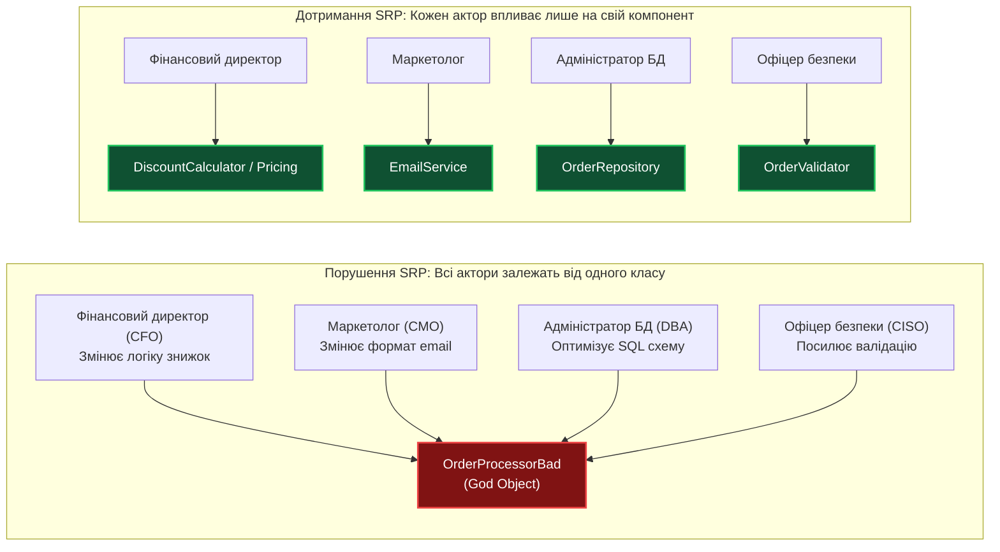
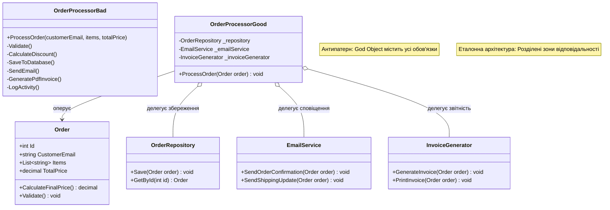
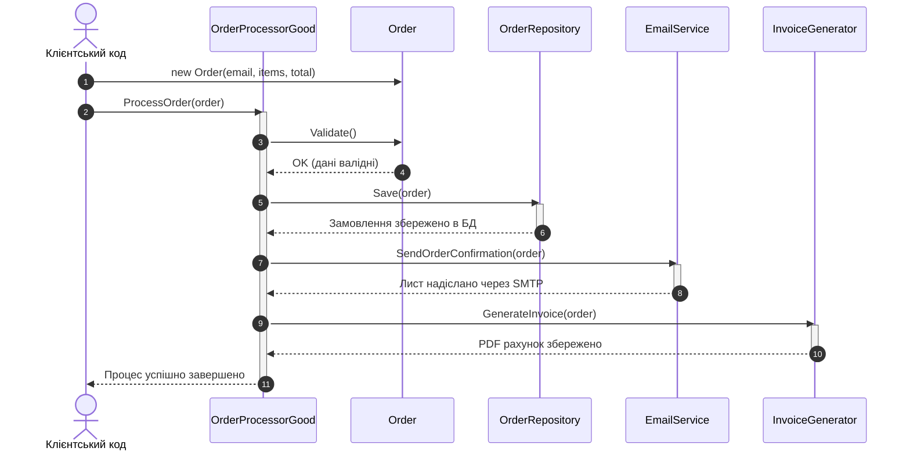

# Лекція 1. Принцип єдиної відповідальності (Single Responsibility Principle — SRP)

> **"A class should have one, and only one, reason to change."**  
> *(Клас повинен мати одну, і тільки одну, причину для зміни).*  
> — **Роберт С. Мартін (Uncle Bob)**

---

### 🧭 Швидка навігація до коду (Кнопки переходу до файлів проєкту):

| Тип прикладу | Клас / Компонент | Роль в архітектурі | Посилання на вихідний код |
| :--- | :--- | :--- | :---: |
| ❌ **Порушення (Bad)** | **`OrderProcessorBad`** | Монолітний God Object (валідація, БД, email, PDF, лог) | [👉 Відкрити `OrderProcessorBad.cs` (рядок 12)](../S/OrderProcessorBad.cs) |
| 🎮 **Демонстрація** | **`SrpBadExampleCommand`** | Консольний запуск сценарію з порушенням | [👉 Відкрити `SrpBadExampleCommand.cs` (рядок 15)](../S/SrpBadExampleCommand.cs) |
| ✅ **Еталон SRP (Good)** | **`Order`** | Модель даних (Entity / DTO) | [👉 Відкрити `Order.cs` (рядок 11)](../S/SRPGoodExample/Order.cs) |
| ✅ **Еталон SRP (Good)** | **`OrderValidator`** | Бізнес-правила перевірки замовлення | [👉 Відкрити `OrderValidator.cs` (рядок 11)](../S/SRPGoodExample/OrderValidator.cs) |
| ✅ **Еталон SRP (Good)** | **`DiscountCalculator`** | Фінансові розрахунки знижок | [👉 Відкрити `DiscountCalculator.cs` (рядок 9)](../S/SRPGoodExample/DiscountCalculator.cs) |
| ✅ **Еталон SRP (Good)** | **`OrderRepository`** | Персистентність (робота з базою даних) | [👉 Відкрити `OrderRepository.cs` (рядок 12)](../S/SRPGoodExample/OrderRepository.cs) |
| ✅ **Еталон SRP (Good)** | **`EmailService`** | Форматування та надсилання сповіщень | [👉 Відкрити `EmailService.cs` (рядок 11)](../S/SRPGoodExample/EmailService.cs) |
| ✅ **Еталон SRP (Good)** | **`ReportGenerator`** | Генерація друкованих документів та PDF | [👉 Відкрити `ReportGenerator.cs` (рядок 11)](../S/SRPGoodExample/ReportGenerator.cs) |
| ✅ **Еталон SRP (Good)** | **`Logger`** | Системне логування та аудит | [👉 Відкрити `Logger.cs` (рядок 9)](../S/SRPGoodExample/Logger.cs) |
| ✅ **Еталон SRP (Good)** | **`OrderProcessorGood`** | Оркестратор процесу (Фасад) | [👉 Відкрити `OrderProcessorGood.cs` (рядок 12)](../S/OrderProcessorGood.cs) |
| 🎮 **Демонстрація** | **`SrpGoodExampleCommand`** | Консольний запуск еталонного сценарію | [👉 Відкрити `SrpGoodExampleCommand.cs` (рядок 17)](../S/SrpGoodExampleCommand.cs) |

---

## 1. Навчальні цілі лекції

Опрацювавши цю лекцію, ви:
1. **Зрозумієте справжню природу терміну «відповідальність»** у контексті бізнес-акторів, а не просто кількості рядків чи методів у класі.
2. **Навчитеся діагностувати антипатерн «God Object» (Божественний об'єкт)** та супутні запахи коду (Code Smells) під час проведення Code Review.
3. **Опануєте техніку декомпозиції монолітного класу** на високомобільні сервіси з високим зчепленням (High Cohesion) та слабкою зв'язністю (Low Coupling).
4. **Дослідите взаємодію SRP з патернами проектування GoF** (Facade, Repository, Strategy).
5. **Зрозумієте межі принципу**, щоб не перетворити проект на хаос із сотень однорядкових класів (уникнення надлишкового ускладнення — Overengineering).

---

## 2. Філософія та фундаментальна теорія принципу

### 2.1. Поширена помилка трактування: дія проти відповідальності
Найчастіша помилка розробників-початківців полягає у буквальному сприйнятті слова «єдина»:
> *«Мій клас виконує лише одну дію — він обробляє замовлення! Отже, він відповідає SRP!»*

Це хибне твердження. У такій інтерпретації «обробка замовлення» може непомітно увібрати в себе:
* перевірку коректності введеного email (валідація даних);
* розрахунок персональної знижки на основі суми (фінансові правила);
* генерацію SQL-запиту та відкриття з'єднання з БД (персистентність);
* формування тексту листа та з'єднання з поштовим SMTP-сервером (комунікація);
* створення PDF-файлу з фіскальним чеком (форматування документів);
* запис логів у текстовий файл (інфраструктурний аудит).

Хоча розробник сприймає це як «один процес», з погляду архітектури програмного забезпечення тут поєднано **шість кардинально різних відповідальностей**.

### 2.2. Концепція «Актора» (Actor) за Робертом Мартіном
У книзі *«Clean Architecture»* Роберт Мартін уточнив класичне формулювання:
> **«Модуль або клас повинен відповідати за одного і тільки одного актора (Actor).»**

**Актор** — це джерело змін, конкретна роль, особа або група стейкхолдерів бізнесу, які висувають вимоги до функціоналу:



Коли всі чотири актори вносять зміни в єдиний монолітний клас `OrderProcessorBad`, неминуче виникають критичні проблеми:
1. **Конфлікти злиття у Git (Merge Conflicts)**: кілька інженерів одночасно редагують один файл для різних завдань.
2. **Регресійні збої (Side Effects)**: оптимізація SQL-запиту випадково пошкоджує обчислення знижки або блокує відправку листів.
3. **Необхідність повного повторного тестування**: зміна шаблону привітання вимагає тестування всього фінансового та платіжного циклу.

### 2.3. Метрики якості: Cohesion проти Coupling
SRP є основним практичним інструментом для оптимізації двох головних характеристик програмного коду:
* **Зчеплення (Cohesion)**: показує, наскільки тісно пов'язані методи та властивості всередині одного класу. У класі з високим зчепленням (*High Cohesion*) методи працюють над спільними даними заради єдиної чіткої мети.
* **Зв'язність (Coupling)**: визначає ступінь взаємної залежності різних класів. Архітектура повинна прямувати до слабкої зв'язності (*Low Coupling*), щоб зміна в одному модулі не вимагала каскадних правок у сусідніх.

---

## 3. Симптоми порушення принципу (Code Smells)

Під час аналізу існуючого коду звертайте увагу на такі характерні симптоми:

1. **God Object / Blob Class (Клас-монстр)**:
   - Клас містить тисячі рядків коду, десятки полів та методів.
   - Назва класу часто містить розмиті суфікси: `Manager`, `Processor`, `Handler`, `Controller`, які на практиці роблять «усе на світі».
2. **Divergent Change (Різноспрямовані зміни)**:
   - Розробнику доводиться відкривати та модифікувати один і той самий файл з абсолютно різних приводів (зміна API банку, зміна CSS-стилю листа, оновлення версії драйвера бази даних).
3. **Shotgun Surgery (Дробове поранення)**:
   - Зворотний бік порушення: коли одна відповідальність розмазана по безлічі дрібних фрагментів, і додавання одного поля в замовлення вимагає правок у 15 різних класах.
4. **Неможливість ізольованого тестування (Untestable Code)**:
   - Щоб перевірити просту арифметичну формулу знижки, доводиться підключати реальний SQL Server, розгортати поштовий сервер та створювати папки на файловій системі.

---

## 4. Детальний розбір навчального прикладу

### 4.1. Поганий приклад: порушення SRP
> 🔗 **Файл:** [`OOP - SOLID/S/OrderProcessorBad.cs`](../S/OrderProcessorBad.cs)  
> 👉 [**Відкрити `OrderProcessorBad.cs` у редакторі (рядок 12)**](../S/OrderProcessorBad.cs)  
> 🎮 [**Запуск демонстрації: `SrpBadExampleCommand.cs` (рядок 15)**](../S/SrpBadExampleCommand.cs)

Погляньмо на реалізацію методу [`ProcessOrder`](../S/OrderProcessorBad.cs) у монолітному класі:

```csharp
// Посилання на файл: OOP - SOLID/S/OrderProcessorBad.cs (рядки 14-53)
public void ProcessOrder(string customerEmail, List<string> items, decimal totalPrice)
{
    // 1. Валідація замовлення (рядки 16-21)
    if (string.IsNullOrEmpty(customerEmail))
        throw new ArgumentException("Email не може бути порожнім");
    if (items == null || !items.Any())
        throw new ArgumentException("Замовлення повинно містити товари");

    // 2. Розрахунок знижки (рядки 24-28)
    decimal discount = 0;
    if (totalPrice > 1000)
        discount = totalPrice * 0.1m;
    decimal finalPrice = totalPrice - discount;

    // 3. Збереження в базу даних (рядки 30-36)
    Console.WriteLine("[БД] Підключення до бази даних...");
    Console.WriteLine($"[БД] INSERT INTO Orders (Email, Total) VALUES ('{customerEmail}', {finalPrice})");

    // 4. Відправка email (рядки 38-43)
    Console.WriteLine("\n[EMAIL] Відправка підтвердження замовлення...");

    // 5. Генерація PDF-звіту (рядки 44-50)
    Console.WriteLine("\n[ЗВІТ] Генерація PDF звіту...");

    // 6. Логування (рядки 51-53)
    Console.WriteLine($"\n[ЛОГ] {DateTime.Now}: Замовлення оброблено успішно");
}
```

#### Анатомія інженерної кризи у `OrderProcessorBad`:
* **Втрата транзакційної цілісності**: Якщо на [рядку 38](../S/OrderProcessorBad.cs) поштовий сервер поверне помилку тайм-ауту, запис у базі даних ([рядок 32](../S/OrderProcessorBad.cs)) уже створено, а звіт ([рядок 45](../S/OrderProcessorBad.cs)) не сформовано.
* **Жорстка прив'язка до технологій**: Заміна відправки email на SMS вимагає редагування цього монолітного класу.

---

### 4.2. Еталонний рефакторинг: Розподіл на спеціалізовані сервіси

У правильній архітектурі ми розбиваємо відповідальності на окремі незалежні класи:

| № | Клас / Компонент | Зона відповідальності | Пряме посилання на код |
|:---:|:---|:---|:---:|
| 1 | **`Order`** | Модель даних та стан замовлення | [👉 `Order.cs`](../S/SRPGoodExample/Order.cs) |
| 2 | **`OrderValidator`** | Перевірка коректності email, товарів та суми | [👉 `OrderValidator.cs`](../S/SRPGoodExample/OrderValidator.cs) |
| 3 | **`DiscountCalculator`** | Фінансові правила розрахунку знижки | [👉 `DiscountCalculator.cs`](../S/SRPGoodExample/DiscountCalculator.cs) |
| 4 | **`OrderRepository`** | Збереження та вибірка із сховища даних | [👉 `OrderRepository.cs`](../S/SRPGoodExample/OrderRepository.cs) |
| 5 | **`EmailService`** | Форматування та надсилання поштових листів | [👉 `EmailService.cs`](../S/SRPGoodExample/EmailService.cs) |
| 6 | **`ReportGenerator`** | Генерація PDF та текстових документів | [👉 `ReportGenerator.cs`](../S/SRPGoodExample/ReportGenerator.cs) |
| 7 | **`Logger`** | Технічний аудит та системне логування | [👉 `Logger.cs`](../S/SRPGoodExample/Logger.cs) |
| 8 | **`OrderProcessorGood`** | Оркестратор процесу (Фасад) | [👉 `OrderProcessorGood.cs`](../S/OrderProcessorGood.cs) |
| 🎮 | **`SrpGoodExampleCommand`** | Консольна команда запуску сценарію | [👉 `SrpGoodExampleCommand.cs`](../S/SrpGoodExampleCommand.cs) |

#### Реалізація координатора ([OrderProcessorGood.cs](../S/OrderProcessorGood.cs)):
> 🔗 **Файл:** [`OOP - SOLID/S/OrderProcessorGood.cs`](../S/OrderProcessorGood.cs)  
> 👉 [**Відкрити `OrderProcessorGood.cs` у редакторі (рядок 49)**](../S/OrderProcessorGood.cs)

```csharp
// Посилання на файл: OOP - SOLID/S/OrderProcessorGood.cs (рядки 49-78)
public void ProcessOrder(string customerEmail, List<string> items, decimal totalPrice)
{
    try
    {
        // Створюємо замовлення як модель даних
        var order = new Order
        {
            Id = Guid.NewGuid().ToString().Substring(0, 8),
            CustomerEmail = customerEmail,
            Items = items,
            TotalPrice = totalPrice,
            CreatedAt = DateTime.Now
        };

        // Кожна операція виконується окремим відповідальним сервісом:
        _validator.Validate(order);                                // рядок 64
        order.Discount = _discountCalculator.Calculate(order.TotalPrice); // рядок 65
        _repository.Save(order);                                  // рядок 66
        _emailService.SendOrderConfirmation(order);               // рядок 67
        _reportGenerator.GeneratePdfReport(order);                // рядок 68
        _logger.Log($"Замовлення №{order.Id} успішно оброблено"); // рядок 69

        Console.WriteLine("\n[УСПІХ] Замовлення успішно оброблено всіма спеціалізованими сервісами.");
    }
    catch (Exception ex)
    {
        _logger.Log($"Помилка: {ex.Message}");
        throw;
    }
}
```

        // 2. Делегування збереження
        _repository.Save(order);

        // 3. Делегування відправки листа
        _emailService.SendOrderConfirmation(order);

        // 4. Делегування генерації документа
        _invoiceGenerator.GenerateInvoice(order);

        Console.WriteLine($"[ОРКЕСТРАТОР] Замовлення #{order.Id} успішно завершено.");
    }
}
```

---

## 5. Архітектурні діаграми

### 5.1. Діаграма класів (Class Diagram): Порівняння підходів



### 5.2. Діаграма послідовності (Sequence Diagram) виконання



---

## 6. Порівняльна таблиця інженерних метрик

| Критерій оцінки | Реалізація з порушенням (Bad) | Реалізація за стандартом SRP (Good) |
|:---|:---|:---|
| **Розмір та складність класу** | Понад 100 рядків із переплетенням 6 різних підсистем. | 5 компактних класів по 20–30 рядків кожен. |
| **Зчеплення (Cohesion)** | Вкрай низьке (Low Cohesion). Методи не пов'язані логічно. | Високе (High Cohesion). Кожен клас вирішує рівно одну задачу. |
| **Зв'язність (Coupling)** | Жорстка прив'язка бізнес-процесу до SQL, SMTP та файлової системи. | Слабка (Low Coupling). Компоненти взаємодіють через чіткі межі. |
| **Зручність Unit-тестування** | Неможливо перевірити знижку без емуляції мережі та бази даних. | 100% покриття тестами: кожен компонент тестується ізольовано за мілісекунди. |
| **Ймовірність конфліктів у Git** | Дуже висока: всі розробники команди правлять один файл. | Мінімальна: кожен модуль змінюється лише своїм відповідальним розробником. |
| **Стійкість до регресій** | Низька: правка шаблону листа може зламати збереження в БД. | Максимальна: зміни в генерації PDF не можуть зачепити логіку розрахунку ціни. |

---

## 7. Зв'язок із класичними патернами проектування GoF

Застосування принципу SRP є природним фундаментом для впровадження класичних патернів проектування:

1. **Фасад (Facade)**:
   - Клас `OrderProcessorGood` виступає як Facade для складної підсистеми оформлення замовлення, надаючи викликаючому коду простий та зрозумілий інтерфейс `ProcessOrder(order)`.
2. **Сховище (Repository)**:
   - Клас `OrderRepository` інкапсулює логіку доступу до даних, приховуючи від бізнес-шару деталі роботи з ORM (Entity Framework Core) або «сирим» ADO.NET SQL.
3. **Стратегія (Strategy)**:
   - Якщо логіка знижок у майбутньому стане складнішою (наприклад: сезонні знижки, промокоди, бонуси для VIP-клієнтів), її легко винести в окремий інтерфейс `IDiscountStrategy`, не чіпаючи сутність `Order`.

---

## 8. Методика модульного тестування (Unit Testing)

### Чому поганий приклад неможливо протестувати?
Спроба написати тест для `OrderProcessorBad.ProcessOrder` вимагає:
* наявності активної бази даних;
* робочого SMTP-сервера або перехоплювача сокетів;
* доступу на запис у локальну файлову систему для збереження PDF.
Якщо хоча б один мережевий вузол тимчасово недоступний — тест «падає», хоча математика розрахунку знижки працює ідеально.

### Тестування згідно з SRP:
Завдяки розділенню відповідальностей ми можемо протестувати розрахунок ціни замовлення абсолютно автономно:

```csharp
[Fact]
public void CalculateFinalPrice_WhenTotalExceeds1000_ShouldApply10PercentDiscount()
{
    // Arrange
    var order = new Order(1, "test@example.com", new List<string> { "Ноутбук" }, 2000m);

    // Act
    decimal finalPrice = order.CalculateFinalPrice();

    // Assert
    Assert.Equal(1800m, finalPrice);
}

[Fact]
public void Validate_WhenEmailIsEmpty_ShouldThrowArgumentException()
{
    // Arrange & Act & Assert
    var order = new Order(2, "", new List<string> { "Мишка" }, 100m);
    Assert.Throws<ArgumentException>(() => order.Validate());
}
```

---

## 9. Пастки надлишкового ускладнення (Overengineering)

Прагнучи до досконалості, розробники-початківці іноді доводять SRP до абсурду:
> *«Створимо клас `OrderCustomerEmailValidator`, окремий клас `OrderItemsCountValidator`, окремий клас `OrderPriceNonZeroValidator` і з'єднаємо їх через 5 фабрик!»*

Це явище називається **Class Explosion (Вибух кількості класів)** або **Premature Decomposition**.

### Як знайти здоровий глузд?
1. **Правило спільного повторного використання**: Якщо дві операції завжди змінюються разом і потрібні виключно в парі — вони можуть бути частиною одного класу.
2. **Аналізуйте доменну область**: Валідація інваріантів моделі (наприклад, що ціна не може бути від'ємною) є природним обов'язком самої сутності `Order` (патерн Rich Domain Model), а не зовнішнього десятка допоміжних класів.

---

## 10. Практичні лабораторні завдання

### Завдання 1 (Базовий рівень):
Створіть окремий сервіс `SmsNotificationService`, який відправлятиме SMS-повідомлення у разі успішного замовлення, якщо клієнт надав номер телефону. Модифікуйте `OrderProcessorGood` для підтримки цієї функції, не порушуючи SRP.

### Завдання 2 (Рефакторинг):
Уявіть клас `UserProfileManager`, який одночасно змінює пароль користувача, хешує його за алгоритмом BCrypt, генерує аватарку через сервіс Gravatar та записує зміни в аудит-лог.
Розробіть діаграму класів та декомпозуйте цей моноліт на спеціалізовані компоненти відповідно до SRP.

### Контрольні запитання для самоперевірки:
1. Хто такий «актор» у термінології Clean Architecture, і чим він відрізняється від «користувача програми»?
2. Які дві метрики якості софту оптимізує SRP?
3. Чим відрізняється запах коду *Divergent Change* від *Shotgun Surgery*?
4. Чому наявність кількох методів у класі не завжди означає порушення принципу єдиної відповідальності?
