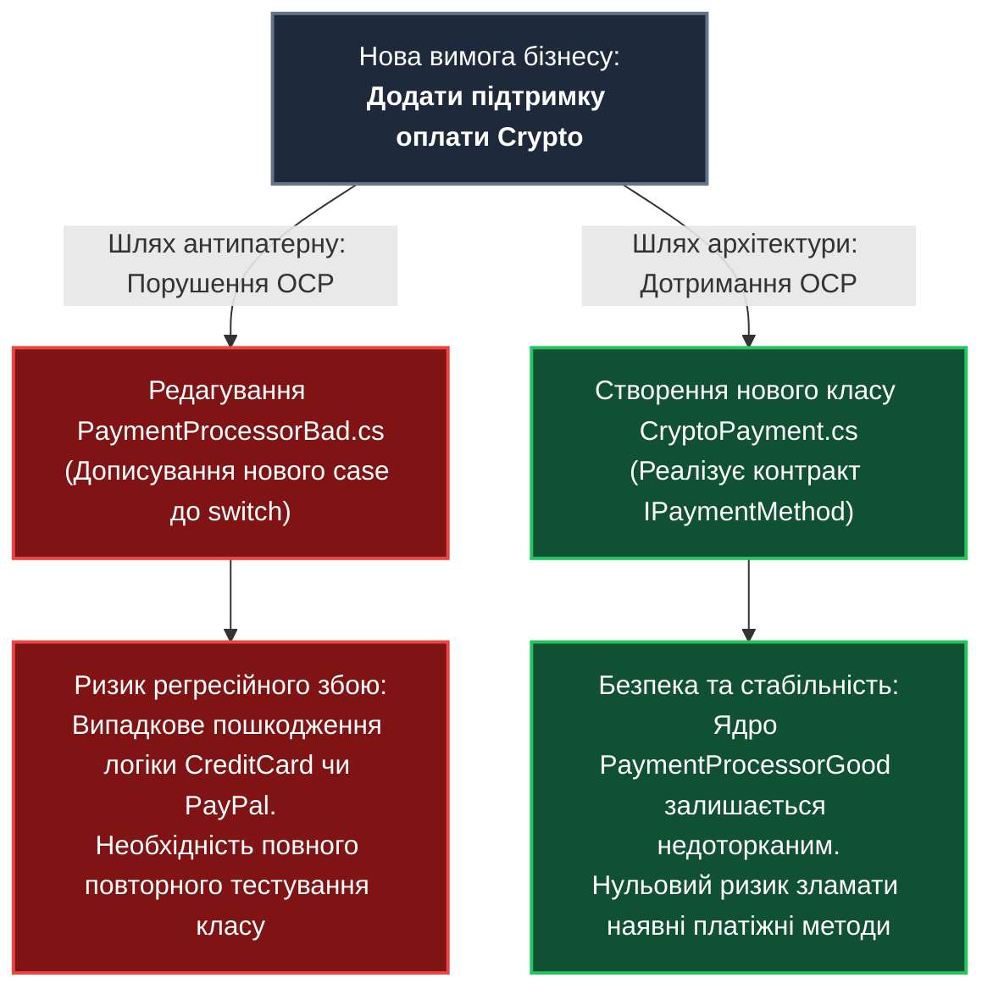
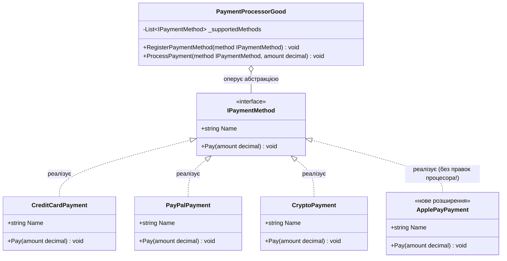
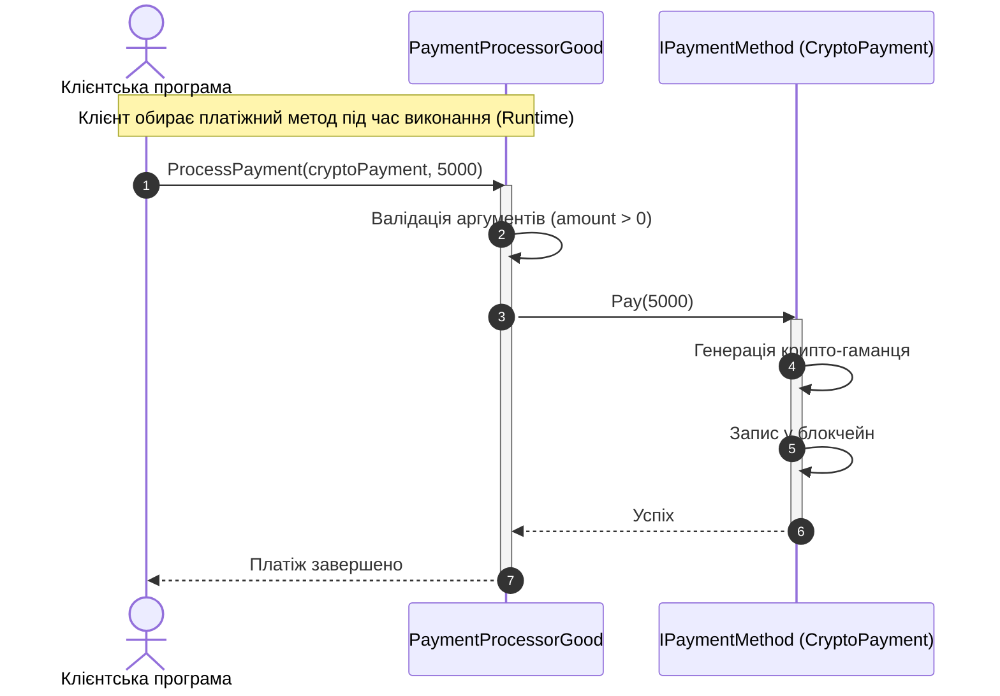

# Лекція 2. Принцип відкритості/закритості (Open/Closed Principle — OCP)

> **"Software entities (classes, modules, functions, etc.) should be open for extension, but closed for modification."**  
> *(Програмні сутності повинні бути відкритими для розширення, але закритими для модифікації).*  
> — **Бертран Мейєр (Bertrand Meyer, 1988)**

---

### 🧭 Швидка навігація до коду (Кнопки переходу до файлів проєкту):

| Тип прикладу | Клас / Компонент | Роль в архітектурі | Посилання на вихідний код |
| :--- | :--- | :--- | :---: |
| ❌ **Порушення (Bad)** | **`PaymentProcessorBad`** | Антипатерн Switch-Hell (перевірка типів оплати) | [👉 Відкрити `PaymentProcessorBad.cs` (рядок 11)](../O/PaymentProcessorBad.cs) |
| 🎮 **Демонстрація** | **`OcpBadExampleCommand`** | Консольний запуск сценарію з порушенням | [👉 Відкрити `OcpBadExampleCommand.cs` (рядок 15)](../O/OcpBadExampleCommand.cs) |
| ✅ **Еталон OCP (Good)** | **`IPaymentMethod`** | Поліморфний контракт оплати (Стратегія) | [👉 Відкрити `IPaymentMethod.cs` (рядок 11)](../O/OCPGoodExample/IPaymentMethod.cs) |
| ✅ **Еталон OCP (Good)** | **`CreditCardPayment`** | Стратегія: Оплата банківською карткою | [👉 Відкрити `CreditCardPayment.cs` (рядок 9)](../O/OCPGoodExample/CreditCardPayment.cs) |
| ✅ **Еталон OCP (Good)** | **`PayPalPayment`** | Стратегія: Оплата через PayPal | [👉 Відкрити `PayPalPayment.cs` (рядок 9)](../O/OCPGoodExample/PayPalPayment.cs) |
| ✅ **Еталон OCP (Good)** | **`CashPayment`** | Стратегія: Оплата готівкою | [👉 Відкрити `CashPayment.cs` (рядок 9)](../O/OCPGoodExample/CashPayment.cs) |
| ✅ **Еталон OCP (Good)** | **`CryptoPayment`** | Стратегія: Оплата криптовалютою | [👉 Відкрити `CryptoPayment.cs` (рядок 9)](../O/OCPGoodExample/CryptoPayment.cs) |
| ✅ **Еталон OCP (Good)** | **`ApplePayPayment`** | Стратегія: Оплата через Apple Pay | [👉 Відкрити `ApplePayPayment.cs` (рядок 9)](../O/OCPGoodExample/ApplePayPayment.cs) |
| ✅ **Еталон OCP (Good)** | **`GooglePayPayment`** | Стратегія: Оплата через Google Pay | [👉 Відкрити `GooglePayPayment.cs` (рядок 9)](../O/OCPGoodExample/GooglePayPayment.cs) |
| ✅ **Еталон OCP (Good)** | **`PaymentProcessorGood`** | Закритий для модифікацій процесор | [👉 Відкрити `PaymentProcessorGood.cs` (рядок 11)](../O/PaymentProcessorGood.cs) |
| 🎮 **Демонстрація** | **`OcpGoodExampleCommand`** | Консольний запуск еталонного сценарію | [👉 Відкрити `OcpGoodExampleCommand.cs` (рядок 17)](../O/OcpGoodExampleCommand.cs) |

---

## 1. Навчальні цілі лекції

Опрацювавши цю лекцію, ви:
1. **Зрозумієте інженерну суть принципу OCP**: чому редагування вже працюючого, протестованого і розгорнутого у продакшені коду несе колосальні фінансові та репутаційні ризики для бізнесу.
2. **Опануєте різницю між історичним OCP Мейєра** (на основі наслідування) та **сучасним поліморфним OCP** (на основі інтерфейсів та абстракцій).
3. **Навчитеся розпізнавати антипатерн «Switch/Case Hell»** та каскадні конструкції `if-else` під час аналізу вихідного коду.
4. **Дослідите зв'язок OCP із патернами GoF**: Strategy (Стратегія), Factory Method (Фабричний метод) та Decorator (Декоратор).
5. **Засвоїте межі застосування**: як запобігти передчасному ускладненню (Overengineering) та слідувати принципу YAGNI.

---

## 2. Філософія та фундаментальна теорія принципу

### 2.1. Економіка змін у програмному забезпеченні
У класичному виробництві (наприклад, машинобудуванні) для додавання нової опції (наприклад, нового типу фар) ніхто не переплавляє каркас автомобіля заново. Замість цього інженери передбачають стандартизовані роз'єми (слоти розширення).

У програмній інженерії діє те саме правило:
* **Закритість для модифікації**: Базовий функціонал системи, який пройшов ретельне тестування та працює у користувачів, не повинен змінюватися щоразу, коли бізнес вимагає нового функціоналу. Зміна перевіреного коду завжди несе ризик внести регресійний баг.
* **Відкритість для розширення**: Архітектура системи повинна дозволяти додавати нову поведінку шляхом **створення нового коду**, а не редагування існуючого.



### 2.2. Еволюція принципу: Мейєр проти Мартіна
Існує дві історичні форми принципу:

1. **OCP за Бертраном Мейєром (1988)**:
   - Базувався на класичному об'єктно-орієнтованому **наслідуванні класів**.
   - Новий функціонал додавався через створення похідного класу, який перевизначав віртуальні методи базового класу.
   - *Недолік*: Тісне зв'язування з батьківським класом (Fragile Base Class problem), небезпека порушення інваріантів батька.
2. **Поліморфний OCP за Робертом Мартіном (Uncle Bob, 1996)**:
   - Базується на **абстракціях та інтерфейсах** (Interface-based polymorphism).
   - Базовий модуль залежить від абстрактного контракту (наприклад, `IPaymentMethod`).
   - Нова функціональність додається шляхом створення нових класів, які реалізують цей інтерфейс. Жодне наслідування важкої реалізації не потрібне!

---

## 3. Симптоми порушення принципу (Code Smells)

1. **Switch / If-Else Hell (Каскад розгалужень за типом)**:
   - Наявність великих блоків `switch` або розгалужених ланцюжків `if (type == "A") ... else if (type == "B") ...`.
   - Щоразу, коли з'являється новий бізнес-тип, розробник змушений шукати всі такі блоки по всьому коду та додавати нову гілку.
2. **Перевірка типів у рантаймі (Type Inspection Smells)**:
   - Використання конструкцій типу `if (obj is CreditCardPayment)`, `typeof()`, або явного приведення типів (casting). Це вірна ознака того, що поліморфізм замінено процедурним кодом.
3. **Експоненційне зростання цикломатичної складності (Cyclomatic Complexity)**:
   - Кожен новий `case` додає новий шлях виконання. Клас із 10 гілками вимагає щонайменше 10 окремих тест-кейсів лише для покриття базових переходів.
4. **Спільне порушення SRP та OCP**:
   - Клас, який знає, як працювати з кожним платіжним шлюзом (і зі Stripe, і з PayPal, і з Bitcoin), має надто багато причин для змін.

---

## 4. Детальний розбір навчального прикладу

## 4. Детальний розбір навчального прикладу

### 4.1. Поганий приклад: порушення OCP
> 🔗 **Файл:** [`OOP - SOLID/O/PaymentProcessorBad.cs`](../O/PaymentProcessorBad.cs)  
> 👉 [**Відкрити `PaymentProcessorBad.cs` у редакторі (рядок 11)**](../O/PaymentProcessorBad.cs)  
> 🎮 [**Запуск демонстрації: `OcpBadExampleCommand.cs` (рядок 15)**](../O/OcpBadExampleCommand.cs)

Погляньмо на реалізацію методу [`ProcessPayment`](../O/PaymentProcessorBad.cs) та [`CalculateFee`](../O/PaymentProcessorBad.cs):

```csharp
// Посилання на файл: OOP - SOLID/O/PaymentProcessorBad.cs (рядки 14-51)
public void ProcessPayment(string paymentType, decimal amount)
{
    // Розгалуження за типом оплати (рядки 16-46)
    if (paymentType == "CreditCard")
    {
        Console.WriteLine($"[ОПЛАТА] Обробка оплати кредитною карткою на суму {amount} грн");
    }
    else if (paymentType == "PayPal")
    {
        Console.WriteLine($"[ОПЛАТА] Обробка оплати через PayPal на суму {amount} грн");
    }
    else if (paymentType == "Cash")
    {
        Console.WriteLine($"[ОПЛАТА] Обробка готівкової оплати на суму {amount} грн");
    }
    // Щоб додати криптовалюту, довелося модифікувати наявний метод (рядок 40):
    else if (paymentType == "Crypto")
    {
        Console.WriteLine($"[ОПЛАТА] Обробка оплати криптовалютою на суму {amount} грн");
    }
    else
    {
        throw new NotSupportedException($"Тип оплати '{paymentType}' не підтримується");
    }
}
```

#### Чому цей підхід є катастрофою в комерційному продукті?
1. **Помилки на етапі виконання (Runtime Errors)**: тип оплати передається як `string` («магічний рядок»). Описка в один символ (`"credicard"` замість `"creditcard"`) спричинить аварійне завершення програми винятком `NotSupportedException` на [рядку 49](../O/PaymentProcessorBad.cs).
2. **Висока ціна змін**: Якщо бізнес вирішить додати підтримку Apple Pay чи Google Pay, розробник зобов'язаний відкрити файл `PaymentProcessorBad.cs`, внести зміни до методу, скомпілювати цей файл та заново протестувати **всі інші способи оплати**, щоб переконатися, що правка випадково не пошкодила роботу з кредитними картками.

---

### 4.2. Еталонний рефакторинг: Поліморфна система на основі інтерфейсу

У правильній архітектурі ми відокремлюємо стабільну поведінку (процес списання платежу) від мінливої (алгоритми конкретних провайдерів):

| № | Клас / Інтерфейс | Роль у системі | Пряме посилання на код |
|:---:|:---|:---|:---:|
| 1 | **`IPaymentMethod`** | Контракт платіжного методу (`Process`, `CalculateFee`) | [👉 `IPaymentMethod.cs`](../O/OCPGoodExample/IPaymentMethod.cs) |
| 2 | **`CreditCardPayment`** | Реалізація оплати банківською карткою | [👉 `CreditCardPayment.cs`](../O/OCPGoodExample/CreditCardPayment.cs) |
| 3 | **`PayPalPayment`** | Реалізація оплати через гаманець PayPal | [👉 `PayPalPayment.cs`](../O/OCPGoodExample/PayPalPayment.cs) |
| 4 | **`CashPayment`** | Реалізація готівкової оплати | [👉 `CashPayment.cs`](../O/OCPGoodExample/CashPayment.cs) |
| 5 | **`CryptoPayment`** | Реалізація криптовалютного платежу | [👉 `CryptoPayment.cs`](../O/OCPGoodExample/CryptoPayment.cs) |
| 6 | **`GooglePayPayment`** | Реалізація оплати Google Pay | [👉 `GooglePayPayment.cs`](../O/OCPGoodExample/GooglePayPayment.cs) |
| 7 | **`ApplePayPayment`** | Реалізація оплати Apple Pay | [👉 `ApplePayPayment.cs`](../O/OCPGoodExample/ApplePayPayment.cs) |
| 8 | **`PaymentProcessorGood`** | Процесор із відкритою реєстрацією методів | [👉 `PaymentProcessorGood.cs`](../O/PaymentProcessorGood.cs) |
| 🎮 | **`OcpGoodExampleCommand`** | Консольна команда запуску OCP сценарію | [👉 `OcpGoodExampleCommand.cs`](../O/OcpGoodExampleCommand.cs) |

#### Реалізація закритого процесора ([PaymentProcessorGood.cs](../O/PaymentProcessorGood.cs)):
> 🔗 **Файл:** [`OOP - SOLID/O/PaymentProcessorGood.cs`](../O/PaymentProcessorGood.cs)  
> 👉 [**Відкрити `PaymentProcessorGood.cs` у редакторі (рядок 45)**](../O/PaymentProcessorGood.cs)

```csharp
// Посилання на файл: OOP - SOLID/O/PaymentProcessorGood.cs (рядки 45-69)
public void ProcessPayment(string paymentMethodName, decimal amount)
{
    // Знаходимо потрібний метод оплати за поліморфним ім'ям (рядки 48-54)
    var paymentMethod = _availablePayments
        .FirstOrDefault(p => p.Name.Equals(paymentMethodName, StringComparison.OrdinalIgnoreCase));

    if (paymentMethod == null)
        throw new NotSupportedException($"Метод оплати '{paymentMethodName}' не підтримується");

    // Поліморфний виклик: процесор не знає внутрішніх деталей методу Process!
    paymentMethod.Process(amount); // рядок 61

    var fee = paymentMethod.CalculateFee(amount); // рядок 63
    var total = amount + fee;

    Console.WriteLine($"\n[ПІДСУМОК] Сума: {amount} грн, Комісія: {fee} грн, До сплати: {total} грн");
}
```

---

## 5. Архітектурні діаграми

### 5.1. Діаграма класів (Class Diagram)



### 5.2. Потік виконання поліморфного виклику



---

## 6. Порівняльна таблиця інженерних метрик

| Метрика | Поганий варіант (Bad Example) | Гарний варіант за OCP (Good Example) |
|:---|:---|:---|
| **Цикломатична складність** | Висока, зростає на +1 з кожним новим типом оплати. | Мінімальна (`O(1)`). Відсутні розгалуження. |
| **Додавання нового методу** | Необхідно змінювати вихідний код `PaymentProcessorBad.cs`. | Створюється новий файл класу без жодного дотику до існуючого коду. |
| **Ризик регресії** | Високий: можна випадково змінити логіку суміжних `case`. | Нульовий: старий код взагалі не компілюється повторно. |
| **Типобезпека** | Відсутня (передається довільний рядок `"paypal"`, `"PAYPAL"`). | Повна строга типізація компілятором C# (`IPaymentMethod`). |
| **Тестованість** | Складна: тести прив'язані до конкретних реалізацій. | Ідеальна: процесор тестується за допомогою одного mock-об'єкта. |

---

## 7. Зв'язок із класичними патернами проектування GoF

1. **Стратегія (Strategy)**:
   - Інтерфейс `IPaymentMethod` є класичним прикладом патерну **Strategy**. Він інкапсулює сімейство взаємозамінних алгоритмів оплати, дозволяючи змінювати алгоритм незалежно від клієнтів, які його використовують.
2. **Фабричний метод (Factory Method)**:
   - Якщо вибір конкретного `IPaymentMethod` залежить від вводу користувача з інтерфейсу (наприклад, radio-button у веб-кошику), для створення екземпляра використовується фабрика `PaymentMethodFactory`. Це ізолює створення об'єктів від їх використання.
3. **Декоратор (Decorator)**:
   - Дозволяє динамічно додавати функціонал до будь-якого способу оплати без модифікації його коду (наприклад: `PaymentLoggingDecorator`, `PaymentCommissionDecorator`).

---

## 8. Методика модульного тестування (Unit Testing)

### Тестування ядра системи з OCP:
Оскільки `PaymentProcessorGood` оперує абстракцією `IPaymentMethod`, ми можемо протестувати роботу процесора за допомогою Mock-об'єкта (наприклад, за допомогою бібліотеки `Moq` або власного тестового шпигуна `FakePaymentMethod`), не відправляючи реальних запитів у платіжні шлюзи:

```csharp
[Fact]
public void ProcessPayment_ShouldInvokePayMethod_WhenArgumentsAreValid()
{
    // Arrange
    var processor = new PaymentProcessorGood();
    var fakeMethod = new FakePaymentMethod(); // Реалізує IPaymentMethod для тестів

    // Act
    processor.ProcessPayment(fakeMethod, 250m);

    // Assert
    Assert.True(fakeMethod.WasPayCalled);
    Assert.Equal(250m, fakeMethod.LastAmountPaid);
}
```

---

## 9. Пастки надлишкового ускладнення (Overengineering)

### Чи потрібно застосовувати OCP абсолютно скрізь?
**Ні!** Це типова помилка молодих архітекторів.
* Якщо у вашій системі є сутність `DayOfWeek` (Дні тижня), малоймовірно, що через місяць людство відкриє «восьмий день тижня». Створювати поліморфну фабрику та інтерфейси для днів тижня — це пряме порушення принципу **YAGNI (You Aren't Gonna Need It)**.
* **Правило трьох змін**: Якщо шматок коду змінюється вперше — зробіть його простим. Якщо ви змінюєте його вдруге — зверніть увагу. Якщо ви повертаєтеся до модифікації цього місця втретє — це сигнал негайно рефакторити його під OCP!

---

## 10. Практичні лабораторні завдання

### Завдання 1 (Базовий рівень):
Створіть новий клас `GooglePayPayment`, який реалізує `IPaymentMethod`. Зареєструйте його в `PaymentProcessorGood` та виконайте оплату. Переконайтеся, що ви не змінили жодного рядка в існуючих класах!

### Завдання 2 (Рефакторинг калькулятора податків):
Вам надано клас `TaxCalculator`, який містить великий `switch(countryCode)` для розрахунку ПДВ для США, України та Німеччини.
Спроектуйте інтерфейс `ITaxPolicy` та рефакторте калькулятор відповідно до принципів OCP.

### Контрольні запитання для самоперевірки:
1. Чому модифікація перевіреного коду несе вищу вартість для бізнесу, ніж написання нового?
2. Чим відрізняється OCP Бертрана Мейєра від OCP Роберта Мартіна?
3. Який зв'язок між принципом OCP та паттерном проектування Strategy?
4. У яких випадках використання простого `switch` є виправданим, а створення інтерфейсів — передчасним ускладненням?
