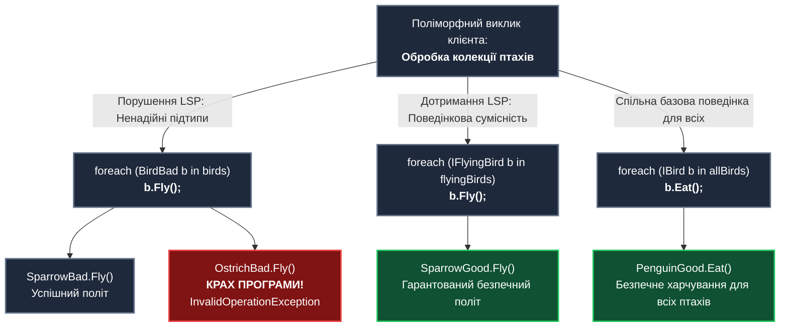
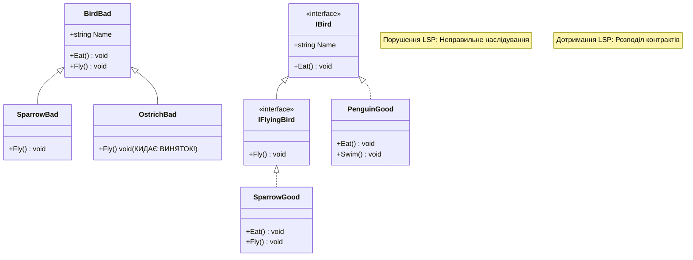

# Лекція 3. Принцип підстановки Лісков (Liskov Substitution Principle — LSP)

> **"Let Φ(x) be a property provable about objects x of type T. Then Φ(y) should be true for objects y of type S where S is a subtype of T."**  
> *(Нехай Φ(x) — властивість, яку можна довести для об'єктів x типу T. Тоді Φ(y) має бути вірною для об'єктів y типу S, де S є підтипом типу T).*  
> — **Барбара Лісков та Жанетт Вінг (Barbara Liskov & Jeannette Wing, 1994)**

---

### 🧭 Швидка навігація до коду (Кнопки переходу до файлів проєкту):

| Тип прикладу | Клас / Компонент | Роль в архітектурі | Посилання на вихідний код |
| :--- | :--- | :--- | :---: |
| ❌ **Порушення (Bad)** | **`BirdBad`** | Базовий клас птаха з методом `Fly()` | [👉 Відкрити `BirdBad.cs` (рядок 10)](../L/LSPBadExample/BirdBad.cs) |
| ❌ **Порушення (Bad)** | **`OstrichBad`** | Страус: кидає `InvalidOperationException` | [👉 Відкрити `OstrichBad.cs` (рядок 9)](../L/LSPBadExample/OstrichBad.cs) |
| ❌ **Порушення (Bad)** | **`PenguinBad`** | Пінгвін: кидає `InvalidOperationException` | [👉 Відкрити `PenguinBad.cs` (рядок 9)](../L/LSPBadExample/PenguinBad.cs) |
| ❌ **Порушення (Bad)** | **`BirdSanctuaryBad`** | Заповідник: краш при спробі запуску | [👉 Відкрити `BirdSanctuaryBad.cs` (рядок 9)](../L/LSPBadExample/BirdSanctuaryBad.cs) |
| 🎮 **Демонстрація** | **`LspBadExampleCommand`** | Консольний запуск сценарію з крашем | [👉 Відкрити `LspBadExampleCommand.cs` (рядок 15)](../L/LspBadExampleCommand.cs) |
| ✅ **Еталон OCP/LSP (Good)** | **`BirdGood`** | Спільний безпечний базовий клас (`Eat`, `Sleep`) | [👉 Відкрити `BirdGood.cs` (рядок 10)](../L/LSPGoodExample/BirdGood.cs) |
| ✅ **Еталон OCP/LSP (Good)** | **`IFlyable`** | Окремий контракт польоту (`Fly`) | [👉 Відкрити `IFlyable.cs` (рядок 9)](../L/LSPGoodExample/IFlyable.cs) |
| ✅ **Еталон OCP/LSP (Good)** | **`ISwimmable`** | Окремий контракт плавання (`Swim`) | [👉 Відкрити `ISwimmable.cs` (рядок 9)](../L/LSPGoodExample/ISwimmable.cs) |
| ✅ **Еталон OCP/LSP (Good)** | **`SparrowGood`** | Горобець: реалізує `IFlyable` | [👉 Відкрити `SparrowGood.cs` (рядок 11)](../L/LSPGoodExample/SparrowGood.cs) |
| ✅ **Еталон OCP/LSP (Good)** | **`EagleGood`** | Орел: реалізує `IFlyable` | [👉 Відкрити `EagleGood.cs` (рядок 11)](../L/LSPGoodExample/EagleGood.cs) |
| ✅ **Еталон OCP/LSP (Good)** | **`PenguinGood`** | Пінгвін: плаває, не літає | [👉 Відкрити `PenguinGood.cs` (рядок 11)](../L/LSPGoodExample/PenguinGood.cs) |
| ✅ **Еталон OCP/LSP (Good)** | **`OstrichGood`** | Страус: бігає, не літає | [👉 Відкрити `OstrichGood.cs` (рядок 11)](../L/LSPGoodExample/OstrichGood.cs) |
| ✅ **Еталон OCP/LSP (Good)** | **`BirdSanctuaryGood`** | Заповідник: безпечний поліморфізм | [👉 Відкрити `BirdSanctuaryGood.cs` (рядок 11)](../L/LSPGoodExample/BirdSanctuaryGood.cs) |
| 🎮 **Демонстрація** | **`LspGoodExampleCommand`** | Консольний запуск еталонного сценарію | [👉 Відкрити `LspGoodExampleCommand.cs` (рядок 17)](../L/LspGoodExampleCommand.cs) |

---

## 1. Навчальні цілі лекції

Опрацювавши цю лекцію, ви:
1. **Зрозумієте фундаментальну відмінність між наслідуванням у реальному світі та підтипуванням в ООП**: чому звичне людське судження «Страус — це птах» або «Квадрат — це прямокутник» ламає програмні системи.
2. **Опануєте методологію проектування за контрактом (Design by Contract)**: поняття передумов (Preconditions), післяумов (Postconditions) та інваріантів (Invariants).
3. **Навчитеся миттєво знаходити порушення LSP**: генерацію винятків `NotSupportedException` або `InvalidOperationException` у методах спадкоємців.
4. **Засвоїте «Золоте правило ООП»**: перевагу композиції над наслідуванням (*Composition over Inheritance*).
5. **Отримаєте практичний навик побудови ієрархій**, де будь-який підтип гарантовано замінює базовий тип без сюрпризів для викликаючого коду.

---

## 2. Філософія та фундаментальна теорія принципу

### 2.1. Чому LSP — це наріжний камінь поліморфізму?
Поліморфізм — це здатність обробляти об'єкти різних типів через єдиний уніфікований інтерфейс. Але якщо похідний клас змінює або ламає очікувану поведінку базового типу, поліморфізм перетворюється на джерело критичних прихованих дефектів.

**Простими словами для студента**:
> Якщо клієнтський код очікує об'єкт типу «Базовий Клас», він повинен мати можливість використовувати **будь-якого** його нащадка, навіть не знаючи про його конкретний тип, і програма при цьому **не повинна впасти чи видати некоректний результат**.



---

### 2.2. Проектування за контрактом (Design by Contract)
Принцип Лісков базується на концепції «Контрактного програмування», розробленого Бертраном Мейєром. Контракт класу визначається трьома правилами:

1. **Передумови (Preconditions)**:
   - Умови, які повинні бути виконані перед викликом методу.
   - **Правило LSP**: Підтип не має права *посилювати* передумови.
   - *Приклад порушення*: Базовий клас приймає будь-яке число від 1 до 1000, а підтип вимагає тільки парні числа від 100 до 200. Клієнт, що передасть число 5, отримає аварійний виняток.
2. **Післяумови (Postconditions)**:
   - Гарантії, які метод забезпечує після свого виконання.
   - **Правило LSP**: Підтип не має права *послаблювати* післяумови.
   - *Приклад порушення*: Базовий метод обіцяє повернути збережений файл у статусі `Closed`, а підтип повертає відкритий дескриптор або взагалі `null`.
3. **Інваріанти (Invariants)**:
   - Внутрішні правила цілісності об'єкта, які повинні залишатися істинними завжди.
   - **Правило LSP**: Усі інваріанти базового класу повинні суворо зберігатися у підтипі.
4. **Правило винятків (Exception Rule)**:
   - Методи підтипу не повинні кидати винятки, типи яких не очікуються клієнтом базового класу.

---

### 2.3. Класичний парадокс: Прямокутник і Квадрат
У математиці геометрії кожен квадрат є окремим випадком прямокутника:
> **Квадрат ⊂ Прямокутник** *(множина всіх квадратів є підмножиною прямокутників)*

Але в об'єктно-орієнтованому програмуванні це відношення хибне:
```csharp
public class Rectangle
{
    public virtual int Width { get; set; }
    public virtual int Height { get; set; }
    public int Area => Width * Height;
}

public class Square : Rectangle
{
    public override int Width 
    { 
        set { base.Width = value; base.Height = value; } // зміна обох сторін!
    }
    public override int Height 
    { 
        set { base.Width = value; base.Height = value; } // зміна обох сторін!
    }
}
```

Якщо клієнтський алгоритм розраховує поведінку прямокутника:
```csharp
void ResizeRectangle(Rectangle r)
{
    r.Width = 10;
    r.Height = 5;
    // Клієнт очікує площу 50! Але якщо передано Square, площа буде 25!
    Debug.Assert(r.Area == 50, "Порушення інваріанту прямокутника!");
}
```
**Висновок**: Поведінка `Square` суперечить поведінці `Rectangle`. У коді підтипування визначається **поведінкою**, а не зовнішньою візуальною схожістю.

---

## 3. Симптоми порушення принципу (Code Smells)

1. **Винятки відмови від функціоналу (`NotSupportedException`)**:
   - Метод похідного класу реалізовано як:
     ```csharp
     public override void Fly() => throw new NotSupportedException();
     ```
2. **Порожні методи-заглушки (Empty Method Overrides)**:
   - Метод перевизначено з порожнім тілом (`{ /* нічого не робимо */ }`), що порушує гарантію виконання післяумови.
3. **Каскадні перевірки типу перед викликом (Downcasting Smells)**:
   - Клієнтський код змушений робити спеціальні перевірки, щоб захиститися від «особливих» спадкоємців:
     ```csharp
     if (bird is not Ostrich && bird is not Penguin)
     {
         bird.Fly();
     }
     ```
4. **Повернення `null` або помилкових статусів там, де базовий клас повертає значення**.

---

## 4. Детальний розбір навчального прикладу

### 4.1. Поганий приклад: порушення LSP
> 🔗 **Файл:** [`OOP - SOLID/L/LSPBadExample/BirdBad.cs`](../L/LSPBadExample/BirdBad.cs)  
> 👉 [**Відкрити базовий клас `BirdBad.cs` у редакторі (рядок 10)**](../L/LSPBadExample/BirdBad.cs)  
> ⚠️ [**Відкрити проблемний клас `OstrichBad.cs` (рядок 9)**](../L/LSPBadExample/OstrichBad.cs)  
> ⚠️ [**Відкрити проблемний клас `PenguinBad.cs` (рядок 9)**](../L/LSPBadExample/PenguinBad.cs)  
> 🎮 [**Запуск демонстрації: `LspBadExampleCommand.cs` (рядок 15)**](../L/LspBadExampleCommand.cs)

У поганій реалізації створено ієрархію, де базовий клас наділяє **всіх** птахів абстрактною дією польоту:

```csharp
// Посилання на файл: OOP - SOLID/L/LSPBadExample/BirdBad.cs (рядки 10-16)
public abstract class BirdBad
{
    public string Name { get; set; } = string.Empty;

    public abstract void Eat();
    public abstract void Fly(); // Помилка: не всі птахи літають! (рядок 15)
}
```

Коли підтипи страуса та пінгвіна змушені реалізувати цей метод, виникає крах поведінкового підтипування:

```csharp
// Посилання на файл: OOP - SOLID/L/LSPBadExample/OstrichBad.cs (рядки 18-22)
public override void Fly()
{
    // Порушення LSP: метод ламає очікування клієнта і кидає виняток!
    throw new InvalidOperationException($"[ПОМИЛКА] {Name} не вміє літати!");
}
```

#### Наслідки в клієнтському коді ([LspBadExampleCommand.cs](../L/LspBadExampleCommand.cs)):

```csharp
// Посилання на файл: OOP - SOLID/L/LspBadExampleCommand.cs (рядки 28-36)
foreach (var bird in birds)
{
    bird.Eat(); // Працює для всіх
    bird.Fly(); // КРАХ ПРОГРАМИ: аварійна зупинка на OstrichBad або PenguinBad!
}
```

---

### 4.2. Еталонний рефакторинг: Розподіл поведінкових контрактів

У правильній архітектурі можливість літати винесено в окремий інтерфейс `IFlyable`, а плавати — в `ISwimmable`:

| № | Клас / Інтерфейс | Роль у системі | Пряме посилання на код |
|:---:|:---|:---|:---:|
| 1 | **`BirdGood`** | Базовий клас для всіх птахів (`Eat`, `Sleep`) | [👉 `BirdGood.cs`](../L/LSPGoodExample/BirdGood.cs) |
| 2 | **`IFlyable`** | Інтерфейс здатності літати (`Fly`) | [👉 `IFlyable.cs`](../L/LSPGoodExample/IFlyable.cs) |
| 3 | **`ISwimmable`** | Інтерфейс здатності плавати (`Swim`) | [👉 `ISwimmable.cs`](../L/LSPGoodExample/ISwimmable.cs) |
| 4 | **`SparrowGood`** | Горобець: реалізує `IFlyable` | [👉 `SparrowGood.cs`](../L/LSPGoodExample/SparrowGood.cs) |
| 5 | **`EagleGood`** | Орел: реалізує `IFlyable` | [👉 `EagleGood.cs`](../L/LSPGoodExample/EagleGood.cs) |
| 6 | **`PenguinGood`** | Пінгвін: реалізує `ISwimmable` (не літає!) | [👉 `PenguinGood.cs`](../L/LSPGoodExample/PenguinGood.cs) |
| 7 | **`OstrichGood`** | Страус: швидкий бігун (не літає!) | [👉 `OstrichGood.cs`](../L/LSPGoodExample/OstrichGood.cs) |
| 8 | **`KiwiGood`** | Ківі: нічний птах (не літає!) | [👉 `KiwiGood.cs`](../L/LSPGoodExample/KiwiGood.cs) |
| 9 | **`ParrotGood`** | Папуга: реалізує `IFlyable` | [👉 `ParrotGood.cs`](../L/LSPGoodExample/ParrotGood.cs) |
| 10 | **`BirdSanctuaryGood`** | Заповідник для безпечної роботи з групами птахів | [👉 `BirdSanctuaryGood.cs`](../L/LSPGoodExample/BirdSanctuaryGood.cs) |
| 🎮 | **`LspGoodExampleCommand`** | Консольна команда запуску LSP сценарію | [👉 `LspGoodExampleCommand.cs`](../L/LspGoodExampleCommand.cs) |

#### Безпечне використання у клієнтському коді:
> 🔗 **Файл:** [`OOP - SOLID/L/LspGoodExampleCommand.cs`](../L/LspGoodExampleCommand.cs)  
> 👉 [**Відкрити `LspGoodExampleCommand.cs` у редакторі (рядок 30)**](../L/LspGoodExampleCommand.cs)

```csharp
// 1. Поліморфна робота з усіма птахами (рядки 32-37):
foreach (var bird in allBirds)
{
    bird.Eat(); // Гарантовано безпечно: кожен підтип вміє їсти!
}

// 2. Робота виключно з тими, хто дійсно вміє літати (рядки 42-47):
foreach (var flyingBird in flyingBirds)
{
    flyingBird.Fly(); // Гарантовано без винятків: компілятор захищає контракт!
}
```

---

## 5. Архітектурні діаграми

### 5.1. Діаграма класів: Погана vs Гарна ієрархія



---

## 6. Порівняльна таблиця метрик надійності

| Параметр | Ієрархія з порушенням LSP | Ієрархія за стандартом LSP |
|:---|:---|:---|
| **Поведінкова передбачуваність** | Низька: клієнт не знає, чи викличе метод аварію. | Абсолютна: будь-який підтип підтримує весь свій контракт. |
| **Кількість блоків `try-catch`** | Велика: клієнтський код змушений ловити винятки непідтримуваних операцій. | Нульова: операція відсутня на рівні сигнатури інтерфейсу. |
| **Необхідність перевірок типу (`is`)** | Постійна (`if (b is not Ostrich)`). | Відсутня: компілятор гарантує коректність типів. |
| **Гнучкість до розширення** | Погана: додавання ківі чи ему зламає наявні цикли. | Ідеальна: нелітаючі птахи просто реалізують `IBird`. |

---

## 7. Зв'язок із класичними патернами проектування GoF

1. **Об'єкт-заглушка (Null Object)**:
   - Замість повернення `null` або викидання винятків, патерн пропонує повертати екземпляр, який реалізує базовий інтерфейс з безпечною дефолтною дією (наприклад, `NoDiscountPolicy`). Це зберігає сумісність LSP.
2. **Компонувальник (Composite)**:
   - У дереві об'єктів як листок (`Leaf`), так і складний контейнер (`Composite`) повинні повністю підтримувати базовий контракт без відмови від операцій.

---

## 8. Методика тестування контрактів (Contract Testing)

Для запобігання порушенням LSP у великих системах використовують **тестування контрактів**:

```csharp
public abstract class BirdContractTests<T> where T : IBird, new()
{
    [Fact]
    public void Eat_ShouldNotThrowException_AndShouldSucceed()
    {
        // Arrange
        IBird bird = new T();

        // Act & Assert (Будь-який підтип зобов'язаний вміти їсти без винятків!)
        var exception = Record.Exception(() => bird.Eat());
        Assert.Null(exception);
    }
}

public class SparrowTests : BirdContractTests<SparrowGood> { }
public class PenguinTests : BirdContractTests<PenguinGood> { }
```

---

## 9. Пастки надлишкового ускладнення (Overengineering)

### Чи треба створювати інтерфейс під кожне окреме дієслово?
Не варто доводити розділення до абсурду: `IBirdEater`, `IBirdWalker`, `IBirdBreather`, `IBirdSleepier`.
* Об'єднуйте обов'язки в базовий інтерфейс, якщо вони притаманні **100% представників** домену.
* Створюйте спеціалізований інтерфейс лише для тієї поведінки, яка є **варіативною** (одні вміють літати, інші — ні).

---

## 10. Практичні лабораторні завдання

### Завдання 1 (Базовий рівень):
Створіть клас `DuckGood` (Качка), яка вміє і літати (`IFlyingBird`), і плавати (створіть інтерфейс `ISwimmingBird`). Продемонструйте безпечну роботу качки в поліморфних колекціях.

### Завдання 2 (Рефакторинг рахунків банку):
Вам надано ієрархію банківських рахунків:
`BankAccount` з методами `Deposit(amount)` та `Withdraw(amount)`.
Створено підтип `FixedDepositAccount` (Депозит без права зняття), де метод `Withdraw` кидає `InvalidOperationException`.
Проведіть рефакторинг ієрархії із забезпеченням дотримання LSP.

### Контрольні запитання для самоперевірки:
1. Чому відношення спадкування в реальному світі не завжди є валідним у коді ООП?
2. Що таке передмови та післяумови, і як вони повинні змінюватися в підтипах за правилом Лісков?
3. Чому наявність `throw new NotImplementedException()` у класі-нащадку є стовідсотковим порушенням LSP?
4. Як принцип LSP пов'язаний із правилом «Композиція краща за наслідування»?
