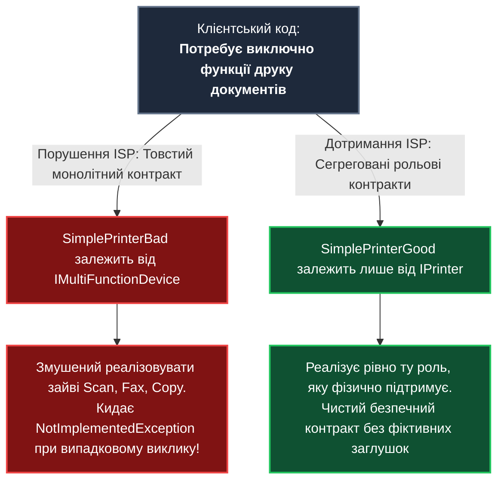
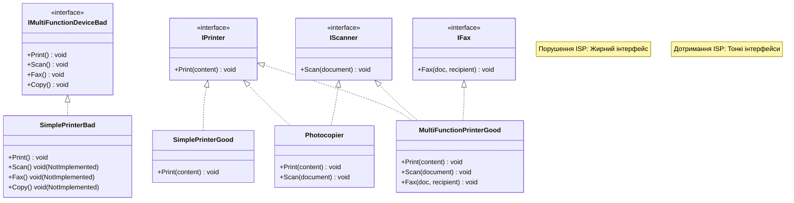

# Лекція 4. Принцип розділення інтерфейсів (Interface Segregation Principle — ISP)

> **"Clients should not be forced to depend upon interfaces that they do not use."**  
> *(Клієнти не повинні залежати від інтерфейсів, якими вони не користуються).*  
> — **Роберт С. Мартін (Uncle Bob)**

---

### 🧭 Швидка навігація до коду (Кнопки переходу до файлів проєкту):

| Тип прикладу | Клас / Компонент | Роль в архітектурі | Посилання на вихідний код |
| :--- | :--- | :--- | :---: |
| ❌ **Порушення (Bad)** | **`IWorkerBad`** | «Жирний» інтерфейс-моноліт (10 несумісних методів) | [👉 Відкрити `IWorkerBad.cs` (рядок 10)](../I/ISPBadExample/IWorkerBad.cs) |
| ❌ **Порушення (Bad)** | **`RobotWorkerBad`** | Робот: змушений реалізовувати обіди та зарплату | [👉 Відкрити `RobotWorkerBad.cs` (рядок 10)](../I/ISPBadExample/RobotWorkerBad.cs) |
| ❌ **Порушення (Bad)** | **`ProgrammerBad`** | Програміст: кидає винятки на бюджет і нічні зміни | [👉 Відкрити `ProgrammerBad.cs` (рядок 10)](../I/ISPBadExample/ProgrammerBad.cs) |
| 🎮 **Демонстрація** | **`IspBadExampleCommand`** | Консольний запуск сценарію з фіктивними методами | [👉 Відкрити `IspBadExampleCommand.cs` (рядок 15)](../I/IspBadExampleCommand.cs) |
| ✅ **Еталон ISP (Контракти)** | **`IWorkable`** | Рольовий контракт: базова робота (`Work`) | [👉 Відкрити `IWorkable.cs` (рядок 9)](../I/ISPGoodExample/Contracts/IWorkable.cs) |
| ✅ **Еталон ISP (Контракти)** | **`IEatable`** | Рольовий контракт: перерви на їжу та каву | [👉 Відкрити `IEatable.cs` (рядок 9)](../I/ISPGoodExample/Contracts/IEatable.cs) |
| ✅ **Еталон ISP (Контракти)** | **`IShiftWorker`** | Рольовий контракт: змінні та нічні графіки | [👉 Відкрити `IShiftWorker.cs` (рядок 9)](../I/ISPGoodExample/Contracts/IShiftWorker.cs) |
| ✅ **Еталон ISP (Контракти)** | **`ISalaried`** | Рольовий контракт: виплата заробітної плати | [👉 Відкрити `ISalaried.cs` (рядок 9)](../I/ISPGoodExample/Contracts/ISalaried.cs) |
| ✅ **Еталон ISP (Контракти)** | **`IOfficeWorker`** | Рольовий контракт: мітинги та корпоративна пошта | [👉 Відкрити `IOfficeWorker.cs` (рядок 9)](../I/ISPGoodExample/Contracts/IOfficeWorker.cs) |
| ✅ **Еталон ISP (Контракти)** | **`IComputerUser`** | Рольовий контракт: робота за комп'ютером | [👉 Відкрити `IComputerUser.cs` (рядок 9)](../I/ISPGoodExample/Contracts/IComputerUser.cs) |
| ✅ **Еталон ISP (Контракти)** | **`IDeveloper`** | Рольовий контракт: написання та рев'ю коду | [👉 Відкрити `IDeveloper.cs` (рядок 9)](../I/ISPGoodExample/Contracts/IDeveloper.cs) |
| ✅ **Еталон ISP (Контракти)** | **`IManager`** | Рольовий контракт: управління командою і бюджетом | [👉 Відкрити `IManager.cs` (рядок 9)](../I/ISPGoodExample/Contracts/IManager.cs) |
| ✅ **Еталон ISP (Good)** | **`RobotWorkerGood`** | Робот: `IWorkable, IShiftWorker` (без зайвого!) | [👉 Відкрити `RobotWorkerGood.cs` (рядок 11)](../I/ISPGoodExample/RobotWorkerGood.cs) |
| ✅ **Еталон ISP (Good)** | **`ProgrammerGood`** | Програміст: розробницькі та офісні контракти | [👉 Відкрити `ProgrammerGood.cs` (рядок 11)](../I/ISPGoodExample/ProgrammerGood.cs) |
| ✅ **Еталон ISP (Good)** | **`ManagerGood`** | Менеджер: управлінські контракти | [👉 Відкрити `ManagerGood.cs` (рядок 11)](../I/ISPGoodExample/ManagerGood.cs) |
| ✅ **Еталон ISP (Good)** | **`InternGood`** | Інтерн: контракти навчання та розробки | [👉 Відкрити `InternGood.cs` (рядок 11)](../I/ISPGoodExample/InternGood.cs) |
| ✅ **Еталон ISP (Good)** | **`FreelancerGood`** | Фрілансер: контракт розробки без мітингів | [👉 Відкрити `FreelancerGood.cs` (рядок 11)](../I/ISPGoodExample/FreelancerGood.cs) |
| 🎮 **Демонстрація** | **`IspGoodExampleCommand`** | Консольний запуск еталонного сценарію | [👉 Відкрити `IspGoodExampleCommand.cs` (рядок 17)](../I/IspGoodExampleCommand.cs) |

---

## 1. Навчальні цілі лекції

Опрацювавши цю лекцію, ви:
1. **Дізнаєтеся історичне походження ISP**: інженерну кризу компанії Xerox із розробкою багатофункціональних пристроїв.
2. **Навчитеся розрізняти «Заголовні інтерфейси» (Header Interfaces) та «Рольові інтерфейси» (Role Interfaces)**.
3. **Опануєте техніку декомпозиції надлишкових («жирних») контрактів** на компактні, клієнтоорієнтовані абстракції.
4. **Зрозумієте зв'язок ISP із патернами GoF** (Adapter, Composite, Facade).
5. **Оціните переваги для тестування**: як невеликі інтерфейси спрощують написання та підтримку Unit-тестів.

---

## 2. Філософія та фундаментальна теорія принципу

### 2.1. Історичний контекст: Кейс компанії Xerox (1990-ті)
Принцип ISP народився безпосередньо з реальної інженерної проблеми, яку Роберт Мартін вирішував як консультант для корпорації **Xerox**:
* Компанія розробляла нове покоління багатофункціональних пристроїв (БФП), які поєднували друк, сканування, факс та зшивання документів.
* Програмне забезпечення для пристрою базувалося на єдиному гігантському класі/інтерфейсі `Job`, який містив сотні методів для всіх можливих завдань.
* Будь-яка модифікація (наприклад, додавання нової опції сканування) вимагала перекомпіляції та повторного тестування абсолютно всіх драйверів — навіть простого модуля зшивача паперу, який взагалі нічого не знав про оптичне розпізнавання.
* Рішенням стало розбиття гігантського контракту `Job` на окремі інтерфейси для кожного типу підсистеми (`IPrintJob`, `IScanJob`, `IFaxJob`).



---

### 2.2. Рольові інтерфейси проти Заголовних
Мартін Фаулер у своїх працях з архітектури розділяє два типи інтерфейсів:

1. **Header Interface (Заголовний інтерфейс)**:
   - Розробник бере конкретний клас (наприклад, `OrderService`) і механічно генерує з нього інтерфейс `IOrderService`, скопіювавши абсолютно всі 40 методів класу.
   - *Проблема*: Це інтерфейс, орієнтований на **постачальника послуги**, а не на **клієнта**. Якщо іншому клієнту потрібен лише 1 метод, він усе одно отримує весь 40-методовий багаж.
2. **Role Interface (Рольовий інтерфейс)**:
   - Інтерфейс проектується з погляду **потреб конкретного споживача**.
   - Він описує одну роль, яку об'єкт відіграє у даній конкретній взаємодії (наприклад: `IDisposable`, `IComparable`, `IEnumerable` у базовій бібліотеці .NET BCL).

---

## 3. Симптоми порушення принципу (Code Smells)

1. **Засилля винятків `NotImplementedException`**:
   - Клас реалізує інтерфейс, але в половині методів пише:
     ```csharp
     public void Fax() => throw new NotImplementedException();
     ```
2. **Порожні реалізації-пустушки**:
   - Методи залишають без логіки, щоб задовольнити компілятор.
3. **Зайві зовнішні залежності**:
   - Клієнту потрібен лише друк тексту, але через монолітний інтерфейс він змушений підтягувати важкі NuGet-пакети драйверів оптичного сканування або факсу.
4. **Часта вимушена перекомпільованість**:
   - Додавання нового параметра в метод `Scan` змушує перекомпілювати клієнтів, які викликають лише метод `Print`.

---

## 4. Детальний розбір навчального прикладу

### 4.1. Поганий приклад: монолітний інтерфейс `IWorkerBad`
> 🔗 **Файл:** [`OOP - SOLID/I/ISPBadExample/IWorkerBad.cs`](../I/ISPBadExample/IWorkerBad.cs)  
> 👉 [**Відкрити інтерфейс `IWorkerBad.cs` у редакторі (рядок 10)**](../I/ISPBadExample/IWorkerBad.cs)  
> ⚠️ [**Відкрити клас `RobotWorkerBad.cs` (рядок 10)**](../I/ISPBadExample/RobotWorkerBad.cs)  
> ⚠️ [**Відкрити клас `ProgrammerBad.cs` (рядок 10)**](../I/ISPBadExample/ProgrammerBad.cs)  
> 🎮 [**Запуск демонстрації: `IspBadExampleCommand.cs` (рядок 15)**](../I/IspBadExampleCommand.cs)

У поганій реалізації створено «жирний» універсальний інтерфейс працівника, що містить 15 методів з різних сфер діяльності:

```csharp
// Посилання на файл: OOP - SOLID/I/ISPBadExample/IWorkerBad.cs (рядки 10-38)
public interface IWorkerBad
{
    // Офісна робота (рядки 13-16)
    void Work();
    void AttendMeeting();
    void SendEmail();
    void UseComputer();

    // Фізіологічні потреби (рядки 19-20)
    void EatLunch();
    void TakeCoffeeBreak();

    // Оплата праці (рядок 23)
    void ReceiveSalary();

    // Менеджмент (рядки 26-28)
    void ManageTeam();
    void ConductPerformanceReview();
    void ApproveBudget();

    // Розробка (рядки 31-33)
    void WriteCode();
    void ReviewCode();
    void DebugCode();

    // Змінний графік (рядки 36-37)
    void WorkNightShift();
    void WorkWeekends();
}
```

Коли виробничий робот [`RobotWorkerBad`](../I/ISPBadExample/RobotWorkerBad.cs) змушений реалізувати цей інтерфейс, виникає засилля фіктивних методів:

```csharp
// Посилання на файл: OOP - SOLID/I/ISPBadExample/RobotWorkerBad.cs (рядки 36-60)
public void EatLunch() => throw new NotImplementedException("Робот не їсть!"); // рядок 38
public void TakeCoffeeBreak() => throw new NotImplementedException("Робот не п'є каву!"); // рядок 43
public void ReceiveSalary() => throw new NotImplementedException("Робот не отримує зарплату!"); // рядок 48
public void AttendMeeting() => throw new NotImplementedException("Робот не ходить на зустрічі!"); // рядок 58
```

Аналогічно, [`ProgrammerBad`](../I/ISPBadExample/ProgrammerBad.cs) змушений кидати винятки для методів управління бюджетом та нічних змін.

---

### 4.2. Еталонний рефакторинг: Рольові інтерфейси за стандартом ISP

У папці [Contracts](../I/ISPGoodExample/Contracts/) гігантський інтерфейс розділено на 8 цільових рольових контрактів:

| № | Рольовий контракт | Призначення | Пряме посилання на код |
|:---:|:---|:---|:---:|
| 1 | **`IWorkable`** | Базова здатність виконувати роботу (`Work`) | [👉 `IWorkable.cs`](../I/ISPGoodExample/Contracts/IWorkable.cs) |
| 2 | **`IEatable`** | Фізіологічні перерви (`EatLunch`, `TakeCoffeeBreak`) | [👉 `IEatable.cs`](../I/ISPGoodExample/Contracts/IEatable.cs) |
| 3 | **`IShiftWorker`** | Робота за змінами (`WorkNightShift`, `WorkWeekends`) | [👉 `IShiftWorker.cs`](../I/ISPGoodExample/Contracts/IShiftWorker.cs) |
| 4 | **`ISalaried`** | Отримання заробітної плати (`ReceiveSalary`) | [👉 `ISalaried.cs`](../I/ISPGoodExample/Contracts/ISalaried.cs) |
| 5 | **`IOfficeWorker`** | Офісні комунікації (`AttendMeeting`, `SendEmail`) | [👉 `IOfficeWorker.cs`](../I/ISPGoodExample/Contracts/IOfficeWorker.cs) |
| 6 | **`IComputerUser`** | Робота за комп'ютером (`UseComputer`) | [👉 `IComputerUser.cs`](../I/ISPGoodExample/Contracts/IComputerUser.cs) |
| 7 | **`IDeveloper`** | Специфіка програмування (`WriteCode`, `ReviewCode`, `DebugCode`) | [👉 `IDeveloper.cs`](../I/ISPGoodExample/Contracts/IDeveloper.cs) |
| 8 | **`IManager`** | Управління командою та бюджетом (`ManageTeam`, `ApproveBudget`) | [👉 `IManager.cs`](../I/ISPGoodExample/Contracts/IManager.cs) |

#### Спеціалізовані реалізації робітників:

| Клас | Реалізовані інтерфейси | Посилання на код |
|:---|:---|:---:|
| **`RobotWorkerGood`** | `IWorkable, IShiftWorker` *(Лише те, що робот робить!)* | [👉 `RobotWorkerGood.cs`](../I/ISPGoodExample/RobotWorkerGood.cs) |
| **`ProgrammerGood`** | `IWorkable, IEatable, ISalaried, IOfficeWorker, IComputerUser, IDeveloper` | [👉 `ProgrammerGood.cs`](../I/ISPGoodExample/ProgrammerGood.cs) |
| **`ManagerGood`** | `IWorkable, IEatable, ISalaried, IOfficeWorker, IComputerUser, IManager` | [👉 `ManagerGood.cs`](../I/ISPGoodExample/ManagerGood.cs) |
| **`InternGood`** | `IWorkable, IEatable, ISalaried, IComputerUser, IDeveloper` | [👉 `InternGood.cs`](../I/ISPGoodExample/InternGood.cs) |
| **`FreelancerGood`** | `IWorkable, IComputerUser, IDeveloper` *(Без офісних мітингів та перерв!)* | [👉 `FreelancerGood.cs`](../I/ISPGoodExample/FreelancerGood.cs) |
| 🎮 **`IspGoodExampleCommand`** | Консольна команда запуску еталонного сценарію | [👉 `IspGoodExampleCommand.cs`](../I/IspGoodExampleCommand.cs) |

#### Чиста реалізація виробничого робота ([RobotWorkerGood.cs](../I/ISPGoodExample/RobotWorkerGood.cs)):
> 🔗 **Файл:** [`OOP - SOLID/I/ISPGoodExample/RobotWorkerGood.cs`](../I/ISPGoodExample/RobotWorkerGood.cs)  
> 👉 [**Відкрити `RobotWorkerGood.cs` у редакторі (рядок 11)**](../I/ISPGoodExample/RobotWorkerGood.cs)

```csharp
// Посилання на файл: OOP - SOLID/I/ISPGoodExample/RobotWorkerGood.cs (рядки 11-28)
public class RobotWorkerGood : IWorkable, IShiftWorker
{
    private string _model;

    public RobotWorkerGood(string model) => _model = model;

    public void Work() => Console.WriteLine($"[Робот {_model}] Виконую виробниче завдання...");
    public void WorkNightShift() => Console.WriteLine($"[Робот {_model}] Працюю в нічну зміну");
    public void WorkWeekends() => Console.WriteLine($"[Робот {_model}] Працюю по вихідних");
    // Жодних методів EatLunch чи ReceiveSalary! 0% фіктивних винятків!
}
```

---

## 5. Архітектурні діаграми

### 5.1. Діаграма класів: Монолітний проти Сегрегованих інтерфейсів



---

## 6. Порівняльна таблиця архітектурних метрик

| Критерій | Монолітний інтерфейс (Bad) | Розділені інтерфейси за ISP (Good) |
|:---|:---|:---|
| **Розмір інтерфейсу** | Громіздкий (Fat Interface). | Мініатюрний, сфокусований на 1 ролі. |
| **Кількість фіктивних методів** | Велика (постійні `NotImplementedException`). | 0% (усі методи мають реальне тіло). |
| **Ступінь зв'язності клієнта** | Сильна: клієнт прив'язаний до чужого API. | Мінімальна: клієнт бачить лише потрібні методи. |
| **Складність написання Mock-тестів** | Висока: у мок-об'єкті треба налаштовувати методи, які тест не викликає. | Тривіальна: мокається рівно 1 потрібний метод. |
| **Стабільність збірок** | Низька: зміна сканера вимагає перекомпіляції клієнтів принтера. | Висока: зміна сканера не торкається принтера. |

---

## 7. Зв'язок із класичними патернами проектування GoF

1. **Адаптер (Adapter)**:
   - Якщо стороння бібліотека надає «жирний» API, ми створюємо вузький інтерфейс, адаптуючи сторонній клас лише до тих операцій, які дійсно потрібні нашій системі.
2. **Композит (Composite)**:
   - Об'єднання кількох тонких інтерфейсів в один комплексний агрегат (як `IMultiFunctionDevice : IPrinter, IScanner`).

---

## 8. Методика модульного тестування

Коли сервіс залежить від вузького інтерфейсу `IPrinter`, створення mock-об'єкта є тривіальним:

```csharp
[Fact]
public void PrintDocumentService_ShouldCallPrintOnce()
{
    // Arrange
    var mockPrinter = new Mock<IPrinter>();
    var service = new DocumentService(mockPrinter.Object);

    // Act
    service.PrintReport("Звіт за 2026 рік");

    // Assert: перевіряємо виклик єдиного методу
    mockPrinter.Verify(p => p.Print("Звіт за 2026 рік"), Times.Once);
}
```

Якби `DocumentService` залежав від старого моноліту, розробнику довелося б турбуватися, чи не викличе виклики сканера або факсу неочікуваних побічних ефектів.

---

## 9. Пастки надлишкового ускладнення (Overengineering)

### Чи треба розбивати кожний метод на окремий інтерфейс?
Створення інтерфейсу для абсолютно кожного методу (`IPrintA4`, `IPrintA3`, `IPrintDuplex`) веде до антипатерну **«Interface Explosion» (Вибух кількості інтерфейсів)**.

**Практичне правило**:
* Якщо група методів вирішує єдину неподільну задачу і всі клієнти завжди використовують їх разом (наприклад, `Open()`, `Read()`, `Close()` у потоках введення-виведення), вони повинні належати одному інтерфейсу.
* Якщо різні клієнти використовують різні підмножини методів — інтерфейс повинен бути розділений.

---

## 10. Практичні лабораторні завдання

### Завдання 1 (Базовий рівень):
Створіть інтерфейс `I3DPrinter` з методом `Print3DModel(string modelPath)`. Створіть клас `Modern3DPrinter`, який реалізує як `IPrinter` (звичайний друк чеків), так і `I3DPrinter`.

### Завдання 2 (Рефакторинг репозиторію):
Вам надано монолітний інтерфейс `IRepository<T>` з 15 методами: `Get`, `GetAll`, `Add`, `Update`, `Delete`, `Search`, `ExportToExcel`, `GenerateSqlScript`, `ClearCache`.
Розбийте його на клієнтоорієнтовані інтерфейси: `IReadOnlyRepository<T>`, `IWriteRepository<T>`, `ISearchable<T>`.

### Контрольні запитання для самоперевірки:
1. Яка історична подія в компанії Xerox призвела до формулювання принципу ISP?
2. Чим відрізняється «рольовий інтерфейс» (Role Interface) від «заголовного» (Header Interface)?
3. Як порушення принципу ISP провокує порушення принципу LSP?
4. Чому наявність надлишкових методів в інтерфейсі ускладнює написання unit-тестів?
