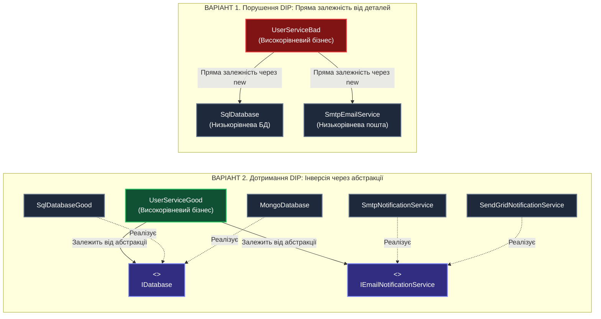
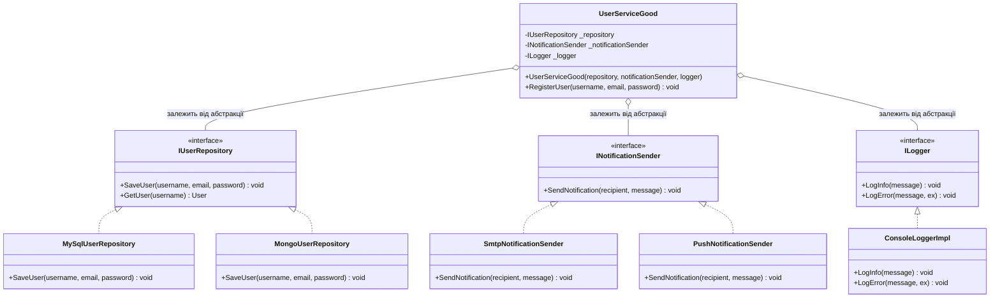
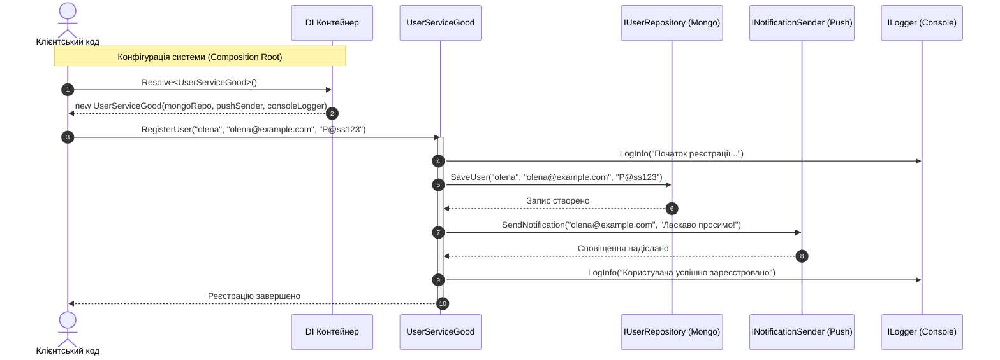

# Лекція 5. Принцип інверсії залежностей (Dependency Inversion Principle — DIP)

> **"High-level modules should not depend on low-level modules. Both should depend on abstractions."**  
> **"Abstractions should not depend on details. Details should depend on abstractions."**  
> *(Високорівневі модулі не повинні залежати від низькорівневих. Обидва повинні залежати від абстракцій).*  
> *(Абстракції не повинні залежати від деталей. Деталі повинні залежати від абстракцій).*  
> — **Роберт С. Мартін (Uncle Bob)**

---

### 🧭 Швидка навігація до коду (Кнопки переходу до файлів проєкту):

| Тип прикладу | Клас / Компонент | Роль в архітектурі | Посилання на вихідний код |
| :--- | :--- | :--- | :---: |
| ❌ **Порушення (Bad)** | **`UserServiceBad`** | Жорстка прив'язка через `new MySQLDatabase()` | [👉 Відкрити `UserServiceBad.cs` (рядок 12)](../D/DIPBadExample/UserServiceBad.cs) |
| ❌ **Порушення (Bad)** | **`MySqlDatabase`** | Низькорівневий модуль: жорстка реалізація СУБД | [👉 Відкрити `MySqlDatabase.cs` (рядок 9)](../D/DIPBadExample/MySqlDatabase.cs) |
| ❌ **Порушення (Bad)** | **`SmtpEmailSender`** | Низькорівневий модуль: поштовий сервіс | [👉 Відкрити `SmtpEmailSender.cs` (рядок 9)](../D/DIPBadExample/SmtpEmailSender.cs) |
| 🎮 **Демонстрація** | **`DipBadExampleCommand`** | Консольний запуск сценарію з жорсткими залежностями | [👉 Відкрити `DipBadExampleCommand.cs` (рядок 15)](../D/DipBadExampleCommand.cs) |
| ✅ **Еталон DIP (Контракти)** | **`IUserRepository`** | Абстракція доступу до даних (Сховище) | [👉 Відкрити `IUserRepository.cs` (рядок 9)](../D/DIPGoodExample/Contracts/IUserRepository.cs) |
| ✅ **Еталон DIP (Контракти)** | **`INotificationSender`** | Абстракція каналу сповіщень | [👉 Відкрити `INotificationSender.cs` (рядок 9)](../D/DIPGoodExample/Contracts/INotificationSender.cs) |
| ✅ **Еталон DIP (Контракти)** | **`ILogger`** | Абстракція аудиту та логування | [👉 Відкрити `ILogger.cs` (рядок 9)](../D/DIPGoodExample/Contracts/ILogger.cs) |
| ✅ **Еталон DIP (Good)** | **`UserServiceGood`** | Високорівневий бізнес-сервіс (чисті абстракції) | [👉 Відкрити `UserServiceGood.cs` (рядок 11)](../D/DIPGoodExample/UserServiceGood.cs) |
| ✅ **Провайдер БД** | **`MySqlUserRepository`** | Реалізація для MySQL | [👉 Відкрити `MySqlUserRepository.cs` (рядок 11)](../D/DIPGoodExample/Repositories/MySqlUserRepository.cs) |
| ✅ **Провайдер БД** | **`PostgresUserRepository`** | Реалізація для PostgreSQL | [👉 Відкрити `PostgresUserRepository.cs` (рядок 11)](../D/DIPGoodExample/Repositories/PostgresUserRepository.cs) |
| ✅ **Провайдер БД** | **`MongoUserRepository`** | Реалізація для MongoDB | [👉 Відкрити `MongoUserRepository.cs` (рядок 11)](../D/DIPGoodExample/Repositories/MongoUserRepository.cs) |
| ✅ **Провайдер логування** | **`ConsoleLoggerImpl`** | Логер у консоль | [👉 Відкрити `ConsoleLoggerImpl.cs` (рядок 11)](../D/DIPGoodExample/Loggers/ConsoleLoggerImpl.cs) |
| ✅ **Провайдер логування** | **`FileLoggerImpl`** | Логер у файл | [👉 Відкрити `FileLoggerImpl.cs` (рядок 11)](../D/DIPGoodExample/Loggers/FileLoggerImpl.cs) |
| ✅ **Провайдер логування** | **`DatabaseLoggerImpl`** | Логер у базу даних | [👉 Відкрити `DatabaseLoggerImpl.cs` (рядок 11)](../D/DIPGoodExample/Loggers/DatabaseLoggerImpl.cs) |
| ✅ **Провайдер сповіщень** | **`SmtpNotificationSender`** | Email сповіщення | [👉 Відкрити `SmtpNotificationSender.cs` (рядок 11)](../D/DIPGoodExample/Notifications/SmtpNotificationSender.cs) |
| ✅ **Провайдер сповіщень** | **`SmsNotificationSender`** | SMS сповіщення | [👉 Відкрити `SmsNotificationSender.cs` (рядок 11)](../D/DIPGoodExample/Notifications/SmsNotificationSender.cs) |
| ✅ **Провайдер сповіщень** | **`PushNotificationSender`** | Push сповіщення | [👉 Відкрити `PushNotificationSender.cs` (рядок 11)](../D/DIPGoodExample/Notifications/PushNotificationSender.cs) |
| 🎮 **Демонстрація** | **`DipGoodExampleCommand`** | Консольний запуск еталонного сценарію через DI | [👉 Відкрити `DipGoodExampleCommand.cs` (рядок 17)](../D/DipGoodExampleCommand.cs) |
| 📁 **Модуль еволюції** | **`DIP_IoC_DI_Evolution`** | Окрема папка архітектурного практикуму | [👉 Відкрити `README.md`](../DIP_IoC_DI_Evolution/README.md) |
| 🚀 **Еволюція (Практикум)**| **`DipEvolutionCommand`** | Повний ланцюжок: DIP -> Abstract Factory -> DI -> Container | [👉 Відкрити `DipEvolutionCommand.cs`](../DIP_IoC_DI_Evolution/DipEvolutionCommand.cs) |
| 🔬 **Глибокий практикум** | **`06_DIP_IoC_DI_Containers_DeepDive.md`** | Повний майстер-клас зв'язку DIP, IoC, Abstract Factory, DI, Container | [👉 Читати окрему лекцію](06_DIP_IoC_DI_Containers_DeepDive.md) |

---

## 1. Навчальні цілі лекції

Опрацювавши цю лекцію, ви:
1. **Зрозумієте розподіл системи на рівні**: що таке «високорівнева бізнес-політика» і чому вона є найціннішим активом компанії, та що таке «низькорівневі деталі» (SQL, HTTP, SMTP).
2. **Чітко розрізните чотири споріднені, але різні поняття**:
   - **DIP** (Dependency Inversion Principle) — архітектурний принцип;
   - **IoC** (Inversion of Control) — концепція проектування (Голлівудський принцип);
   - **DI** (Dependency Injection) — шаблон проектування (ін'єкція залежностей через конструктор);
   - **IoC Container** — фреймворк для автоматичного управління життєвим циклом об'єктів (`Microsoft.Extensions.DependencyInjection`).
3. **Навчитеся будувати архітектуру «Plug-and-Play» (підключуваних модулів)**: заміна SQL на MongoDB або SMTP на хмарний API без зміни бізнес-логіки.
4. **Опануєте життєві цикли служб у .NET**: `Transient`, `Scoped`, `Singleton`.
5. **Сформуєте практичний навик ізольованого Unit-тестування** без реальних підключень до мережі чи баз даних.

---

## 2. Філософія та фундаментальна теорія принципу

### 2.1. У чому полягає «Інверсія»?
У традиційному процедурному та ранньому об'єктно-орієнтованому проектуванні потік залежностей слідував за потоком виконання:
* Високорівневий модуль (наприклад, реєстрація користувача `UserService`) напряму створював об'єкт збереження даних у SQL Server `SqlDatabase` та напряму надсилав лист через `SmtpClient`.
* **Наслідок**: Бізнес-логіка (правила, за якими живе компанія) ставала заручником конкретних низькорівневих бібліотек і баз даних. Якщо компанія вирішувала перейти з SQL Server на PostgreSQL або замінити SMTP на хмарний сервіс SendGrid, доводилося переписувати саму бізнес-логіку!

**Принцип інверсії залежностей перевертає цей зв'язок з ніг на голову**:
1. Бізнес-логіка декларує: *«Мені потрібен механізм збереження даних з контрактом `IDatabase` та механізм сповіщень `IEmailNotificationService`. Як саме вони реалізовані всередині — мене не цікавить!»*
2. Низькорівневі деталі (SQL, Mongo, SMTP, SendGrid) підлаштовуються під цей контракт, реалізуючи інтерфейс, визначений потребами бізнесу.



---

### 2.2. Чотири стовпи: DIP, IoC, DI та IoC Container

Для успішного проходження технічних співбесід важливо не плутати ці терміни:

1. **DIP (Dependency Inversion Principle)**:
   - *Що це*: Високорівнева філософія архітектури. Каже: залежте від абстракцій, а не від конкретних реалізацій.
2. **IoC (Inversion of Control — Інверсія керування)**:
   - *Що це*: Більш загальний архітектурний принцип (відомий як «Голлівудський принцип»: *«Не дзвоніть нам, ми самі вам зателефонуємо»*). Програма перестає сама керувати створенням і викликом компонентів, а передає це право фреймворку.
3. **DI (Dependency Injection — Ін'єкція залежностей)**:
   - *Що це*: Конкретний патерн проектування, спосіб реалізації IoC. Замість того, щоб клас сам викликав `new Dependency()`, потрібні об'єкти передаються йому ззовні (найчастіше через параметри конструктора: *Constructor Injection*).
4. **IoC / DI Container**:
   - *Що це*: Бібліотека/інструмент (наприклад, вбудований у .NET `IServiceCollection`, Autofac, Castle Windsor), яка автоматизує реєстрацію, резолв (створення дерева залежностей) та знищення об'єктів.

---

## 3. Симптоми порушення принципу (Code Smells)

1. **Оператор `new` для службових класів всередині бізнес-методів**:
   - Будь-який виклик `new SqlDatabase()` або `new HttpClient()` всередині доменного сервісу жорстко «пришиває» клас до цієї реалізації.
2. **Неможливість підміни технології без модифікації ядра**:
   - Щоб замінити SQL на NoSQL, доводиться переписувати класи реєстрації користувачів, обробки кошика та формування замовлень.
3. **Неможливість написання модульних тестів (Unit Tests)**:
   - Запуск тесту призводить до реальної спроби записати дані в базу або надіслати реальний email на пошту клієнта.
4. **Кругові залежності (Circular Dependencies)**:
   - Класи посилаються один на одного, через що жоден з них неможливо перенести в окрему бібліотеку збірки.

---

## 4. Детальний розбір навчального прикладу

### 4.1. Поганий приклад: порушення DIP
> 🔗 **Файл:** [`OOP - SOLID/D/DIPBadExample/UserServiceBad.cs`](../D/DIPBadExample/UserServiceBad.cs)  
> 👉 [**Відкрити `UserServiceBad.cs` у редакторі (рядок 12)**](../D/DIPBadExample/UserServiceBad.cs)  
> ⚠️ [**Відкрити жорстку залежність `MySqlDatabase.cs` (рядок 9)**](../D/DIPBadExample/MySqlDatabase.cs)  
> ⚠️ [**Відкрити жорстку залежність `SmtpEmailSender.cs` (рядок 9)**](../D/DIPBadExample/SmtpEmailSender.cs)  
> ⚠️ [**Відкрити жорстку залежність `FileLogger.cs` (рядок 9)**](../D/DIPBadExample/FileLogger.cs)  
> 🎮 [**Запуск демонстрації: `DipBadExampleCommand.cs` (рядок 15)**](../D/DipBadExampleCommand.cs)

У поганій реалізації високорівневий клас `UserServiceBad` сам створює та контролює три низькорівневі служби через оператор `new`:

```csharp
// Посилання на файл: OOP - SOLID/D/DIPBadExample/UserServiceBad.cs (рядки 12-26)
public class UserServiceBad
{
    // Жорстка прив'язка до конкретних класів:
    private readonly MySqlDatabase _database;
    private readonly SmtpEmailSender _emailSender;
    private readonly FileLogger _logger;

    public UserServiceBad()
    {
        // Порушення DIP: створення конкретних реалізацій всередині конструктора!
        _database = new MySqlDatabase();       // рядок 23
        _emailSender = new SmtpEmailSender(); // рядок 24
        _logger = new FileLogger();           // рядок 25
    }

    public void RegisterUser(string username, string email, string password)
    {
        // Пряма робота з MySQL, SMTP та файловою системою (рядки 30-50)...
    }
}
```

#### Чому це глухий кут?
* Неможливо підключити MongoDB чи PostgreSQL без переписування [рядка 23](../D/DIPBadExample/UserServiceBad.cs).
* Неможливо протестувати реєстрацію користувача в Unit-тесті без наявності робочого сервера MySQL на комп'ютері.
* Будь-яка зміна конструктора `MySqlDatabase` вимагає правок у `UserServiceBad`.

---

### 4.2. Еталонний рефакторинг: Архітектура модулів за стандартом DIP

У правильній архітектурі ми розриваємо жорстке зв'язування за допомогою трьох інтерфейсів та реалізацій у вигляді взаємозамінних плагінів:

#### 1. Чисті абстракції:
| Інтерфейс | Зона абстракції | Пряме посилання на код |
|:---|:---|:---:|
| **`IUserRepository`** | Контракт доступу до бази даних користувачів | [👉 `IUserRepository.cs`](../D/DIPGoodExample/IUserRepository.cs) |
| **`INotificationSender`** | Контракт каналу сповіщень | [👉 `INotificationSender.cs`](../D/DIPGoodExample/INotificationSender.cs) |
| **`ILogger`** | Контракт системи логування та аудиту | [👉 `ILogger.cs`](../D/DIPGoodExample/ILogger.cs) |

#### 2. Взаємозамінні реалізації (Plug-and-Play компоненти):
* **Репозиторії баз даних**:
  - [👉 `MySqlUserRepository.cs`](../D/DIPGoodExample/Repositories/MySqlUserRepository.cs) — робота з MySQL.
  - [👉 `PostgresUserRepository.cs`](../D/DIPGoodExample/Repositories/PostgresUserRepository.cs) — робота з PostgreSQL.
  - [👉 `MongoUserRepository.cs`](../D/DIPGoodExample/Repositories/MongoUserRepository.cs) — робота з MongoDB.
* **Канали сповіщень**:
  - [👉 `SmtpNotificationSender.cs`](../D/DIPGoodExample/Notifications/SmtpNotificationSender.cs) — відправка Email.
  - [👉 `SmsNotificationSender.cs`](../D/DIPGoodExample/Notifications/SmsNotificationSender.cs) — відправка SMS.
  - [👉 `PushNotificationSender.cs`](../D/DIPGoodExample/Notifications/PushNotificationSender.cs) — Push-повідомлення.
* **Системи логування**:
  - [👉 `ConsoleLoggerImpl.cs`](../D/DIPGoodExample/Loggers/ConsoleLoggerImpl.cs) — логування в консоль.
  - [👉 `FileLoggerImpl.cs`](../D/DIPGoodExample/Loggers/FileLoggerImpl.cs) — логування у файл.
  - [👉 `DatabaseLoggerImpl.cs`](../D/DIPGoodExample/Loggers/DatabaseLoggerImpl.cs) — логування в таблицю БД.

#### 3. Високорівневий сервіс з ін'єкцією через конструктор:
> 🔗 **Файл:** [`OOP - SOLID/D/DIPGoodExample/UserServiceGood.cs`](../D/DIPGoodExample/UserServiceGood.cs)  
> 👉 [**Відкрити `UserServiceGood.cs` у редакторі (рядок 11)**](../D/DIPGoodExample/UserServiceGood.cs)  
> 🎮 [**Запуск демонстрації: `DipGoodExampleCommand.cs` (рядок 17)**](../D/DipGoodExampleCommand.cs)

```csharp
// Посилання на файл: OOP - SOLID/D/DIPGoodExample/UserServiceGood.cs (рядки 11-48)
public class UserServiceGood
{
    private readonly IUserRepository _repository;
    private readonly INotificationSender _notificationSender;
    private readonly ILogger _logger;

    // Впровадження залежностей через конструктор (Constructor Injection, рядки 18-23):
    public UserServiceGood(
        IUserRepository repository, 
        INotificationSender notificationSender, 
        ILogger logger)
    {
        _repository = repository ?? throw new ArgumentNullException(nameof(repository));
        _notificationSender = notificationSender ?? throw new ArgumentNullException(nameof(notificationSender));
        _logger = logger ?? throw new ArgumentNullException(nameof(logger));
    }

    public void RegisterUser(string username, string email, string password)
    {
        _logger.LogInfo($"Початок реєстрації користувача {username}");
        _repository.SaveUser(username, email, password);
        _notificationSender.SendNotification(email, "Ласкаво просимо!");
        _logger.LogInfo($"Користувача {username} успішно зареєстровано");
    }
}
```


Тепер `UserServiceGood` абсолютно не знає, яка саме база даних працює і яким чином надсилається лист.

---

## 5. Архітектурні діаграми

### 5.1. Діаграма класів: Повна взаємодія компонентів за DIP



### 5.2. Потік виконання (Sequence Diagram)



---

## 6. Життєві цикли служб у .NET (Service Lifetimes)

Під час реєстрації служб в офіційному DI-контейнері ASP.NET Core / .NET Generic Host доступні три життєві цикли:

```csharp
// Приклад конфігурації у Program.cs
builder.Services.AddTransient<IEmailNotificationService, SendGridNotificationService>();
builder.Services.AddScoped<IDatabase, SqlDatabaseGood>();
builder.Services.AddSingleton<ICacheService, InMemoryCacheService>();
```

1. **Transient (Транзієнтний / Одноразовий)**:
   - Новий екземпляр класу створюється **щоразу**, коли він запитується з контейнера.
   - Ідеально для: легковажних сервісів без збереження внутрішнього стану (stateless).
2. **Scoped (В межах області видимості)**:
   - Створюється **один екземпляр на один скоуп**. У веб-додатках скоуп відповідає одному HTTP-запиту.
   - Ідеально для: контекстів баз даних (`DbContext` в Entity Framework), де всі репозиторії протягом одного запиту повинні розділяти одну транзакцію.
3. **Singleton (Одинак)**:
   - Створюється рівно **один екземпляр на весь час роботи програми**.
   - Ідеально для: кешів у пам'яті, клієнтів з пулами з'єднань (`HttpClient`), системних конфігурацій.

---

## 7. Порівняльна таблиця архітектурних переваг

| Характеристика | Поганий варіант (Bad) | Гарний варіант за DIP (Good) |
|:---|:---|:---|
| **Зв'язність (Coupling)** | Жорстка прив'язка до конкретних класів. | Слабкозв'язана архітектура (Loose Coupling). |
| **Заміна технології** | Вимагає повного переписування бізнес-сервісів. | Змінюється 1 рядок у конфігурації DI-контейнера. |
| **Тестованість (Unit Tests)** | 0% ізоляції. Потрібна жива інфраструктура. | 100% швидкісні тести з використанням моків. |
| **Паралельна розробка** | Frontend/Backend розробники чекають базу даних. | Розробники погоджують інтерфейс і працюють паралельно. |

---

## 8. Методика модульного тестування (Unit Testing)

Завдяки DIP бізнес-логіку реєстрації можна протестувати за долі мілісекунди без запуску реальної БД:

```csharp
[Fact]
public void RegisterUser_ShouldSaveToDatabase_AndSendWelcomeEmail()
{
    // Arrange: створюємо mock-об'єкти
    var mockDb = new Mock<IDatabase>();
    var mockEmail = new Mock<IEmailNotificationService>();
    var userService = new UserServiceGood(mockDb.Object, mockEmail.Object);

    // Act
    userService.RegisterUser("olena@test.com", "Олена");

    // Assert: перевіряємо, що база відкрила підключення і виконала запис
    mockDb.Verify(db => db.Connect(), Times.Once);
    mockDb.Verify(db => db.ExecuteQuery(It.Is<string>(q => q.Contains("olena@test.com"))), Times.Once);
    mockDb.Verify(db => db.Disconnect(), Times.Once);

    // Assert: перевіряємо, що поштовик відправив привітання
    mockEmail.Verify(email => email.SendEmail("olena@test.com", It.IsAny<string>(), It.IsAny<string>()), Times.Once);
}
```

---

## 9. Пастки надлишкового ускладнення (Overengineering)

### Чи потрібно створювати інтерфейс абсолютно для кожного класу?
**Категорично ні!** Це часта хвороба початківців:
* **Не потрібні інтерфейси для DTO та моделей даних**: `User`, `Order`, `CustomerDto` — це структури даних (патерни Anemic/Rich Data), вони не мають варіативної поведінки.
* **Не потрібні інтерфейси для чистих функцій та утиліт**: `MathHelper`, `StringExtensions` тощо.
* Інтерфейс потрібен там, де є **зовнішня інфраструктурна залежність** (БД, мережа, час `IDateTimeProvider`, диск) або **поліморфна бізнес-стратегія** (способи оплати, правила розрахунку податків).

---

## 10. Практичні лабораторні завдання

### Завдання 1 (Базовий рівень):
Створіть клас `TelegramNotificationService`, який реалізує `IEmailNotificationService` (або загальний `INotificationService`) для відправки повідомлень у Telegram-чат. Передайте його в `UserServiceGood` і переконайтеся, що реєстрація користувача працює без змін у коді сервісу!

### Завдання 2 (Рефакторинг інфраструктурного логера):
Вам надано сервіс `PaymentGateway`, який всередині викликає `File.AppendAllText("C:/logs.txt", ...)`.
Спроектуйте інтерфейс `ILoggerService` та проведіть рефакторинг із забезпеченням дотримання DIP.

### Контрольні запитання для самоперевірки:
1. Що таке «високорівневі» та «низькорівневі» модулі у термінології Роберта Мартіна?
2. У чому полягає різниця між принципом DIP, патерном Dependency Injection та DI-контейнером?
3. Чим відрізняються життєві цикли `Transient`, `Scoped` та `Singleton` у платформі .NET?
4. Чому використання патерну Service Locator вважається антипатерном у сучасному проектуванні?
