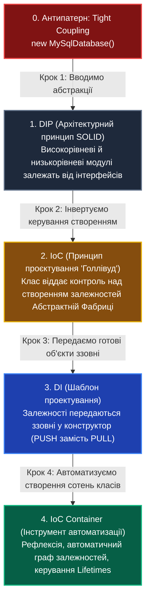
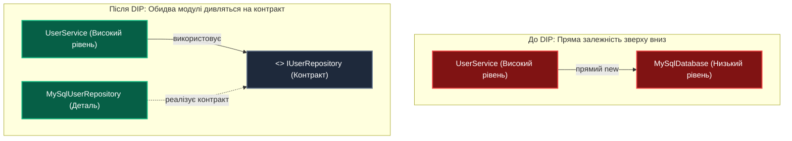
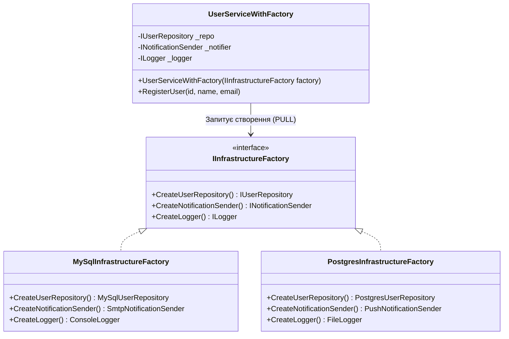
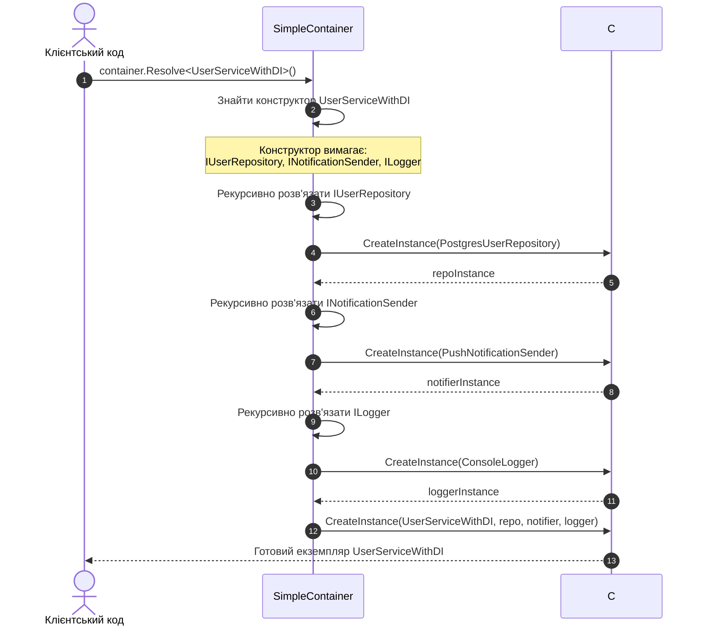
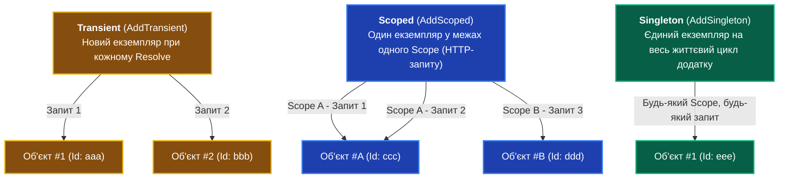

# Лекція 6. Спеціальний практикум: Архітектурна еволюція від DIP до IoC, DI та сучасних контейнерів

> **"DIP defines the destination: depend on abstractions. IoC inverts the control. DI provides the mechanism. The Container automates the mechanics."**  
> *(DIP визначає мету: залежати від абстракцій. IoC інвертує контроль. DI надає механізм. Контейнер автоматизує рутину).*  
> — **Марк Сіман (Mark Seemann), автор «Dependency Injection in .NET»**

---

### 🧭 Швидка навігація до вихідного коду (Кнопки переходу у Visual Studio / VS Code):

| Етап еволюції | Клас / Файл коду | Роль в архітектурі | Посилання на вихідний код |
| :--- | :--- | :--- | :---: |
| 📁 **Папка модуля**| `DIP_IoC_DI_Evolution`| Головна папка еволюційного практикуму | [👉 Відкрити `README.md`](../DIP_IoC_DI_Evolution/README.md) |
| **Крок 1: DIP** | `IUserRepository.cs` | Контракт сховища користувачів | [👉 Відкрити `IUserRepository.cs` (рядок 7)](../DIP_IoC_DI_Evolution/Step1_DIP/IUserRepository.cs) |
| **Крок 1: DIP** | `INotificationSender.cs` | Контракт каналу сповіщень | [👉 Відкрити `INotificationSender.cs` (рядок 7)](../DIP_IoC_DI_Evolution/Step1_DIP/INotificationSender.cs) |
| **Крок 1: DIP** | `ILogger.cs` | Контракт аудиту та логування | [👉 Відкрити `ILogger.cs` (рядок 6)](../DIP_IoC_DI_Evolution/Step1_DIP/ILogger.cs) |
| **Крок 1: DIP** | `DipPrincipleDemo.cs` | Демонстрація розвороту залежностей | [👉 Відкрити `DipPrincipleDemo.cs` (рядок 8)](../DIP_IoC_DI_Evolution/Step1_DIP/DipPrincipleDemo.cs) |
| **Крок 2: IoC** | `IInfrastructureFactory.cs` | Абстрактна фабрика сімейств драйверів | [👉 Відкрити `IInfrastructureFactory.cs` (рядок 12)](../DIP_IoC_DI_Evolution/Step2_AbstractFactory_IoC/IInfrastructureFactory.cs) |
| **Крок 2: IoC** | `ConcreteFactories.cs` | Фабрики MySQL та PostgreSQL | [👉 Відкрити `ConcreteFactories.cs` (рядок 6)](../DIP_IoC_DI_Evolution/Step2_AbstractFactory_IoC/ConcreteFactories.cs) |
| **Крок 2: IoC** | `UserServiceWithFactory.cs` | Сервіс, залежний від фабрики (Pull model) | [👉 Відкрити `UserServiceWithFactory.cs` (рядок 16)](../DIP_IoC_DI_Evolution/Step2_AbstractFactory_IoC/UserServiceWithFactory.cs) |
| **Крок 2: IoC** | `FactoryIoCDemo.cs` | Демонстрація інверсії контролю | [👉 Відкрити `FactoryIoCDemo.cs` (рядок 6)](../DIP_IoC_DI_Evolution/Step2_AbstractFactory_IoC/FactoryIoCDemo.cs) |
| **Крок 3: DI** | `UserServiceWithDI.cs` | Чистий Constructor Injection (Push model) | [👉 Відкрити `UserServiceWithDI.cs` (рядок 16)](../DIP_IoC_DI_Evolution/Step3_DependencyInjection/UserServiceWithDI.cs) |
| **Крок 3: DI** | `MethodAndPropertyInjectionDemo.cs`| Демонстрація Method та Property DI | [👉 Відкрити `MethodAndPropertyInjectionDemo.cs` (рядок 28)](../DIP_IoC_DI_Evolution/Step3_DependencyInjection/MethodAndPropertyInjectionDemo.cs) |
| **Крок 3: DI** | `FakeUserRepository.cs` | In-memory Mock для ізольованого тесту | [👉 Відкрити `FakeUserRepository.cs` (рядок 10)](../DIP_IoC_DI_Evolution/Step3_DependencyInjection/FakeUserRepository.cs) |
| **Крок 3: DI** | `PureDiDemo.cs` | Практикум Pure DI та тестування | [👉 Відкрити `PureDiDemo.cs` (рядок 8)](../DIP_IoC_DI_Evolution/Step3_DependencyInjection/PureDiDemo.cs) |
| **Крок 4: Container**| `SimpleContainer.cs` | Власний навчальний IoC-контейнер з нуля | [👉 Відкрити `SimpleContainer.cs` (рядок 14)](../DIP_IoC_DI_Evolution/Step4_IoCContainer/MiniContainer/SimpleContainer.cs) |
| **Крок 4: Container**| `MiniContainerDemo.cs` | Демонстрація рефлексії контейнера | [👉 Відкрити `MiniContainerDemo.cs` (рядок 9)](../DIP_IoC_DI_Evolution/Step4_IoCContainer/MiniContainer/MiniContainerDemo.cs) |
| **Крок 4: Container**| `LifetimesDemo.cs` | Transient vs Scoped vs Singleton | [👉 Відкрити `LifetimesDemo.cs` (рядок 11)](../DIP_IoC_DI_Evolution/Step4_IoCContainer/DotNetContainer/LifetimesDemo.cs) |
| **Крок 4: Container**| `DotNetContainerDemo.cs` | Промисловий Microsoft.Extensions.DI | [👉 Відкрити `DotNetContainerDemo.cs` (рядок 11)](../DIP_IoC_DI_Evolution/Step4_IoCContainer/DotNetContainer/DotNetContainerDemo.cs) |
| 🎮 **Оркестратор** | `DipEvolutionCommand.cs` | Консольне інтерактивне меню запуску | [👉 Відкрити `DipEvolutionCommand.cs` (рядок 13)](../DIP_IoC_DI_Evolution/DipEvolutionCommand.cs) |

---

## 1. Навчальні цілі лекції

Опрацювавши цей спеціальний практикум, ви:
1. **Раз і назавжди зрозумієте різницю між чотирма фундаментальними термінами**, які 90% розробників вважають синонімами:
   - **DIP** — Архітектурний принцип (SOLID);
   - **IoC** — Загальна концепція проектування (Hollywood Principle);
   - **Abstract Factory** — Класичний патерн проєктування GoF для інверсії створення об'єктів;
   - **DI** — Шаблон впровадження залежностей (Constructor, Method, Property);
   - **IoC Container** — Інструмент автоматизації та керування життєвим циклом об'єктів.
2. **Пройдете покроковий шлях від "спагеті-коду" до Enterprise-архітектури**.
3. **Побачите, як працює IoC-контейнер зсередини** (написавши власний міні-контейнер на 40 рядків C# рефлексії без жодної магії).
4. **Опануєте життєві цикли служб у .NET**: `Transient`, `Scoped`, `Singleton` з практичним доказом поведінки через ідентифікатори екземплярів `Guid`.
5. **Навчитеся писати 100% тестований код** без реальних підключень до баз даних чи зовнішніх мережевих API.

---

## 2. Велика порівняльна матриця 4 концепцій



| Критерій порівняння | DIP (Принцип інверсії) | IoC (Інверсія контролю) | DI (Впровадження залежностей) | IoC Container (Контейнер) |
| :--- | :--- | :--- | :--- | :--- |
| **Категорія** | Архітектурне правило | Парадигма / Концепція | Патерн проектування | Інструмент / Бібліотека |
| **Головне питання** | *Від чого залежати?* | *Хто керує створенням?* | *Як передати залежність?* | *Хто автоматизує граф?* |
| **Ключова ідея** | Абстракції замість деталей | Don't call us, we'll call you | Залежності приходять ззовні | Декларативна реєстрація + Reflection |
| **Типова реалізація** | `interface IUserRepository` | Abstract Factory, Template Method | `UserService(IUserRepository r)` | `services.AddScoped<IUserRepo>()` |
| **Хто створює об'єкт?** | Будь-хто (не регламентує) | Зовнішній механізм / Фабрика | Той, хто викликає конструктор | Контейнер (ServiceProvider) |
| **Потребує сторонніх NuGet?** | Ні (чистий C#) | Ні (чистий C#) | Ні (чистий C# / Pure DI) | Так (`Microsoft.Extensions.DI`) |

---

## 3. Крок 0. Вихідна точка: Криза жорсткого зв'язування (Tight Coupling)

У традиційному процедурному підході бізнес-клас створює своїх помічників безпосередньо через ключове слово `new`:

```csharp
// ПОГАНА РЕАЛІЗАЦІЯ (Порушення DIP, IoC та DI)
public class UserServiceBad
{
    private readonly MySqlDatabase _database;
    private readonly SmtpEmailSender _emailSender;

    public UserServiceBad()
    {
        // Клас сам керує життєвим циклом і жорстко прив'язаний до MySQL та SMTP!
        _database = new MySqlDatabase("Server=localhost;Database=prod;");
        _emailSender = new SmtpEmailSender("smtp.gmail.com", 587);
    }
}
```

### Чому це катастрофа для бізнесу:
1. **Неможливо змінити базу даних**: Перехід на PostgreSQL, MongoDB чи хмарне сховище вимагає переписування та ретестування бізнес-класу `UserServiceBad`.
2. **Неможливо написати швидкі модульні тести (Unit Tests)**: Будь-який тест намагається підключитися до реального сервера `localhost` і відправити реальний email на поштовий сервер.
3. **Порушення SRP та OCP**: Клас займається не лише бізнес-логікою, а й конфігурацією з'єднань, портами та адресами інфраструктури.

---

## 4. Крок 1. DIP: Введення абстракцій та розворот стрілки залежностей

Принцип інверсії залежностей (Robert C. Martin) стверджує:
> **1. Високорівневі модулі не повинні залежати від низькорівневих модулів. Обидва повинні залежати від абстракцій.**  
> **2. Абстракції не повинні залежати від деталей. Деталі повинні залежати від абстракцій.**



### Реалізація контрактів у коді:
Ми виносимо операції в незалежні інтерфейси:
* [`IUserRepository.cs`](../DIP_IoC_DI_Evolution/Step1_DIP/IUserRepository.cs) — контракт роботи з даними (`Save`, `GetById`).
* [`INotificationSender.cs`](../DIP_IoC_DI_Evolution/Step1_DIP/INotificationSender.cs) — контракт комунікації (`Send`).
* [`ILogger.cs`](../DIP_IoC_DI_Evolution/Step1_DIP/ILogger.cs) — контракт системного аудиту (`LogInfo`, `LogError`).

### Відкрите питання після Кроку 1:
Контракти створені, але **де і хто фізично виконуватиме `new MySqlUserRepository()`?**  
Якщо сервіс напише `_repo = new MySqlUserRepository()`, він все одно контролюватиме конкретний тип. Тут на сцену виходить **IoC**.

---

## 5. Крок 2. IoC через патерн Абстрактна Фабрика (Abstract Factory)

**Inversion of Control (IoC)** — це принцип архітектури, згідно з яким керування створенням об'єктів та потоком програми передається зовнішньому механізму.

Історично першим елегантним рішенням цієї проблеми в об'єктно-орієнтованому проєктуванні (GoF) став патерн **Абстрактна Фабрика (Abstract Factory)**:



### Як це працює у коді:
Погляньмо на [`UserServiceWithFactory.cs`](../DIP_IoC_DI_Evolution/Step2_AbstractFactory_IoC/UserServiceWithFactory.cs):

```csharp
public class UserServiceWithFactory
{
    private readonly IUserRepository _userRepository;
    private readonly INotificationSender _notificationSender;
    private readonly ILogger _logger;

    public UserServiceWithFactory(IInfrastructureFactory factory)
    {
        // Контроль створення інвертовано (IoC): сервіс не знає конкретних класів MySQL чи Postgres!
        _userRepository = factory.CreateUserRepository();
        _notificationSender = factory.CreateNotificationSender();
        _logger = factory.CreateLogger();
    }
}
```

### Чому Абстрактна Фабрика — це революція для свого часу:
1. Ми можемо однією зміною фабрики в точці запуску [`FactoryIoCDemo.cs`](../DIP_IoC_DI_Evolution/Step2_AbstractFactory_IoC/FactoryIoCDemo.cs) перемкнути весь стек інфраструктури:
   ```csharp
   // Локальний стек MySQL + SMTP + Console:
   var localService = new UserServiceWithFactory(new MySqlInfrastructureFactory());

   // Хмарний стек PostgreSQL + Push + File:
   var cloudService = new UserServiceWithFactory(new PostgresInfrastructureFactory());
   ```
2. Бізнес-сервіс залишається повністю незмінним.

### Проблема моделі PULL (Чому потрібен наступний крок — DI):
* **Зайве посередництво**: Сервісу насправді потрібен лише репозиторій. Йому не потрібна сама фабрика.
* **Негнучкість сімейств**: Якщо нам потрібна база MySQL, але сповіщення через Push — доведеться створювати ще одну комбінаторну фабрику `MySqlWithPushFactory`.
* **Модель витягування (PULL)**: Сервіс все одно повинен знати, які методи фабрики викликати.

---

## 6. Крок 3. Dependency Injection (DI) та Pure DI

**Dependency Injection (DI)** — це конкретний шаблон реалізації IoC, який переводить архітектуру з моделі **PULL** (сервіс запитує фабрику) у модель **PUSH** (сервісу передають вже готові об'єкти ззовні).

```mermaid
flowchart LR
    classDef pullStyle fill:#854d0e,stroke:#eab308,color:#ffffff,stroke-width:2px;
    classDef pushStyle fill:#1e40af,stroke:#3b82f6,color:#ffffff,stroke-width:2px;

    subgraph PullModel["Модель PULL (Abstract Factory)"]
        UserPull["UserService"]:::pullStyle -->|1. Викликай CreateRepo()| Factory["IInfrastructureFactory"]:::pullStyle
        Factory -.->|2. Поверни екземпляр| UserPull
    end

    subgraph PushModel["Модель PUSH (Dependency Injection)"]
        Root["Composition Root<br/>(Зовнішній викликач)"]:::pushStyle -->|1. Створив repo| Repo["MySqlRepo"]:::pushStyle
        Root -->|2. Впорснув у конструктор| UserPush["UserService(repo)"]:::pushStyle
    end
```

### Три способи впровадження залежностей (Injection Styles):

1. **Constructor Injection (Впровадження через конструктор)** — *Основний рекомендований спосіб*:
   Файл: [`UserServiceWithDI.cs`](../DIP_IoC_DI_Evolution/Step3_DependencyInjection/UserServiceWithDI.cs)
   ```csharp
   public class UserServiceWithDI
   {
       private readonly IUserRepository _repository;
       private readonly INotificationSender _notifier;

       // Залежності гарантовано ініціалізовані, об'єкт неможливо створити у битому стані
       public UserServiceWithDI(IUserRepository repository, INotificationSender notifier)
       {
           _repository = repository ?? throw new ArgumentNullException(nameof(repository));
           _notifier = notifier ?? throw new ArgumentNullException(nameof(notifier));
       }
   }
   ```

2. **Method Injection (Впровадження через параметр методу)**:
   Файл: [`MethodAndPropertyInjectionDemo.cs`](../DIP_IoC_DI_Evolution/Step3_DependencyInjection/MethodAndPropertyInjectionDemo.cs)
   Використовується, коли залежність потрібна лише для одного конкретного методу і залежить від вхідних параметрів запиту:
   ```csharp
   public string ExportUserReport(string userId, IReportFormatter formatter)
   {
       // Форматер (JSON чи XML) передається лише сюди
       return formatter.Format(_repository.GetById(userId));
   }
   ```

3. **Property (Setter) Injection (Впровадження через властивість)**:
   Файл: [`MethodAndPropertyInjectionDemo.cs`](../DIP_IoC_DI_Evolution/Step3_DependencyInjection/MethodAndPropertyInjectionDemo.cs)
   Використовується для опціональних залежностей зі значенням за замовчуванням:
   ```csharp
   public ILogger Logger { get; set; } = new ConsoleLogger(); // дефолтний безпечний логер
   ```

### Що таке Pure DI (Ручний DI)?
**Pure DI** (також відомий як *Poor Man's DI*) — це практика впровадження залежностей без використання будь-яких сторонніх IoC-бібліотек. Усі об'єкти збираються в єдиній точці входу програми (**Composition Root**):

Файл: [`PureDiDemo.cs`](../DIP_IoC_DI_Evolution/Step3_DependencyInjection/PureDiDemo.cs)
```csharp
// Точка композиції: ручна збірка будь-якої комбінації без фабрик-посередників!
var service = new UserServiceWithDI(
    new PostgresUserRepository(),
    new SmtpNotificationSender(),
    new ConsoleLogger()
);
```

### Ідеальна тестованість: Mock/Fake без БД
Завдяки Constructor DI ми можемо за 1 секунду написати ізольований модульний тест за допомогою [`FakeUserRepository.cs`](../DIP_IoC_DI_Evolution/Step3_DependencyInjection/FakeUserRepository.cs):
```csharp
var fakeRepo = new FakeUserRepository(); // Збереження у Dictionary в пам'яті
var testService = new UserServiceWithDI(fakeRepo, fakeNotifier, fakeLogger);

testService.RegisterUser("t1", "Тест", "test@test.com");
Assert.Equal(1, fakeRepo.SaveCallCount); // Миттєва перевірка без підключення до MySQL!
```

---

## 7. Крок 4.1. Що всередині IoC-контейнера? Навчальний MiniContainer на рефлексії

Коли студент чує про IoC-контейнери, у нього виникає враження складної «чорної скриньки».  
Щоб зруйнувати цей міф, ми реалізували власний контейнер у файлі [`SimpleContainer.cs`](../DIP_IoC_DI_Evolution/Step4_IoCContainer/MiniContainer/SimpleContainer.cs) всього на **35 рядків коду**!

### Архітектура нашого SimpleContainer:
1. **Словник реєстрації типів**: `Dictionary<Type, Type>` (зв'язує `IUserRepository` ➔ `PostgresUserRepository`).
2. **Словник сінглтонів**: `Dictionary<Type, object>` (кешує створені екземпляри).
3. **Рефлексія**:
   - `ConstructorInfo constructor = type.GetConstructors()[0];`
   - Для кожного параметра `param` у конструкторі рекурсивно викликаємо `Resolve(param.ParameterType)`.
   - Викликаємо `Activator.CreateInstance(type, resolvedParameters)`.



Тепер студент розуміє: **IoC-контейнер — це просто автоматизована рекурсивна фабрика, побудована на словниках і рефлексії!**

---

## 8. Крок 4.2. Життєві цикли служб у .NET: Transient, Scoped, Singleton

У реальних проєктах (ASP.NET Core, мікросервіси) використовується офіційний високопродуктивний контейнер `Microsoft.Extensions.DependencyInjection`.

Контейнер не просто створює об'єкти — він контролює, **скільки часу живе екземпляр і коли його знищувати (Garbage Collection)**.



### Практичний доказ у коді [`LifetimesDemo.cs`](../DIP_IoC_DI_Evolution/Step4_IoCContainer/DotNetContainer/LifetimesDemo.cs):
Кожен сервіс при створенні генерує новий `Guid.NewGuid()`. Запустивши демонстрацію, ми спостерігаємо консольний вивід:

```text
[Scope 1] Transient 1 ID: 4a2f8b1c...
[Scope 1] Transient 2 ID: 9f12d83e...  <-- РІЗНІ (новий об'єкт щоразу!)

[Scope 1] Scoped 1    ID: 7e89a011...
[Scope 1] Scoped 2    ID: 7e89a011...  <-- ОДНАКОВІ (спільний у межах одного Scope)

[Scope 1] Singleton 1 ID: 3b1144cc...
[Scope 1] Singleton 2 ID: 3b1144cc...  <-- ОДНАКОВІ (єдиний на процес)

--- Створення Scope 2 (новий запит) ---
[Scope 2] Scoped 3    ID: 11cba908...  <-- ЗМІНИВСЯ (новий Scope = новий екземпляр)
[Scope 2] Singleton 3 ID: 3b1144cc...  <-- ТОЙ САМИЙ, ЩО Й У SCOPE 1!
```

---

## 9. Архітектурні підводні камені та антипатерни

### 1. Антипатерн «Service Locator» (Псевдо-DI):
```csharp
// ПОГАНО: Клас отримує ServiceProvider і сам витягує з нього залежності
public class OrderService
{
    public OrderService(IServiceProvider provider)
    {
        // Це антипатерн! Залежності приховані всередині, неможливо зрозуміти,
        // що насправді потрібно класу без читання його коду.
        _repo = provider.GetRequiredService<IOrderRepository>();
    }
}
```

### 2. Помилка «Captive Dependency» (Полонена залежність):
Якщо зареєструвати `SingletonService`, який у своєму конструкторі приймає `ScopedService` (наприклад, `DbContext` бази даних):
* `ScopedService` «захоплюється» у вічний полон сінглтоном і ніколи не знищується.
* Виникає витік пам'яті (Memory Leak) та використання застарілих кешів з'єднань з БД.
* **Правило:** *Об'єкт із довшим часом життя ніколи не повинен тримати об'єкт із коротшим часом життя.*

---

## 10. Лабораторний практикум для закріплення матеріалу

1. **Завдання 1 (DIP)**: Додайте новий інтерфейс `ISmsSender` та його реалізацію `TwilioSmsSender`. Перевірте, скільки рядків коду в `UserServiceWithDI` доведеться змінити (відповідь: нуль).
2. **Завдання 2 (Abstract Factory)**: Створіть фабрику `TestingInfrastructureFactory`, яка повертає `FakeUserRepository` та `FakeNotificationSender`. Запустіть сервіс з цією фабрикою.
3. **Завдання 3 (MiniContainer)**: Додайте в `SimpleContainer.cs` підтримку життєвого циклу `Scoped`.
4. **Завдання 4 (Lifetimes)**: Спробуйте зареєструвати репозиторій як `Singleton`, а логер як `Transient`. Проаналізуйте наслідки для багатопотокового середовища.
