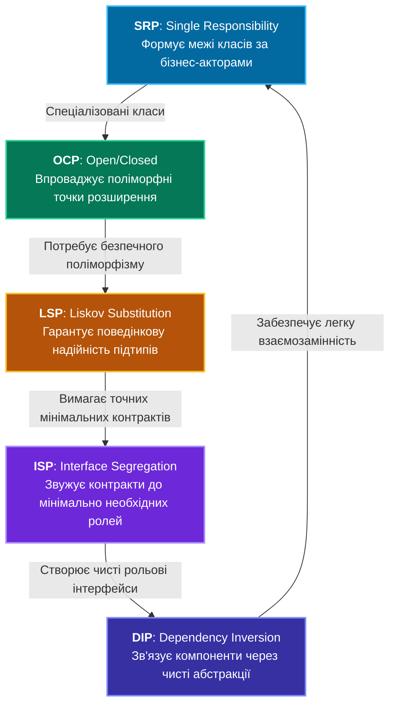

# Навчальний комплекс: Принципи проектування SOLID у C# .NET

Ласкаво просимо до повного курсу лекцій та практичних розборів принципів **SOLID**. Ця папка містить структуровані, академічно ґрунтовні та практично орієнтовані матеріали, розроблені за стандартами університетських курсів з архітектури програмного забезпечення та практик комерційної розробки в екосистемі **.NET**.

---

## Навігатор по лекціях курсу

Кожна лекція в цій папці є повноцінним посібником, що охоплює теорію, математичні та інженерні витоки, розбір типових помилок, вичерпний аналіз вихідного коду проекту, діаграми Mermaid, шаблони проектування GoF, методику написання модульних тестів та лабораторні завдання.

| № | Лекція | Принцип | Поганий приклад (Bad) | Еталонний код (Good) | Демонстрація |
|:---:|:---|:---|:---:|:---:|:---:|
| **01** | [01_Single_Responsibility_Principle.md](01_Single_Responsibility_Principle.md) | **S** — SRP | [👉 `OrderProcessorBad.cs`](../S/OrderProcessorBad.cs) | [👉 `OrderProcessorGood.cs`](../S/OrderProcessorGood.cs)<br/>[👉 `Order.cs`](../S/SRPGoodExample/Order.cs) | [👉 `SrpBad#L15`](../S/SrpBadExampleCommand.cs)<br/>[👉 `SrpGood#L17`](../S/SrpGoodExampleCommand.cs) |
| **02** | [02_Open_Closed_Principle.md](02_Open_Closed_Principle.md) | **O** — OCP | [👉 `PaymentProcessorBad.cs`](../O/PaymentProcessorBad.cs) | [👉 `PaymentProcessorGood.cs`](../O/PaymentProcessorGood.cs)<br/>[👉 `IPaymentMethod.cs`](../O/OCPGoodExample/IPaymentMethod.cs) | [👉 `OcpBad#L15`](../O/OcpBadExampleCommand.cs)<br/>[👉 `OcpGood#L17`](../O/OcpGoodExampleCommand.cs) |
| **03** | [03_Liskov_Substitution_Principle.md](03_Liskov_Substitution_Principle.md) | **L** — LSP | [👉 `BirdBad.cs`](../L/LSPBadExample/BirdBad.cs)<br/>[👉 `OstrichBad.cs`](../L/LSPBadExample/OstrichBad.cs) | [👉 `BirdGood.cs`](../L/LSPGoodExample/BirdGood.cs)<br/>[👉 `IFlyable.cs`](../L/LSPGoodExample/IFlyable.cs) | [👉 `LspBad#L15`](../L/LspBadExampleCommand.cs)<br/>[👉 `LspGood#L17`](../L/LspGoodExampleCommand.cs) |
| **04** | [04_Interface_Segregation_Principle.md](04_Interface_Segregation_Principle.md) | **I** — ISP | [👉 `IWorkerBad.cs`](../I/ISPBadExample/IWorkerBad.cs)<br/>[👉 `RobotWorkerBad.cs`](../I/ISPBadExample/RobotWorkerBad.cs) | [👉 `Contracts/IWorkable#L9`](../I/ISPGoodExample/Contracts/IWorkable.cs)<br/>[👉 `RobotWorkerGood.cs`](../I/ISPGoodExample/RobotWorkerGood.cs) | [👉 `IspBad#L15`](../I/IspBadExampleCommand.cs)<br/>[👉 `IspGood#L17`](../I/IspGoodExampleCommand.cs) |
| **05** | [05_Dependency_Inversion_Principle.md](05_Dependency_Inversion_Principle.md) | **D** — DIP | [👉 `UserServiceBad.cs`](../D/DIPBadExample/UserServiceBad.cs)<br/>[👉 `MySqlDatabase.cs`](../D/DIPBadExample/MySqlDatabase.cs) | [👉 `UserServiceGood.cs`](../D/DIPGoodExample/UserServiceGood.cs)<br/>[👉 `IUserRepository.cs`](../D/DIPGoodExample/IUserRepository.cs) | [👉 `DipBad#L15`](../D/DipBadExampleCommand.cs)<br/>[👉 `DipGood#L17`](../D/DipGoodExampleCommand.cs) |
| **06** | [06_DIP_IoC_DI_Containers_DeepDive.md](06_DIP_IoC_DI_Containers_DeepDive.md) | **D** — Deep Dive | [👉 `UserServiceWithFactory.cs`](../DIP_IoC_DI_Evolution/Step2_AbstractFactory_IoC/UserServiceWithFactory.cs) | [👉 `UserServiceWithDI.cs`](../DIP_IoC_DI_Evolution/Step3_DependencyInjection/UserServiceWithDI.cs)<br/>[👉 `SimpleContainer.cs`](../DIP_IoC_DI_Evolution/Step4_IoCContainer/MiniContainer/SimpleContainer.cs) | [👉 `DipEvolutionCommand`](../DIP_IoC_DI_Evolution/DipEvolutionCommand.cs) |

---

## Чому SOLID розглядається як єдина цілісна система?

Принципи SOLID не існують ізольовано. Спроба застосувати лише один принцип у вакуумі зазвичай призводить до деформації архітектури:
- Намагання реалізувати **OCP** без **LSP** призведе до появи поліморфних підтипів, які кидають `NotSupportedException` і ламають викликаючий код.
- Намагання реалізувати **DIP** без **ISP** створить гігантські абстракції, що потягнуть за собою непотрібні залежності в усі куточки системи.
- Намагання розділити класи за **SRP** без **DIP** призведе до монолітного ланцюжка жорстко зв'язаних між собою дрібних об'єктів.

### Загальна діаграма синергії:



---

## Як вивчати цей матеріал: Методичні поради

1. **Читайте лекцію паралельно з вихідним кодом проекту**:
   - Усі класи та інтерфейси мають прямі посилання на файли у проекті `OOP - SOLID`.
   - Запустіть демонстраційний проект через консоль:
     ```bash
     dotnet run --project "OOP - SOLID.csproj"
     ```
2. **Аналізуйте еволюцію коду**:
   - Спочатку уважно дослідіть *Bad Example* (поганий приклад): знайдіть у ньому описані в лекції симптоми (Code Smells).
   - Спробуйте подумки відповісти на запитання: «Що станеться, якщо замовник попросить додати нову функцію або змінити технологію бази даних?».
   - Після цього відкрийте *Good Example* і простежте, як принципи SOLID перетворюють заплутаний моноліт на елегантну архітектуру з низьким зчепленням.
3. **Виконуйте лабораторні завдання наприкінці кожної лекції**:
   - В кінці кожного документа містяться практичні вправи та питання до співбесід різного рівня складності (Junior / Middle / Senior).
