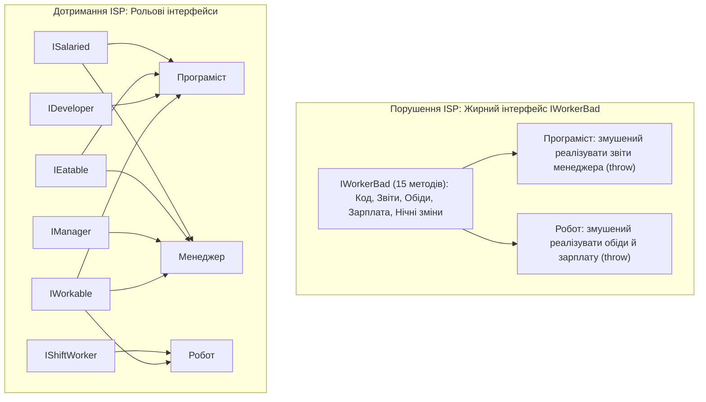
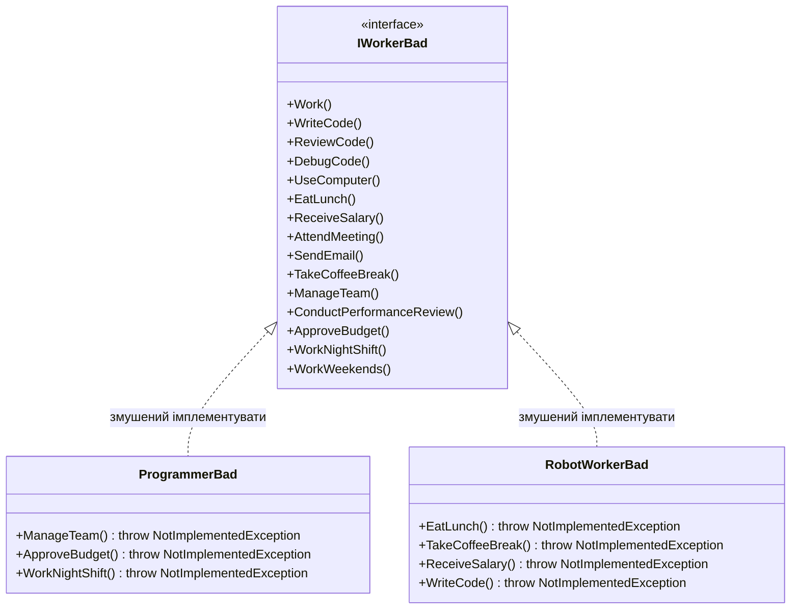

# Лекція 4. Принцип розділення інтерфейсів (Interface Segregation Principle — ISP)

> **"Clients should not be forced to depend upon interfaces that they do not use."**  
> *— Роберт С. Мартін (Uncle Bob)*

---

### 🧭 Швидка навігація до коду (Кнопки переходу до файлів цієї теми):

| Тип прикладу | Клас / Компонент | Роль в архітектурі | Посилання на вихідний код |
| :--- | :--- | :--- | :---: |
| ❌ **Порушення (Bad)** | **`IWorkerBad`** | «Жирний» інтерфейс-моноліт (10 несумісних методів) | [👉 Відкрити `IWorkerBad.cs` (рядок 10)](ISPBadExample/IWorkerBad.cs) |
| ❌ **Порушення (Bad)** | **`RobotWorkerBad`** | Робот: змушений реалізовувати обіди та зарплату | [👉 Відкрити `RobotWorkerBad.cs` (рядок 10)](ISPBadExample/RobotWorkerBad.cs) |
| ❌ **Порушення (Bad)** | **`ProgrammerBad`** | Програміст: кидає винятки на бюджет і нічні зміни | [👉 Відкрити `ProgrammerBad.cs` (рядок 10)](ISPBadExample/ProgrammerBad.cs) |
| 🎮 **Демонстрація** | **`IspBadExampleCommand`** | Консольний запуск сценарію з фіктивними методами | [👉 Відкрити `IspBadExampleCommand.cs` (рядок 15)](IspBadExampleCommand.cs) |
| ✅ **Еталон ISP (Контракти)** | **`IWorkable`** | Рольовий контракт: базова робота (`Work`) | [👉 Відкрити `IWorkable.cs` (рядок 9)](ISPGoodExample/Contracts/IWorkable.cs) |
| ✅ **Еталон ISP (Контракти)** | **`IEatable`** | Рольовий контракт: перерви на їжу та каву | [👉 Відкрити `IEatable.cs` (рядок 9)](ISPGoodExample/Contracts/IEatable.cs) |
| ✅ **Еталон ISP (Контракти)** | **`IShiftWorker`** | Рольовий контракт: змінні та нічні графіки | [👉 Відкрити `IShiftWorker.cs` (рядок 9)](ISPGoodExample/Contracts/IShiftWorker.cs) |
| ✅ **Еталон ISP (Контракти)** | **`ISalaried`** | Рольовий контракт: виплата заробітної плати | [👉 Відкрити `ISalaried.cs` (рядок 9)](ISPGoodExample/Contracts/ISalaried.cs) |
| ✅ **Еталон ISP (Контракти)** | **`IOfficeWorker`** | Рольовий контракт: мітинги та корпоративна пошта | [👉 Відкрити `IOfficeWorker.cs` (рядок 9)](ISPGoodExample/Contracts/IOfficeWorker.cs) |
| ✅ **Еталон ISP (Контракти)** | **`IComputerUser`** | Рольовий контракт: робота за комп'ютером | [👉 Відкрити `IComputerUser.cs` (рядок 9)](ISPGoodExample/Contracts/IComputerUser.cs) |
| ✅ **Еталон ISP (Контракти)** | **`IDeveloper`** | Рольовий контракт: написання та рев'ю коду | [👉 Відкрити `IDeveloper.cs` (рядок 9)](ISPGoodExample/Contracts/IDeveloper.cs) |
| ✅ **Еталон ISP (Контракти)** | **`IManager`** | Рольовий контракт: управління командою і бюджетом | [👉 Відкрити `IManager.cs` (рядок 9)](ISPGoodExample/Contracts/IManager.cs) |
| ✅ **Еталон ISP (Good)** | **`RobotWorkerGood`** | Робот: `IWorkable, IShiftWorker` (без зайвого!) | [👉 Відкрити `RobotWorkerGood.cs` (рядок 11)](ISPGoodExample/RobotWorkerGood.cs) |
| ✅ **Еталон ISP (Good)** | **`ProgrammerGood`** | Програміст: розробницькі та офісні контракти | [👉 Відкрити `ProgrammerGood.cs` (рядок 11)](ISPGoodExample/ProgrammerGood.cs) |
| ✅ **Еталон ISP (Good)** | **`ManagerGood`** | Менеджер: управлінські контракти | [👉 Відкрити `ManagerGood.cs` (рядок 11)](ISPGoodExample/ManagerGood.cs) |
| ✅ **Еталон ISP (Good)** | **`InternGood`** | Інтерн: контракти навчання та розробки | [👉 Відкрити `InternGood.cs` (рядок 11)](ISPGoodExample/InternGood.cs) |
| ✅ **Еталон ISP (Good)** | **`FreelancerGood`** | Фрілансер: контракт розробки без мітингів | [👉 Відкрити `FreelancerGood.cs` (рядок 11)](ISPGoodExample/FreelancerGood.cs) |
| 🎮 **Демонстрація** | **`IspGoodExampleCommand`** | Консольний запуск еталонного сценарію | [👉 Відкрити `IspGoodExampleCommand.cs` (рядок 17)](IspGoodExampleCommand.cs) |
| 📚 **Повна лекція** | **`04_Interface_Segregation_Principle.md`** | Академічна розширена лекція | [👉 Читати лекцію](../Docs/04_Interface_Segregation_Principle.md) |

---

## 1. Фундаментальна теорія та походження принципу

### 1.1. Історія виникнення: інцидент у компанії Xerox
Принцип ISP народився з реального інженерного кейсу, коли Роберт Мартін консультував компанію Xerox. 

У Xerox розробляли нове покоління багатофункціональних пристроїв (МФП), які поєднували принтер, сканер, факс і копір. Усі завдання в системі опрацьовувалися через єдиний монолітний базовий клас `Job`. Будь-яка зміна в коді (наприклад, додавання нової опції зшивання документів для степлера) змінювала клас `Job`, через що доводилося повністю перекомпільовувати та заново тестувати модуль сканування, модуль мережевого друку та навіть модуль підрахунку витрати тонера.

Рішенням стало розділення одного величезного інтерфейсу на кілька вузьких рольових інтерфейсів: `IPrintJob`, `IScanJob`, `IFaxJob`. Кожен клієнтський модуль став залежати лише від того контракту, який йому реально необхідний.

### 1.2. Суть принципу ISP простими словами
> **Краще мати багато невеликих, специфічних, клієнт-орієнтованих інтерфейсів, ніж один універсальний "товстий" інтерфейс-моноліт (Fat / Polluted Interface).**

Якщо інтерфейс вимагає від класу-реалізатора методів, які цьому класу за своєю природою не потрібні, клас змушений або залишати порожні методи-заглушки, або викидати `NotImplementedException`. Це створює "забруднення" архітектури та робить систему надзвичайно крихкою.



---

## 2. Ознаки та симптоми порушення ("Code Smells")

1. **Fat Interface / Polluted Interface ("Забруднений" інтерфейс)**  
   Інтерфейс оголошує десятки методів, які обслуговують зовсім різні підсистеми або не мають між собою логічного доменного зв'язку.
2. **Засилля винятків `NotImplementedException` або порожніх методів**  
   Класи реалізують інтерфейс лише частково, залишаючи тіла методів порожніми або викидаючи `throw new NotImplementedException()`.
3. **Ефект доміно при зміні сигнатури методу**  
   Зміна одного методу в інтерфейсі призводить до помилок компіляції в десятках непов'язаних класів по всьому проєкту.
4. **Клієнт знає занадто багато**  
   Клієнтський модуль отримує доступ до методів, які йому категорично заборонено викликати, що провокує людські помилки в розробці.

---

## 3. Детальний аналіз Поганого прикладу (Bad Example)

### 3.1. Архітектурна схема проблеми
Інтерфейс `IWorkerBad` намагається описати всі можливі обов'язки всіх співробітників компанії одночасно:



### 3.2. Фрагмент вихідного коду з дефектом
У файлі `ProgrammerBad.cs`:
```csharp
public class ProgrammerBad : IWorkerBad
{
    // Програміст вміє кодити:
    public void WriteCode() => Console.WriteLine("Пишу код...");

    // Але інтерфейс змушує його імплементувати управління бюджетом:
    public void ApproveBudget()
    {
        throw new NotImplementedException($"{_name} не затверджує бюджет");
    }
}
```

У файлі `RobotWorkerBad.cs`:
```csharp
public class RobotWorkerBad : IWorkerBad
{
    // Робот працює 24/7:
    public void WorkNightShift() => Console.WriteLine("Працюю в нічну зміну");

    // Але інтерфейс вимагає від залізного маніпулятора їсти обід та пити каву:
    public void EatLunch()
    {
        throw new NotImplementedException("Робот не їсть!");
    }
}
```

**Критичні наслідки для проєкту:**
* Помилки проєктування виявляються лише в процесі виконання (Runtime Crashes) замість етапу компіляції.
* Порушується принцип поліморфізму: тип стверджує, що він `IWorkerBad`, але більше половини його методів є неробочими фікціями.
* Наслідок порушення ISP майже завжди тягне за собою пряме порушення LSP (Liskov Substitution Principle).

---

## 4. Архітектурна декомпозиція: Гарний приклад (Good Example)

Рішення полягає в розбитті інтерфейсу на **8 вузьких, спеціалізованих рольових контрактів (Role Interfaces)**, кожен з яких описує одну конкретну рису діяльності.

### 4.1. Система рольових інтерфейсів (`Contracts/`)
1. `IWorkable` — базовий процес виконання роботи (`Work()`).
2. `IDeveloper` — інженерна діяльність розробки ПЗ (`WriteCode()`, `ReviewCode()`, `DebugCode()`).
3. `IComputerUser` — взаємодія з персональним комп'ютером (`UseComputer()`).
4. `IOfficeWorker` — регламентні офісні процедури (`AttendMeeting()`, `SendEmail()`).
5. `IEatable` — задоволення фізіологічних потреб працівника (`EatLunch()`, `TakeCoffeeBreak()`).
6. `ISalaried` — фінансові компенсації (`ReceiveSalary()`).
7. `IManager` — управлінські компетенції (`ManageTeam()`, `ConductPerformanceReview()`, `ApproveBudget()`).
8. `IShiftWorker` — робота в змінному режимі (`WorkNightShift()`, `WorkWeekends()`).

### 4.2. Моделювання ролей через множинну імплементацію інтерфейсів

```mermaid
classDiagram
    class IWorkable { <<interface>> +Work() }
    class IDeveloper { <<interface>> +WriteCode() +ReviewCode() +DebugCode() }
    class IComputerUser { <<interface>> +UseComputer() }
    class IOfficeWorker { <<interface>> +AttendMeeting() +SendEmail() }
    class IEatable { <<interface>> +EatLunch() +TakeCoffeeBreak() }
    class ISalaried { <<interface>> +ReceiveSalary() }
    class IManager { <<interface>> +ManageTeam() +ApproveBudget() }
    class IShiftWorker { <<interface>> +WorkNightShift() +WorkWeekends() }

    class ProgrammerGood {
        +Work()
        +WriteCode()
        +UseComputer()
        +EatLunch()
        +ReceiveSalary()
    }

    class ManagerGood {
        +Work()
        +ManageTeam()
        +AttendMeeting()
        +UseComputer()
        +EatLunch()
        +ReceiveSalary()
    }

    class RobotWorkerGood {
        +Work()
        +WorkNightShift()
        +WorkWeekends()
    }

    class FreelancerGood {
        +Work()
        +WriteCode()
        +ReceiveSalary()
    }

    class InternGood {
        +Work()
        +WriteCode()
        +UseComputer()
        +EatLunch()
    }

    IWorkable <|.. ProgrammerGood
    IDeveloper <|.. ProgrammerGood
    IComputerUser <|.. ProgrammerGood
    IEatable <|.. ProgrammerGood
    ISalaried <|.. ProgrammerGood

    IWorkable <|.. ManagerGood
    IManager <|.. ManagerGood
    IOfficeWorker <|.. ManagerGood
    IComputerUser <|.. ManagerGood
    IEatable <|.. ManagerGood
    ISalaried <|.. ManagerGood

    IWorkable <|.. RobotWorkerGood
    IShiftWorker <|.. RobotWorkerGood

    IWorkable <|.. FreelancerGood
    IDeveloper <|.. FreelancerGood
    ISalaried <|.. FreelancerGood

    IWorkable <|.. InternGood
    IDeveloper <|.. InternGood
    IComputerUser <|.. InternGood
    IEatable <|.. InternGood
```



### 4.3. Чому це рішення є елегантним?
* **Програміст (`ProgrammerGood`):** Отримує інструменти розробника, комп'ютер, зарплату та обід. Жодних методів управління бюджетом!
* **Менеджер (`ManagerGood`):** Отримує інструменти керівника та офісні мітинги, не пишучи фіктивного коду на C#.
* **Робот (`RobotWorkerGood`):** Працює в нічну зміну і не має методів для кави, піци чи зарплати.
* **Фрілансер (`FreelancerGood`):** Пише код і отримує оплату, але не ходить на обов'язкові офісні зустрічі бізнес-центру.
* **Інтерн (`InternGood`):** Вчиться і кодить, обідає з колегами, але поки не претендує на контракт `ISalaried`.

**Результат:** Жодного рядка з `throw new NotImplementedException()`. 100% реалізованих методів є реальними і безпечними для виклику.

---

## 5. Порівняльний аналіз архітектурних метрик

| Критерій оцінки | Товстий інтерфейс (`IWorkerBad`) | Рольові інтерфейси (ISP) |
| :--- | :--- | :--- |
| **Розмір інтерфейсу** | 15 непов'язаних методів в одному контракті | 1-3 методи на кожен сфокусований контракт |
| **Фіктивні методи (NotImplemented)** | Присутні в більшості класів | **Повністю відсутні** |
| **Залежність клієнтів** | Клієнт бачить і залежить від чужих методів | Клієнт бачить **лише свій робочий контекст** |
| **Вплив змін на перекомпcompіляцію** | Будь-яка правка вимагає збірки всього проєкту | Зміни локалізовані виключно в цільовому модулі |
| **Гнучкість комбінування** | Монолітна, важко змінювана структура | Легко комбінувати контракти під будь-яку нову професію |

---

## 6. Поради викладача-практика: Патерни та підводні камені

### 6.1. Інтерфейси з одним методом (Single Method Interfaces)
У стандартній бібліотеці .NET більшість найпопулярніших інтерфейсів мають від 1 до 3 методів:
* `IDisposable` — метод `Dispose()`;
* `IComparable<T>` — метод `CompareTo(T other)`;
* `IEnumerable<T>` — метод `GetEnumerator()`;
* `ICommand` — методи `Execute()`, `CanExecute()`.

Це прямий наслідок принципу ISP: такий інтерфейс має мінімальні вимоги до клієнта і його надзвичайно легко реалізувати в будь-якому класі.

### 6.2. Як бути з легасі-бібліотеками, які надають "жирний" інтерфейс?
Якщо стороння бібліотека повертає вам гігантський об'єкт із 50 методами, скористайтеся **патерном Адаптер (Adapter Pattern)**:
1. Створіть свій власний маленький інтерфейс із 2 методами, які реально потрібні вашому модулю.
2. Створіть клас-адаптер, який реалізує ваш маленький інтерфейс і перенаправляє виклики у великий бібліотечний об'єкт.
3. Ваш бізнес-код стане повністю захищеним від сторонньої складності.

---

## 7. Контрольні запитання та лабораторні завдання

### 7.1. Питання для самоперевірки
1. Які проблеми збірки та версіонування коду виникають при зміні великого інтерфейсу в командному проєкті?
2. Чому наявність `throw new NotImplementedException()` у класі майже завжди сигналізує про порушення ISP?
3. Чим відрізняється рольовий інтерфейс (Role Interface) від інтерфейсу-заголовка (Header Interface)?
4. Як принцип ISP пов'язаний з принципом підстановки Лісков (LSP)?

### 7.2. Практичне завдання для закріплення
1. Створіть новий клас `DevOpsEngineerGood` у папці `ISPGoodExample`.
2. Визначте, які з наявних інтерфейсів йому підходять (`IWorkable`, `IComputerUser`, `IShiftWorker`, `ISalaried`, `IEatable`).
3. За потреби створіть новий спеціалізований інтерфейс `IInfrastructureManager` з методом `DeployToProduction()`.
4. Реалізуйте клас і додайте його демонстрацію в `IspGoodExampleCommand.cs`.
