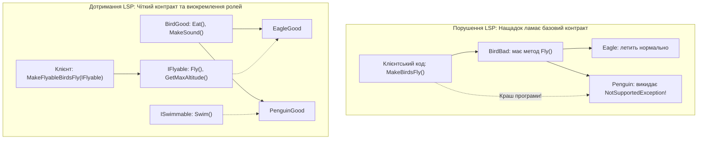
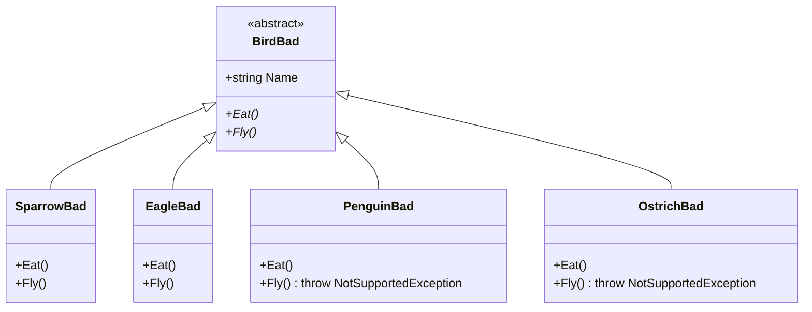
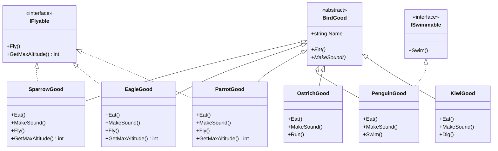
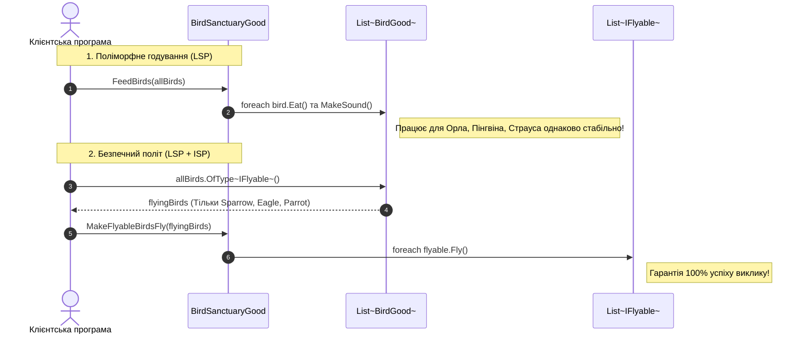

# Лекція 3. Принцип підстановки Барбари Лісков (Liskov Substitution Principle — LSP)

> **"If for each object o₁ of type S there is an object o₂ of type T such that for all programs P defined in terms of T, the behavior of P is unchanged when o₁ is substituted for o₂, then S is a subtype of T."**  
> *— Барбара Лісков (Barbara Liskov, 1987), Жанетт Вінг (Jeannette Wing, 1994)*

---

### 🧭 Швидка навігація до коду (Кнопки переходу до файлів цієї теми):

| Тип прикладу | Клас / Компонент | Роль в архітектурі | Посилання на вихідний код |
| :--- | :--- | :--- | :---: |
| ❌ **Порушення (Bad)** | **`BirdBad`** | Базовий клас птаха з методом `Fly()` | [👉 Відкрити `BirdBad.cs` (рядок 10)](LSPBadExample/BirdBad.cs) |
| ❌ **Порушення (Bad)** | **`OstrichBad`** | Страус: кидає `InvalidOperationException` | [👉 Відкрити `OstrichBad.cs` (рядок 9)](LSPBadExample/OstrichBad.cs) |
| ❌ **Порушення (Bad)** | **`PenguinBad`** | Пінгвін: кидає `InvalidOperationException` | [👉 Відкрити `PenguinBad.cs` (рядок 9)](LSPBadExample/PenguinBad.cs) |
| ❌ **Порушення (Bad)** | **`BirdSanctuaryBad`** | Заповідник: краш при спробі запуску | [👉 Відкрити `BirdSanctuaryBad.cs` (рядок 9)](LSPBadExample/BirdSanctuaryBad.cs) |
| 🎮 **Демонстрація** | **`LspBadExampleCommand`** | Консольний запуск сценарію з крашем | [👉 Відкрити `LspBadExampleCommand.cs` (рядок 15)](LspBadExampleCommand.cs) |
| ✅ **Еталон OCP/LSP (Good)** | **`BirdGood`** | Спільний безпечний базовий клас (`Eat`, `Sleep`) | [👉 Відкрити `BirdGood.cs` (рядок 10)](LSPGoodExample/BirdGood.cs) |
| ✅ **Еталон OCP/LSP (Good)** | **`IFlyable`** | Окремий контракт польоту (`Fly`) | [👉 Відкрити `IFlyable.cs` (рядок 9)](LSPGoodExample/IFlyable.cs) |
| ✅ **Еталон OCP/LSP (Good)** | **`ISwimmable`** | Окремий контракт плавання (`Swim`) | [👉 Відкрити `ISwimmable.cs` (рядок 9)](LSPGoodExample/ISwimmable.cs) |
| ✅ **Еталон OCP/LSP (Good)** | **`SparrowGood`** | Горобець: реалізує `IFlyable` | [👉 Відкрити `SparrowGood.cs` (рядок 11)](LSPGoodExample/SparrowGood.cs) |
| ✅ **Еталон OCP/LSP (Good)** | **`EagleGood`** | Орел: реалізує `IFlyable` | [👉 Відкрити `EagleGood.cs` (рядок 11)](LSPGoodExample/EagleGood.cs) |
| ✅ **Еталон OCP/LSP (Good)** | **`PenguinGood`** | Пінгвін: плаває, не літає | [👉 Відкрити `PenguinGood.cs` (рядок 11)](LSPGoodExample/PenguinGood.cs) |
| ✅ **Еталон OCP/LSP (Good)** | **`OstrichGood`** | Страус: бігає, не літає | [👉 Відкрити `OstrichGood.cs` (рядок 11)](LSPGoodExample/OstrichGood.cs) |
| ✅ **Еталон OCP/LSP (Good)** | **`BirdSanctuaryGood`** | Заповідник: безпечний поліморфізм | [👉 Відкрити `BirdSanctuaryGood.cs` (рядок 11)](LSPGoodExample/BirdSanctuaryGood.cs) |
| 🎮 **Демонстрація** | **`LspGoodExampleCommand`** | Консольний запуск еталонного сценарію | [👉 Відкрити `LspGoodExampleCommand.cs` (рядок 17)](LspGoodExampleCommand.cs) |
| 📚 **Повна лекція** | **`03_Liskov_Substitution_Principle.md`** | Академічна розширена лекція | [👉 Читати лекцію](../Docs/03_Liskov_Substitution_Principle.md) |

---

## 1. Фундаментальна теорія та походження принципу

### 1.1. Що таке "Поведінковий підтип" (Behavioral Subtyping)?
На відміну від інших принципів SOLID, які спочатку були інженерними рекомендаціями, LSP має суворе математичне та академічне підґрунтя. Барбара Лісков (лауреатка премії Тюрінга) ввела поняття **поведінкового підтипу**.

У мовах зі статичною типізацією (як-от C# чи Java) компілятор гарантує лише так звану **синтаксичну сумісність**: якщо клас `Penguin` успадковує `Bird`, то об'єкт `Penguin` можна передати в метод, який очікує `Bird`. Проте компілятор **не може перевірити семантичну (поведінкову) сумісність**!

> **Суть принципу LSP простими словами:**  
> Функції або методи, які використовують посилання на базові класи, повинні мати можливість використовувати об'єкти похідних класів, **не знаючи про це і не ламаючи очікувану поведінку програми**.

Якщо для роботи з нащадком клієнтський код змушений робити спеціальні перевірки типів (`if (b is Penguin)`), загортати виклики в блоки `try-catch` або очікувати аварійного завершення програми — **принцип підстановки Лісков порушено**.



---

## 2. Контрактне проєктування (Design by Contract)

Принцип LSP базується на теорії контрактного програмування Бертрана Меєра. Спадкоємець зобов'язаний дотримуватися чотирьох непорушних правил контракту:

1. **Передумови не можуть бути посилені в підтипі (Preconditions cannot be strengthened):**  
   Якщо базовий метод приймає будь-які числа від -∞ до +∞, нащадок не має права вимагати лише додатні числа.
2. **Післяумови не можуть бути послаблені в підтипі (Postconditions cannot be weakened):**  
   Якщо базовий метод гарантує повернення відкритого сокета або ненульового об'єкта, нащадок зобов'язаний гарантувати щонайменше те саме.
3. **Інваріанти базового типу повинні зберігатися (Invariants must be preserved):**  
   Усі внутрішні правила валідності стану базового класу мають беззаперечно виконуватися нащадком.
4. **Правило винятків (History Constraint / Exception Rule):**  
   Методи підтипу не повинні генерувати нові типи неочікуваних винятків, на які клієнт базового типу не розраховує.

---

## 3. Класичні парадокси порушення LSP

### 3.1. Парадокс "Квадрат і Прямокутник"
У математиці та геометрії квадрат — це окремий випадок прямокутника (усі сторони рівні). Проте в ООП, якщо ми створимо:
```csharp
public class Rectangle
{
    public virtual int Width { get; set; }
    public virtual int Height { get; set; }
    public int GetArea() => Width * Height;
}

public class Square : Rectangle
{
    public override int Width { set { base.Width = value; base.Height = value; } }
    public override int Height { set { base.Width = value; base.Height = value; } }
}
```
То клієнтський тест впаде:
```csharp
void TestArea(Rectangle r)
{
    r.Width = 5;
    r.Height = 4;
    Assert.Equal(20, r.GetArea()); // Для Square повернеться 16! Порушення LSP!
}
```
**Висновок викладача:** Стосунки в реальному світі (IS-A) **не завжди транслюються в спадкування в програмному коді**.

### 3.2. Парадокс "Птах і Пінгвін"
Біологічно пінгвін — це птах. Проте, якщо базовий клас `Bird` у програмі визначає здатність літати `Fly()`, включення пінгвіна чи страуса в цю ієрархію створює критичний дефект проєктування.

---

## 4. Детальний аналіз Поганого прикладу (Bad Example)

### 4.1. Архітектурна схема проблеми
У нашому проєкті базовий клас `BirdBad` декларує політ як обов'язкову дію для всіх без винятку птахів:



### 4.2. Фрагмент вихідного коду з дефектом
У файлі `PenguinBad.cs`:
```csharp
public class PenguinBad : BirdBad
{
    public override void Eat()
    {
        Console.WriteLine($"[{Name}] Пінгвін їсть рибу");
    }

    public override void Fly()
    {
        // Викидання винятку замість виконання дії — це порушення LSP!
        throw new NotSupportedException($"{Name}: пінгвін не вміє літати!");
    }
}
```

А у клієнтському коді орнітологічного заповідника `BirdSanctuaryBad.cs`:
```csharp
public void MakeBirdsFly(List<BirdBad> birds)
{
    foreach (var bird in birds)
    {
        // Клієнт змушений ловити виняток через те, що нащадок не сумісний з базовим типом:
        try
        {
            bird.Fly();
        }
        catch (NotSupportedException ex)
        {
            Console.WriteLine($"   [ПОМИЛКА] {ex.Message}");
        }
    }
}
```

**Чому це погано:**
* Клієнтський код не може безпечно довіряти контракту базового класу.
* З'являється потреба в постійних перевірках типів (`if (bird is PenguinBad) continue;`) або надлишкових блоках `try-catch`.
* Порушується принцип поліморфізму: тип-нащадок ламає клієнта замість розширення функціоналу.

---

## 5. Проєктування через рольові інтерфейси: Гарний приклад (Good Example)

Щоб дотриматися принципу Лісков, ми залишаємо в базовому класі `BirdGood` **виключно ту поведінку, яка дійсно притаманна 100% представників домену**:
* `Eat()` — усі птахи харчуються;
* `MakeSound()` — усі птахи видають звуки.

Специфічні поведінкові ролі ми виносимо в окремі контракти:
* `IFlyable` — для тих, хто дійсно літає (`Fly()`, `GetMaxAltitude()`);
* `ISwimmable` — для тих, хто плаває (`Swim()`).

### 5.1. Діаграма класів (UML Class Diagram)



### 5.2. Безпечна робота клієнтського заповідника (`BirdSanctuaryGood.cs`)

```csharp
// 1. Працює гарантовано з УСІМА птахами без жодного ризику збою
public void FeedBirds(List<BirdGood> birds)
{
    foreach (var bird in birds)
    {
        bird.Eat();
        bird.MakeSound();
    }
}

// 2. Політ викликається ТІЛЬКИ для тих, хто за контрактом вміє літати
public void MakeFlyableBirdsFly(List<IFlyable> flyingBirds)
{
    foreach (var bird in flyingBirds)
    {
        bird.Fly(); // ЖОДНИХ помилок чи NotSupportedException!
    }
}
```



---

## 6. Порівняльний аналіз архітектурних метрик

| Критерій оцінки | Поганий приклад (`BirdBad`) | Гарний приклад (`BirdGood`) |
| :--- | :--- | :--- |
| **Поведінкова сумісність** | Порушена: пінгвін кидає виняток при спробі злетіти | **Повна сумісність**: будь-який нащадок безпечний |
| **Чистота клієнтського коду** | Потребує блоків `try-catch` та перевірок типів | **Чистий та надійний**: ніяких винятків чи "милиць" |
| **Спадкування інтерфейсу vs реалізації** | Нав'язування фіктивного методу підтипам | **Рольові інтерфейси** (`IFlyable`, `ISwimmable`) |
| **Збереження передумов та післяумов** | Післяумова методу `Fly()` зірвана винятком | Кожен метод повністю виконує свої зобов'язання |
| **Сила типізації** | Помилки виявляються тільки в Runtime під час падіння | Помилки несумісності виявляються **на етапі компіляції** |

---

## 7. Поради викладача-практика: "IS-A" vs "WORKS-AS"

### 7.1. Чому наслідування — найбільш небезпечний зв'язок в ООП?
У класичних підручниках часто вчать: *"Якщо об'єкт B є різновидом A (IS-A), використовуйте успадкування"*.  
Це підхід, який призводить до катастроф у промисловій архітектурі.
> **Золоте правило архітектора:**  
> В ООП відношення наслідування має означати не біологічну чи побутову схожість ("Пінгвін — це птах"), а **поведінкову еквівалентність у контексті програми ("Пінгвін поводиться як повноцінний Птах у всіх операціях")**. Якщо поведінка відрізняється — обирайте **композицію (Composition over Inheritance)** або **рольові інтерфейси**.

### 7.2. Як одразу виявити порушення LSP під час Code Review?
Звертайте увагу на такі ознаки:
1. Метод нащадка містить порожнє тіло `{ /* нічого не робимо */ }`.
2. Метод нащадка повертає `null`, `-1` або `NotSupportedException` / `NotImplementedException`.
3. У коді з'являється перевірка `if (animal is Dog dog) dog.Bark(); else if (animal is Cat cat)...`.

---

## 8. Контрольні запитання та лабораторні завдання

### 8.1. Питання для самоперевірки
1. Сформулюйте математичне визначення принципу Лісков своїми словами.
2. Чому викидання `NotSupportedException` у перевизначеному методі є грубим порушенням LSP?
3. У чому полягає різниця між синтаксичним поліморфізмом (компілятор C#) та семантичною підстановкою (LSP)?
4. Чому парадокс квадрата та прямокутника не можна розв'язати через звичайне спадкування класів?

### 8.2. Практичне завдання для закріплення
1. Створіть новий клас `DuckGood` (Дика качка), який успадковує `BirdGood` та одночасно реалізує **обидва** інтерфейси: `IFlyable` та `ISwimmable`.
2. Додайте качку до загального списку птахів у `LspGoodExampleCommand.cs`.
3. Переконайтеся, що вона автоматично бере участь у годуванні, у демонстрації польотів та у запливах на воді без зміни жодного рядка коду класу `BirdSanctuaryGood`.
