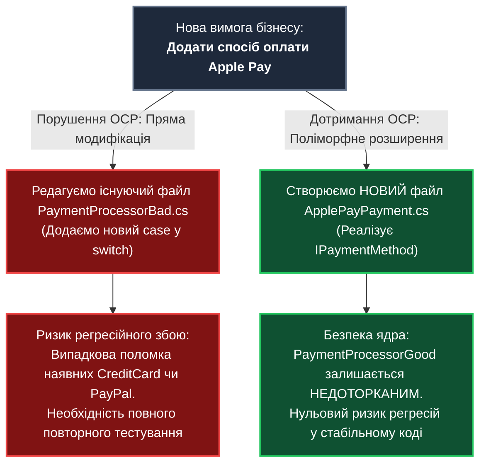
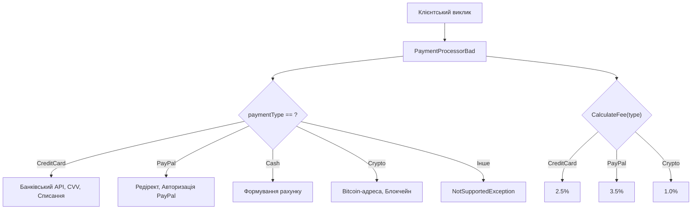
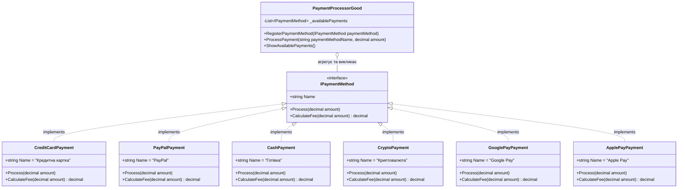
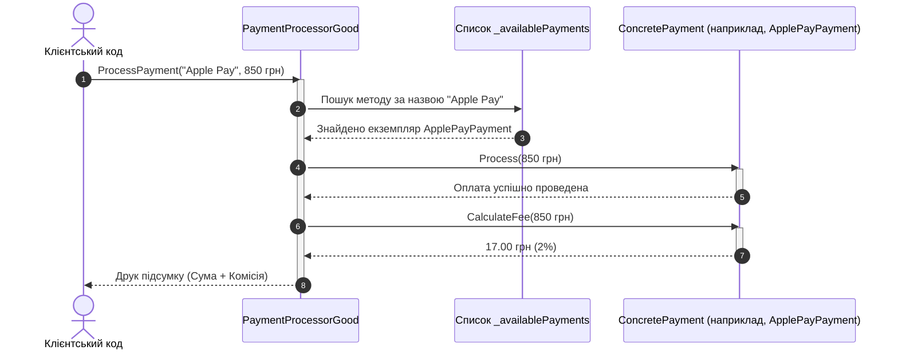

# Лекція 2. Принцип відкритості/закритості (Open/Closed Principle — OCP)

> **"Software entities (classes, modules, functions, etc.) should be open for extension, but closed for modification."**  
> *— Бертран Меєр (Bertrand Meyer, 1988), популяризовано Робертом Мартіном*

---

### 🧭 Швидка навігація до коду (Кнопки переходу до файлів цієї теми):

| Тип прикладу | Клас / Компонент | Роль в архітектурі | Посилання на вихідний код |
| :--- | :--- | :--- | :---: |
| ❌ **Порушення (Bad)** | **`PaymentProcessorBad`** | Антипатерн Switch-Hell (перевірка типів оплати) | [👉 Відкрити `PaymentProcessorBad.cs` (рядок 11)](PaymentProcessorBad.cs) |
| 🎮 **Демонстрація** | **`OcpBadExampleCommand`** | Консольний запуск сценарію з порушенням | [👉 Відкрити `OcpBadExampleCommand.cs` (рядок 15)](OcpBadExampleCommand.cs) |
| ✅ **Еталон OCP (Good)** | **`IPaymentMethod`** | Поліморфний контракт оплати (Стратегія) | [👉 Відкрити `IPaymentMethod.cs` (рядок 11)](OCPGoodExample/IPaymentMethod.cs) |
| ✅ **Еталон OCP (Good)** | **`CreditCardPayment`** | Стратегія: Оплата банківською карткою | [👉 Відкрити `CreditCardPayment.cs` (рядок 9)](OCPGoodExample/CreditCardPayment.cs) |
| ✅ **Еталон OCP (Good)** | **`PayPalPayment`** | Стратегія: Оплата через PayPal | [👉 Відкрити `PayPalPayment.cs` (рядок 9)](OCPGoodExample/PayPalPayment.cs) |
| ✅ **Еталон OCP (Good)** | **`CashPayment`** | Стратегія: Оплата готівкою | [👉 Відкрити `CashPayment.cs` (рядок 9)](OCPGoodExample/CashPayment.cs) |
| ✅ **Еталон OCP (Good)** | **`CryptoPayment`** | Стратегія: Оплата криптовалютою | [👉 Відкрити `CryptoPayment.cs` (рядок 9)](OCPGoodExample/CryptoPayment.cs) |
| ✅ **Еталон OCP (Good)** | **`ApplePayPayment`** | Стратегія: Оплата через Apple Pay | [👉 Відкрити `ApplePayPayment.cs` (рядок 9)](OCPGoodExample/ApplePayPayment.cs) |
| ✅ **Еталон OCP (Good)** | **`GooglePayPayment`** | Стратегія: Оплата через Google Pay | [👉 Відкрити `GooglePayPayment.cs` (рядок 9)](OCPGoodExample/GooglePayPayment.cs) |
| ✅ **Еталон OCP (Good)** | **`PaymentProcessorGood`** | Закритий для модифікацій процесор | [👉 Відкрити `PaymentProcessorGood.cs` (рядок 11)](PaymentProcessorGood.cs) |
| 🎮 **Демонстрація** | **`OcpGoodExampleCommand`** | Консольний запуск еталонного сценарію | [👉 Відкрити `OcpGoodExampleCommand.cs` (рядок 17)](OcpGoodExampleCommand.cs) |
| 📚 **Повна лекція** | **`02_Open_Closed_Principle.md`** | Академічна розширена лекція | [👉 Читати лекцію](../Docs/02_Open_Closed_Principle.md) |

---

## 1. Фундаментальна теорія та походження принципу

### 1.1. Історичний контекст
Принцип Open/Closed був вперше сформульований Бертраном Меєром у його фундаментальній книзі *"Object-Oriented Software Construction"* (1988). У часи Меєра головним інструментом перевикористання вважалося класичне успадкування класів. 

Згодом Роберт Мартін переосмислив цей принцип для сучасного компонентного проєктування: замість жорсткого спадкування базових класів акцент змістився на **поліморфізм інтерфейсів (Polymorphic OCP)**.

### 1.2. Два стовпи принципу OCP
1. **Відкрито для розширення (Open for extension):**  
   Поведінка модуля може бути розширена. Ми можемо змусити модуль виконувати нові дії, коли вимоги бізнесу змінюються або виникають нові сценарії використання.
2. **Закрито для модифікації (Closed for modification):**  
   Розширення поведінки модуля **не повинно призводити до зміни його скомпільованого, перевіреного та стабільного вихідного коду**.



---

## 2. Ознаки та симптоми порушення ("Code Smells")

1. **Каскади `if-else` або `switch-case` за типом об'єкта (Type Checking Smell)**  
   Коли логіка розгалужується на основі строкового значення типу, числового ідентифікатора або enum (`if (type == "CreditCard") ... else if (type == "PayPal") ...`).
2. **Циклічне зростання складності (Cyclomatic Complexity)**  
   З кожною новою інтеграцією чи бізнес-правилом метод додає ще одне розгалуження, перетворюючись на незбагненне дерево рішень.
3. **Дублювання перевірок у різних методах**  
   Якщо в класі є кілька методів, які залежать від того ж типу (наприклад, `ProcessPayment` та `CalculateFee`), новий тип доведеться додавати в **усі** ці методи одночасно. Якщо пропустити один — виникне прихований баг.
4. **Високий ризик регресії (Regression Risk)**  
   Навіть крихітна правка в спільному файлі вимагає повторного повного тестування (Full Regression Testing) всієї платіжної підсистеми.

---

## 3. Детальний аналіз Поганого прикладу (Bad Example)

### 3.1. Архітектурна схема проблеми
Клас `PaymentProcessorBad` напряму контролює всі способи оплати всередині себе:



### 3.2. Фрагмент вихідного коду (`PaymentProcessorBad.cs`)
```csharp
public class PaymentProcessorBad
{
    public void ProcessPayment(string paymentType, decimal amount)
    {
        if (paymentType == "CreditCard")
        {
            // логіка картки
        }
        else if (paymentType == "PayPal")
        {
            // логіка PayPal
        }
        else if (paymentType == "Cash")
        {
            // логіка готівки
        }
        // Щоб додати новий спосіб, МИ ЗМУШЕНІ ЗМІНЮВАТИ цей файл:
        else if (paymentType == "Crypto")
        {
            // логіка криптовалюти
        }
        else
        {
            throw new NotSupportedException($"Тип оплати '{paymentType}' не підтримується");
        }
    }

    public decimal CalculateFee(string paymentType, decimal amount)
    {
        // ДУБЛЮВАННЯ розгалужень за типом!
        if (paymentType == "CreditCard") return amount * 0.025m;
        else if (paymentType == "PayPal") return amount * 0.035m;
        else if (paymentType == "Cash") return 0;
        else if (paymentType == "Crypto") return amount * 0.01m;
        return 0;
    }
}
```

**Критичні недоліки:**
* **Порушення OCP:** Для підключення Google Pay, Apple Pay або терміналу потрібно фізично переписувати файл `PaymentProcessorBad.cs`.
* **Порушення SRP:** Клас знає тонкощі протоколів банку, PayPal API, Bitcoin-мережі та Face ID.
* **Крихкість коду:** Якщо програміст припуститься синтаксичної або логічної помилки в гілці `Crypto`, це може паралізувати оплату кредитними картками.

---

## 4. Проєктування через абстракції: Гарний приклад (Good Example)

Щоб зробити систему відкритою для розширення, ми виділяємо спільний контракт поведінки в інтерфейс `IPaymentMethod`, а кожен спосіб оплати перетворюємо на ізольований клас-стратегію.

### 4.1. Контракт інтерфейсу (`IPaymentMethod.cs`)
```csharp
public interface IPaymentMethod
{
    string Name { get; }
    void Process(decimal amount);
    decimal CalculateFee(decimal amount);
}
```

Кожна платіжна система інкапсулює свою власну поведінку та формулу розрахунку комісії:
* `CreditCardPayment` (комісія 2.5%, робота з CVV та 3D-Secure);
* `PayPalPayment` (комісія 3.5%, авторизація гаманця);
* `CashPayment` (комісія 0%, формування платіжного документа);
* `CryptoPayment` (комісія 1%, підтвердження блоків у блокчейні);
* `GooglePayPayment` (комісія 2%, біометрія Android);
* `ApplePayPayment` (комісія 2%, Secure Element + Face ID).

### 4.2. Діаграма класів (UML Class Diagram)



### 4.3. Діаграма взаємодії під час виконання (Sequence Diagram)



---

## 5. Порівняльний аналіз архітектурних метрик

| Показник | Поганий приклад (`PaymentProcessorBad`) | Гарний приклад (`PaymentProcessorGood`) |
| :--- | :--- | :--- |
| **Додавання нового методу** | Модифікація коду наявного класу (2+ місця) | **Створення 1 нового класу** (0 змін у процесорі) |
| **Циклічна складність (Cyclomatic Complexity)** | Зростає лінійно з кожним новим `else-if` | **Константна (`O(1)`)** — однаковий код для будь-якої кількості методів |
| **Ризик зламати наявні платежі** | Високий (спільний код і змінні) | **Нульовий** (новий код знаходиться в ізольованому файлі) |
| **Unit-тестування нової фічі** | Повний регресійний тест всього класу | Тестується тільки окремий клас нового методу |
| **Принцип DRY (Don't Repeat Yourself)** | Типи перевіряються в кількох методах | Поліморфізм усуває необхідність перевірки типів |

---

## 6. Поради викладача-практика: Патерни та підводні камені

### 6.1. Які патерни GoF реалізують OCP?
* **Стратегія (Strategy Pattern):** `IPaymentMethod` є класичним прикладом патерна Стратегія. Ми взаємозамінно підставляємо різні алгоритми оплати під час виконання.
* **Фабричний метод (Factory Method) / Провайдер:** Дозволяє вибирати потрібну стратегію на основі рядкового ключа, конфігураційного файлу або заголовка HTTP-запиту.
* **Декоратор (Decorator Pattern):** Дозволяє розширювати поведінку (наприклад, додавати логування або повторні спроби при збоях) без зміни вихідного коду цільового сервісу.

### 6.2. Підводний камінь: "Стратегічне закриття" (Strategic Closure)
Розробники-початківці іноді намагаються зробити відкритим для розширення абсолютно все в системі. Це призводить до вибуху непотрібних інтерфейсів і порожніх абстракцій (Overengineering).
> **Правило викладача:** Неможливо спроєктувати систему так, щоб вона була закрита від **будь-яких** можливих у майбутньому змін. Захищайте від змін ті вузли, де **імовірність появи нових бізнес-варіантів висока** (наприклад: способи оплати, типи експорту звітів, канали доставки сповіщень, алгоритми розрахунку знижок).

---

## 7. Контрольні запитання та лабораторні завдання

### 7.1. Питання для самоперевірки
1. Яка головна небезпека внесення змін у перевірений, стабільний клас при появі нової вимоги?
2. Як поліморфізм в об'єктно-орієнтованому програмуванні допомагає позбутися ланцюжків `if-else`?
3. Чому метод `CalculateFee` у поганому прикладі був джерелом дублювання коду?
4. Чи означає принцип OCP, що в існуючих класах взагалі ніколи не можна виправляти баги?

### 7.2. Практичне завдання для закріплення
1. Створіть новий клас `MonobankPayment`, який реалізує `IPaymentMethod`.
2. Задайте комісію 1.5% та додайте специфічну поведінку (імітація виклику Monobank Open API та нарахування кешбеку).
3. Зареєструйте його в `PaymentProcessorGood` через метод `RegisterPaymentMethod(new MonobankPayment())`.
4. Переконайтеся, що обробка платежу працює, не змінивши жодного рядка логіки всередині `PaymentProcessorGood`.
