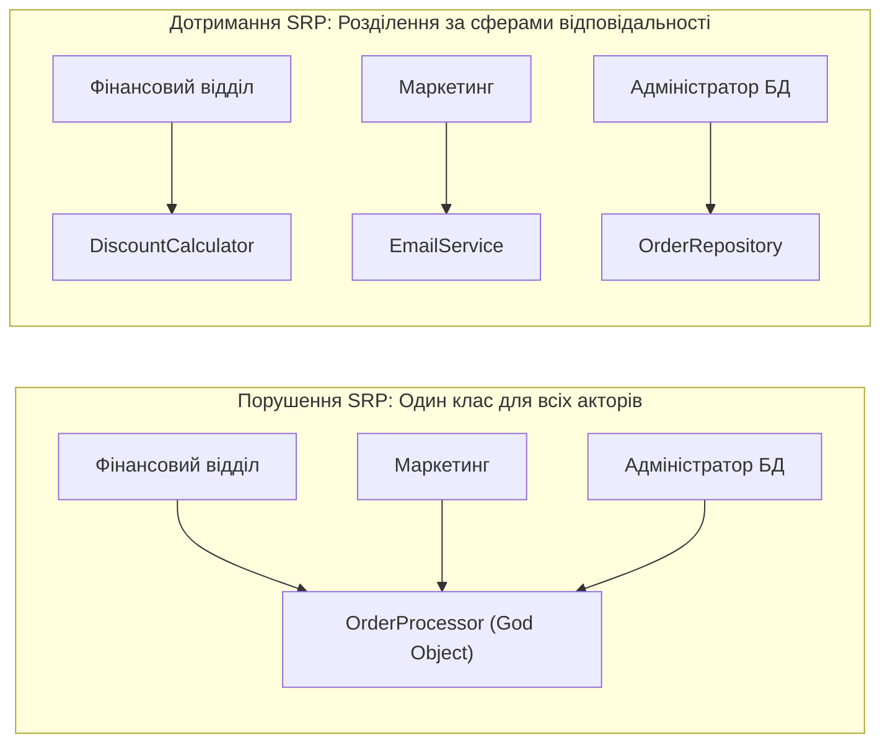
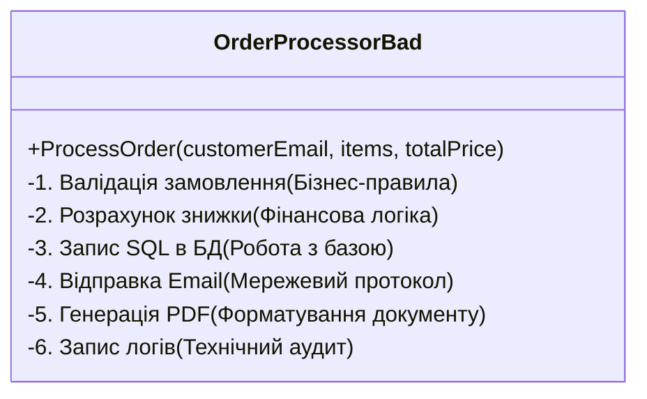
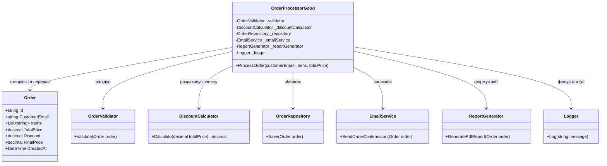
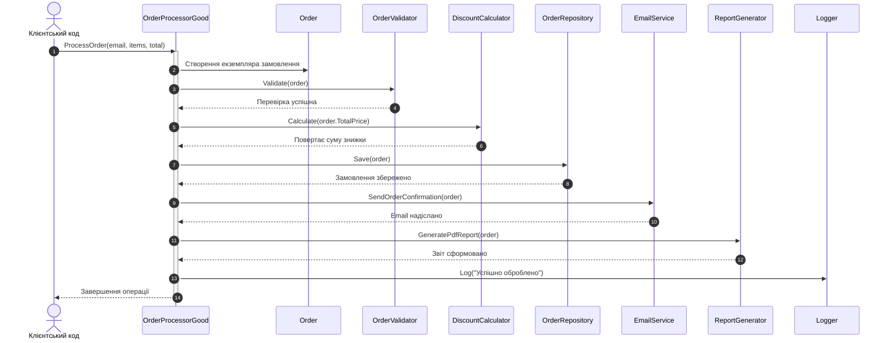

# Лекція 1. Принцип єдиної відповідальності (Single Responsibility Principle — SRP)

> **"A class should have one, and only one, reason to change."**  
> *— Роберт С. Мартін (Uncle Bob)*

---

### 🧭 Швидка навігація до коду (Кнопки переходу до файлів цієї теми):

| Тип прикладу | Клас / Компонент | Роль в архітектурі | Посилання на вихідний код |
| :--- | :--- | :--- | :---: |
| ❌ **Порушення (Bad)** | **`OrderProcessorBad`** | Монолітний God Object (валідація, БД, email, PDF, лог) | [👉 Відкрити `OrderProcessorBad.cs` (рядок 12)](OrderProcessorBad.cs) |
| 🎮 **Демонстрація** | **`SrpBadExampleCommand`** | Консольний запуск сценарію з порушенням | [👉 Відкрити `SrpBadExampleCommand.cs` (рядок 15)](SrpBadExampleCommand.cs) |
| ✅ **Еталон SRP (Good)** | **`Order`** | Модель даних (Entity / DTO) | [👉 Відкрити `Order.cs` (рядок 11)](SRPGoodExample/Order.cs) |
| ✅ **Еталон SRP (Good)** | **`OrderValidator`** | Бізнес-правила перевірки замовлення | [👉 Відкрити `OrderValidator.cs` (рядок 11)](SRPGoodExample/OrderValidator.cs) |
| ✅ **Еталон SRP (Good)** | **`DiscountCalculator`** | Фінансові розрахунки знижок | [👉 Відкрити `DiscountCalculator.cs` (рядок 9)](SRPGoodExample/DiscountCalculator.cs) |
| ✅ **Еталон SRP (Good)** | **`OrderRepository`** | Персистентність (робота з базою даних) | [👉 Відкрити `OrderRepository.cs` (рядок 12)](SRPGoodExample/OrderRepository.cs) |
| ✅ **Еталон SRP (Good)** | **`EmailService`** | Форматування та надсилання сповіщень | [👉 Відкрити `EmailService.cs` (рядок 11)](SRPGoodExample/EmailService.cs) |
| ✅ **Еталон SRP (Good)** | **`ReportGenerator`** | Генерація друкованих документів та PDF | [👉 Відкрити `ReportGenerator.cs` (рядок 11)](SRPGoodExample/ReportGenerator.cs) |
| ✅ **Еталон SRP (Good)** | **`Logger`** | Системне логування та аудит | [👉 Відкрити `Logger.cs` (рядок 9)](SRPGoodExample/Logger.cs) |
| ✅ **Еталон SRP (Good)** | **`OrderProcessorGood`** | Оркестратор процесу (Фасад) | [👉 Відкрити `OrderProcessorGood.cs` (рядок 12)](OrderProcessorGood.cs) |
| 🎮 **Демонстрація** | **`SrpGoodExampleCommand`** | Консольний запуск еталонного сценарію | [👉 Відкрити `SrpGoodExampleCommand.cs` (рядок 17)](SrpGoodExampleCommand.cs) |
| 📚 **Повна лекція** | **`01_Single_Responsibility_Principle.md`** | Академічна розширена лекція | [👉 Читати лекцію](../Docs/01_Single_Responsibility_Principle.md) |

---

## 1. Фундаментальна теорія та філософія принципу

### 1.1. Що насправді означає "Одна відповідальність"?
Багато початківців і навіть досвідчених розробників трактують принцип SRP надто спрощено: *"Клас повинен робити лише щось одне"*. Проте це визначення стосується скоріше чистих функцій на рівні процедурного програмування. 

На рівні об'єктно-орієнтованого проєктування **відповідальність** (responsibility) формулюється через бізнес-контекст:
> **Відповідальність — це обов'язок класу перед конкретним актором (Actor) або бізнес-стейкхолдером системи.**

Актор — це джерело змін. У реальній IT-системі це можуть бути:
* **Бухгалтерія / Фінансовий відділ (CFO)** — змінює логіку розрахунку податків, знижок та валютних курсів.
* **Відділ маркетингу / CRM (CMO)** — змінює шаблони сповіщень, email-листи, тексти SMS.
* **Адміністратори баз даних / DevOps (CTO)** — змінюють схему БД, мігрують з MySQL на PostgreSQL або змінюють структуру таблиць.
* **Служба безпеки / Compliance** — змінює вимоги до валідації паролів або перевірки поштових скриньок.

Якщо один клас розв'язує задачі, які диктуються різними акторами, будь-яка зміна вимог від одного відділу створює ризик зламати функціонал для іншого.



### 1.2. Високе зчеплення (High Cohesion) та низька зв'язність (Low Coupling)
SRP — це головний інструмент для досягнення двох фундаментальних метрик якісної архітектури:
1. **Зчеплення (Cohesion)** — ступінь того, наскільки тісно пов'язані методи та поля всередині одного класу між собою. Клас із високим зчепленням сфокусований на одному завданні, всі його методи оперують спільними даними.
2. **Зв'язність (Coupling)** — ступінь взаємозалежності між різними класами. Чим менше класи знають про внутрішній устрій один одного, тим легше вносити зміни та тестувати систему.

---

## 2. Ознаки та симптоми порушення ("Code Smells")

1. **God Object / Blob Class (Клас-монстр)**  
   Клас розростається до сотень або тисяч рядків коду, містить десятки методів, які стосуються різних доменних областей (і валідація, і SQL-запити, і форматування тексту, і HTTP-запити).
2. **Divergent Change (Різноспрямовані зміни)**  
   Вам доводиться модифікувати один і той самий клас щоразу, коли змінюються зовсім різні бізнес-вимоги: змінили шаблон email — правимо `OrderProcessor`, додали поле в БД — знову правимо `OrderProcessor`, змінили формулу знижки — знову той самий файл.
3. **Shotgun Surgery (Дробове поранення)**  
   Зворотний бік порушення: коли одна й та сама відповідальність "розмазана" по багатьох класах, і зміна однієї деталі вимагає правок у 10 різних місцях.
4. **Неможливість написання ізольованих Unit-тестів**  
   Для тестування розрахунку знижки доводиться підключати реальну базу даних, генерувати фейкові email-сервери та створювати файли на диску.

---

## 3. Детальний аналіз Поганого прикладу (Bad Example)

### 3.1. Архітектурна схема проблеми
У нашому навчальному рішенні клас `OrderProcessorBad` бере на себе шість абсолютно різних ролей:



### 3.2. Чому це глухий кут у реальній розробці?
Розглянемо фрагмент з файлу `OrderProcessorBad.cs`:

```csharp
public void ProcessOrder(string customerEmail, List<string> items, decimal totalPrice)
{
    // 1. Валідація
    if (string.IsNullOrEmpty(customerEmail))
        throw new ArgumentException("Email не може бути порожнім");

    // 2. Знижка
    decimal discount = totalPrice > 1000 ? totalPrice * 0.1m : 0;
    decimal finalPrice = totalPrice - discount;

    // 3. База даних
    Console.WriteLine($"[БД] INSERT INTO Orders (Email, Total) VALUES ('{customerEmail}', {finalPrice})");

    // 4. Email
    Console.WriteLine($"[EMAIL] Відправка підтвердження на {customerEmail}");

    // 5. PDF
    Console.WriteLine($"[ЗВІТ] Генерація PDF звіту...");

    // 6. Логування
    Console.WriteLine($"[ЛОГ] {DateTime.Now}: Замовлення оброблено успішно");
}
```

**Каскадні ризики:**
* **Ризик конфліктів у системі контролю версій (Git Merge Conflicts):** Два розробники одночасно працюють над завданнями: один оптимізує SQL-запити, інший оновлює формат звіту. Вони редагують один і той самий метод `ProcessOrder`, створюючи конфлікти злиття.
* **Регресійні збої:** Виправляючи друкарську помилку в тілі email-повідомлення, програміст може випадково зачепити змінну `finalPrice` і спотворити суму, яка записується в базу даних.
* **Трудомісткість тестування:** Неможливо перевірити, чи правильно рахується знижка `totalPrice * 0.1m`, без того, щоб не викликати код запису в базу та відправки пошти.

---

## 4. Архітектурна декомпозиція: Гарний приклад (Good Example)

Для приведення коду до відповідності принципу SRP ми розділяємо кожну сферу інтересів на окремий, самодостатній клас із вузькою та зрозумілою зоною відповідальності.

### 4.1. Розподіл обов'язків
1. `Order` — модель предметної області (Data Entity / DTO). Відповідає виключно за інкапсуляцію даних замовлення.
2. `OrderValidator` — відповідає тільки за перевірку коректності вхідних даних відповідно до бізнес-правил.
3. `DiscountCalculator` — відповідає за алгоритм нарахування знижок та ціноутворення.
4. `OrderRepository` — відповідає за персистентність (збереження стану замовлення в сховищі даних).
5. `EmailService` — відповідає за взаємодію з клієнтом через поштовий сервіс.
6. `ReportGenerator` — відповідає за представлення даних та підготовку звітних документів.
7. `Logger` — технічний сервіс аудиту та моніторингу подій системи.
8. `OrderProcessorGood` — оркестратор (Facade / Coordinator), який координує послідовність дій, не вникаючи у внутрішню реалізацію жодного з кроків.

### 4.2. Діаграма класів (UML Class Diagram)



### 4.3. Діаграма послідовності обробки замовлення (Sequence Diagram)



---

## 5. Порівняльний аналіз архітектурних метрик

| Критерій оцінки | Поганий підхід (`OrderProcessorBad`) | Гарний підхід (`OrderProcessorGood`) |
| :--- | :--- | :--- |
| **Кількість причин для зміни** | 6 (валідація, знижки, БД, email, звіт, лог) | **1** для кожного класу |
| **Рівень зчеплення (Cohesion)** | Низький (Low Cohesion) — мішанина завдань | **Високий (High Cohesion)** — чіткий фокус |
| **Рівень зв'язності (Coupling)** | Жорстко пов'язаний з усіма деталями | **Слабкий (Loose Coupling)** завдяки модульності |
| **Unit-тестування** | Майже неможливе без реальної інфраструктури | **Легке та швидке**: кожен клас тестується ізольовано |
| **Паралельна робота в команді** | Постійні конфлікти в одному файлі | Розробники працюють над різними файлами |
| **Повторне використання коду** | Нульове (код замкнений усередині методу) | `EmailService`, `OrderValidator` перевикористовуються всюди |

---

## 6. Поради викладача-практика: Шаблони, пастки та баланс

### 6.1. Які патерни проєктування (GoF) тут використано?
* **Фасад (Facade):** `OrderProcessorGood` надає простий, уніфікований інтерфейс для складної підсистеми з багатьох компонентів.
* **Стратегія (Strategy) / Обчислювач:** `DiscountCalculator` відокремлює алгоритм розрахунку вартості від структури самого замовлення.
* **Репозиторій (Repository):** `OrderRepository` інкапсулює логіку доступу до сховища даних, приховуючи від бізнес-логіки деталі SQL-запитів.

### 6.2. Де проходить межа: як не скотитися в "оверінжиніринг"?
Студенти часто роблять помилку крайнощів: створюють окремий клас для кожного рядка коду (`OrderEmailSenderSubjectCreator`, `OrderPriceAdder`).
> **Правило золотого перетину:** Розділяйте класи не за кількістю рядків, а **за джерелами бізнес-змін (акторами)**. Якщо дві дії завжди змінюються разом і належать одному домену (наприклад, валідація формату email та валідація наявності товарів як частина перевірки замовлення), вони можуть перебувати в одному валідаторі, доки він не стане завеликим.

---

## 7. Контрольні запитання та лабораторні завдання

### 7.1. Питання для самоперевірки
1. Що таке "актор" у контексті принципу SRP? Наведіть 3 приклади акторів для інтернет-магазину.
2. Чим відрізняється правило "функція робить одну дію" від правила "клас має одну відповідальність"?
3. Як порушення SRP впливає на швидкість проходження Unit-тестів і запуск CI/CD пайплайнів?
4. Чи є клас `OrderProcessorGood` порушенням SRP, якщо він координує роботу шести інших класів? Обґрунтуйте свою відповідь.

### 7.2. Практичне завдання для закріплення
1. Створіть новий сервіс `InventoryService` у папці `SRPGoodExample`, який відповідає за списання залишків товарів зі складу (`CheckStock(items)`, `DeductStock(items)`).
2. Інтегруйте його в `OrderProcessorGood` через конструктор.
3. Перевірте, чи не порушилася робота інших класів (`DiscountCalculator`, `EmailService`).
